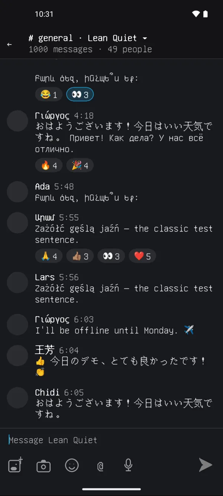

# Lean Quiet

[Lean](https://lean-lang.org) is usually for proving statements with and about code. But can we 
build entire apps with it, and prove they work as users might want?
I think we can now!

This app is written mostly in Lean. It builds for iOS and Android and implements chat with emojis and reactions. Non-Lean code is limited to things like scrolling or using the camera ([what isn't Lean, and why](#what-isnt-lean-and-why)) so in a
meaningful sense Lean does everything from processing TCP packets to drawing pixels on the screen.
This allows for proving a surprising range of user-relevant properties! See: [What is Proven](#what-is-proven).

Like [Quiet](https://github.com/TryQuiet/quiet), Lean Quiet is also local-first, end-to-end encrypted, and peer-to-peer, so many properties that would normally depend on a server operator (such as privacy, access control, or uptime) are provided by the code itself. This means they are provable over all possible deployments, assuming user device integrity! See: [Towards Proofs for n Clients](#towards-proofs-for-n-clients).

Can we also prove the absence of the *qualitative* bugs that only show up in certain cases, like UI layout glitches at a certain screen size or RTL language, or a lack of responsiveness under load, or an accessibility gap? This seems tantalizingly possible too, and we show many such proofs here.

There is something exhilarating about adding a proof where one would usually add an end-to-end test. Sci fi. 🪐 

# What it looks like

<em>The status bar and keyboard are Android's, the rest is Lean Quiet.</em>

## What is proven

Lean checks these theorems about the code that runs, except the two
marked *(model)*, which are over a model so far. Whatever any peer or
anyone on the network does:

- **nobody can post as another member;** ¹
- **nobody joins without an invitation and members' approval;** ¹
- **only admins remove others, and no removal can be undone;** ¹
- **no peer can alter or rename an op:** its id is the hash of its
  bytes, and it has one parse; ²
- **non-members get none of a community's ops;**
- **no device's secrets leave it;** *(model)*
- **a node's trust rule lets in exactly the live members;** ¹
- **honest nodes that hold the same ops agree;** ² *(model)*
- **only a session's two devices can derive its keys, even if both
  devices' long-term keys later leak.** ³

¹ assuming Ed25519 signatures cannot be forged. ² assuming SHA-256 has
no collisions. ³ in the symbolic model of the cryptography.

**Not yet proven:**
- that messages are secret from non-members (the seal's secrecy);
- that a removal reaches a live session from the removal itself, which
  needs `sum_project`;
- the bootstrap over the running code, rather than a model;
- that content is drawn faithfully all the way to pixels (proven up to
  each row's layout; painting is not).

### Towards Proofs for n Clients

The sync proofs already run the real sync code, in a world of two
devices whose network can delay, reorder or drop messages
([`stream_delivers`]). Devices that hold the same ops agree, whatever
order the ops arrived in (proven so far over a model of purging:
[`same_ops_same_verdicts`]). So for n devices, it comes down to proving
that every op reaches every member: the running round under any
delivery order (`conn_runs_exchange`) and the closure it delivers
(`closure_delivered`), then a world of n devices with fair delivery.

### What is Assumed

**Hypotheses.** These are named in the theorems that take them, and
nothing else is assumed:
- [`Unforgeable`]: a signature that verifies under a device key was made
  by that key's holder (Ed25519).
  - The membership theorems say "signed by d" to mean "the signature
    verifies under d".
  - `no_impersonation` takes `Unforgeable` to conclude that d's holder
    signed.
  - Reading any of them as "an attacker cannot" rests on it.
- [`CollisionFree`]: SHA-256 has no collision among the ops a node
  received.
  - It gives [`Distinct`]: no two ops share an id.
  - The engine's agreement and budget theorems take `Distinct`.
  - Sync's Merkle labels take the same of what they hash (in
    [`lbl_inj`]).
- [`NoSecondPreimage`]: SHA-256 has no second preimage on a file's
  Merkle tree inputs, for the attachment laws. [`assumptions_hold`]
  shows that it can hold.
- [`Suite.Good`]: X25519 agrees (`dh a (pub b) = dh b (pub a)`), the
  AEAD opens what it seals, and public keys are 32 bytes. These are
  correctness only, and say nothing about secrecy.
- **A read transaction is one moment** (`read_one_moment` and
  `agrees_notice` take it), as two hypotheses. *Snapshot:* inside one
  SQLite read transaction, every read answers as one state of the store
  and outbox (SQLite's snapshot isolation, on a WAL reader). *Journal:*
  the keys a notice names (the journal's, written by triggers on the
  index and verdict tables, and a write's own ops') include every watch
  whose answer changed since the last moment. The headless app's
  `liveSound` check tests the journal (every fresh answer the cache
  holds equals a read now); the snapshot is not tested on its own.
- **The session secrecy theorems assume the symbolic (Dolev-Yao)
  model:** perfect primitives, with the attacker reading, replaying and
  injecting every message. They have no computational reduction. DH is
  over named exponents only, with no low-order points, clamping or
  Ed25519-to-X25519 conversion. Their agreement is non-injective: a
  replayed handshake is accepted again.

**Trusted, not proven.** Each item is tested instead, as noted:
- **Lean** (its kernel, compiler and runtime), and the OS's randomness
  for keys and nonces.
- **The crypto libraries meet those hypotheses:** ed25519-dalek,
  curve25519-dalek, chacha20poly1305 and sha2, the Rust crates libquiet
  uses. They are tested byte-identical to libsodium, and the handshake
  is tested against the Noise test vectors.
- **SQLite behaves like the engine's own store.** This is tested row for
  row against the model, and with kill -9 crash tests. A frame's reads in one
  transaction see one committed state (SQLite's snapshot isolation): the
  snapshot hypothesis above, which the screen's laws take.
- **Deleted bytes are gone from the disk.**
  - A purge deletes with SQLite's `secure_delete` on, then runs
    `VACUUM` and truncates the WAL.
  - `tests/engine/Purge.lean` reads the database's files raw and finds no
    byte of a purged secret.
  - Without any one of the three steps, it does find them.
  - Below SQLite, it is assumed that the filesystem and the flash keep
    no older copy of a block.
  - In practice that is doubtful: journaling and copy-on-write
    filesystems, and flash wear-levelling, keep old blocks.
  - The sound fix is for session secrets never to reach the disk, as
    ephemeral ops (wanted, below).
- [**The native code**](#what-isnt-lean-and-why): what connects Lean to
  the OS, and the libraries it calls. It is tested end to end, over
  localhost TCP and on devices.
- **That each statement says what we mean.** Read it: every name below
  links to its statement.

### Security proofs

✅ proven over running code · 🟡 partly · ⬜ wanted · *(model)* proven
over a separate model. 🥊🥊🥊 is what a user is promised; 🥊🥊 is what
that rests on; 🥊 is supporting. All 521 rest on Lean's standard axioms
only, and about three fifths of its theorems (340 of 521) are about
the code that runs; the rest are over models so far
([not yet about running code](#not-yet-about-running-code-todo)).

| | | Guarantee | Theorems |
|---|---|---|---|
| | | **Identity and membership** | |
| ✅ | 🥊🥊🥊 | **No impersonation.** A message attributed to user u's device d was signed, as that exact op, by d's key. That key also signed d's admission into u. | [`no_impersonation`] |
| ✅ | 🥊🥊🥊 | **No joining unapproved.** Every member is the founder, or redeemed an invitation and was approved by its threshold of distinct members. The request was signed by both the link's key and the device. | [`admission_needs_approval`], [`admission_approved`], [`request_invited`] |
| ✅ | 🥊🥊🥊 | **Only admins remove others,** and only admins make admins. | [`removal_authorized`], [`admin_granted`] |
| ✅ | 🥊🥊🥊 | **Removal sticks, and history stays.** No replay, delay or reordering restores a removed member, or invalidates a valid op. | [`removed_stays`], [`valid_stays`] |
| ✅ | 🥊🥊 | **Every op is signed by whom it must be.** A message is signed by an admitted device of its author, and an approval by a member other than the requester. An invitation is signed by its issuer, and a community's name by an admin. Each admission was consented to by its device. | [`message_authorized`], [`approval_signed`], [`invitation_issued`], [`named_by_admin`], [`admission_consented`] |
| ✅ | 🥊🥊 | **Admins' removals stand,** even of each other, and a removed member's earlier approvals still count. | [`admin_removal_stands`], [`mutual_removal`], [`removed_approver_admits`] |
| | | **Confidentiality** | |
| ✅ | 🥊🥊🥊 | **Non-members get no ops, even by asking by id.** A session sends only sync messages and ops of the rooms its peer is let into. A have for a room the peer may not see is ignored, so a peer cannot ask whether this node holds an op of another community, or a local op. Wants authorize ids against the shown rooms' index before any blob read. | [`recv_send`], [`hold_reply_local`], [`heldIn_index`], [`hold_reply_local_premises`], [`want_reads_authorized`], [`want_blind`], [`want_blind_step`] |
| ✅ | 🥊🥊🥊 | **Secrets stay on the device.** No local op (a secret, a session key, a pending join) is ever offered or sent. Of a connection's ops, only the two handshake messages are not local. | [`offer_shared`], [`wire_kinds`], [`local_kinds`], [`joinOps_travels`], [`found_travels`], [`stopWaiting_local`] |
| 🟡 | 🥊🥊 | **The stream discloses only what it may.** It offers only ids of stored, shared ops, never one still pending, and the clock sends only round messages, offers and retries of outstanding wants. Proven of the running code: what a filed write and a tick send. Not yet: that an offer names only stored ops is proven of a model of offering (`Engine.offer`). | [`filed_send`], [`offer_stored`], [`tick_send`] |
| 🟡 | 🥊🥊🥊 | **Messages are sealed to members only.** Proven: the `recipients` query names exactly the live members' encryption keys, and a member opens what was sealed under the key wrapped to it. Not yet: the running wrap writers use that query (today an approval below its threshold already wraps the key to the requester), and the seal's secrecy from non-members. | [`recipients_iff`], [`members_iff`], [`member_opens`], [`openSealed_seal`], [`unbox_box`], [`check_reads_shared`] |
| ✅ | 🥊🥊🥊 | **Sessions are secret and authenticated,** in the symbolic model, over the handshake functions that run. An attacker who reads, replays and injects every message, and knows every key but the two devices' static keys and the session's ephemerals, derives neither transport key, and the initiator accepts only the reply the responder wrote to this request. Replays are accepted again; payloads are not covered. | [`kk_secret`], [`kk_secret_init`], [`kk_secret_resp`], [`kk_authentic`], [`kk_authentic_resp`], [`kk_secret_init_tight`], [`kk_runs`], [`handshake_agrees`] |
| 🟡 | 🥊🥊🥊 | **A closed session's keys cannot be recovered,** from the disk or from the static keys later. Every way a session ends purges its keys, and a silent responder's session ends once its lease (90 s by default) passes. With the ephemerals gone, the transcript and both static keys do not give the transport keys (tested: no file of the database keeps a byte of them). Not yet: that `closing` names every ephemeral (`close_forgets`). | [`close_purges`], [`close_gone`], [`responder_expires`], [`live_not_expired`], [`tick_drop_iff`], [`round_not_dropped`], [`kk_forward_secret`], [`purge_named`] |
| ⬜ | 🥊🥊🥊 | **Session secrets never reach the disk.** They would be ephemeral ops, held in memory, so forward secrecy would not rest on deletion. A restart then redials. | |
| ⬜ | 🥊🥊🥊 | **Removed members cannot read new messages.** This needs key rotation, which is not built. | |
| 🟡 | 🥊🥊 | **Every offered id names a stored op in one of the peer's rooms.** Proven of each step a connection takes, while the room index holds exactly each room's stored ops; booting, write turns and purges keep it so. Not yet: that the node's entry points (`onFrame`, `onTick`, `onWrite`) chain these steps. | [`have_shown`], [`boot_cached`], [`write_cached`], [`purge_cached`], [`cached_items`], [`write_snaps`], [`have_shown_premises`] |
| | | **Connections** | |
| ✅ | 🥊🥊🥊 | **The trust rule lets in exactly the live members.** Read from the node's tables, it accepts exactly the devices of admitted, unremoved users. Nodes that hold the same ops agree on it. | [`connect_iff`], [`refuse_nonmember`], [`connect_approved`], [`connect_agree`] |
| ✅ | 🥊🥊🥊 | **A removal cuts the removed user out of the rule.** Once a node holds it, the rule refuses every device of that user, except a device also admitted into another live user. Only an admin can remove another user, and nothing undoes it. | [`removal_cuts_off`], [`removals_iff`], [`removal_authorized`], [`removed_stays`] |
| 🟡 | 🥊🥊🥊 | **A removal ends a live session's sync.** Proven: a connection carries a room only if the trust rule takes its peer, so a refused peer gets nothing of the room and nothing of it is taken from them. Not yet: deriving the refusal from the removal itself in the running node (`sum_project`). The session stays open, with no rooms. | [`rooms_trusted`], [`rooms_cut`], [`trusts_live`], [`rooms_model`], [`recv_send`], [`recv_take`], [`removal_cuts_off`] |
| ⬜ | 🥊🥊🥊 | **No packet goes to a removed member.** Wanted: from the first engine turn after a node decides a removal, it sends the removed user's devices nothing. Today their sessions stay open with no rooms, and a replayed request is answered with its old reply. | |
| 🟡 | 🥊🥊🥊 | **No session before approval,** however hellos are lost or replayed, and sessions form only with trusted peers. Proven over a model. Wanted over the running handshake (`answer_trusted`, `untrusted_silent`). | [`no_connection_before_approval`], [`sessions_trusted`] *(model)* |
| 🟡 | 🥊🥊🥊 | **Peers cannot push ops in** outside the rooms they are let into, nor plant a device's local state. Proven for sessions. Not yet for the handshake: a bare request's hello payload has its shared ops stored before the trust check (a fix is in progress). | [`recv_take`], [`intake_local`], [`stored_local`], [`local_fact_mine`], [`intakeConn_conn`] |
| ✅ | 🥊🥊 | **Both ends hold one session.** Two ends that complete a handshake hold the same hash, each names the other, and each one's send key is the other's receive key. A frame opens to what was sealed, for the connection it names. | [`established_agrees`], [`open_seal`], [`cid_seal`] |
| | | **Hostile input** | |
| ✅ | 🥊🥊🥊 | **One parse per op.** A decoded op re-encodes to exactly the bytes received, its id is their SHA-256, and a Valid op is exactly its body's encoding under its own type: no parser differential, no malleability, no renamed or re-typed op. | [`Codec.encode_decode`], [`Op.id_decode`], [`distinct_of_collisionFree`], [`op_of_valid`] |
| ✅ | 🥊🥊🥊 | **Hostile bytes decode to a well-formed value or to nothing.** A QOI picture comes out at 1–2048 px a side, with exactly its pixels' bytes, so at most 16 MiB whatever it claims. An mDNS packet keeps its RFC limits, and its pointer chains end by construction. Invite links and QR segments are valid. | [`Pic.decode_sized`], [`Mdns.decode_valid`], [`Community.parse_valid`], [`Qr.parse_valid`] |
| ✅ | 🥊🥊🥊 | **Attachments authenticate themselves.** Any peer may relay a file's chunks, but a chunk is Valid only if it is its file's own slice. One op stands for each index, progress counts exactly the chunks held, and the chunks put together are the file. Assumes SHA-256 has no second preimage on the tree's inputs. | [`chunk_is_slice`], [`verify_sound`], [`complete_assembles`], [`chunk_unique`], [`progress_exact`], [`assumptions_hold`], [`no_injective_hash`] |
| 🟡 | 🥊🥊🥊 | **Judging cannot be hung.** From any state, judging empties its queue within a budget read off the tables. Not yet of the running node: proven of states whose purges are `purgeS`, a model of the SQL purge. | [`drain_bounded`], [`drain_terminates`], [`step_budget`] |
| ✅ | 🥊🥊🥊 | **Authenticate before parsing:** a sealed frame's payload is decoded only after its AEAD check passes, under the receive key of the session the frame names. A frame that fails leaves the node and its store as they were, and sends nothing. | [`sealed_auth`], [`openFrame_auth`], [`onFrame_sealed`], [`sealed_unopened`] |
| 🟡 | 🥊🥊 | **Bounded buffering:** inbound frames wait in a bounded queue, each at most 1 MiB, with one partial frame per socket, whatever the peer's length fields say; a full queue blocks its producer, and sockets are capped globally and per address. Proven of a model of the reader's loop (`keeps`); wiring it to the running reader is a todo. Tested: the queue's backpressure and socket admission. | [`buffer_bounded`], [`frames_kept`], [`frames_tooBig`], [`admit_bounded`] |
| ✅ | 🥊🥊 | **No amplification:** a decoded op is exactly its bytes, so no larger. A bundle's payloads are together smaller than it. Linear decoding time is not proven. | [`Op.decode_exact`], [`Op.decode_parts`], [`decode_sum`] |
| 🟡 | 🥊🥊 | **Resources are capped:** sockets, each connection's `known` and `asked` sets, retries and want replies, without dropping honest sessions. Not covered: the local room index, snapshots and closure caches, and round and CPU work. | [`hold_bounded`], [`conn_bounded`], [`honest_no_drop`], [`retry_bounded`], [`want_reads_authorized`], [`want_blind`], [`want_budget`] |

### Quality proofs

| | | Guarantee | Theorems |
|---|---|---|---|
| | | **The engine** | |
| 🟡 | 🥊🥊🥊 | **Honest nodes agree.** The same ops, in any order, batching or interleaving, give the same verdicts. Not yet of the running node: proven of states whose purges are `purgeS`, a model of the SQL purge. | [`same_ops_same_verdicts`], [`order_free`] |
| ✅ | 🥊🥊 | **Verdicts are the spec's, and final.** Once judging settles, every stored verdict is the spec's over the ops received, and no later op changes it. | [`drain_settles`], [`status_iff_spec`], [`spec_extends`], [`inv_ingest`], [`inv_step`] |
| 🟡 | 🥊🥊🥊 | **Purge is safe.** A purged session or courier is gone, no shared op is ever deleted, and the engine settles on what remains. Not yet: proven of the purge's model (`purgeS`); the running purge is SQL, tested against it. | [`purge_gone`], [`purge_shared`], [`purge_settles`] |
| 🟡 | 🥊🥊 | **Purge takes exactly what it must.** It takes the named conn and local ops and their stored dependents. Shared dependents are judged again. Not yet: proven of the purge's model (`purgeS`); the running purge is SQL, tested against it. | [`purge_named`], [`purge_undecides`], [`purge_inv`], [`mem_purgeSet`], [`reach_ops`] |
| ✅ | 🥊 | **Families compose, op by op:** adding a family changes no verdict or scope of the first's ops. Strict decoding round-trips. | [`sum_left`], [`sum_scope_left`], [`Codec.decode_encode`], [`Op.decode_bytes`] |
| ⬜ | 🥊🥊🥊 | **The Community laws hold in the running node** (`sum_project`). In the store composed with the Connection family, every Community view answers as it would in a store of the Community ops alone. This carries every law above to the node that runs. | |
| ✅ | 🥊🥊🥊 | **The honest path works.** A request with its invitation and both signatures is valid, an eligible member's approval is valid, and enough approvals admit and let the device in. The remover's intent writes only removals that stand. | [`request_valid`], [`approve_valid`], [`admit_admits`], [`connect_admitted`], [`removeMember_valid`] |
| | | **Sync** | |
| 🟡 | 🥊🥊🥊 | **A sync round is complete.** Each side is sent exactly what the other holds in the range and it lacks. On any path, it takes at most one answer more than the two sides hold in the range. Not yet: proven of the round's model (`exchange`); wanted of the running round (`conn_runs_exchange`). | [`exchange_complete`] |
| ✅ | 🥊🥊 | **Fingerprints are honest.** Equal Merkle labels mean equal sets, and a side opens a round with an honest claim. | [`lbl_inj`], [`opening_honest`], [`num_inj`] |
| 🟡 | 🥊🥊🥊 | **Partial sync is safe.** A node that holds an op's requirement closure judges it as its peer does. Not yet: proven of the spec, which running judging reaches only on states whose purges are modelled. | [`spec_local`] |
| 🟡 | 🥊🥊🥊 | **A joiner connects, and both sides converge,** over a socket that loses, duplicates and reorders. Proven over a model only. Wanted: the same of the running code (`conn_runs_exchange`, `closure_delivered`). | [`bootstrap`], [`bootstrap_ideal`], [`bootstrap_possible`], [`reachable_inv`] *(model)* |
| 🟡 | 🥊🥊🥊 | **The running connection does all this.** Proven: a connection answers a claim that lists ids exactly as `exchange` does, from the round's snapshot. Not yet: the whole round under any delivery order (`conn_runs_exchange`), and each op's requirement closure (`closure_delivered`). | [`conn_answers_ids`] |
| 🟡 | 🥊🥊🥊 | **New ops reach connected members.** In a world of two nodes running the sync code on held stores, with fixed rooms, frames in the clear and no handshake: an op written while a member's session is up is offered at once, and the member holds it after one exchange (the offer, a want, the op), when both sides' rooms include its room, neither held it, and the receiver has a free ask slot and a response budget. Not yet of the runner, with TCP, sealed frames, the trust rule's rooms and the handshake. | [`stream_offered`], [`stream_delivers`], [`stream_delivers_steps`], [`stream_offered_runs`], [`stream_delivers_runs`] |
| ⬜ | 🥊🥊🥊 | **Everyone converges.** Wanted: under fair delivery, members linked by any chain of connections eventually hold every op of their community, and so the same verdicts. Proven so far for two nodes, over a model. | |
| ⬜ | 🥊🥊 | **Staleness is never hidden.** Wanted: "up to date as of T" means a round this device opened at T ended with it holding everything the peer held in that room, and a sync that stalls is shown within a stated bound. | |
| ⬜ | 🥊🥊🥊 | **A synced page is complete:** after syncing a page, a device shows every row its peer shows for it (`page_sync`). | |
| ⬜ | 🥊🥊 | **Sync is efficient.** Each op is sent at most once per connection, and a round needs at most fan·Δ·⌈log n⌉ claims. | |
| ⬜ | 🥊 | **The cached Merkle tree's labels are `lbl`'s,** for O(log n) fingerprints with no change on the wire. | |
| | | **The screen** | |
| 🟡 | 🥊🥊🥊 | **Nothing on screen is covered or mis-tapped.** Content in the viewport is drawn below the header, and above the composer and keyboard. Pinned to the bottom, the newest message is wholly visible. A tap lands on the row, or emoji key, drawn under it. Not yet: proven of the formulas the twins' C applies (`Seam`), and of a copy of the sheet painter's placement. | [`visible_in_viewport`], [`newest_visible`], [`pinned_visible`], [`pinned_tap`], [`hit_iff`] |
| ⬜ | 🥊🥊🥊 | **Every control is big enough to tap.** Every tappable control's hit area, not just its drawn size, is at least 48 dp by 48 dp on Android and 44 pt by 44 pt on iOS, at every supported screen size and text scale. | |
| ⬜ | 🥊🥊 | **A tap means one thing.** On every screen, no two controls' hit areas overlap, so a point selects at most one control. A tap selects the control drawn under it. Today this is proven for the emoji sheet and message rows only (`keys_disjoint`, `hit_iff`, `pinned_tap`). | |
| ⬜ | 🥊🥊 | **Every control shown can be tapped.** A control that is drawn has its hit area on screen, and not under the header, the composer or the keyboard. | |
| ⬜ | 🥊🥊 | **A tap acts once.** A second tap on a control while its action is in flight starts nothing new (Send sends once). A press that turns into a scroll past the slop is not a tap. | |
| ⬜ | 🥊🥊 | **Destructive actions are guarded.** Every action that cannot be undone asks for a second confirmation, as removal does (`writes_only_after_two`). Its control keeps a clear gap from the controls around it. | |
| ✅ | 🥊🥊🥊 | **A screen re-reads only what changed.** A list changes only when a row is filed under a key it read, and no list holds an op twice. | [`eval_stable`], [`view_stable`], [`filed_rel`], [`mem_keysOf`], [`matching_nodup`] |
| ✅ | 🥊🥊🥊 | **Removing someone takes two confirmations.** Nothing is written before the second, and cancelling writes nothing. Each attempt starts fresh, and one in flight cannot be replaced. The action is offered only to an admin, on another present member. | [`writes_only_after_two`], [`cancel_writes_nothing`], [`open_fresh`], [`no_replace`], [`offered_only`] |
| ✅ | 🥊🥊 | **The people list is the present members,** each once. A removed member leaves it and its count, but keeps their name on their messages. | [`present_iff`], [`present_nodup`] |
| 🟡 | 🥊🥊🥊 | **The screen is one moment.** Every frame is drawn over a single store state, the latest the app has seen. Proven over the running cache, given SQLite's snapshot isolation and the journal hypothesis (Assumed): every read a frame makes, cached or not, returns that frame's moment's answer. Not yet: the outbox's notice keys derived from its ops, and `step` itself as a statement. | [`read_one_moment`], [`answer_agrees`], [`agrees_store`], [`agrees_notice`], [`agrees_keep`], [`agrees_empty`], [`eval_stable`], [`view_stable`] |
| ⬜ | 🥊🥊 | **An action's toast stays until the screen shows it.** A toast for an action (removing someone, a new name or avatar) stays up until every component on screen has re-read a state that holds the action's op, or until the OS's toast time passes, whichever comes first. So a toast that leaves early proves the screen has caught up. | |
| 🟡 | 🥊🥊 | **The layout is exact.** Proven of the running code: the sheet's composition, the invite's hints and QR, and the camera preview. Not yet: the slide, the keyboard shift and page rows (Geometry's formulas, which the shells copy), and the emoji keys (a copy of the sheet painter's placement). | [`placed_row`], [`newest_drawn`], [`pinned_row`], [`keys_disjoint`], [`hit_cell`], [`reachable`], [`compose_row`], [`compose_top`], [`Link.hints_fit`], [`Link.qr_fits`], [`Camera.src_in`] |
| 🟡 | 🥊🥊🥊 | **Message text is shown faithfully.** Proven: wrapping drops only spaces, keeps every other character in order, and every line fits when every character does; bidi reordering drops and invents nothing; the glyphs placed are exactly the visible characters. Not yet: numbers keep their order in right-to-left text in general (#3), and `layout` as one statement. | [`wrap_keeps`], [`wrap_fits`], [`visual_perm`], [`place_shows`], [`place_starts`], [`digits_keep_order`] |
| 🟡 | 🥊🥊🥊 | **Names are shown correctly.** Proven: a row's name is its author's newest valid profile's, which only a device admitted into that user can write, cut to a logical prefix; no explicit bidi control can reorder a name or a message; and a row is marked "⚠ Duplicate" exactly when another member's name looks alike (equal once invisible characters are dropped and spaces collapsed). Not covered: look-alike letters across scripts, and invisible characters in a message's body. | [`message_read`], [`profile_read`], [`profile_authorized`], [`no_renaming`], [`name_placed`], [`oneLine_prefix`], [`controls_neutral`], [`marks_invisible`], [`namesake_iff`], [`row_marked`], [`twin_shown`], [`twin_before_time`], [`hit_twin`] |
| ✅ | 🥊🥊 | **Times, reactions and pictures are shown as held:** the claimed time's clock, each reaction's count of distinct reactors, and each picture at its aspect inside its box. One pill per emoji, whose reactors are exactly who reacted with it, each once; a picture's box has one side at its bound and the other scaled by its aspect. | [`time_shown`], [`message_read`], [`tally_nodup`], [`tally_mem`], [`picBox_aspect`] |
| 🟡 | 🥊🥊🥊 | **What you see is what was sent.** Proven over a model where every list read is the engine's: a shown message is a valid fact of the store, its row's name, time and text are its author's name, its claimed time and its body opened with a key the store holds, and the conversation is exactly the messages under keys this device holds. Not yet: from the row's layout to its pixels. | [`message_read`], [`readable_held`], [`readable_complete`], [`eval_stable`] |
| ✅ | 🥊🥊🥊 | **Every community is reachable, and is one entry.** A switcher row's tap selects exactly the entry it draws, every entry has a row, no two entries share an acceptance or a community, and a page is drawn from its key alone, which names its entry's op, never a name. | [`switcherOrder_sound`], [`switcherOrder_complete`], [`dedupe_nodup`], [`dedupe_one_per_community`], [`select_tapped_dedupe`], [`drawPage_key`], [`pageIn_acc`] |
| ⬜ | 🥊🥊 | **The screen keeps up.** Wanted: input first, no blank rows past a latency bound, within a frame budget, with bounded reads. | |
| ✅ | 🥊🥊 | **Display order.** A channel sorts by a counter its devices share, then the time, then the id, with no ties, so devices with the same ops order it alike. Past the counter's cap, each device's own arrival order shows instead, and that exception is itself a law. | [`msg_cmp`], [`time_is_display`], [`order_total`], [`Pos.cmp_eq_iff`], [`Pos.cmp_lt_trans`], [`send_after`], [`arrival_order`], [`receipt_once`], [`order_local`], [`display_agrees`], [`readable_held`], [`readable_complete`] |
| | | **Codes, pictures and discovery** | |
| ✅ | 🥊🥊 | **What the encoders write reads back.** This holds for QR segments and codewords, invite links and mDNS packets. QR error correction is sound, and format and version readings tolerate their designed bit errors. | [`parse_segsBits`], [`parse_dataStream`], [`RS.correct_sound`], [`RS.correct_clean`], [`decodeFormat_correct`], [`decodeVersion_correct`], [`parse_text`], [`Base62.decode_encode`], [`Mdns.decode_encode`], [`decode_roundtrip`] |
| 🟡 | 🥊 | **Pictures render whole:** scaled and composited pictures are well-formed and opaque, and the tray's layout fits. Not yet: proven of `Pic`, which only qr's Android harness runs; the app draws its own. | [`render_wellFormed`], [`render_opaque`], [`scale_wellFormed`], [`fit_round`], [`Pic.layout_inside`], [`Pic.layout_apart`] |

The theorems not listed here are lemmas. The axiom audit,
`tests/Axioms.lean`, lists them all.

### Not yet about running code (todo)

A law is about running code when every definition its statement names
runs from the app's `main` or the node's runner, or is proven equal to
code that does. `tests/Wiring.lean` classifies every law from the code,
with `tests/wiring.txt` for what the code cannot say, and
`ci/proof-links.py` writes these tables and the lead's count.

<!-- wiring:begin -->
**340 of 521 laws are about running code;** 181 are not yet. Stated only: none.

| Area | Laws | About running code | Not yet |
|---|---|---|---|
| Engine | 81 | 35 | 46 |
| Sync | 82 | 81 | 1 |
| mDNS | 3 | 0 | 3 |
| Node and wire | 35 | 19 | 16 |
| Bootstrap | 11 | 0 | 11 |
| Connections | 30 | 27 | 3 |
| Community | 152 | 132 | 20 |
| QR codes | 10 | 10 |  |
| Pictures | 13 | 0 | 13 |
| Screen | 83 | 21 | 62 |
| App | 21 | 15 | 6 |

| Missing link | Laws | To make them real |
|---|---|---|
| `Engine.purgeS`, `Engine.purgeSet` | [`order_free`]*†, [`reach_drain`], [`drain_terminates`]*†, [`drain_settles`]*†, [`same_ops_same_verdicts`]*†, [`stored_local`]*†, [`local_fact_mine`]*†, [`drain_bounded`]*†, [`step_budget`]*†, [`purge_gone`]†, [`purge_named`]†, [`purge_shared`]†, [`purge_undecides`]†, [`mem_purgeSet`]†, [`purge_inv`]†, [`purge_settles`]†, [`reach_ops`]*†, [`order_local`]*†, [`sealed_unopened`]*†, [`sealed_auth`]*†, [`purge_cached`]†, [`write_offers`], [`hold_wants`], [`want_sends`], [`op_taken`], [`write_offers_all`], [`close_gone`]*†, [`allowPeer_iff`], [`allowPeer_settles`] | The running purge is SQL (`purgeSql`), only tested against this model: write purge once over the store, as `drain` is, and bridge it (`run_purge`). |
| `World.peer`, `Setup.sync`, `Who.other` +8 | [`stream_delivers`]†, [`stream_delivers_steps`]†, [`stream_delivers_runs`]†, [`write_offers`], [`hold_wants`], [`want_sends`], [`op_taken`], [`stream_offered`]†, [`stream_offered_runs`]†, [`write_offers_all`], [`fanout_offers`], [`seal_mem`] | A harness (held stores, frames in the clear, fixed rooms, no handshake): show the runner (`Runner.start`) steps as `World` does. |
| `Sync.exchange` | [`exchange_complete`]†, [`conn_answers_ids`]°† | The round's model: prove the running round (`Conn.onRbsr`) performs it under any delivery order (`conn_runs_exchange`). |
| `Engine.offer` | [`offer_shared`]*†, [`offer_stored`]*† | Nothing that runs calls `offer` (a connection offers in `Conn.filed` and `Conn.tick`): restate these over `Conn`, or offer through `offer`. |
| `Community.recipients`, `Community.members` | [`recipients_iff`]†, [`members_iff`]† | The key-wrap writers (`found`, `approve`) do not read `recipients`: wrap through the query, and tie a wrap's recipient to an admission. |
| `Scene.approval`, `Scene.K`, `Scene.S` +12 | [`no_connection_before_approval`]†, [`sessions_trusted`]†, [`bootstrap_possible`]†, [`bootstrap`]†, [`bootstrap_ideal`]†, [`reachable_inv`]†, [`admitted_inv`], [`allowedA`], [`allowedB`], [`allowPeer_iff`], [`allowPeer_settles`] | The bootstrap's model (ops/connection/bootstrap/): retired by `conn_runs_exchange`, `closure_delivered`, `answer_trusted` and `untrusted_silent` over the running code. |
| restates `App.read` | [`read_one_moment`]† | Its two branches, inline. Todo: state it of `App.read`. |
| `Seam.place`, `Geom.composerTop`, `Geom.viewNow` +5 | [`placed_row`]†, [`visible_in_viewport`]†, [`newest_visible`]†, [`newest_drawn`]†, [`pinned_row`]†, [`pinned_visible`]†, [`pinned_tap`]† | The twins' C applies this formula, trusted: export `Seam` for the twins to call, as `Pic` and `Qr` are. |
| `Grid.ctop` (restates `Sheet.gridRow`) | [`hit_iff`]†, [`hit_cell`]*†, [`keys_disjoint`]*†, [`reachable`]† | Its index arithmetic, and App's sheet rows'. Todo: have the painter place keys by `Grid.ctop`. |
| `Sync.keeps` | [`buffer_bounded`]*† | The model of the TCP reader's loop (engine/wire/Tcp.lean): have the loop step by it, or prove its buffers are `keeps`'s. |
| `Pic.decode`, `Geom.box`, `Rgba.wellFormed` +7 | [`fit_small`], [`fit_le`], [`fit_pos`], [`fit_long`], [`fit_round`]†, [`layout_sizes`], [`Pic.layout_inside`]†, [`layout_apart`]†, [`add_stored`], [`scale_wellFormed`]†, [`render_wellFormed`]†, [`render_opaque`]†, [`decode_sized`]† | Runs only in qr's Android harness; the app has its own QOI (`Qoi.decode`) and tray: use `Pic` in the app, or prove these of its code. |
| `Mdns.decode`, `Mdns.encode` | [`Mdns.decode_encode`]†, [`decode_valid`]*†, [`decode_roundtrip`]† | Nothing that runs discovers peers by mDNS (tests/mdns runs `Mdns.Net`): have the runner announce and browse with it. |
| `Arrival.lit` | [`lit_zero`], [`lit_mono`], [`lit_full`], [`lit_clockwise`], [`ring_counts`] | `paintRing` tests `onRing` and `arc` inline: have it paint by `lit`. |
| `Merkle.rootAndProofsSlowM` | [`val_rootAndProofsSlowM`], [`slow_hashes`], [`slow_over_budget`] | Nothing that runs calls it. |
| `Community.approveWrapAll` | [`wrapAll_over`] | Nothing that runs calls it. |
| `Codec.decBytesListM` | [`slow_bytes_over_budget`] | Nothing that runs calls it. |
| `Codec.digitsSlowM` | [`val_digitsSlowM`], [`work_digitsSlowM`], [`slow_digits_over_budget`] | Nothing that runs calls it. |
| `Codec.readAllM` | [`readAllM_eq`] | Nothing that runs calls it; `Codec.decBytesListM` do. |
| `CostT.bind` | [`val_rootAndProofsM`], [`rootAndProofs_hashes`], [`rootAndProofs_hashes_lt`], [`rootAndProofs_hashed`], [`rootAndProofs_hashed_lt`], [`val_rootAndProofsSlowM`], [`slow_hashes`], [`slow_over_budget`], [`val_decNatFromM`], [`work_digitsM`], [`work_decNatFromM`], [`val_decBytesFromM`], [`work_decBytesFromM`], [`cost_decBytesFromM_at`], [`val_digitsSlowM`], [`work_digitsSlowM`], [`slow_digits_over_budget`], [`readAllM_eq`], [`slow_bytes_over_budget`], [`decoded_started`], [`image_steady`], [`image_settles`], [`image_twice`], [`imageV_over_budget`], [`within_bind`], [`within_bindP`], [`costs_bind`], [`costs_bindP`], [`ingest_costs`], [`statuses_costs`], [`waitOn_costs`], [`decide_costs`], [`step_costs`], [`view_lists`], [`findM_cost`], [`startM_cost`], [`setM_cost`], [`rows_cost`], [`buildM_cost`], [`rebuild_cost`] | Nothing that runs calls it. |
| `CostT.charged` | [`image_steady`], [`image_settles`], [`image_twice`], [`imageV_over_budget`], [`ingest_costs`], [`statuses_costs`], [`waitOn_costs`], [`decide_costs`], [`step_costs`] | Nothing that runs calls it; `CostT.lift` do. |
| `CostT.chargedBy` | [`costs_bindP`], [`decide_costs`], [`step_costs`], [`list_costs`], [`view_lists`] | Nothing that runs calls it. |
| `CostT.lift` | [`decoded_started`], [`image_steady`], [`image_settles`], [`image_twice`], [`imageV_over_budget`] | Nothing that runs calls it. |
| `CostT.pure` | [`val_rootAndProofsM`], [`rootAndProofs_hashes`], [`rootAndProofs_hashes_lt`], [`rootAndProofs_hashed`], [`rootAndProofs_hashed_lt`], [`val_rootAndProofsSlowM`], [`slow_hashes`], [`slow_over_budget`], [`val_decNatFromM`], [`work_digitsM`], [`work_decNatFromM`], [`val_decBytesFromM`], [`work_decBytesFromM`], [`cost_decBytesFromM_at`], [`val_digitsSlowM`], [`work_digitsSlowM`], [`slow_digits_over_budget`], [`readAllM_eq`], [`slow_bytes_over_budget`], [`decoded_started`], [`image_steady`], [`image_settles`], [`image_twice`], [`imageV_over_budget`], [`costs_bindP`], [`ingest_costs`], [`statuses_costs`], [`waitOn_costs`], [`decide_costs`], [`step_costs`], [`view_lists`], [`findM_cost`], [`startM_cost`], [`setM_cost`], [`rows_cost`], [`buildM_cost`], [`rebuild_cost`] | Nothing that runs calls it. |
| `CostT.run` | [`within_bind`], [`within_bindP`], [`Costs.time`], [`Costs.mono`], [`costs_bind`], [`costs_bindP`], [`ingest_costs`], [`statuses_costs`], [`waitOn_costs`], [`decide_costs`], [`step_costs`], [`list_costs`], [`view_lists`] | Nothing that runs calls it; `CostT.bind`, `Counted.cost`, `Counted.val` +1 do. |
| `Counted.cost` | [`rootAndProofs_hashes`], [`rootAndProofs_hashes_lt`], [`rootAndProofs_hashed`], [`rootAndProofs_hashed_lt`], [`slow_hashes`], [`slow_over_budget`], [`work_digitsM`], [`work_decNatFromM`], [`work_decBytesFromM`], [`cost_decBytesFromM_at`], [`work_digitsSlowM`], [`slow_digits_over_budget`], [`readAllM_eq`], [`slow_bytes_over_budget`], [`findM_cost`], [`startM_cost`], [`setM_cost`], [`rows_cost`], [`buildM_cost`], [`rebuild_cost`] | Nothing that runs calls it. |
| `Counted.val` | [`val_rootAndProofsM`], [`val_rootAndProofsSlowM`], [`val_decNatFromM`], [`val_decBytesFromM`], [`val_digitsSlowM`], [`readAllM_eq`] | Nothing that runs calls it. |
| `Meter.time` | [`Costs.time`] | Nothing that runs calls it. |
| `Engine.listCost` | [`list_costs`], [`view_lists`] | Nothing that runs calls it. |
| `Both.bottom` | [`rowAt_spec`] | Nothing that runs calls it. |
| `Both.rowAt` | [`rowAt_spec`] | Nothing that runs calls it. |
| `Both.top` | [`rowAt_spec`] | Nothing that runs calls it. |
| `Rows.push` | [`push_ok`] | Nothing that runs calls it; `Heights.Both.pushNewer`, `Heights.Both.pushOlder` do. |
| `T.build` | [`build_ok`] | Nothing that runs calls it; `Heights.rebuild` do. |
| `T.buildM` | [`buildM_cost`], [`rebuild_cost`] | Nothing that runs calls it; `T.build` do. |
| `T.depth` | [`set_toList`], [`findM_cost`], [`startM_cost`], [`setM_cost`] | Nothing that runs calls it. |
| `T.find` | [`find_spec`], [`below_window`], [`above_window`] | Nothing that runs calls it; `Both.rowAt` do. |
| `T.findM` | [`findM_cost`], [`rows_cost`] | Nothing that runs calls it; `T.find` do. |
| `T.set` | [`set_toList`] | Nothing that runs calls it; `Rows.push` do. |
| `T.setM` | [`setM_cost`], [`rows_cost`] | Nothing that runs calls it; `T.set` do. |
| `T.size` | [`start_eq`], [`find_spec`], [`set_toList`], [`push_ok`], [`rows_cost`], [`start_mono`], [`start_size`], [`below_window`], [`above_window`], [`rowAt_spec`], [`build_ok`], [`rebuild_ok`] | Nothing that runs calls it; `Heights.T.mk` do. |
| `T.start` | [`start_eq`], [`find_spec`], [`start_mono`], [`start_size`], [`below_window`], [`above_window`] | Nothing that runs calls it; `Both.bottom`, `Both.top`, `Heights.screenY` do. |
| `T.startM` | [`startM_cost`], [`rows_cost`] | Nothing that runs calls it; `T.start` do. |
| `T.sum` | [`start_eq`], [`find_spec`], [`set_toList`], [`push_ok`], [`rows_cost`], [`start_mono`], [`start_size`], [`below_window`], [`above_window`], [`rowAt_spec`], [`build_ok`], [`rebuild_ok`] | Nothing that runs calls it; `Both.bottom`, `Both.rowAt`, `Both.top` +1 do. |
| `T.toList` | [`start_eq`], [`set_toList`], [`push_ok`], [`rows_cost`], [`build_ok`], [`rebuild_ok`] | Nothing that runs calls it. |
| `Heights.clog` | [`le_pow_clog`], [`clog_least`], [`rebuild_cost`] | Nothing that runs calls it; `Heights.rebuild` do. |
| `Heights.rebuild` | [`rebuild_ok`] | Nothing that runs calls it. |
| `Heights.screenY` | [`anchor_stable`] | Nothing that runs calls it. |
| `Board.apply` | [`seen_take`] | Nothing that runs calls it; `RWorld.frame`, `World.frame` do. |
| `Board.keep` | [`ver_ident`]*, [`fresh`]*, [`seen_keep`] | Nothing that runs calls it; `RWorld.pass`, `RWorld.passEager`, `World.pass` do. |
| `Board.put` | [`put_same`], [`put_moves`], [`ver_ident`]*, [`fresh`]*, [`seen_put`] | Nothing that runs calls it; `Live.Eager.b1`, `Live.RWorld.read1`, `World.pass` do. |
| `Board.take` | [`ver_ident`]*, [`fresh`]*, [`seen_take`] | Nothing that runs calls it; `Live.Eager.b1`, `RWorld.frame`, `World.frame` do. |
| `Eager.eager` | [`eager_stale`] | Nothing that runs calls it. |
| `Eager.eval` | [`w1_inv`], [`eager_stale`], [`marked_fresh`] | Nothing that runs calls it. |
| `Eager.hits` | [`w1_inv`], [`eager_stale`], [`marked_fresh`] | Nothing that runs calls it. |
| `Eager.reads` | [`w1_inv`], [`eager_stale`], [`marked_fresh`] | Nothing that runs calls it. |
| `Eager.w1` | [`w1_inv`], [`eager_stale`], [`marked_fresh`] | Nothing that runs calls it. |
| `Gated.quiet` | [`gated_stale`] | Nothing that runs calls it. |
| `Gated.w5` | [`gated_stale`], [`ungated_fresh`] | Nothing that runs calls it. |
| `RWorld.commit` | [`RWorld.inv_commit`] | Nothing that runs calls it. |
| `RWorld.evict` | [`inv_evict`] | Nothing that runs calls it. |
| `RWorld.frame` | [`RWorld.inv_frame`], [`RWorld.settle`], [`eager_stale`], [`marked_fresh`] | Nothing that runs calls it. |
| `RWorld.marked` | [`RWorld.settle`] | Nothing that runs calls it; `RWorld.pass` do. |
| `RWorld.pass` | [`RWorld.inv_pass`], [`RWorld.settle`], [`marked_fresh`] | Nothing that runs calls it. |
| `RWorld.passEager` | [`eager_stale`] | Nothing that runs calls it. |
| `World.afterActs` | [`acts_shown`] | Nothing that runs calls it. |
| `World.commit` | [`World.inv_commit`], [`fold_commits`] | Nothing that runs calls it; `Live.Gated.w4`, `Live.World.runActs` do. |
| `World.frame` | [`World.inv_frame`], [`World.settle`], [`settle_passes`], [`ungated_fresh`], [`acts_shown`] | Nothing that runs calls it; `Live.Gated.frameGated`, `Live.Gated.w4` do. |
| `World.marked` | [`World.settle`], [`marked_pass`], [`settle_passes`] | Nothing that runs calls it; `World.pass` do. |
| `World.pass` | [`World.inv_pass`], [`World.settle`], [`marked_pass`], [`settle_passes`] | Nothing that runs calls it; `Live.Gated.w4`, `Gated.w5`, `World.passActs` do. |
| `World.passActs` | [`acts_shown`], [`passActs_acts`], [`passActs_comp`], [`passActs_indep`] | Nothing that runs calls it. |
| `World.type` | [`type_only`] | Nothing that runs calls it. |
| `Live.staleW` | [`RWorld.inv_commit`], [`RWorld.inv_pass`], [`RWorld.inv_frame`], [`inv_evict`], [`RWorld.settle`], [`w1_inv`] | Nothing that runs calls it; `RWorld.marked`, `RWorld.passEager` do. |
| `Pics.after` | [`decoded_started`], [`image_steady`], [`image_settles`], [`image_twice`] | Nothing that runs calls it. |
| `Pics.costIn` | [`decoded_started`], [`image_steady`], [`image_twice`], [`imageV_over_budget`] | Nothing that runs calls it. |
| `Pics.imageV` | [`imageV_over_budget`] | Nothing that runs calls it. |
| (none) | [`spec_extends`]†, [`distinct_of_collisionFree`]†, [`spec_local`]†, [`no_injective_hash`]†, [`nodup_full`], [`Symbolic.good`], [`exposed_parts`], [`pageIn_acc`]†, [`model_fits`], [`window_rows`] | Nothing to wire: each is about a specification or an assumption. |

\* only a premise names it. ° about running code, but names it beside. † a guarantee above cites it.

| Assumption | Laws | |
|---|---|---|
| [`Unforgeable`] | 2 | An Ed25519 signature that verifies under a device key was made by that key's holder. |
| [`CollisionFree`] | 20 | SHA-256 has no collision among the ops a node received. |
| [`NoSecondPreimage`] | 14 | SHA-256 has no second preimage on a file's Merkle tree inputs. |
| [`Suite.Good`] | 6 | X25519 agrees, the AEAD opens what it seals, and public keys are 32 bytes (correctness only). |
| [`Seal.Good`] | 4 | The seal's AEAD and key wrap open what they seal (correctness only). |
| [`Symbolic.sym`] | 13 | The symbolic model of the cryptography, over which the running handshake runs. |
| [`Model.run`] | 146 | The store model: SQLite's reads, writes and write turns answer as the model's tables (tested by tests/engine/Differential.lean and QueryDiff.lean). Not its purge: `purgeS` is a model. |
| [`Engine.Inv`] | 43 | The tables' invariant. Purges keep it only by `purge_inv`, over the model `purgeS`, and the purge test (tests/engine/Purge.lean). |
<!-- wiring:end -->

## What isn't Lean, and why

**Lean decides; native code carries.** Lean runs the engine, the
protocol and the UI, and paints every pixel the app shows. But only the
OS can open a window, deliver a touch or show a keyboard, and its APIs
are C, Java and Objective-C. So each platform wraps Lean in a thin
native shell, and the engine sits on two vetted libraries. Where they
meet Lean is the *seam*, and there are six places it runs:

- **Input in.** Touches, the keyboard's text, the screen's insets, the
  camera's frames and the clock, through Platform.lean's 14 externs;
  touches come as small fixed-size events, in the order the OS gave
  them.
- **Pixels out.** Lean hands over finished rows of pixels for three
  layers (the list, the header and the composer), and native code
  copies them into the OS's buffers.
- **Scrolling.** The OS's own physics moves the offset, and Lean draws
  at it.
- **Storage.** Three calls into SQLite: open, exec, and one statement.
- **Crypto.** SHA-256, Ed25519, X25519 and two AEADs, from vetted Rust
  crates behind one C file.
- **Tests.** A control channel, in development builds only, through
  which tests drive the app as a person would.

The network is not one of them. The handshake, framing, sync rounds,
the trust rule and judging are Lean, and so are the TCP and UDP sockets
under them (Std.Async, over Lean's runtime).

**Most of the platform code is there so scrolling feels native.** A chat
app is judged by its scroll, and two things make one feel right:
- **Speed.** Lean's frames go to the OS's compositor as layers, and a
  native vsync thread slides the list layer to the current offset on
  every refresh, whether or not Lean has a new frame yet. The list moves
  at the display's rate while Lean is busy with sync, and Lean draws
  each frame at the offset predicted for when it shows.
- **Familiarity.** Fling speed, deceleration, the bounce at the ends,
  how a drag hands off to a fling: people know these by feel, and they
  differ between Android and iOS. Rather than reverse-engineer Google's
  and Apple's curves in Lean, the app uses the real ones: Android's
  VelocityTracker and OverScroller with the device's ViewConfiguration,
  and on iOS an actual UIScrollView, turned upside down so its offset is
  the chat's bottom-anchored one. A fling feels like every other list on
  the phone because it is one. (Moving the physics into Lean is possible,
  and listed [below](#what-else-can-we-move-into-lean).)

The keyboard is the same story: a hidden EditText on Android and a
UITextField on iOS hold the composer's text, so every input method,
autocorrect, dictation and composition works as people expect, and Lean
draws the result.

**Why this is not a big deal for safety.** The app's safety properties
(who can post, join, read and remove; what sync discloses; whom the
trust rule lets in; that no op can be forged or altered) are decided in
Lean, over the bytes that come off the network. The shells never parse
an op, hold a key or name a member. So when native code is wrong, it
fails in ways orthogonal to those properties: a list drawn a few rows
off, a dropped touch, a fling that stutters, a crash. Those failures are
visible and immediate, the kind testing on devices finds, and none of
them forges a message, leaks a key or lets a stranger in. The few places
where native code does touch them are named:
- **The crypto and SQLite** are on the safety path. That is why what the
  theorems need of them is stated as hypotheses ([What is Assumed](#what-is-assumed)),
  and why they are tested byte for byte against libsodium and the Noise
  test vectors, and row for row against the engine's model, with kill -9
  crashes.
- **Where a tap lands** decides which message it acts on. The hit test
  is proven from the position the shell reports, and removing someone
  takes two confirmations.
- **The text the keyboard hands over** is what gets sent. Lean draws the
  composer from the text it holds, so what is shown before Send is what
  is sent.
- **The control channel** can post as the device, so release builds
  leave it out, and development builds answer only adb (Android) or the
  launch's token (iOS).

**None of the native code is proven:** the proofs take it, and the
libraries under it, as given. It is small, and the goal is to keep
shrinking it: [what else can we move into
Lean?](#what-else-can-we-move-into-lean) lists each decision native code
still makes, how to move it without losing speed, and what that would
let us prove.

| runs on | Lean in the app | our native code | under it |
|---|---|---|---|
| **Android** | 18,376 lines: the engine 10,434, the app 5,657, `engine/renderer/qr/`'s Qr 2,285 | 2,956 lines of C, Java and Rust | SQLite 3.50.4, the Rust crypto crates, and Lean's runtime and libuv 1.51.0 built from source |
| **iOS** | the same | 1,705 lines of C, Objective-C and Rust | the same |
| **the desktop and tests** | the same, and 4,861 lines of tests | 683 lines of C and Rust | the system's SQLite, the same crates, the toolchain's own runtime |

- Counts are non-blank lines, comments included, and the Lean counts
  include the proofs. With each native file counted once, there are
  4,696 lines in all. `engine/wire/mdns/` (949) and `ops/connection/bootstrap/` (1,385)
  are not in the app.
- The tables below count each file once, under its main job, and name
  the functions in it that do other jobs, with their own counts.
- The builds add 955 lines of shell, and the assets 294 lines of Python
  and shell. They run at build time, not in the app.
- SQLite's amalgamation alone is 246,245 lines of C. Cargo.lock lists
  52 packages besides ours, build-time ones included.
- Paths are the new layout's ([docs/LAYOUT.md](docs/LAYOUT.md)):
  `app/android`, `app/ios` and `app/host` are now `platforms/android`,
  `platforms/ios` and `platforms/headless`.

### Each platform's shell

What Lean cannot reach without the OS: why each piece is native, and
what happens if it is wrong.

| | lines | what it does | why it is native | if it is wrong |
|---|---|---|---|---|
| **The Android activity** ([`activity.c`](platforms/android/twin/activity.c), [`activity.h`](platforms/android/twin/activity.h)) | 664 | The NativeActivity's callbacks: the surface, touches, insets and the Java half's events, under one lock. It runs Lean's main on a thread of its own (256 MB of stack), sends stdout to logcat, and copies the APK's assets to the data directory. | Android hands a native app these only through NativeActivity's C callbacks. | The app does not start, or misses an event. The proofs take touches and insets as the OS gave them, in order. |
| **The Java half** ([`LeanActivity.java`](platforms/android/twin/java/com/holmes/leanquiet/LeanActivity.java)) | 312 | The insets at every frame of the keyboard's animation. A hidden EditText holds the composer's text. Send, the clipboard, and the back camera's luma (Camera2). | These APIs are Java's. An EditText is what lets every input method work: autocorrect, dictation, composing CJK. | The composer rides the keyboard badly, or holds other text than was typed, which it then shows. The text, selection and composition Lean reads are the EditText's. |
| **The compositor** ([`layer.c`](platforms/android/twin/layer.c), [`layer.h`](platforms/android/twin/layer.h)) | 566 | A vsync thread (AChoreographer) shows Lean's three frames as three ASurfaceControl layers, in one transaction per vsync: the list slid for the offset and lifted by the keyboard, the header, and the composer riding the keyboard. Each layer has three buffers, each reused only once the compositor releases it. | Speed: the list moves at the display's rate without waiting for Lean. The compositor's API is the NDK's C. | Rows land in the wrong place, or late. Where they should land is `Seam.place`, proven in Lean and copied here (see [Where native code still decides](#where-native-code-still-decides)). |
| **Scrolling** ([`scroll.c`](platforms/android/twin/scroll.c), [`scroll.h`](platforms/android/twin/scroll.h)) | 308 | Android's own VelocityTracker and OverScroller through JNI, with the device's ViewConfiguration. | Familiarity: a fling starts, slows and stops as every Android list's does. | A fling feels off. Nothing else: the offset is an input to every theorem, so any offset is drawn correctly. |
| **UIKit** ([`quiet_ios.m`](platforms/ios/quiet_ios.m)) | 1,029 | All of the above on iOS: an upside-down UIScrollView, whose offset is the bottom-anchored one; IOSurface layer contents changed in one Core Animation transaction; a clear UITextField; UIKit's tap and long-press recognizers; the keyboard layout guide; AVFoundation's camera; the pasteboard; the display link. It also implements the externs, as quiet_android.c does on Android. | UIKit is Objective-C, and a real UIScrollView is iOS's scrolling, its physics, bounce and indicator, with nothing reverse-engineered. | As on Android. A layer in the flipped scroll view lands at `shown`, and a tap reports `tapped`; [`Placement.lean`](platforms/ios/Placement.lean) proves the rest from Geometry. |
| **The control channel** ([`ctl.c`](platforms/android/twin/ctl.c), [`ctl_ios.c`](platforms/ios/ctl_ios.c)) | 510 | The line protocol tests and demos drive the app through; Lean's `App.command` gives each line its meaning. Only in development builds. Android: the abstract socket `@leanquiet`, answering only adb's shell or root. iOS: TCP on 127.0.0.1:7417, behind a token. | Tests drive the real app on a real device and read Lean's state back. | It can act as the device (see [Where native code still decides](#where-native-code-still-decides)); a release build has no listener. |
| **Heap tags off** ([`notag.c`](platforms/android/leanrt/notag.c)) | 10 | Lean's runtime drops a pointer's top byte, which arm64 Android tags, so tagging is turned off before anything allocates. | It must run before Lean's runtime allocates anything. | A crash at start. |
| **The headless twin** ([`host.c`](platforms/headless/host.c)) | 325 | Platform.lean's externs with no OS, driven by a script, with PPM dumps of the screen. | The app's own frame loop runs in tests without a phone. | Tests only; it never ships. |

### Pixels

**Painting is Lean's.** Glyphs are blitted from a prebuilt bitmap of GNU
Unifont ([`Font.lean`](engine/renderer/Font.lean),
[`Paint.lean`](engine/renderer/Paint.lean)). Pictures are decoded (QOI) and
box-filtered in Lean, and rows are painted on Lean's task threads. No
font is rasterized at run time: [`font.py`](tools/font.py) scales
Unifont up (Scale3x) and [`emoji.py`](tools/emoji.py) resamples
Noto Color Emoji into QOI pictures, at build time. emoji.py also
decides which code points draw as emoji (Unicode's presentation rules),
as a flag Lean reads.

Native code copies the finished rows into the OS's buffers:

| | lines | what it does | what the proofs assume of it |
|---|---|---|---|
| **Into the OS's buffers** (`bl_present` in [`layer.c`](platforms/android/twin/layer.c), `lq_fill_surface` in quiet_ios.m) | 77, 34 | memcpy into an AHardwareBuffer or an IOSurface, waiting a bounded time for one the compositor is not reading. | Nothing. |
| **The window's background** (`lq_paint` in [`quiet_android.c`](platforms/android/twin/quiet_android.c)) | 19 | Fills a new window with the list's background colour, which shows where a slide uncovers rows. | Nothing. |

Two more steps on the way, row reuse and iOS's byte order, are work
Lean could do. They are under
[Where native code still decides](#where-native-code-still-decides).

### Libraries

| | what it gives | what the proofs assume of it |
|---|---|---|
| **The Rust crypto** ([`lib.rs`](engine/native/crypto/src/lib.rs), 145 lines, over ed25519-dalek 3.0.0, curve25519-dalek 5.0.0, chacha20poly1305 0.11.0, sha2 0.10.9 and getrandom 0.3.4) | SHA-256; Ed25519, verified strictly; X25519; the Ed25519 to X25519 conversion; ChaCha20-Poly1305 with Noise's nonce; XChaCha20-Poly1305; the OS's random bytes. One build on every platform. | [`Unforgeable`], [`CollisionFree`], [`NoSecondPreimage`] and [`Suite.Good`] (see Assumed). Tested byte for byte against libsodium ([`crypto_compat.c`](tests/engine/crypto_compat.c)) and against the Noise test vectors. |
| **SQLite** | The store. Phones ship the vendored 3.50.4 ([`third_party/sqlite`](third_party/sqlite)). The desktop links the system's `libsqlite3`, 3.46.1 on the machine local CI runs on. | It behaves like the engine's model ([`Model.lean`](engine/core/Model.lean)). This is tested row for row, with kill -9 crashes and the purge's raw read, on the desktop's SQLite only. |
| **Lean's runtime and libuv** | Reference counting; the ByteArray, String and Array primitives, which are `@[extern]` in Lean's core and implemented in C; tasks and threads; files; clocks; and Std.Async, which gives the TCP runner its sockets ([`Tcp.lean`](engine/wire/Tcp.lean)), mDNS its UDP, and an invite its dial hints (the interface addresses). Phones build it from Lean's source ([`build.sh`](platforms/android/leanrt/build.sh), [`leanrt.sh`](platforms/ios/leanrt.sh)), with no mimalloc and no GMP, OpenSSL stubbed, and libuv compiled from its source lists. | **Lean** in Trusted. The proofs reason about the core's Lean definitions, and the C must match them. The phones' build is not the one the tests run on. |

### FFI glue

| | lines | what it does | what the proofs assume of it |
|---|---|---|---|
| **Platform.lean on Android** ([`quiet_android.c`](platforms/android/twin/quiet_android.c)) | 538 | The 16 externs. Each frame's three row arrays go into the layers. Touches and the Java half's events come back as four words each, the layout `App.Event.decode` reads. The text, the camera's luma (into a ByteArray), the clipboard, and the local timezone's offset (`lq_tz_min`: `localtime_r`'s `tm_gmtoff`, also in quiet_ios.m and host.c), by which rows show a message's UTC time. A log line (`lq_log`: logcat's "lean" tag, NSLog on iOS, stderr on the host). A watchdog logs a backtrace of Lean's thread if it stalls 3 s. | The words mean what `Event.decode` reads, and the offset is the OS's. |
| **SQLite** ([`glue.c`](engine/native/glue.c), [`glue_android.c`](platforms/android/native/glue_android.c)) | 72, 76 | Open, exec, and one statement with blob parameters, every column back as bytes. glue_android.c's SQLite code is a copy of glue.c's, over the vendored SQLite; iOS links it too. | Rows come back as stored. |
| **The crypto** ([`crypto.c`](engine/native/crypto.c)) | 141 | Checks sizes, calls the Rust, and wipes secret bytes from its stack. | Its size rules are decisions of its own (below). |
| **Text** (`ba_utf8` in activity.c, `cp` in LeanActivity.java, `lq_cp` in quiet_ios.m) | 37, 4, 11 | UTF-16 to UTF-8, and the selection and composition in code points, three ways. | The positions index the text Lean gets. |

Lean's side of the seam is every `@[extern]`, each an `opaque` Lean
cannot see into:

| Lean | C | what |
|---|---|---|
| `Engine.sha256` ([`Core.lean`](engine/core/Core.lean)) | `le_sha256` in crypto.c | SHA-256 |
| `Community.edKeypair`, `edSign`, `edVerify` ([`Compose.lean`](ops/community/Compose.lean)) | `le_ed25519_*` in crypto.c | Ed25519 |
| `Engine.Crypto.x25519`, `x25519Base`, `staticOf`, `staticPubOf`, `chachaSeal`, `chachaOpen`, `xchachaSeal`, `xchachaOpen`, `randomBytes` ([`Crypto.lean`](engine/core/Crypto.lean)) | `le_*` in crypto.c | X25519, the key conversion, the two AEADs, random bytes |
| `Engine.Db.open`, `exec` and `query`, over the opaque type `DbPointed` ([`Sqlite.lean`](engine/core/Sqlite.lean)) | `le_sql_*` in glue.c and glue_android.c | SQLite |
| The 14 of [`Platform.lean`](engine/renderer/Platform.lean): `screen`, `scroll`, `scrollBy`, `scrollTo`, `frame`, `text`, `ime`, `textClear`, `copy`, `ctlPoll`, `ctlReply`, `scan`, `luma`, `nowUs` | `lq_*` in each twin | the platform |
| `register`, `browse`, `poll` ([`NetProbe.lean`](platforms/ios/probe/NetProbe.lean)) | `lq_sd_*` in [`dnssd.c`](platforms/ios/probe/dnssd.c) | DNS-SD, for the iOS network probe only |

- There is no `@[implemented_by]`, no `unsafe` and no `axiom`. The
  other way, `@[export]` gives qr's own Android harness `Qr.decodeLuma`
  (`engine/renderer/qr/Export.lean`) and the picture composer
  (`engine/renderer/pic/Composer.lean`).
- **A pure extern is one fixed function to the logic.** The C under
  `sha256`, the Ed25519 and X25519 functions and the AEADs must be
  deterministic and have no effect. `randomBytes` and the database calls
  are `IO`.
- **Nothing checks the signatures.** Each borrowed argument (`@&`) must
  be a `b_lean_obj_arg` in the C. `le_random` still declares the world
  argument that Lean 4.34 no longer passes; it is unused.

### Where native code still decides

This native code does more than carry: it makes decisions, or does work
Lean could do. The proofs do not cover it, and it is first in line to
[move into Lean](#what-else-can-we-move-into-lean).

**Decisions made in native code:**

| | lines | the decision | the proofs |
|---|---|---|---|
| **What a touch is** (`lq_pump` and `lq_release_at` in quiet_android.c, `tap` in host.c) | 68, 19, 10 | A press that stays within 8 dp is a tap, or a long press at 500 ms. A finger that goes down on the composer is also reported as a drag, the app's to scroll. The region is where the finger went down. A list tap's screen row y becomes the content distance `b + composerTop - 1 - y`, at the latest vsync's offset b (on a page, plus the keyboard's shift). | [`hit_iff`] and [`pinned_tap`] take that distance as given; `tapRow` states the formula the C must apply. On iOS UIKit decides, and Placement.lean proves the conversion from UIKit's layout. |
| **Where the list lands** (`bl_place_list`, and the composer's top in `bl_vsync`, in layer.c; `dump` in host.c) | 14, 34 | Frame row r, drawn at offset bf, goes to screen row `top - over - shift + (bn - bf) + r` for the vsync's offset bn (a page: `top - over + r`), cropped to the viewport. The composer's top is `h - bot - max(ime, inset)`. | [`placed_row`], [`visible_in_viewport`] and [`newest_visible`] are about `Seam.place`. That the C computes the same is trusted, as Geometry.lean says. |
| **The offset** (`bs_touch`, `bs_at`, `bs_pending` and `bs_vsync` in scroll.c; `bl_ahead` in layer.c) | 116, 27 | A drag follows the finger, resampled 5 ms before the vsync. The offset stays within 0 and the content's height less the viewport's. During a fling, Lean draws at the offset predicted for when its frame shows: at most two vsyncs ahead, and short of where the fling stops. | Nothing. |
| **Which input counts** (`ba_push` and `ba_motion` in activity.c; the editor action in LeanActivity.java; `textFieldShouldReturn` in quiet_ios.m) | 15, 29 | Only the first finger counts. A full queue drops moves but keeps downs and ups. The keyboard's Send, or Enter, sends. | Nothing. |
| **Crypto sizes** (crypto.c) | | A ChaCha20-Poly1305 key that is not 32 bytes seals under 32 zero bytes, while opening refuses it. XChaCha20-Poly1305 with a wrong-sized key or nonce seals to empty bytes. A wrong-sized Ed25519 seed gives empty bytes. | [`Suite.Good`] and `Seal.Good` say the AEAD opens what it seals for every key and nonce. The running AEADs do so only for 32-byte keys and 24-byte nonces. |
| **The camera on iOS** (quiet_ios.m) | | The back camera at 1280 × 720, oriented 90° always. Android reads the sensor's own orientation. | [`Camera.src_in`] takes the frame's header as given. |
| **The control channel** (ctl.c and ctl_ios.c, started by activity.c and quiet_ios.m) | | Only development builds have it: `RELEASE=1` builds compile no listener. On Android it is the abstract socket `@leanquiet`, which has no file permissions, so it closes any connection, unread, whose peer (by the kernel's `SO_PEERCRED`) is not adb's shell or root. On iOS it is TCP on 127.0.0.1:7417 (every interface only for a launch with `LEANQUIET_CTL_REMOTE=1`), and a connection's first line must be the launch's 128-bit token. Its commands include `send` (posts as this device), `invite` (the current invite link), `found` and `chaos` (both write ops), and `state` (the composer's text). | Nothing. Another process on the device is not in the model. `android:ctl-guard` and `ios:ctl-guard` test who is answered, with release builds that do not listen. |

- **No protocol decision is native.** The handshake, framing, sync
  rounds, the trust rule and judging are Lean, and the TCP and UDP under
  them are Lean's own Std.Async.
- **The placement formula has four copies:** Geometry.lean's (proven),
  layer.c's (Android), host.c's (the headless twin) and
  `platforms/headless/Sim.lean`'s (the host tests, without the slide or the
  keyboard). iOS gets it from UIKit's layout.

**Performance work Lean could do:**

| | lines | what it does | what the proofs assume of it |
|---|---|---|---|
| **Row reuse** (`lq_stage` in quiet_android.c and in quiet_ios.m) | 57, 63 | Copies a frame into a staging buffer. It skips each row that is the same Lean object as the last frame's, at the place the offset's change moves it to. The last frame is held, so a row seen again is the same immutable row. Lean knows which rows it painted, so it could say which are new. | A skipped row holds the same pixels. |
| **Byte order on iOS** (`lq_row` in quiet_ios.m) | 12 | Swizzles every pixel from R G B X to B G R A. Android's buffers take R G B X as it is, so there Lean's rows are copied unchanged. | Nothing. |

No Lean version of these exists, and none was timed for this README. The
Android twin logs its own costs every 120 frames: Lean's time per
frame, the copy's time and rows copied, and the time handing frames over
(`lq_time`); and missed vsyncs and rows left uncovered (`bl_stats` in
layer.c). The app's host session (`mise run host:app`) reports Lean's
step time and unpainted rows on a fling. The checklist below measures
with these.

### How it is tested

- **On devices, by hand:** `android:twin-demo-e2e`, `android:scan-e2e`,
  `ios:sim-e2e` and `ios:e2e` (mise.toml). `ci/workflow.yml` would
  run the first and the third on self-hosted runners; it is not in use.
- **Local CI runs no native twin.** It drives the app through
  `platforms/headless/Sim.lean`'s `Io`. host.c runs only in `mise run
  host:twin-demo`.
- **The engine's tests run the crypto and SQLite glue:** against
  libsodium, against the model, through kill -9, the purge's raw read,
  and two nodes over localhost TCP.

## What else can we move into Lean?

**The goal is for Lean to make every decision the app makes**, and for
native code to do only what the OS alone can: hand over input, host the
layers, run the platform's keyboard and scroll physics, and copy bytes.
Every decision that moves is one more thing the proofs can reach. Each
item says what moves, what replaces it, how to keep it as fast, and what
it would let us prove.

Most valuable first. The first eight move decisions native code makes
today, the ninth is glue, and the last trades the platform's scroll
physics for a provable one.

- [ ] **Decide taps and keys in Lean.**
  - Moves: `lq_pump` and `lq_release_at` (87 lines of quiet_android.c),
    host.c's `tap`, the first-finger rule in `ba_motion`, and "Enter
    sends" in LeanActivity.java and quiet_ios.m.
  - Instead: the twin hands Lean each touch as it came (finger, down,
    move or up; x, y; time) and the latest vsync's placement (offset,
    composer top, shift), and the keyboard's actions as they came. A
    Lean function turns them into `App.Event`s.
  - Speed: a few touches a frame, and the long-press timer already
    runs on Lean's thread once a frame. The twin-demo e2e's taps check
    it on the emulator.
  - Then provable: [`hit_iff`] and [`pinned_tap`] from the finger's
    screen row, not from a distance the C worked out; and the wanted "a
    press that turns into a scroll past the slop is not a tap". iOS
    keeps UIKit's recognizers.
- [ ] **Call the placement; don't copy it.**
  - Moves: the formulas in layer.c's `bl_place_list` and `bl_vsync`,
    and host.c's `dump`.
  - Instead: `Seam.place`, `Seam.pinned` and `Geom.composerTop`,
    exported (`@[export]`) over fixed-width integers and called by the
    vsync thread and by host.c. Sim.lean calls them too.
  - Speed: the vsync thread is not Lean's. It registers with Lean's
    runtime once (`lean_initialize_thread`, as qr's JNI does). The
    exports take and return scalars only, so a call allocates nothing
    and never waits on Lean. `bl_stats`'s missed vsyncs must stay 0 on
    the same fling, before and after.
  - Then provable: [`placed_row`], [`visible_in_viewport`] and
    [`newest_visible`] of the placement that runs. Geometry's trusted
    step goes.
- [ ] **Bound the offset in Lean.**
  - Moves: scroll.c's clamps and its rules for `scrollBy` and
    `scrollTo` (`bs_pending`), and layer.c's prediction (`bl_ahead`).
  - Instead: exported pure functions of the offset, the rate, the lead,
    the fling's end and the heights. The physics stays the OS's:
    VelocityTracker and OverScroller, and UIScrollView.
  - Speed: as for the placement, on the vsync thread.
  - Then provable: the offset Lean draws at is within the content's
    range, and during a fling between the offset now and where the
    fling stops.
- [ ] **The control channel in Lean, and off unless asked.**
  - Today: only development builds have it, and it answers only adb or
    root (Android) or the launch's token (iOS).
  - Moves: ctl.c and ctl_ios.c (510 lines).
  - Instead: a listener on 127.0.0.1 in Lean (Std.Async's TCP), started
    only when the launch asks for it. Android reaches it with `adb
    forward tcp:N tcp:M`. iOS's `twin` report stays an extern.
  - Speed: nothing to lose; it serves tests.
  - Then provable: an app launched without the flag reads no command,
    as a statement about `App.start`.
- [ ] **Sizes as types in the crypto.**
  - Moves: crypto.c's size checks and its fallbacks (the zero key, the
    empty results).
  - Instead: fixed-size byte types in `Engine.Crypto` (32-byte keys,
    24-byte nonces), so crypto.c passes pointers it never checks.
  - Speed: the same either way.
  - Then provable: [`Suite.Good`] and `Seal.Good`, as stated, of the
    AEADs that run.
- [ ] **Decide row reuse in Lean.**
  - Moves: the row comparison in both twins' `lq_stage` (57 and 63
    lines).
  - Instead: each frame carries its shift and which rows are new, which
    Lean knows because it painted them. The twin moves its buffer by
    the shift and copies the listed rows.
  - Speed: the same copies as today. Compare `lq_time`'s copy time and
    rows copied, and `bl_stats`, on the same fling before and after; and
    host.c's dumps byte for byte.
  - Then provable: the staging buffer equals the frame Lean drew, the
    first step of the wanted "content is drawn faithfully all the way to
    pixels".
- [ ] **Paint in the platform's byte order.**
  - Moves: iOS's per-pixel swizzle (`lq_row`, 12 lines).
  - Instead: Paint writes B G R A on iOS, so the twin copies rows with
    memcpy, as Android's does.
  - Speed: Lean writes the same bytes in another order, and the twin's
    loop goes. Compare the app's `stats` (Lean's frame time) and the
    screenshots, before and after.
  - Then provable: the bytes the compositor reads are the bytes Lean
    painted.
- [ ] **Report the iOS camera's orientation; don't assume it.**
  - Moves: quiet_ios.m's fixed 90°.
  - Instead: the orientation AVFoundation gives for the frames, as
    Android's twin reads the sensor's.
  - Speed: nothing changes.
  - Then provable: nothing new, but [`Camera.src_in`]'s input is then
    the OS's, not a guess.
- [ ] **Decode the keyboard's text in Lean.**
  - Moves: `ba_utf8` (activity.c), `cp` (LeanActivity.java) and `lq_cp`
    (quiet_ios.m).
  - Instead: the twin hands over the UTF-16 code units and UTF-16
    offsets, and Lean decodes them and converts the offsets.
  - Speed: the text is short, and changes once a keystroke.
  - Then provable: the selection and the composition are positions in
    the text Lean holds, with one rule for an unpaired surrogate on
    every platform.
- [ ] **Scroll physics in Lean.**
  - Moves: scroll.c's VelocityTracker and OverScroller calls, and on
    iOS the UIScrollView's deceleration and bounce.
  - Instead: Android's physics needs no reverse engineering:
    VelocityTracker, OverScroller and ViewConfiguration are AOSP's own
    open source, so their curves and constants can be ported and
    checked against the platform's, fling by fling. iOS publishes its
    deceleration rates (`UIScrollView.DecelerationRate`); the rest (the
    rubber band, the hand-off from drag to fling) is measured from
    recordings and matched. The twins then report only touches and
    vsyncs.
  - Speed: a few multiply-adds a vsync, on the vsync thread, as for the
    placement. The risk is feel, not speed: a fling that is almost
    native feels wrong, so it is matched against the platform's own on
    the same touches before it ships.
  - Then provable: the offset never leaves the content's range, a fling
    slows steadily and stops where it was predicted to, and the
    prediction Lean draws at is the offset shown.

**What stays native:**
- **The OS's own APIs:** the window and the compositor (ASurfaceControl
  and AHardwareBuffer; IOSurface and Core Animation), vsync, touches as
  the OS delivers them, the keyboard (an EditText and a UITextField, so
  every input method works), the camera, the clipboard, permissions and
  the app's lifecycle, logging, and the last copy into the OS's buffers.
  Scrolling's physics stays the OS's for now, so a fling feels native,
  as LAYOUT.md has it (the last item above would move it).
- **Vetted crypto:** the Rust crates, their hypotheses kept as
  hypotheses.
- **SQLite, tested as it ships.** The desktop's tests link the system's
  SQLite while phones ship 3.50.4, and glue_android.c repeats glue.c.
  One vendored SQLite and one glue file on every platform would make the
  engine's differential, crash and purge tests run what ships.
- **Lean's runtime and libuv,** with the phones' builds of them run by
  tests too.

## Layout

One Lake package, laid out as [docs/LAYOUT.md](docs/LAYOUT.md) says:
the engine for everything that holds for every op type, ops by family
and domain, and platforms by name. A module's name is its path
(`engine/core/Codec.lean` is `engine.core.Codec`); namespaces are the
code's own (`Engine`, `Community`, `Connection`, …).

| directory | what |
|---|---|
| `engine/core/` | the op engine: codec, ids, judging, the store (SQLite and held), lists, purge |
| `engine/wire/` | frames, the node and its TCP runner, and mDNS/DNS-SD discovery (`mdns/`) |
| `engine/renderer/` | the app's rows, text, images and paint, the platform seam, QR encoding and decoding (`qr/`) and pictures (`pic/`) |
| `engine/native/` | the C glue and the Rust crypto (`crypto/`) |
| `ops/sync/` | sync's rounds, fingerprints and connection, and their laws |
| `ops/connection/` | the Connection family (the handshake and sessions), and the bootstrap's model and its laws (`bootstrap/`) |
| `ops/community/` | the Community family and its laws, and each domain's view (`message/`, `profile/`, `reaction/`, `attachment/`, `membership/`, `link/`) |
| `ops/app/` | the app's own state: pages, composer, switcher, removal, and the chaos generator |
| `App.lean` | the root component; `Main.lean` runs it on a platform, and `Quiet.lean` imports every module of the app |
| `platforms/` | the Android and iOS shells, and the headless twin with the programs the tests drive (`headless/`) |
| `tests/` | the axiom audit (`Axioms.lean`) and its gate (`check.sh`), and each part's suites (`engine/`, `app/`, `qr/`, `mdns/`, `net/`) |
| `docs/` | the layout, sync's design, the engine, QR, mDNS and bootstrap notes, building for phones |
| `tools/`, `third_party/` | asset and test tools; the vendored SQLite |

The gates are mise tasks (`mise tasks` lists every task):
- `mise run check`: every library builds, and every law of
  `tests/Axioms.lean` rests on the standard axioms;
- `mise run test:engine`, `test:app`, `test:qr`, `test:mdns` and
  `test:net`: each part's suites (`tests/<part>/`);
- `mise run readme:links`: the README's theorem links match the code.

CI runs locally for now:
- `ci/local.sh` runs every gate, or `ci/local.sh check app` for some
  (its parts: check, engine, mdns, qr, net, app, readme, reorg). Logs
  go to `out/ci/`. `mise run ci` runs it.
- `ci/workflow.yml` is the same for a hosted runner, and is not in use.

Sync's design is [docs/SYNC.md](docs/SYNC.md).

Each part's history is its former repository's (lean-engine,
lean-quiet, lean-qr, lean-mdns, lean-net), rewritten into its directory
and then moved into this layout (`git log --follow` follows a file).
Their other branches are kept as `import/<dir>/<branch>`. A branch begun
on the old layout comes over with `ci/reorg-map.tsv` (where each file
went) and `ci/reorg-imports.py` (its new files' imports).

<!-- proof-links: written by ci/proof-links.py; do not edit -->
[`stream_delivers`]: engine/wire/WorldLaws.lean#L603-L635
[`same_ops_same_verdicts`]: engine/core/Termination.lean#L118-L126
[`Unforgeable`]: ops/community/Laws.lean#L270-L272
[`CollisionFree`]: engine/core/Proofs.lean#L542-L544
[`Distinct`]: engine/core/Proofs.lean#L538-L540
[`lbl_inj`]: ops/sync/Fp.lean#L264-L268
[`NoSecondPreimage`]: ops/community/Merkle.lean#L146-L147
[`assumptions_hold`]: ops/community/Merkle.lean#L543-L547
[`Suite.Good`]: ops/connection/Noise.lean#L61-L65
[`no_impersonation`]: ops/community/Laws.lean#L289-L302
[`admission_needs_approval`]: ops/community/Laws.lean#L469-L477
[`admission_approved`]: ops/community/Laws.lean#L388-L398
[`request_invited`]: ops/community/Laws.lean#L352-L362
[`removal_authorized`]: ops/community/Laws.lean#L517-L520
[`admin_granted`]: ops/community/Laws.lean#L556-L557
[`removed_stays`]: ops/community/Laws.lean#L563-L566
[`valid_stays`]: ops/community/Laws.lean#L570-L574
[`message_authorized`]: ops/community/Laws.lean#L255-L261
[`approval_signed`]: ops/community/Laws.lean#L371-L381
[`invitation_issued`]: ops/community/Laws.lean#L337-L343
[`named_by_admin`]: ops/community/Laws.lean#L608-L610
[`admission_consented`]: ops/community/Laws.lean#L274-L280
[`admin_removal_stands`]: ops/community/Laws.lean#L528-L541
[`mutual_removal`]: ops/community/Laws.lean#L549-L553
[`removed_approver_admits`]: ops/community/Laws.lean#L488-L499
[`recv_send`]: ops/sync/ConnLaws.lean#L156-L158
[`hold_reply_local`]: ops/sync/OfferLaws.lean#L663-L673
[`heldIn_index`]: ops/sync/OfferLaws.lean#L686-L689
[`hold_reply_local_premises`]: ops/sync/OfferLaws.lean#L712-L716
[`want_reads_authorized`]: ops/sync/ServeLaws.lean#L124-L128
[`want_blind`]: ops/sync/ServeLaws.lean#L132-L138
[`want_blind_step`]: ops/sync/ServeLaws.lean#L144-L149
[`offer_shared`]: engine/core/Sync.lean#L83-L86
[`wire_kinds`]: ops/connection/Laws.lean#L48-L49
[`local_kinds`]: ops/connection/Laws.lean#L55-L56
[`joinOps_travels`]: ops/community/Intents.lean#L299-L303
[`found_travels`]: ops/community/Intents.lean#L310-L314
[`stopWaiting_local`]: ops/community/Intents.lean#L306-L307
[`filed_send`]: ops/sync/ConnLaws.lean#L185-L188
[`offer_stored`]: engine/core/Sync.lean#L98-L101
[`tick_send`]: ops/sync/ConnLaws.lean#L194-L197
[`recipients_iff`]: ops/community/Connect.lean#L214-L218
[`members_iff`]: ops/community/Connect.lean#L205-L208
[`member_opens`]: ops/community/Laws.lean#L928-L932
[`openSealed_seal`]: ops/community/Laws.lean#L918-L920
[`unbox_box`]: ops/community/Keys.lean#L89-L91
[`check_reads_shared`]: ops/community/Laws.lean#L839-L841
[`kk_secret`]: ops/connection/NoiseSymbolic.lean#L595-L609
[`kk_secret_init`]: ops/connection/NoiseSymbolic.lean#L547-L556
[`kk_secret_resp`]: ops/connection/NoiseSymbolic.lean#L561-L569
[`kk_authentic`]: ops/connection/NoiseSymbolic.lean#L806-L820
[`kk_authentic_resp`]: ops/connection/NoiseSymbolic.lean#L872-L885
[`kk_secret_init_tight`]: ops/connection/NoiseSymbolic.lean#L616-L625
[`kk_runs`]: ops/connection/NoiseSymbolic.lean#L304-L312
[`handshake_agrees`]: ops/connection/Noise.lean#L308-L320
[`close_purges`]: engine/wire/CloseLaws.lean#L32-L40
[`close_gone`]: engine/wire/CloseLaws.lean#L20-L24
[`responder_expires`]: ops/sync/TimeLaws.lean#L45-L47
[`live_not_expired`]: ops/sync/TimeLaws.lean#L50-L54
[`tick_drop_iff`]: ops/sync/TimeLaws.lean#L12-L15
[`round_not_dropped`]: ops/sync/TimeLaws.lean#L34-L37
[`kk_forward_secret`]: ops/connection/NoiseSymbolic.lean#L685-L696
[`purge_named`]: engine/core/Purge.lean#L267-L271
[`have_shown`]: ops/sync/OfferLaws.lean#L557-L569
[`boot_cached`]: engine/wire/NodeLaws.lean#L259-L260
[`write_cached`]: engine/wire/NodeLaws.lean#L436-L440
[`purge_cached`]: engine/wire/NodeLaws.lean#L508-L513
[`cached_items`]: engine/wire/NodeLaws.lean#L271-L274
[`write_snaps`]: ops/sync/OfferLaws.lean#L613-L616
[`have_shown_premises`]: ops/sync/OfferLaws.lean#L705-L709
[`connect_iff`]: ops/community/Connect.lean#L146-L150
[`refuse_nonmember`]: ops/community/Connect.lean#L161-L164
[`connect_approved`]: ops/community/Connect.lean#L182-L193
[`connect_agree`]: ops/community/Connect.lean#L226-L229
[`removal_cuts_off`]: ops/community/Connect.lean#L241-L245
[`removals_iff`]: ops/community/Connect.lean#L43-L44
[`rooms_trusted`]: ops/connection/RoomLaws.lean#L74-L79
[`rooms_cut`]: ops/connection/RoomLaws.lean#L93-L103
[`trusts_live`]: ops/connection/RoomLaws.lean#L40-L46
[`rooms_model`]: ops/connection/RoomLaws.lean#L109-L111
[`recv_take`]: ops/sync/ConnLaws.lean#L127-L129
[`no_connection_before_approval`]: ops/connection/bootstrap/Laws.lean#L39-L46
[`sessions_trusted`]: ops/connection/bootstrap/Laws.lean#L63-L68
[`intake_local`]: engine/core/Sync.lean#L41-L43
[`stored_local`]: engine/core/Sync.lean#L137-L140
[`local_fact_mine`]: ops/community/Laws.lean#L627-L631
[`intakeConn_conn`]: engine/core/Sync.lean#L36-L37
[`established_agrees`]: ops/connection/Laws.lean#L59-L69
[`open_seal`]: ops/connection/Frame.lean#L51-L55
[`cid_seal`]: ops/connection/Frame.lean#L79-L82
[`Codec.encode_decode`]: engine/core/Codec.lean#L743-L746
[`Op.id_decode`]: engine/core/Core.lean#L89-L91
[`distinct_of_collisionFree`]: engine/core/Proofs.lean#L546-L549
[`op_of_valid`]: ops/community/Laws.lean#L227-L232
[`Pic.decode_sized`]: engine/renderer/pic/Laws.lean#L198-L201
[`Mdns.decode_valid`]: engine/wire/mdns/Laws.lean#L540-L541
[`Community.parse_valid`]: ops/community/Link.lean#L213-L214
[`Qr.parse_valid`]: engine/renderer/qr/SegLaws.lean#L336-L338
[`chunk_is_slice`]: ops/community/Laws.lean#L673-L682
[`verify_sound`]: ops/community/Merkle.lean#L435-L441
[`complete_assembles`]: ops/community/Merkle.lean#L482-L488
[`chunk_unique`]: ops/community/Laws.lean#L763-L769
[`progress_exact`]: ops/community/Intents.lean#L618-L627
[`no_injective_hash`]: ops/community/Merkle.lean#L245-L247
[`drain_bounded`]: engine/core/Budget.lean#L163-L168
[`drain_terminates`]: engine/core/Termination.lean#L84-L87
[`step_budget`]: engine/core/Budget.lean#L124-L126
[`sealed_auth`]: ops/connection/Laws.lean#L190-L201
[`openFrame_auth`]: ops/connection/Laws.lean#L142-L149
[`onFrame_sealed`]: engine/wire/NodeLaws.lean#L52-L58
[`sealed_unopened`]: engine/wire/NodeLaws.lean#L67-L73
[`buffer_bounded`]: engine/wire/Frame.lean#L213-L218
[`frames_kept`]: engine/wire/Frame.lean#L158-L161
[`frames_tooBig`]: engine/wire/Frame.lean#L180-L183
[`admit_bounded`]: engine/wire/Slots.lean#L49-L54
[`Op.decode_exact`]: engine/core/Core.lean#L96-L98
[`Op.decode_parts`]: engine/core/Core.lean#L101-L104
[`decode_sum`]: engine/core/Codec.lean#L779-L782
[`hold_bounded`]: ops/sync/BoundsLaws.lean#L38-L39
[`conn_bounded`]: ops/sync/BoundsLaws.lean#L177-L178
[`honest_no_drop`]: ops/sync/RetryLaws.lean#L78-L83
[`retry_bounded`]: ops/sync/RetryLaws.lean#L141-L142
[`want_budget`]: ops/sync/ServeLaws.lean#L174-L177
[`order_free`]: engine/core/Proofs.lean#L634-L639
[`drain_settles`]: engine/core/Termination.lean#L110-L114
[`status_iff_spec`]: engine/core/Proofs.lean#L483-L485
[`spec_extends`]: engine/core/SpecLemmas.lean#L137-L139
[`inv_ingest`]: engine/core/Proofs.lean#L229-L229
[`inv_step`]: engine/core/Proofs.lean#L260-L260
[`purge_gone`]: engine/core/Purge.lean#L261-L263
[`purge_shared`]: engine/core/Purge.lean#L274-L276
[`purge_settles`]: engine/core/Budget.lean#L192-L198
[`purge_undecides`]: engine/core/Proofs.lean#L376-L383
[`purge_inv`]: engine/core/Proofs.lean#L391-L395
[`mem_purgeSet`]: engine/core/Proofs.lean#L364-L368
[`reach_ops`]: engine/core/Proofs.lean#L624-L626
[`sum_left`]: engine/core/Families.lean#L79-L82
[`sum_scope_left`]: engine/core/Families.lean#L85-L86
[`Codec.decode_encode`]: engine/core/Codec.lean#L737-L737
[`Op.decode_bytes`]: engine/core/Core.lean#L94-L94
[`request_valid`]: ops/community/Laws.lean#L409-L417
[`approve_valid`]: ops/community/Laws.lean#L425-L433
[`admit_admits`]: ops/community/Laws.lean#L441-L452
[`connect_admitted`]: ops/community/Connect.lean#L169-L179
[`removeMember_valid`]: ops/community/Intents.lean#L484-L491
[`exchange_complete`]: ops/sync/RoundLaws.lean#L232-L241
[`opening_honest`]: ops/sync/RoundLaws.lean#L323-L325
[`num_inj`]: ops/sync/Fp.lean#L37-L37
[`spec_local`]: engine/core/Locality.lean#L54-L58
[`bootstrap`]: ops/connection/bootstrap/Laws.lean#L401-L405
[`bootstrap_ideal`]: ops/connection/bootstrap/Laws.lean#L423-L424
[`bootstrap_possible`]: ops/connection/bootstrap/Laws.lean#L208-L218
[`reachable_inv`]: ops/connection/bootstrap/Steps.lean#L222-L223
[`conn_answers_ids`]: engine/wire/WorldLaws.lean#L1246-L1268
[`stream_offered`]: engine/wire/WorldLaws.lean#L1192-L1204
[`stream_delivers_steps`]: engine/wire/WorldLaws.lean#L640-L657
[`stream_offered_runs`]: engine/wire/WorldLaws.lean#L1211-L1217
[`stream_delivers_runs`]: engine/wire/WorldLaws.lean#L687-L692
[`visible_in_viewport`]: engine/renderer/Geometry.lean#L90-L95
[`newest_visible`]: engine/renderer/Geometry.lean#L99-L105
[`pinned_visible`]: engine/renderer/Geometry.lean#L147-L151
[`pinned_tap`]: engine/renderer/Geometry.lean#L154-L157
[`hit_iff`]: engine/renderer/SheetGeom.lean#L93-L95
[`eval_stable`]: engine/core/View.lean#L137-L142
[`view_stable`]: engine/core/View.lean#L163-L165
[`filed_rel`]: engine/core/Decl.lean#L189-L196
[`mem_keysOf`]: engine/core/Decl.lean#L79-L82
[`matching_nodup`]: engine/core/Decl.lean#L158-L161
[`writes_only_after_two`]: ops/app/Remove.lean#L56-L59
[`cancel_writes_nothing`]: ops/app/Remove.lean#L63-L64
[`open_fresh`]: ops/app/Remove.lean#L67-L69
[`no_replace`]: ops/app/Remove.lean#L74-L76
[`offered_only`]: ops/app/Remove.lean#L83-L86
[`present_iff`]: ops/app/PeopleLaws.lean#L27-L30
[`present_nodup`]: ops/app/PeopleLaws.lean#L37-L38
[`read_one_moment`]: engine/renderer/LiveLaws.lean#L227-L232
[`answer_agrees`]: engine/renderer/LiveLaws.lean#L73-L75
[`agrees_store`]: engine/renderer/LiveLaws.lean#L84-L87
[`agrees_notice`]: engine/renderer/LiveLaws.lean#L201-L205
[`agrees_keep`]: engine/renderer/LiveLaws.lean#L213-L215
[`agrees_empty`]: engine/renderer/LiveLaws.lean#L70-L70
[`placed_row`]: engine/renderer/Geometry.lean#L81-L85
[`newest_drawn`]: engine/renderer/Geometry.lean#L108-L111
[`pinned_row`]: engine/renderer/Geometry.lean#L141-L144
[`keys_disjoint`]: engine/renderer/SheetGeom.lean#L148-L150
[`hit_cell`]: engine/renderer/SheetGeom.lean#L144-L146
[`reachable`]: engine/renderer/SheetGeom.lean#L165-L168
[`compose_row`]: engine/renderer/SheetGeom.lean#L189-L193
[`compose_top`]: engine/renderer/SheetGeom.lean#L199-L202
[`Link.hints_fit`]: ops/community/link/View.lean#L49-L51
[`Link.qr_fits`]: ops/community/link/View.lean#L67-L67
[`Camera.src_in`]: engine/renderer/Camera.lean#L51-L53
[`wrap_keeps`]: engine/renderer/WrapLaws.lean#L132-L135
[`wrap_fits`]: engine/renderer/WrapLaws.lean#L206-L209
[`visual_perm`]: engine/renderer/TextLaws.lean#L46-L47
[`place_shows`]: engine/renderer/TextLaws.lean#L63-L65
[`place_starts`]: engine/renderer/TextLaws.lean#L128-L134
[`digits_keep_order`]: engine/renderer/TextLaws.lean#L109-L116
[`message_read`]: ops/community/message/ViewLaws.lean#L62-L67
[`profile_read`]: ops/community/message/ViewLaws.lean#L40-L42
[`profile_authorized`]: ops/community/Laws.lean#L307-L314
[`no_renaming`]: ops/community/Laws.lean#L321-L332
[`name_placed`]: ops/community/reaction/RowLaws.lean#L89-L92
[`oneLine_prefix`]: engine/renderer/TextLaws.lean#L97-L98
[`controls_neutral`]: engine/renderer/TextLaws.lean#L153-L157
[`marks_invisible`]: engine/renderer/TextLaws.lean#L159-L159
[`namesake_iff`]: ops/community/profile/NamesakeLaws.lean#L113-L118
[`row_marked`]: ops/community/profile/NamesakeLaws.lean#L139-L144
[`twin_shown`]: ops/community/reaction/RowLaws.lean#L94-L98
[`twin_before_time`]: ops/community/reaction/RowLaws.lean#L101-L105
[`hit_twin`]: ops/community/reaction/RowLaws.lean#L115-L117
[`time_shown`]: ops/community/reaction/RowLaws.lean#L84-L87
[`tally_nodup`]: ops/community/reaction/RowLaws.lean#L56-L60
[`tally_mem`]: ops/community/reaction/RowLaws.lean#L68-L71
[`picBox_aspect`]: ops/community/reaction/RowLaws.lean#L19-L28
[`readable_held`]: ops/community/Intents.lean#L407-L419
[`readable_complete`]: ops/community/Intents.lean#L447-L457
[`switcherOrder_sound`]: ops/app/Pages.lean#L674-L676
[`switcherOrder_complete`]: ops/app/Pages.lean#L681-L683
[`dedupe_nodup`]: ops/app/Switch.lean#L52-L53
[`dedupe_one_per_community`]: ops/app/Switch.lean#L56-L58
[`select_tapped_dedupe`]: ops/app/Switch.lean#L82-L84
[`drawPage_key`]: App.lean#L903-L907
[`pageIn_acc`]: App.lean#L909-L912
[`msg_cmp`]: ops/community/message/Order.lean#L137-L144
[`time_is_display`]: ops/community/message/Order.lean#L148-L154
[`order_total`]: ops/community/message/Order.lean#L168-L175
[`Pos.cmp_eq_iff`]: engine/core/Order.lean#L44-L46
[`Pos.cmp_lt_trans`]: engine/core/Order.lean#L57-L59
[`send_after`]: ops/community/message/Order.lean#L365-L383
[`arrival_order`]: ops/community/message/Order.lean#L336-L348
[`receipt_once`]: ops/community/message/Order.lean#L293-L296
[`order_local`]: ops/community/message/Order.lean#L423-L435
[`display_agrees`]: ops/community/message/Order.lean#L465-L475
[`parse_segsBits`]: engine/renderer/qr/SegLaws.lean#L157-L161
[`parse_dataStream`]: engine/renderer/qr/SegLaws.lean#L193-L197
[`RS.correct_sound`]: engine/renderer/qr/Laws.lean#L55-L57
[`RS.correct_clean`]: engine/renderer/qr/Laws.lean#L74-L76
[`decodeFormat_correct`]: engine/renderer/qr/Format.lean#L104-L105
[`decodeVersion_correct`]: engine/renderer/qr/Format.lean#L113-L116
[`parse_text`]: ops/community/Link.lean#L197-L198
[`Base62.decode_encode`]: ops/community/Link.lean#L133-L133
[`Mdns.decode_encode`]: engine/wire/mdns/Laws.lean#L289-L290
[`decode_roundtrip`]: engine/wire/mdns/Laws.lean#L584-L587
[`render_wellFormed`]: engine/renderer/pic/Laws.lean#L219-L219
[`render_opaque`]: engine/renderer/pic/Laws.lean#L222-L226
[`scale_wellFormed`]: engine/renderer/pic/Laws.lean#L236-L236
[`fit_round`]: engine/renderer/pic/Laws.lean#L87-L90
[`Pic.layout_inside`]: engine/renderer/pic/Laws.lean#L170-L172
[`Pic.layout_apart`]: engine/renderer/pic/Laws.lean#L147-L148
[`reach_drain`]: engine/core/Proofs.lean#L529-L530
[`write_offers`]: engine/wire/WorldLaws.lean#L425-L433
[`hold_wants`]: engine/wire/WorldLaws.lean#L442-L448
[`want_sends`]: engine/wire/WorldLaws.lean#L457-L464
[`op_taken`]: engine/wire/WorldLaws.lean#L487-L494
[`write_offers_all`]: engine/wire/WorldLaws.lean#L1160-L1171
[`allowPeer_iff`]: ops/connection/bootstrap/Bridge.lean#L29-L32
[`allowPeer_settles`]: ops/connection/bootstrap/Bridge.lean#L35-L39
[`fanout_offers`]: engine/wire/WorldLaws.lean#L1017-L1023
[`seal_mem`]: engine/wire/WorldLaws.lean#L1129-L1133
[`admitted_inv`]: ops/connection/bootstrap/Scene.lean#L154-L156
[`allowedA`]: ops/connection/bootstrap/Scene.lean#L219-L219
[`allowedB`]: ops/connection/bootstrap/Scene.lean#L231-L233
[`fit_small`]: engine/renderer/pic/Laws.lean#L37-L37
[`fit_le`]: engine/renderer/pic/Laws.lean#L50-L50
[`fit_pos`]: engine/renderer/pic/Laws.lean#L59-L59
[`fit_long`]: engine/renderer/pic/Laws.lean#L71-L71
[`layout_sizes`]: engine/renderer/pic/Laws.lean#L143-L144
[`layout_apart`]: engine/renderer/pic/Laws.lean#L147-L148
[`add_stored`]: engine/renderer/pic/Laws.lean#L239-L242
[`decode_sized`]: engine/renderer/pic/Laws.lean#L198-L201
[`decode_valid`]: engine/wire/mdns/Laws.lean#L540-L541
[`lit_zero`]: ops/community/attachment/ArrivalLaws.lean#L84-L85
[`lit_mono`]: ops/community/attachment/ArrivalLaws.lean#L88-L90
[`lit_full`]: ops/community/attachment/ArrivalLaws.lean#L94-L95
[`lit_clockwise`]: ops/community/attachment/ArrivalLaws.lean#L101-L106
[`ring_counts`]: ops/community/attachment/ArrivalLaws.lean#L275-L278
[`val_rootAndProofsSlowM`]: ops/community/MerkleCost.lean#L308-L310
[`slow_hashes`]: ops/community/MerkleCost.lean#L339-L342
[`slow_over_budget`]: ops/community/MerkleCost.lean#L351-L354
[`wrapAll_over`]: ops/community/WrapLaws.lean#L90-L94
[`slow_bytes_over_budget`]: engine/core/CodecCost.lean#L392-L395
[`val_digitsSlowM`]: engine/core/CodecCost.lean#L166-L167
[`work_digitsSlowM`]: engine/core/CodecCost.lean#L173-L174
[`slow_digits_over_budget`]: engine/core/CodecCost.lean#L192-L195
[`readAllM_eq`]: engine/core/CodecCost.lean#L371-L373
[`val_rootAndProofsM`]: ops/community/MerkleCost.lean#L52-L55
[`rootAndProofs_hashes`]: ops/community/MerkleCost.lean#L94-L98
[`rootAndProofs_hashes_lt`]: ops/community/MerkleCost.lean#L112-L114
[`rootAndProofs_hashed`]: ops/community/MerkleCost.lean#L205-L209
[`rootAndProofs_hashed_lt`]: ops/community/MerkleCost.lean#L223-L225
[`val_decNatFromM`]: engine/core/CodecCost.lean#L121-L122
[`work_digitsM`]: engine/core/CodecCost.lean#L75-L78
[`work_decNatFromM`]: engine/core/CodecCost.lean#L133-L136
[`val_decBytesFromM`]: engine/core/CodecCost.lean#L292-L293
[`work_decBytesFromM`]: engine/core/CodecCost.lean#L300-L303
[`cost_decBytesFromM_at`]: engine/core/CodecCost.lean#L328-L332
[`decoded_started`]: ops/app/Pics.lean#L240-L244
[`image_steady`]: ops/app/Pics.lean#L332-L335
[`image_settles`]: ops/app/Pics.lean#L394-L396
[`image_twice`]: ops/app/Pics.lean#L407-L411
[`imageV_over_budget`]: ops/app/Pics.lean#L447-L450
[`within_bind`]: engine/core/Cost.lean#L210-L212
[`within_bindP`]: engine/core/Cost.lean#L268-L271
[`costs_bind`]: engine/core/Cost.lean#L410-L411
[`costs_bindP`]: engine/core/Cost.lean#L425-L429
[`ingest_costs`]: engine/core/IngestCost.lean#L41-L43
[`statuses_costs`]: engine/core/IngestCost.lean#L53-L55
[`waitOn_costs`]: engine/core/IngestCost.lean#L62-L64
[`decide_costs`]: engine/core/IngestCost.lean#L93-L95
[`step_costs`]: engine/core/IngestCost.lean#L116-L120
[`view_lists`]: engine/core/ListCost.lean#L78-L81
[`findM_cost`]: engine/renderer/Heights.lean#L571-L571
[`startM_cost`]: engine/renderer/Heights.lean#L589-L589
[`setM_cost`]: engine/renderer/Heights.lean#L607-L607
[`rows_cost`]: engine/renderer/Heights.lean#L627-L632
[`buildM_cost`]: engine/renderer/Heights.lean#L437-L439
[`rebuild_cost`]: engine/renderer/Heights.lean#L470-L472
[`list_costs`]: engine/core/ListCost.lean#L32-L35
[`Costs.time`]: engine/core/Cost.lean#L393-L395
[`Costs.mono`]: engine/core/Cost.lean#L397-L397
[`rowAt_spec`]: engine/renderer/Heights.lean#L548-L551
[`push_ok`]: engine/renderer/Heights.lean#L328-L330
[`build_ok`]: engine/renderer/Heights.lean#L421-L422
[`set_toList`]: engine/renderer/Heights.lean#L202-L206
[`find_spec`]: engine/renderer/Heights.lean#L173-L176
[`below_window`]: engine/renderer/Heights.lean#L248-L251
[`above_window`]: engine/renderer/Heights.lean#L254-L258
[`start_eq`]: engine/renderer/Heights.lean#L148-L149
[`start_mono`]: engine/renderer/Heights.lean#L236-L237
[`start_size`]: engine/renderer/Heights.lean#L244-L245
[`rebuild_ok`]: engine/renderer/Heights.lean#L462-L463
[`le_pow_clog`]: engine/renderer/Heights.lean#L388-L388
[`clog_least`]: engine/renderer/Heights.lean#L394-L394
[`anchor_stable`]: engine/renderer/Heights.lean#L498-L503
[`seen_take`]: engine/renderer/BoardLaws.lean#L245-L246
[`ver_ident`]: engine/renderer/BoardLaws.lean#L211-L216
[`fresh`]: engine/renderer/BoardLaws.lean#L180-L180
[`seen_keep`]: engine/renderer/BoardLaws.lean#L257-L258
[`put_same`]: engine/renderer/BoardLaws.lean#L48-L49
[`put_moves`]: engine/renderer/BoardLaws.lean#L75-L79
[`seen_put`]: engine/renderer/BoardLaws.lean#L232-L233
[`eager_stale`]: engine/renderer/ReaderLaws.lean#L486-L491
[`w1_inv`]: engine/renderer/ReaderLaws.lean#L382-L382
[`marked_fresh`]: engine/renderer/ReaderLaws.lean#L498-L500
[`gated_stale`]: engine/renderer/BoardLaws.lean#L653-L656
[`ungated_fresh`]: engine/renderer/BoardLaws.lean#L668-L670
[`RWorld.inv_commit`]: engine/renderer/ReaderLaws.lean#L114-L115
[`inv_evict`]: engine/renderer/ReaderLaws.lean#L136-L137
[`RWorld.inv_frame`]: engine/renderer/ReaderLaws.lean#L133-L133
[`RWorld.settle`]: engine/renderer/ReaderLaws.lean#L288-L292
[`RWorld.inv_pass`]: engine/renderer/ReaderLaws.lean#L253-L255
[`acts_shown`]: engine/renderer/BoardLaws.lean#L550-L557
[`World.inv_commit`]: engine/renderer/BoardLaws.lean#L335-L336
[`fold_commits`]: engine/renderer/BoardLaws.lean#L538-L544
[`World.inv_frame`]: engine/renderer/BoardLaws.lean#L399-L399
[`World.settle`]: engine/renderer/BoardLaws.lean#L405-L410
[`settle_passes`]: engine/renderer/BoardLaws.lean#L475-L482
[`marked_pass`]: engine/renderer/BoardLaws.lean#L448-L451
[`World.inv_pass`]: engine/renderer/BoardLaws.lean#L373-L374
[`passActs_acts`]: engine/renderer/BoardLaws.lean#L576-L577
[`passActs_comp`]: engine/renderer/BoardLaws.lean#L590-L591
[`passActs_indep`]: engine/renderer/BoardLaws.lean#L601-L604
[`type_only`]: engine/renderer/BoardLaws.lean#L618-L620
[`nodup_full`]: ops/community/Intents.lean#L578-L580
[`Symbolic.good`]: ops/connection/NoiseSymbolic.lean#L296-L298
[`exposed_parts`]: ops/connection/NoiseSymbolic.lean#L936-L939
[`model_fits`]: engine/core/ListCost.lean#L59-L60
[`window_rows`]: engine/renderer/Heights.lean#L488-L490
[`Seal.Good`]: ops/community/Keys.lean#L40-L43
[`Symbolic.sym`]: ops/connection/NoiseSymbolic.lean#L259-L269
[`Model.run`]: engine/core/Model.lean#L103-L103
[`Engine.Inv`]: engine/core/Proofs.lean#L202-L219
<!-- /proof-links -->
