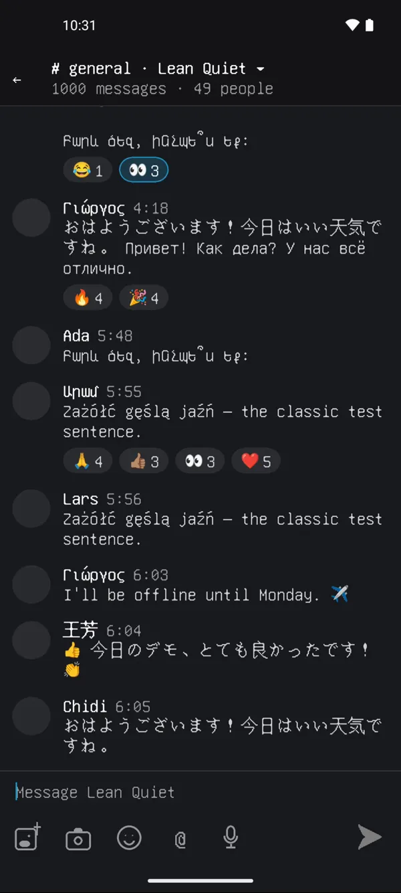
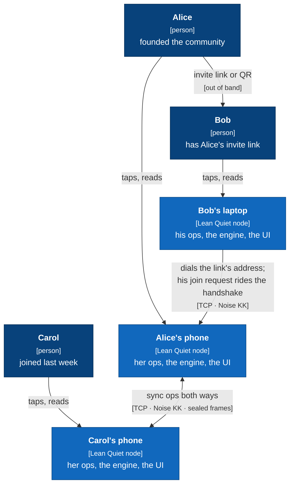
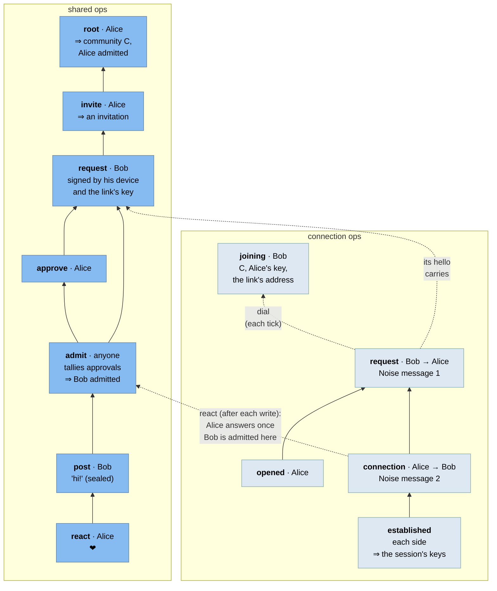
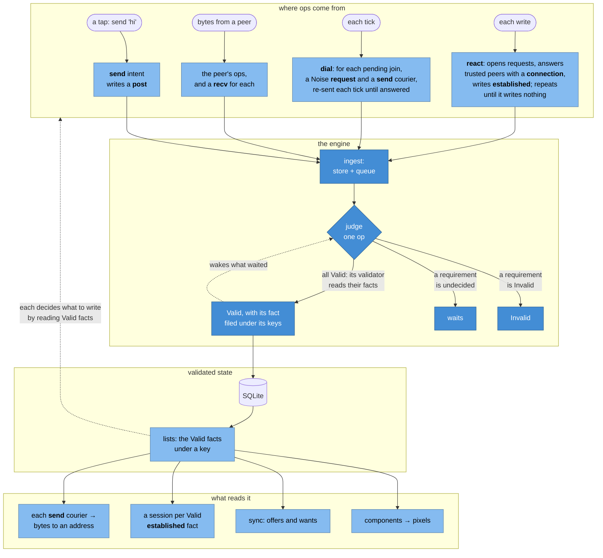

# Lean Quiet

[Lean](https://lean-lang.org) is usually for proving statements with and about code. But can we 
build entire apps with it, and prove they work as users might want?
I think we can now!

This app is written mostly in Lean. It builds for iOS, Android, Linux, Apple Silicon macOS and [Windows](platforms/windows/README.md) and implements chat with emojis and reactions. Non-Lean code is limited to things like scrolling or using the camera ([what isn't Lean, and why](#what-isnt-lean-and-why)) so in a
meaningful sense Lean does everything from processing TCP packets to drawing pixels on the screen.
This allows for proving a surprising range of user-relevant properties! See: [What is Proven](#what-is-proven).

Like [Quiet](https://github.com/TryQuiet/quiet), Lean Quiet is also local-first, end-to-end encrypted, and peer-to-peer, so many properties that would normally depend on a server operator (such as privacy, access control, or uptime) are provided by the code itself. Proofs can establish specified properties across executions satisfying their hypotheses, including device integrity, cryptographic and native-code trust, and the scheduling/delivery conditions needed for progress. See: [Towards Proofs for n Clients](#towards-proofs-for-n-clients).

Can we also prove the absence of the *qualitative* bugs that only show up in certain cases, like UI layout glitches at a certain screen size or RTL language, or a lack of responsiveness under load, or an accessibility gap? This seems tantalizingly possible too, and we show many such proofs here.

There is something exhilarating about adding a proof where one would usually add an end-to-end test. Sci fi. 🪐 

# What it looks like

<em>The status bar and keyboard are Android's, the rest is Lean. Scrolling is better in person.</em>

# How it works

A Lean Quiet node's state is ops: messages, joins and approvals, and
also dials and sessions. An op names the ops it requires, so the ops
form a DAG, and one engine turns them into validated state. What is
proven below is about these ops and this engine.

## Peers, and no server

Each device runs a node, and nodes talk to each other directly. A node
dials the member who invited it, so here Bob's and Carol's ops reach
each other through Alice.

## The op DAG: found, join, post, and the connection that carries them

A solid arrow points from an op to an op it requires. An op is Valid
once everything it requires is Valid and its validator accepts their
facts. A dashed arrow points from an op to a fact a view read before
writing it. Time runs downward. Not drawn: every community op also
requires the root, and an author's op requires the op that admitted
them (Alice's is the root).

Shared ops sync to members and are never deleted. Connection ops are
one node's own, or travel bare between two nodes; they never sync, and
closing a session purges them.

## One node: ops in, validated state out

A tap, a peer's bytes, the clock and the engine's own writes all turn
into ops. The engine is the same code for every op type: an op type
brings its validator and the keys its facts are filed under.

The engine and the community are in [docs/ENGINE.md](docs/ENGINE.md),
and sync in [docs/SYNC.md](docs/SYNC.md).

## What is proven

Lean checks the theorem statements under their stated hypotheses. The tables
below distinguish running code from models and unfinished connections to the
app. Cryptographic authenticity and progress also depend on the assumptions
below; the [vacuity report](#vacuity-check-reports) records which concrete premises have been checked:

- **accepted posts have signatures that verify under an admitted device key;** ¹
- **nobody joins without an invitation and the approval of someone
  admitted;** ¹
- **only admins remove others, and no removal can be undone;** ¹
- **a removal cuts off every device of the removed user, for good,** and
  its node can rejoin only as a new device;
- **a removal reaches every live session:** each connection step reads
  its rooms afresh, so once the removal is stored, only its notice of
  that community goes to the removed member;
- **no peer can alter or rename an op:** its id is the hash of its
  bytes, and it has one parse; ²
- **non-members get none of a community's ops;**
- **sync does not offer or send local secret ops;**
- **a sealed frame is authenticated before any of it is parsed;**
- **a node's trust rule lets in exactly the live members;** ¹
- **honest nodes that hold the same ops agree;** ² *(model)*
- **only a session's two nodes can derive its keys, even if both
  nodes' long-term keys leak after it closes:** every session end
  purges its keys from the store. ³ (A phone backup taken while it was
  open is not covered.)

And of what a user sees and does:

- **devices with the same ops show a channel in the same order** (past
  a counter's cap, each device's own arrival order, itself a law);
- **wrapping drops only spaces, and bidi reordering drops and invents
  nothing;**
- **removing someone takes two confirmations,** and cancelling writes
  nothing;
- **back restores the state before a page opened** (clearing only that
  page's one-line field);
- **a screen need re-read only what changed:** a list's answer changes
  only when a row is filed under a key it read.

¹ Interpreting verification as the owner actually signing needs the Ed25519
assumptions and signing-history scoping fix below. ² Assuming no collision among
the relevant encountered inputs. ³ In the symbolic model of the cryptography.

**Not yet proven:**
- that removed users are not admitted to the network again: a removed
  member can still invite and approve a new device on its own node
  (see what removal means, under [Security proofs](#security-proofs));
- that messages are secret from non-members: the seal's secrecy, and
  that content keys are wrapped only to members (an approval's wrap
  does not wait for the approval to be Valid);
- that a removed member cannot read new messages: removal cuts their
  sync, but content keys are not rotated yet;
- that a closed session's ephemeral keys are gone: that closing purges
  every one (`close_forgets`), and that deleted bytes leave the disk
  (assumed, and doubtful on journaling filesystems and flash);
- that every member eventually gets every op: proven for n nodes
  running the sync code (fixed rooms, frames in the clear) given that each
  live link carries an op within a bound B, but that bound is not proven
  yet (the have → want step over time, the round on reconnect)
  ([towards n clients](#towards-proofs-for-n-clients));
- bootstrap convergence for every fair execution of the running app. Concrete
  infinite witnesses and production-runner checks are now implemented
  ([evidence and remaining boundary](#bootstrap-witnesses-and-running-app-checks));
- whole-app resource bounds, cancellation of every blocked wait, and prioritized
  write-to-display and per-peer service bounds ([current audit](docs/EXECUTION-PROGRESS.md));
- a signing-history assumption scoped to verification attempts in an execution;
- that content is drawn faithfully all the way to pixels (proven up to
  each row's layout; painting is not).

The laws have already caught bugs, in code that had shipped and in
code being written: [what the proofs caught](docs/CAUGHT.md).

### Towards Proofs for n Clients

The sync proofs run the real sync code in a world of n devices
(engine/world/, [docs/PROOFS.md](docs/PROOFS.md)): each device is the
running node on its own store, and the network may delay, reorder,
duplicate or drop any frame, with timely delivery across live links from
some time on. Sessions are still opened directly, with frames in the
clear: TCP, sealed sessions and the handshake are not in that world yet.
Every step of every execution leaves every device good ([`good_always`],
[docs/GOOD.md](docs/GOOD.md)): one theorem over the World's acts, which
the other invariants are projections of, and by which every device's
verdicts are the spec's.
In every execution, stores only gain shared ops ([`grows`]); and if each
live link carries an op within a bound B, every member holds every op
within d · B over a web of diameter d, and a device back from offline
catches up ([`converge`], [`offline`]). Devices that hold the same ops
agree, whatever order the ops arrived in (proven so far over a model of
purging: [`same_ops_same_verdicts`]). So it comes down to that per-link
bound. Part of it is proven: a want in flight gets its op across within
three network delays plus the sender's queue, which drains a position per
tick ([`want_reaches`], [`drain`]); the round and closure steps are
proven per connection (`conn_runs_exchange`, `closure_delivered`). Still
open: that a have is answered with a want over time (a change to always
answer it is approved), the round that runs when devices connect or
reconnect, the premises that remain (the session staying open, room in
the queue, no hash collision), and then TCP, sealed sessions and the
handshake.

### What is Assumed

**Cryptographic trust assumptions.** For the intended security interpretation:

- Honest devices keep their private signing keys under their owners' control;
  attackers cannot extract those keys or make the devices sign unauthorized
  operations. SHA-256 itself has no secret key.
- Ed25519 key generation, signing and verification are implemented correctly,
  and feasible attackers cannot forge a signature on a new message except with
  negligible probability. This concerns digital signatures; encryption alone
  does not establish who signed. See [Ed25519's specification](https://www.rfc-editor.org/rfc/rfc8032.html)
  and the [standard unforgeability definition](https://securitybook.eecs.berkeley.edu/chapters/lec05.html#definitions).
- SHA-256 resists finding two different inputs with the same hash (**collision
  resistance**) and finding a different input matching a specified input's hash
  (**second-preimage resistance**). These are computational assumptions, not a
  claim that collisions do not exist. [NIST describes both properties and SHA-256's security strengths](https://csrc.nist.gov/Projects/Hash-Functions).

**Exact Lean hypotheses.** The proofs use the following predicates; their
relationship to those computational assumptions is not a proved reduction:

- [`Unforgeable`] says that every signature an op in the store carries, if it
  verifies under a key, was made by that key's holder (`Signed key message`,
  the holder's signing history). It is stated over the store's signatures, not
  over every byte string: a valid signature exists for every message under
  every key, so the unscoped form would force `Signed` to hold of every
  message ([`unscoped_signs_all`]) and say nothing about who signed. Scoped,
  it is Ed25519's unforgeability as a fact about one store, false only if a
  forgery is in it; a toy scheme with a signature for every message shows it
  holds of an informative `Signed` (`unforgeableScoped` in
  tests/vacuity/Contracts.lean). It is a
  computational assumption, not proved in Lean. The validator laws establish
  that the required signatures verify.
- [`CollisionFree`] requires no SHA-256 collision among the ops in the given
  received list. This finite property gives [`Distinct`] and can be checked
  on a concrete list. Sync's label law [`lbl_inj`] has its own hash premise.
- [`NoCollision`] says no input hashed in checking a chunk collides, under
  SHA-256, with an input the file's root hashes. Both are finite lists of bytes
  at hand, so it fails only if a real collision is among them, and it can be
  checked: tests/vacuity/Attachment.lean decides it on real SHA-256 for a
  two-chunk file. It is not stated over every byte string: SHA-256 has second
  preimages (more inputs than outputs); finding one is what is infeasible.
  [`assumptions_hold`] also gives a model hash for which it holds of every input.
- [`Suite.Good`] and [`Seal.Good`] are what the laws take of a suite: DH and
  key-derivation correctness, and AEAD roundtrips within the crate's plaintext
  (at most 274877906816 bytes) and associated-data limits. **Sizes are not
  assumed:** keys and nonces are `Bytes 32` and `Bytes 24` (engine/core/Crypto.lean),
  the only sizes the native code accepts, and code that reads one from storage
  or the wire checks it once (`Bytes.of?`). The running suites have both
  ([`cryptoSeal_good`], [`suite_good`]) given the crates' correctness, which is
  stated once, in the crypto trust file engine/core/Trust.lean ([`NativeCrypto`]):
  XChaCha20-Poly1305 and ChaCha20-Poly1305 open what they seal, X25519 agrees,
  and a SHA-256 digest is 32 bytes. Each is a named premise, never an axiom.
  tests/vacuity/CryptoTrust.lean checks each from both sides: the native crates
  satisfy it on real inputs, and a broken implementation of the same shape fails
  it (in the kernel). These contracts are correctness only; they do not
  establish secrecy.
- **Delivery within the session lease** (an environment premise, for
  liveness only). A frame sent on a live session reaches the peer before
  the session's lease runs out; otherwise the session closes, and the next
  reconnect starts over. The running app's sessions end on silence and on
  transport loss, as a sleeping phone's sockets do. Keeping authenticated
  sessions across transport loss was tried and is parked (see
  [not yet](#not-yet-about-running-code-todo)): the target theorem's
  "unless the session closes first" form does not need it.
- **A read transaction is one moment** (`read_one_moment` and
  `agrees_notice` take it), as two hypotheses. *Snapshot:* inside one
  SQLite read transaction, every read answers as one state of the store
  and outbox (SQLite's snapshot isolation, on a WAL reader). *Journal:*
  the rows and verdicts a notice takes (the journal's, written by
  triggers on the index and verdict tables, netted, and a write's own
  ops' positions), matched against the windows the cache watches, reach
  every read whose answer changed since the last moment. Over the
  engine's model that is a theorem (`read_notice_iff`, `watch_stable`),
  and `window_check` tests the triggers against it. The headless app's
  `liveSound` check tests the journal (every fresh answer the cache
  holds equals a read now); the snapshot is not tested on its own.
- **The session secrecy and authentication theorems assume the
  symbolic (Dolev-Yao) model:** perfect primitives, with the attacker
  reading, replaying and injecting every message. They have no
  computational reduction. DH is over named exponents only, with no
  low-order points, clamping or Ed25519-to-X25519 conversion.
  Authentication is stated over the calls to honest parties the
  attacker is given, and its agreement is non-injective: a replayed
  handshake is accepted again.

**Trusted implementation boundaries.** Tests provide evidence for the exercised
behavior; they do not prove all of these assumptions:
- **Lean** (its kernel, compiler and runtime), and the OS's randomness
  for keys and nonces.
- **The crypto implementations behave as specified:** ed25519-dalek,
  curve25519-dalek, chacha20poly1305 and sha2, the Rust crates libquiet
  uses. Compatibility tests compare their outputs with libsodium, and the
  handshake is tested against Noise vectors. What the proofs take of them
  is one file, engine/core/Trust.lean ([`NativeCrypto`]): correctness on
  sized inputs, checked against the crates in tests/vacuity/CryptoTrust.lean.
  These checks do not establish unforgeability or collision resistance.
- **SQLite behaves like the engine's own store.** This is tested row for
  row against the model, and with kill -9 crash tests. A frame's reads in one
  transaction see one committed state (SQLite's snapshot isolation): the
  snapshot hypothesis above, which the screen's laws take.
- **Deleted bytes are gone from the disk.**
  - A purge deletes with SQLite's `secure_delete` on, then runs
    `VACUUM` and truncates the WAL.
  - `tests/engine/Purge.lean` reads the database's files raw and finds no
    byte of a purged secret.
  - Without any one of the three steps, it does find them.
  - Below SQLite, it is assumed that the filesystem and the flash keep
    no older copy of a block.
  - In practice that is doubtful: journaling and copy-on-write
    filesystems, and flash wear-levelling, keep old blocks.
  - The sound fix is for session secrets never to reach the disk, as
    ephemeral ops (wanted, below).
  - The app's checkpoint is one row: saving one deletes the older in the
    same transaction, with the invites, drafts and queued secrets it held
    (`tests/engine/Purge.lean`'s `checkpointRows`; before, every frame's
    checkpoint was kept).
- [**The native code**](#what-isnt-lean-and-why): what connects Lean to
  the OS, and the libraries it calls. It is tested end to end, over
  localhost TCP and on devices.
- **That each statement says what we mean.** Read it: every name below
  links to its statement.

### Security proofs

✅ proven over running code · 🟡 partly · ⬜ wanted · *(model)* proven
over a separate model. 🥊🥊🥊 is what a user is promised; 🥊🥊 is what
that rests on; 🥊 is supporting. Theorem statements still require their listed
hypotheses. All 1571 rest on Lean's standard axioms only, and about three quarters of its theorems (1194 of 1542, not counting 29 negative controls) are about the code that runs; another 57 run the
phone's node code over a modelled network and plain transport (the
World); the rest are over models so far
([not yet about running code](#not-yet-about-running-code-todo)).

**What removal means.** Removal takes a member off the community's
network. Nodes that know of it refuse the member's nodes (the trust
rule), so they open no session with them, sync nothing to them and wrap
no key to them. It does not take back what the member did: its ops stay
Valid and are shown to everyone, including those it makes after its
removal (messages, invitations, approvals, and a removed admin's
removals, grants and renames). A partition can always keep some members
from learning of a removal for a while; only a central server, or giving
up availability, could prevent that (CAP). Those members accept the
removed member's new ops, and every member should end up seeing the same
thing, so the ops must be Valid for all. What removal must guarantee is
that removed users are not admitted to the network. That is not proven
yet: a removed member's invitations and approvals count, so it can admit
a new device on its own node (the 🟡 row under Connections).

| | | Guarantee | Theorems |
|---|---|---|---|
| | | **Identity and membership** | |
| ✅ | 🥊🥊🥊 | **No impersonation.** A message attributed to a user and device was signed, as that exact op, by the holder of the device's key, who also signed the op that admitted the device into the user. Assumes no forged signature is in the store (Ed25519 unforgeability, over the signatures the store holds). | [`no_impersonation`] |
| ✅ | 🥊🥊🥊 | **No joining unapproved.** Every member is the founder, or redeemed an invitation and was approved by one admitted device other than its own (for a device link, a device of the same user). There are no thresholds: one member could mint the users any threshold counts. The request carries signatures that verify under both the link's key and the device key. | [`admission_needs_approval`], [`admission_approved`], [`request_invited`] |
| ✅ | 🥊🥊🥊 | **Only admins remove others,** and only admins make admins. | [`removal_authorized`], [`admin_granted`] |
| ✅ | 🥊🥊🥊 | **Removal sticks, and history stays.** No replay, delay or reordering restores a removed member, or invalidates a valid op. | [`removed_stays`], [`valid_stays`] |
| ✅ | 🥊🥊 | **Every op verifies under the required keys:** a message under its author's admitted device, an approval under a member's device other than the requester's, an invitation under its issuer, a community name under an admin, and an admission under the admitted device (read as consent under the signing-history assumption). | [`message_authorized`], [`approval_signed`], [`invitation_issued`], [`named_by_admin`], [`admission_consented`] |
| ✅ | 🥊🥊 | **A removed member's ops stand.** Admins' removals stand, even of each other and by an admin since removed, and a removed member's approvals count, whenever they were made: nothing orders an op before or after a removal. | [`admin_removal_stands`], [`mutual_removal`], [`removed_approver_admits`] |
| | | **Confidentiality** | |
| ✅ | 🥊🥊🥊 | **Non-members get no ops, even by asking by id.** A session sends only ops of the rooms its peer is let into; haves and wants for any other room, or for a local op, get nothing. | [`recv_send`], [`hold_reply_local`], [`heldIn_index`], [`hold_reply_local_premises`], [`onWant_authorized`], [`serveOwed_blind`], [`serveOwed_shown`] |
| ✅ | 🥊🥊🥊 | **Secrets stay on the device.** The running filed and closure offers name only shared ops; no local op (a secret, a session key, a pending join) is offered or sent. Of a connection's ops, only the two handshake messages are not local. | [`offer_shared`], [`wire_kinds`], [`local_kinds`], [`joinOps_travels`], [`found_travels`], [`stopWaiting_local`] |
| ✅ | 🥊🥊 | **The stream discloses only what it may.** The running filed stream and closure walk offer only stored, shared ops in shown rooms. `Conn.tick` sends only round messages, offers and retries. | [`filed_send`], [`offer_shared`], [`offer_stored`], [`tick_send`] |
| 🟡 | 🥊🥊🥊 | **Messages are sealed to members only.** Proven: `recipients` names exactly the live members' node keys; an approval wraps the key to the requester only in the write that admits it; and a member reads every post sealed under a key wrapped to it, through the functions the app runs (the approver's `wrapKey`, the member's `unbox`, the poster's `sealedPost`, the screen's `openStored`), assuming only the crates' correctness. Not yet: wrapping through that query (an approval's wrap does not wait for the approval to be Valid, or check the device is live), and the seal's secrecy. | [`recipients_iff`], [`members_iff`], [`member_reads`], [`sealedPost_opens`], [`wrapKey_opens`], [`member_opens`], [`openSealed_seal`], [`openBody_sealBody`], [`unbox_box`], [`cryptoSeal_good`], [`check_reads_shared`], [`approveReq_wrap_admits`] |
| ✅ | 🥊🥊🥊 | **Sessions are secret,** in the symbolic model, over the handshake functions that run: an active attacker without the two static keys and the ephemerals derives neither transport key, whichever honest parties it talks to. A control shows an attacker with the initiator's static and ephemeral does derive them. Payloads are not covered. | [`kk_secret`], [`kk_secret_init`], [`kk_secret_resp`], [`kk_secret_init_tight`], [`kk_runs`], [`handshake_agrees`] |
| ✅ | 🥊🥊🥊 | **Sessions are authenticated,** in the symbolic model, over the handshake functions that run. The attacker's calls to honest parties are an explicit set, since a symbolic message does not record who made it. Unless the responder answered this request among them, the initiator accepts no reply the attacker can make; a reply it accepts is that answer, and both hold one session. Unless the initiator sent the responder a request with this payload, the responder accepts none as from it. This needs the responder's static secret, and the initiator's static or ephemeral (for the responder, both statics); controls show that with the responder's static leaked the attacker forges either message. Not covered: replay (an answer or request can be accepted again) and computational soundness. | [`kk_authentic`], [`kk_agree`], [`kk_authentic_resp`], [`kk_agree_resp`], [`kk_authentic_tight`], [`kk_authentic_resp_tight`] |
| 🟡 | 🥊🥊🥊 | **A closed session's keys cannot be recovered,** from the disk or from the static keys later. Every established session is kept open or retired, and each completed close, including crash recovery, leaves no row holding its ephemeral or transport keys; no later purge brings one back, and without the ephemerals nothing derives them. Assumes a deleted row leaves no byte on disk (`secure_delete`, `VACUUM`, the WAL truncated; tested raw). Caught a crash's session kept for good ([caught](docs/CAUGHT.md)). Not yet: a phone backup taken while a session is open; an initiator's ephemeral while its request waits; the step from stored bytes to the symbolic model's names. | [`close_forgets`], [`purge_forgets`], [`retired_complete`], [`forget_stays`], [`close_purges`], [`close_gone`], [`drop_iff_silent`], [`keepalive_sent`], [`live_stays`], [`kk_forward_secret`], [`purge_named`] |
| ⬜ | 🥊🥊🥊 | **Session secrets never reach the disk.** They would be ephemeral ops, held in memory, so forward secrecy would not rest on deletion. A restart then redials. | |
| ⬜ | 🥊🥊🥊 | **Removed members cannot read new messages.** This needs key rotation, which is not built. | |
| 🟡 | 🥊🥊 | **Every offered id names a stored op in one of the peer's rooms.** Proven of each connection step, given a room index that booting, writes and purges keep exact. Not yet: that the node's entry points chain these steps. | [`have_shown`], [`boot_cached`], [`write_cached`], [`purge_cached`], [`cached_items`], [`write_items`], [`have_shown_premises`] |
| | | **Connections** | |
| ✅ | 🥊🥊🥊 | **A node handshakes with its own key, not a device's.** A session's statics are the two nodes' keys; device keys only sign. A device binds itself to its node by signing the node's key into its root or request, so a removed device does not block a new one on the same node. | [`opened_endpoint`], [`established_endpoint`], [`endpoint_signed`], [`endpoint_derives`], [`meV_node`], [`new_device_trusted`] |
| ✅ | 🥊🥊🥊 | **The trust rule lets in exactly the live members' nodes.** Read from the node's tables, it accepts a node key exactly when a live device is admitted under it: admitted, and none of its users removed. Nodes that hold the same ops agree on it. | [`connect_iff`], [`deviceLive_iff`], [`refuse_nonmember`], [`connect_approved`], [`connect_agree`] |
| ✅ | 🥊🥊🥊 | **A removal cuts every device of the removed user,** wherever else it is admitted, and for good. Only a device's own consent ties it to a user, so nobody can get a device cut by tying it to someone else; only admins remove others. | [`removal_cuts_off`], [`cut_stays`], [`cut_consented`], [`removals_iff`], [`removal_authorized`], [`removed_stays`] |
| 🟡 | 🥊🥊🥊 | **A removed member's node stops holding the community, and can rejoin only as a new device.** A join writes a fresh device, never an admitted one, and a pending join or a dropped session is dialed until answered. Not yet: that a removed user is not admitted to the network again. Its invitations and approvals stay Valid, so it can invite and approve a new device naming its own node's key, which the trust rule lets in (`new_device_trusted`) once those ops reach one node unaware of the removal, or one colluding member. | [`mine_not_removed`], [`rejoin_fresh`], [`join_new_device`], [`removed_stays_removed`], [`rejoin_dials`], [`reconnect_dials`] |
| ✅ | 🥊🥊🥊 | **A removal ends a live session's sync.** In every entry point, each connection step reads its rooms afresh; a connection syncs a room only with a peer the trust rule takes, and to a removed peer carries only the removal's notice, then closes. | [`entry_fresh`], [`rooms_cut_node`], [`rooms_trusted`], [`rooms_cut`], [`rooms_removed`], [`rooms_complete`], [`notice_then_cut`], [`trusts_live`], [`rooms_model`], [`recv_send`], [`recv_take`], [`removal_cuts_off`] |
| 🟡 | 🥊🥊🥊 | **No packet goes to a removed member but the notice of its removal.** In every entry point, each frame sealed for the session carries, of that community, only sync messages and the removal with its closure (within the walk's budget); then the session closes. Not yet: that an entry point's bare handshake replies are only answers to trusted peers (proven per step: `answer_trusted`, `resend_trusted`); nor once a removed member admits a new device on its own node (above). | [`removal_reaches_session`], [`notice_sent`], [`closure`], [`notice_send`], [`removed_gets_only_notice`], [`notice_once`], [`notice_no_holds`], [`notice_then_cut`], [`answer_trusted`], [`resend_trusted`] |
| 🟡 | 🥊🥊🥊 | **No session before approval,** however hellos are lost or replayed. Proven of each running step: a responder answers, or re-answers, only a peer the trust rule takes, and the trust rule takes exactly the live members' nodes. Not yet: the same guarantee as an invariant over every entry point of the running node. | [`answer_trusted`], [`resend_trusted`], [`connect_iff`] |
| ✅ | 🥊🥊🥊 | **Peers cannot push ops in** outside the rooms they are let into, nor plant a device's local state, purges included. A session takes only its rooms' ops; the bare wire takes only a hello's join request. | [`recv_take`], [`bare_takes_only_join`], [`intake_local`], [`stored_local`], [`local_fact_mine`], [`intakeConn_conn`] |
| ✅ | 🥊🥊 | **Both ends hold one session.** Both ends of a handshake hold the same hash, name each other, and cross their send and receive keys; what the running `sealFor` seals opens, under the session's key, to the bytes sealed, and its header names the session. At the running keys every premise is discharged but the crates' correctness (the crypto trust file): keys and nonces are sized types, and `sealFor` checks the sizes it reads. | [`established_agrees_sodium`], [`established_agrees`], [`sealFor_opens`], [`open_seal_sodium`], [`cid_seal_sodium`], [`open_seal`], [`cid_seal`], [`suite_good`] |
| | | **Hostile input** | |
| ✅ | 🥊🥊🥊 | **One parse per op.** A decoded op re-encodes to exactly the bytes received, its id is their SHA-256, and a Valid op is exactly its body's encoding under its own type: no parser differential, no malleability, no renamed or re-typed op. | [`Codec.encode_decode`], [`Op.id_decode`], [`distinct_of_collisionFree`], [`op_of_valid`] |
| ✅ | 🥊🥊🥊 | **Hostile bytes decode to a well-formed value or to nothing.** A QOI picture comes out at 1–2048 px a side and at most 16 MiB, whatever it claims; invite links and QR segments are valid. So are mDNS packets, though the app does not run mDNS yet. | [`Pic.decode_sized`], [`Image.decode_sized`], [`Mdns.decode_valid`], [`Community.parse_valid`], [`Qr.parse_valid`] |
| ✅ | 🥊🥊🥊 | **Attachments authenticate themselves.** Any peer may relay a chunk, but it is Valid only if it is its file's own slice; progress counts exactly the chunks held, and together they are the file. A Valid attachment and its chunks claim their message's time, so sync's ranges carry a photo with its message. Assumes no SHA-256 collision between what a file's root hashes and what checking its chunks hashed (concrete bytes; checked on real SHA-256 in the attachment tests). | [`chunk_is_slice`], [`verify_sound`], [`complete_assembles`], [`chunk_unique`], [`progress_exact`], [`chunks_in_window`], [`assumptions_hold`], [`no_injective_hash`] |
| ✅ | 🥊🥊🥊 | **Judging cannot be hung.** From any state, judging empties its queue within a budget read off the tables. | [`drain_bounded`], [`drain_terminates`], [`step_budget`] |
| ✅ | 🥊🥊🥊 | **Authenticate before parsing:** a sealed frame's payload is decoded only after its AEAD check passes, under the receive key of the session the frame names. A frame that fails leaves the node and its store as they were, and sends nothing. | [`sealed_auth`], [`openFrame_auth`], [`onFrame_sealed`], [`sealed_unopened`] |
| 🟡 | 🥊🥊 | **Bounded buffering:** inbound frames wait in a bounded queue, each at most 1 MiB, whatever the peer's length fields say, and sockets are capped. Proven of a model of the reader's loop (`keeps`); not yet of the running reader. | [`buffer_bounded`], [`frames_kept`], [`frames_tooBig`], [`admit_bounded`] |
| ✅ | 🥊🥊 | **No amplification:** a decoded op is exactly its bytes, so no larger. A bundle's payloads are together smaller than it. Linear decoding time is not proven. | [`Op.decode_exact`], [`Op.decode_parts`], [`decode_sum`] |
| 🟡 | 🥊🥊 | **Resources are capped:** sockets, connection hint/ask sets, closure and replies; full rounds keep no sender closure state. A connection keeps no copy of a room: rounds answer from the node's one index, and a connection's round state is one entry per shown room, whatever the room's size or how many peers are mid-round. Not covered: room/notice metadata, the index's own contents, transient allocations, and round/CPU work. | [`hold_bounded`], [`conn_bounded`], [`conn_state_bounded`], [`full_round_stateless`], [`closure_capped`], [`closure_complete_under_cap`], [`honest_no_drop`], [`work_retry_bounded`], [`onWant_authorized`], [`serveOwed_blind`], [`serveOwed_budget`] |
| ✅ | 🥊🥊 | **Live sessions stay up.** With positive `live/3` and ticks and delivery within that interval, either side sends traffic or an empty-have keepalive; only silence drops it. Unserved asks expire separately. | [`drop_iff_silent`], [`keepalive_sent`], [`live_stays`], [`asks_expire`] |
| ✅ | 🥊🥊 | **Newest first.** A round opens over the structure range first, then the claimed times; every answer lists its pieces and its ids newest first, and a message's haves follow its claims' order. A photo's chunks claim their message's time, so a fresh node gets the newest messages with their photos first (tested end to end on a 200-message chaos room, with chunks at time 0 as a control). Not ordered: a difference found deeper in the claim tree is offered after a shallower, older one, and the stream offers ops in store order. | [`opening_newest_first`], [`answer_newest_first`], [`newest_first`], [`window_first`], [`chunks_in_window`] |
| ✅ | 🥊🥊 | **Rooms progress independently.** An idle room starts beside a stalled one; an unshown room gets an empty end without changing the connection. | [`room_independent`], [`unshown_room_answered`], [`uncarried_room_answered`] |
| ✅ | 🥊🥊 | **Purges notify readers.** Session and courier purge roots reach the app alongside stored ids. The reader's fallback poll is still present. | [`purges_notified`], [`flush_notifies`], [`close_purges`] |

### Quality proofs

| | | Guarantee | Theorems |
|---|---|---|---|
| | | **The engine** | |
| ✅ | 🥊🥊🥊 | **Honest nodes agree.** The same ops, in any order, batching or interleaving, give the same verdicts. | [`same_ops_same_verdicts`], [`order_free`], [`reach_drain`] |
| ✅ | 🥊🥊 | **Verdicts are the spec's, and final.** Once judging settles, every stored verdict is the spec's over the ops received, and no later op changes it. | [`drain_settles`], [`status_iff_spec`], [`spec_extends`], [`inv_ingest`], [`inv_step`] |
| ✅ | 🥊🥊🥊 | **Taking an op in twice is taking it in once.** In the running intake, an op the store holds changes nothing, so a retried write, a peer's resend, or an op synced back is harmless: nothing is stored or queued twice, and no verdict changes. | [`ingestS_known`], [`ingestS_twice`], [`ingest_twice`], [`run_ingestEach`], [`ingestAll_again`] |
| ✅ | 🥊🥊🥊 | **Purge is safe.** A purged session or courier is gone, no shared op is ever deleted, and the engine settles on what remains. The purge SQLite runs is one code over the store, proven equal to the model these are stated over. | [`purge_gone`], [`purge_shared`], [`purge_settles`], [`run_purge`] |
| ✅ | 🥊🥊 | **Purge takes exactly what it must.** It takes the named conn and local ops and their stored dependents. Shared dependents are judged again, and every state the node reaches, purges included, keeps the tables' invariant. | [`purge_named`], [`purge_undecides`], [`purge_inv`], [`reach_inv`], [`mem_purgeSet`], [`reach_ops`] |
| ✅ | 🥊 | **Families compose, op by op:** adding a family changes no verdict or scope of the first's ops. Strict decoding round-trips. | [`sum_left`], [`sum_scope_left`], [`Codec.decode_encode`], [`Op.decode_bytes`] |
| ✅ | 🥊🥊🥊 | **The Community laws hold in the running node** (`sum_project`). Its store also holds Connection ops, but at rest its Community ops keep Community's invariant and verdicts, and views that read only Community relations, such as the trust rule, answer as in a Community-only store. | [`sum_project`], [`sum_project_node`], [`spec_sum_left`], [`view_proj`], [`connect_iff_node`], [`members_iff_node`], [`recipients_iff_node`], [`node_settles`] |
| ✅ | 🥊🥊 | **The app's own state is ops, beside the node's.** The store also holds the app's settings, a family on top of Community's and Connection's: their ops keep their verdicts, and the node's hooks read the store as theirs. The appearance the app reads is the newest one stored, and choosing one writes a Valid local op, never offered to a peer. | [`current_newest`], [`choose_valid`], [`choose_local`], [`node_left`], [`left_list`] |
| ✅ | 🥊🥊 | **Where a window is, is an op, kept in memory.** Each change of page writes a nav op to the app's ephemeral log, rebuilt from its live ops, and the page and back stack the frame shows are exactly what the newest nav op names. No ephemeral op is ever stored: the store's intake drops them, from this node's own jobs too. | [`withNav_cache`], [`placeIn_newest`], [`node_nav_ephemeral`], [`intake_durable`], [`stored_durable`] |
| ✅ | 🥊🥊 | **Unsent text is an op, kept in memory** (DRAFT01). Leaving a conversation writes its draft, text and photos, to the app's ephemeral log; the log's newest draft for that entry is exactly it, and an empty composer leaves none, so coming back brings the text back. A draft is never stored or sent. | [`stash_use`], [`draftIn_newest`], [`draftIn_empty`], [`write_ephemeral`], [`write_valid`] |
| ✅ | 🥊 | **The in-memory store's lists are in order, and never re-sorted.** Its reads, which the app's ephemeral log runs, put a list's rows in position order: exactly the rows filed, sorted, as the fast merge sort sorts them; a union of lists in order merges in one pass to the same rows. | [`perm_sortPos`], [`sortPos_sorted`], [`sortPos_eq_fast`], [`sortPos_map`], [`insertBy_map`], [`foldr_insertBy`], [`insertBy_merge`], [`mergeRuns_eq_sortPos`], [`union_rows`] |
| ✅ | 🥊🥊🥊 | **The honest path works.** A request with its invitation and both signatures is valid, an eligible member's approval is valid, and one approval admits and lets the device in. The remover's intent writes only removals that stand. | [`request_valid`], [`approve_valid`], [`admit_admits`], [`connect_admitted`], [`removeMember_valid`] |
| | | **Sync** | |
| 🟡 | 🥊🥊🥊 | **A sync round finishes and finds every difference, whatever is written meanwhile.** Each claim is answered from the live index, and nothing assumes the indices stay still: a run of the actual handler that stays current ends within its claims' rank over everything both sides held during it, linear in the room's size (writes during the round only add to it), and every op either side held at the start and kept reaches the other's index or is offered or wanted on the wire, under fingerprint and capacity premises. With both indices fixed during the round, it is `exchange`: 2k + 2 answers for a room of at most leaf·fanᵏ items, so logarithmic; under concurrent writes only the linear bound is proven. Ops written after the round opened go by the stream. Not yet: a logarithmic bound under writes; embedding the round in the full Node/TCP execution. | [`RoundRun.terminates`], [`RoundRun.discovers`], [`live_round_complete`], [`exchange_complete`], [`exchange_log`], [`conn_runs_exchange`] |
| 🟡 | 🥊🥊🥊 | **A room shown on a live session gets a round, whichever end starts showing it.** Rounds open only on events: the dialer's tick opens one in each shown room that is due, that is newly shown, asked for by the responder (an empty have naming the room, sent when it starts showing it), short of ask slots last time, or idle for the 10-minute safety period; with no event, no round opens. So a round opens within two ticks and one delivery of either end starting to show a room. Main's 30 s dialer timer is kept as the negative control, which these laws refuse ([caught](docs/CAUGHT.md)). Proven of each connection's tick and receipt. Not yet: through the node's entry points (refresh, sealing). | [`round_due`], [`shown_due`], [`responder_asks`], [`ask_due`], [`join_round`], [`no_round_before_safety`], [`responder_opens_none`], [`shipped_controls_apply`] |
| ✅ | 🥊🥊 | **Fingerprints are honest.** Equal Merkle labels mean equal sets, and a side opens a round with an honest claim. | [`lbl_inj`], [`opening_honest`], [`num_inj`] |
| 🟡 | 🥊🥊🥊 | **Partial sync is safe.** A node that holds an op's requirement closure judges it as its peer does. Not yet: proven of the spec, which running judging reaches once it settles. | [`spec_local`] |
| 🟡 | 🥊🥊🥊 | **A joiner connects, and both sides converge.** Proven over the running node (the actual `Node` steps with the production connection hooks and native crypto, over a modelled network): a native-certified successful join exists and continues fairly. Not yet: convergence for every fair execution of the running app, the target theorem ([checks](#bootstrap-witnesses-and-running-app-checks)). | [`successful_fair_extension`], [`Execution.fairRun_fair`] |
| 🟡 | 🥊🥊🥊 | **The connection's progress steps work.** A round discovers missing IDs on the live index; queued requirement closures eventually arrive and validate under recurring service and delivery. Not yet: whole-app composition. | [`conn_answers_ids`], [`conn_runs_exchange`], [`closure_delivered`] |
| 🟡 | 🥊🥊🥊 | **New ops reach connected members.** With two nodes running the sync code, fixed rooms and no handshake, an op written during a session is offered at once and held after one exchange (offer, want, op), given ask slots and budget. A send into a room the other end does not show yet is not taken as a have; it arrives by the round that opens when that end starts showing the room. Not yet of the runner, with TCP, sealed frames and the handshake. | [`stream_offered`], [`stream_delivers`], [`stream_delivers_steps`], [`stream_offered_runs`], [`stream_delivers_runs`], [`write_offers`], [`write_offers_all`], [`hold_wants`], [`op_taken`] |
| ✅ | 🥊🥊🥊 | **Wants retain their order.** Authorized IDs queue once when capacity permits. With positive service budgets, an ID with p predecessors is served within p + 1 steps; unavailable asks expire. | [`onWant_all`], [`onWant_order`], [`serveOwed_head`], [`serveOwed_fifo`], [`owed_within`], [`want_sends`], [`asks_expire`] |
| 🟡 | 🥊🥊🥊 | **UI-first service without starving sync.** Three of four polls prefer local writes. A local head is selected within two completed turns; an admitted peer frame is served or retired within `4 * (maxSocks + 1)`. A local write's shared ops are committed before `onWrite` returns. Not yet proved: commit-to-display and neighbour-delivery bounds. | [`Prioritized.write_within`], [`source_or_cancelled_within`], [`write_within_churn`], [`Priority.write_within`], [`Priority.event_within`], [`Priority.local_share`], [`Priority.phase_cycle`], [`Loop.turn_records`], [`Loop.turn_timer`], [`Tick.cofinal`], [`urgent_ahead`], [`ahead_bytes`], [`cut_bytes`], [`push_capped`], [`serveOwed_hot`], [`hot_ids`], [`lane_control`], [`fresh_served`], [`write_hot`], [`onWrite_receives`] |
| 🟡 | 🥊🥊🥊 | **Everyone converges.** With n nodes running the sync code (fixed rooms, no handshake), against any network and attacker: shared stores only grow, and an op crosses a session in three hops of the running node, over frames of any payloads at a node with any sessions: a have of an unasked op is answered with a want, a want of a held op queues it or sends it, and an op of a shown room is stored, given ask and queue room (finding 7). Over time, a want in flight gets its op across within 3Δ plus the sender's queue (at most `maxKnown` ticks), with every node invariant the running node's own; the queue drains one position per tick. Given an op crossing each live edge within B, every member holds it within d · B over a web of diameter d, and a node back from offline catches up. Not yet: the have → want hop over time (waits on S3) and the reconnect round, so not yet that each live edge carries every op within B; still premises: the session staying open, queue room, no hash collision; not with TCP, sealed sessions and the handshake. | [`converge`], [`offline`], [`want_reaches`], [`drain`], [`want_to_op`], [`op_hop`], [`write_hop`], [`step_waits`], [`grows`], [`managed_nil`], [`owes_queued_start`], [`ix_covers_start`], [`owed_bounded_start`], [`deliver_wants`], [`deliver_queues`], [`deliver_takes`], [`onSealed_wants`], [`onSealed_queues`], [`onSealed_takes`], [`onSealed_waits`], [`onTick_moves`], [`serve_moves`], [`onHold_wants`], [`recv_asked`], [`recv_owed`], [`recv_appends`], [`node_serve`] |
| 🟡 | 🥊🥊🥊 | **Every world of n nodes stays good.** In every execution of the n-node World running the sync code (fixed rooms, no handshake), from empty stores, against any network and attacker, every step leaves every node good: it manages no session, its sessions owe only what they queue and queue at most `maxKnown`, its index covers its store, and its store is one the engine reaches, with judging settled; every packet in flight was sent in the past; and each store moves only by write turns and purges. So at every node and every step, verdicts are the spec's, and nodes that received the same ops, in any order, agree. The World's other invariants are its projections, over one interface any World instantiates ([docs/GOOD.md](docs/GOOD.md)). Not covered: the production hooks (sealed sessions, the handshake, rooms from the store), lifecycle (suspend, resume, the write journal), the world-level conjuncts beyond packet times (provenance, secrecy, removal over the wire), and drain-cap's urgent class. | [`good_always`], [`Plain.good_keeps`], [`moves_always`], [`verdicts_spec`], [`Plain.agree`], [`sent_keeps`], [`Keeps.always`], [`Guar.always`] |
| 🟡 | 🥊🥊 | **A node invariant is proven once, for any hooks.** For any World setup whose run is a run, a node invariant that survives each piece of the node's code under its own hooks (following established sessions, the family's reactions, dialing, catalog sweeps, the outbox, ending a session) survives every entry point the World runs: frames, ticks with deferred retries or without, writes, closes. The plain World's node invariants are its instances, and a hook that stores an op without indexing it breaks the index's (a negative control). Not yet: the instances for the app's own hooks (sealed sessions, the handshake), the same skeletons for progress relations, and drain-cap's idle turn. | [`onTick_keeps`], [`onFrame_keeps`], [`onWrite_keeps`], [`onClose_keeps`], [`oq_pieces`], [`ix_pieces`], [`bounded_pieces`], [`managed_pieces`], [`dial_mutant_unindexed`] |
| ⬜ | 🥊🥊 | **Staleness is never hidden.** Wanted: "up to date as of T" means a round this device opened at T ended with it holding everything the peer held in that room, and a sync that stalls is shown within a stated bound. | |
| ⬜ | 🥊🥊🥊 | **A synced page is complete:** after syncing a page, a device shows every row its peer shows for it (`page_sync`). | |
| ⬜ | 🥊🥊 | **Sync is efficient.** Each op is sent at most once per connection, and a round needs at most fan·Δ·⌈log n⌉ claims. | |
| ✅ | 🥊 | **A room's fingerprints and answers come from its canonical Merkle treap, in O(height) hashes, with no change on the wire.** The running opening and answer are `opening`'s and `answer`'s over the room's items, so the round laws above are about them; an opening costs at most 2·height hashes and an answer 2·(fan + 1)·height, whatever the room holds; an insert height + 1. Not proven: the height itself, O(log n) only in expectation over hash ids (tests/scale measures 22, 31 and 39 at 1k, 10k and 100k items); a member can grind ids for a deeper treap. | [`Index.answer_eq`], [`Index.opening_eq`], [`answerT_canon`], [`answerTM_hashes`], [`openingTM_hashes`], [`insert_hashes`], [`label_canon`] |
| | | **The screen** | |
| ✅ | 🥊🥊🥊 | **Component work has revocable ownership.** In the reader's and raster worker's shared demand plan, a key is held iff some component declares it, revoked completions are rejected, and visible work goes first. End-to-end latency remains unproved ([details](docs/PERF.md#component-demand-the-running-starting-point)). | [`Demand.owned_iff`], [`Demand.complete_retired`], [`Demand.next_visible`], [`Demand.retained_prefix`], [`Demand.retained_ticket`], [`Demand.remount_rejects`] |
| 🟡 | 🥊🥊🥊 | **Visible work retains its turn.** The actual reader/raster chooser selects or retires a continuously visible queued item within `p + 1` attempts, with `p` preceding entries. Not yet: whole-worker progress and queue capacity. | [`Demand.next_map`], [`Demand.takeBy_map`], [`Demand.filter_rank`], [`Demand.take_progress`], [`Demand.take_changes`], [`Demand.selected_or_retired`], [`Demand.selected_within`] |
| ✅ | 🥊🥊 | **Unmounted pages issue no new reads or writes.** The running read and write gates reject unmounted pages and old leases, even after a remount. Pruning the cache to the mounted queries is proven of `Lifecycle.prune`, which nothing running calls yet. | [`unmount_read`], [`unmount_write`], [`old_callback`], [`unmounted_quiet`], [`old_quiet`], [`live_exact`], [`subscriptions_exact`], [`mounted_runs`] |
| 🟡 | 🥊🥊 | **Lifecycle state survives a restart or resize.** The running checkpoint keeps the page and the message anchor, and a resize keeps the anchor's distance from the top when it fits. Not yet: crash durability as a law; crashes are tested ([inventory](docs/LIFECYCLE.md)). | [`restore_checkpoint`], [`page_round`], [`restore_page_anchor`], [`apply_page_anchor`], [`resize_anchor`], [`viewport_geometry`], [`viewport_possible`] |
| 🟡 | 🥊🥊🥊 | **Nothing on screen is covered or mis-tapped.** Content is drawn between the header and the composer or keyboard, the newest message is wholly visible when pinned, and a tap lands on the row or emoji key drawn under it. Not yet: the OS's events and the compositor's copies. | [`Surface.visible_in_viewport`], [`newest_visible`], [`Surface.pinned_visible`], [`pinned_tap`], [`hit_iff`] |
| ⬜ | 🥊🥊🥊 | **Every control is big enough to tap.** Every tappable control's hit area, not just its drawn size, is at least 48 dp by 48 dp on Android and 44 pt by 44 pt on iOS, at every supported screen size and text scale. | |
| ⬜ | 🥊🥊 | **A tap means one thing.** On every screen, no two controls' hit areas overlap, so a point selects at most one control. A tap selects the control drawn under it. Today this is proven for the emoji sheet and message rows only (`keys_disjoint`, `hit_iff`, `pinned_tap`). | |
| ⬜ | 🥊🥊 | **Every control shown can be tapped.** A control that is drawn has its hit area on screen, and not under the header, the composer or the keyboard. | |
| 🟡 | 🥊🥊🥊 | **Typing and sending never wait on sync.** A frame never waits on the node: every write is offered to its channel without blocking, and none is lost, repeated or overtaken; a build check finds none of the known blocking calls on a frame path. Not yet: waits on unfinished tasks are unchecked, and `trySend` not waiting is assumed. | [`offer_split`], [`offer_runs`] |
| ⬜ | 🥊🥊 | **A tap acts once.** A second tap on a control while its action is in flight starts nothing new (Send sends once). A press that turns into a scroll past the slop is not a tap. | |
| ⬜ | 🥊🥊 | **Destructive actions are guarded.** Every action that cannot be undone asks for a second confirmation, as removal does (`writes_only_after_two`). Its control keeps a clear gap from the controls around it. | |
| ✅ | 🥊🥊🥊 | **A screen need re-read only what changed.** A list changes only when a row is filed under a key it read, and no list holds an op twice. | [`eval_stable`], [`view_stable`], [`filed_rel`], [`mem_keysOf`], [`matching_nodup`] |
| 🟡 | 🥊🥊🥊 | **Notices are exact.** A screen watches windows of lists. Proven: after any batch of commits and purges, a subscriber is notified exactly when a window it watches changed, and its watch misses nothing it reads. Not yet: the running frame's windows are wider than its rows (`past_hull_le`), and SQLite's triggers are tested, not proven. | [`notice_iff`], [`read_notice_iff`], [`read_rows_iff`], [`Engine.window_rows`], [`watch_stable`], [`run_exact`], [`fact_stable`], [`find_costs`], [`notify_cost`], [`screen_subs`], [`hull_near`], [`past_hull_le`], [`key_notice_imprecise`], [`unnetted_imprecise`], [`keep_scrolled_off`], [`agrees_notice`], [`agrees_unmount`], [`watched_held`] |
| ✅ | 🥊🥊🥊 | **Removing someone takes two confirmations.** Nothing is written before the second, and cancelling writes nothing. Each attempt starts fresh, and one in flight cannot be replaced. The action is offered only to an admin, on another present member. | [`writes_only_after_two`], [`cancel_writes_nothing`], [`open_fresh`], [`no_replace`], [`offered_only`] |
| ✅ | 🥊🥊 | **Back goes back.** Back after opening a page restores the state before it (clearing only that page's one-line field; the ephemeral log's newest nav op names the place before); back at a root does nothing; after a switch, backs never leave the new home; and no step changes the composer's draft. | [`back_go`], [`NavLaws.back_open`], [`NavLaws.back_root`], [`back_switch`], [`go_inv`], [`NavLaws.depth`], [`draft_back`], [`into_native`] |
| ✅ | 🥊🥊 | **The people list is the present members,** each once: users with a live device. A removed member leaves it and its count, but keeps their name on their messages. | [`present_iff`], [`present_not_removed`], [`present_nodup`] |
| 🟡 | 🥊🥊🥊 | **The screen is one moment.** Every frame is drawn over one store state, the latest the app has seen: every read through the running cache returns its moment's answer, given SQLite's snapshot isolation and the journal hypothesis. Not yet: the reader's pass as a law, and one moment across the reader and the frame. | [`read_one_moment`], [`answer_agrees`], [`agrees_store`], [`agrees_notice`], [`agrees_keep`], [`agrees_empty`], [`eval_stable`], [`view_stable`] |
| 🟡 | 🥊🥊🥊 | **Scrolling always shows something.** Proven of the running frame: from the bottom up to the last loaded row, and above it while older messages are outside the window, no position is blank; each vsync shifts the published buffer and fills the rest. Not yet: bounded frame work, or OS scheduling. | [`Cover.covered`], [`Cover.line_painted`], [`Translate.covered`], [`Translate.equivariance`], [`Translate.fill_pixel`], [`Slide.edge_eq`] |
| ✅ | 🥊 | **Cached placeholders keep every pixel.** The frame's single cached period matches the original generator for every height; width, density, theme or background changes select matching pixels. | [`Hold.messageLine_key`], [`Hold.prepare_key`], [`Hold.prepare_reuses`], [`Hold.prepare_rows`], [`Hold.cachedMessagePlane_exact`], [`Hold.cachedMessagePlane_reuses`] |
| ⬜ | 🥊🥊 | **An action's toast stays until the screen shows it.** A toast for an action stays up until every component on screen has re-read a state holding its op, or the OS's toast time passes. | |
| 🟡 | 🥊🥊 | **The layout is exact.** Proven of the running code: the emoji sheet's keys sit exactly over their tap boxes; the composer's photo chips are in order, apart and on screen; the invite's hints and QR and the camera preview fit. Not yet: the graphics API and pixel copies. | [`Surface.placed_row`], [`Surface.newest_drawn`], [`Surface.pinned_row`], [`keys_disjoint`], [`hit_cell`], [`reachable`], [`itemAt_place`], [`lineOf_ctop`], [`chips_apart`], [`x_clear`], [`chips_fit`], [`compose_row`], [`compose_top`], [`Link.hints_fit`], [`Link.qr_fits`], [`Camera.src_in`] |
| 🟡 | 🥊🥊🥊 | **Message text is shown faithfully.** Wrapping drops only spaces, and every line fits when every character does; bidi reordering drops and invents nothing; the glyphs placed are exactly the visible characters; number runs stay whole and in order. Unicode's bidi tests pass in the implemented scope. Not yet: the bidi algorithm as a law, embeddings, isolates, brackets and mirroring ([scope](docs/BIDI.md)). | [`wrap_keeps`], [`wrap_fits`], [`visual_perm`], [`place_shows`], [`place_starts`], [`numbers_keep_order`], [`arabic_numbers_keep_order`] |
| 🟡 | 🥊🥊🥊 | **Names are shown correctly.** A name is its author's newest valid profile, cut to a prefix; explicit bidi controls have no directional authority; a name starts next to its avatar; and a row is marked "⚠ Duplicate" exactly when another member's name looks alike. Not covered: look-alike letters across scripts, and invisible characters in a message's body. | [`profile_read`], [`profile_authorized`], [`no_renaming`], [`name_placed`], [`oneLine_prefix`], [`controls_neutral`], [`marks_invisible`], [`namesake_iff`], [`row_marked`], [`twin_shown`], [`twin_before_time`], [`hit_twin`], [`name_starts`], [`flush_shows`] |
| 🟡 | 🥊🥊 | **Noto coverage is bounded, and the glyph memo is the raster.** Font reads are bounds-checked, coverage fits its bitmap, and the memo the compiler runs for a glyph's bitmap is proven equal to rastering it (`@[csimp]`). Not yet: pixel fidelity, and memory bounds: a font keeps the glyphs it rasters until the app rebuilds it, on suspend and on a density change; the raster is checked against fontTools ([report](docs/NOTO.md)). | [`Ttf.byte_in_bounds`], [`Ttf.cmap_entry`], [`Ttf.coverage_value`], [`Ttf.raster_valid`], [`Ttf.raster_pixel`], [`Ttf.Memo.bitmap_eq_fast`], [`Ttf.Memo.Table.get_eq`] |
| ✅ | 🥊🥊 | **Times, reactions and pictures are shown as held:** the claimed time's clock, each reaction's count of distinct reactors, and each picture at its own aspect inside its box. | [`time_shown`], [`projectSet_mem`], [`projectSet_nodup`], [`picBox_aspect`] |
| 🟡 | 🥊🥊🥊 | **What you see is what was sent.** Over a model of the reads: a shown message is a Valid fact, shown with its author, claimed time and body opened with a key the store holds, and the conversation is exactly the messages this device can open. Not yet: from a row's layout to its pixels. | [`message_own`], [`readable_held`], [`readable_complete`], [`eval_stable`] |
| ✅ | 🥊🥊🥊 | **Every community is reachable, and is one entry.** Every entry has a switcher row whose tap selects exactly it, no two entries share a community, and a page is drawn from its entry's op, never a name. | [`switcherOrder_sound`], [`switcherOrder_complete`], [`dedupe_nodup`], [`dedupe_one_per_community`], [`select_tapped_dedupe`], [`drawPage_key`], [`pageIn_acc`] |
| ⬜ | 🥊🥊 | **The screen keeps up.** Wanted: input first, no blank rows past a latency bound, within a frame budget, with bounded reads. | |
| ✅ | 🥊🥊 | **Display order.** A channel sorts by a counter its devices share, then the time, then the id, with no ties, so devices with the same ops order it alike. Past the counter's cap, each device's own arrival order shows instead, and that exception is itself a law. | [`msg_cmp`], [`time_is_display`], [`order_total`], [`Pos.cmp_eq_iff`], [`Pos.cmp_lt_trans`], [`send_after`], [`arrival_order`], [`receipt_once`], [`order_local`], [`display_agrees`], [`readable_held`], [`readable_complete`] |
| | | **Codes, pictures and discovery** | |
| ✅ | 🥊🥊 | **What the encoders write reads back:** QR segments and codewords, invite links and mDNS packets, and QR error correction is sound. Nothing running writes mDNS packets or `leanquiet://` links yet. | [`parse_segsBits`], [`parse_dataStream`], [`RS.correct_sound`], [`RS.correct_clean`], [`decodeFormat_correct`], [`decodeVersion_correct`], [`parse_text`], [`parse_uri`], [`Base62.decode_encode`], [`Mdns.decode_encode`], [`decode_roundtrip`] |
| 🟡 | 🥊 | **Pictures render whole:** scaled and composited pictures are well-formed and opaque, and the tray's layout fits. Not yet: proven of `Pic`, which only qr's Android harness runs; the app draws its own. | [`render_wellFormed`], [`render_opaque`], [`scale_wellFormed`], [`fit_round`], [`Pic.layout_inside`], [`Pic.layout_apart`] |

The theorems not listed here are lemmas. The axiom audit,
`tests/Axioms.lean`, lists them all.

### Not yet about running code (todo)

A law is about running code when every definition its statement names
runs from the app's `main` or the node's runner, or is proven equal to
code that does. `tests/Wiring.lean` classifies every law from the code,
with `tests/wiring.txt` for what the code cannot say, and
`ci/proof-links.py` writes these tables and the lead's count.

<!-- wiring:begin -->
**1194 of 1542 laws are about running code;** another 57 run its node code in a World, and 291 are not yet. Stated only: none. 29 laws are negative controls: each proves a mutant breaks its law (they are not counted here, nor in the lead).

| Area | Laws | About running code | In a World | Not yet |
|---|---|---|---|---|
| Engine | 216 | 168 |  | 48 |
| Sync | 330 | 284 |  | 46 |
| The n-node World | 43 | 8 | 35 |  |
| mDNS | 3 | 0 |  | 3 |
| Node and wire | 208 | 143 | 16 | 49 |
| Connections | 32 | 28 |  | 4 |
| Community | 241 | 212 |  | 29 |
| QR codes | 10 | 10 |  |  |
| Pictures | 13 | 1 |  | 12 |
| Screen | 282 | 220 |  | 62 |
| App | 139 | 97 | 6 | 36 |
| Node | 16 | 16 |  |  |
| App state | 9 | 7 |  | 2 |

| Missing link | Laws | To make them real |
|---|---|---|
| `Execution.fairRun`, `Execution.dequeued`, `Execution.trace` | 2 World laws; not yet: [`world_trace_moves`], [`empty_trace_store`], [`world_trace_history`], [`empty_trace_history`], [`world_trace_unique`], [`empty_trace_unique`] | Actual Node.onTick/onFrame/onWrite/onClose and production Connection.hooks, native crypto, explicit Held store and entropy tape. Infinite FIFO service is proved; a native-certified successful prefix has a fair continuation. Wanted: store/transport refinement and whole-bootstrap convergence for every suitably fair app execution; finite TCP regressions do not prove these. |
| `Execution.lift` | 4 World laws; not yet: [`run_count`]*, [`run_get`], [`run_view`]*, [`run_arrivedFrom`]*, [`ProgressTape.answer_ready`]*, [`production_step_moves`], [`production_step_retains`], [`production_step_reachable`], [`production_step_settled`], [`write_store_tape`], [`production_write_receives`], [`production_step_history`] +1 more | Explicit Held store adapter inside the production-node entropy-tape interpreter. Native SQLite and entropy refinement remains external; answer_ready proves one actual handler call consumes its next tape value. |
| `Sync.World.peer`, `Sync.Setup.sync`, `Who.other` +7 | 32 World laws; not yet: [`secrecy_runs`] | Real: both nodes are the running `Engine.Sync.Node`, its entry points run on held stores. Assumed: the network may deliver, duplicate, drop or delay any frame, and sessions open directly, with plain frames (no handshake). Wanted: the World with the app's own `Sync` (the Connection family, sealed sessions, the handshake), which makes these laws wired. |
| `World.step`, `Exec.world`, `Plain.setup` +3 | 28 World laws | Real: n nodes, each the running `Engine.Sync.Node` with a3's `Setup.sync` (fixed rooms), its entry points run on held stores. Assumed: the network may deliver, duplicate, drop or delay any packet (from gst, `Net.Admits`'s timely delivery across live edges), sessions open by the harness's `connect`, frames in the clear, and a transport close drops only that address's sessions (S1: no loss without a close). Wanted: the n-node World with the app's own Sync (the Connection family, sealed sessions, the handshake; holmes-71's session forms), which makes these laws wired. |
| `Sync.exchange` | [`exchange_complete`]†, [`conn_answers_ids`]°†, [`exchange_ids_stable`], [`exchange_log`]†, [`exchange_stable`], [`conn_runs_exchange`]† | conn_runs_exchange now connects exchange's missing IDs to exact alternating onRbsr batches and proves termination under snapshot/fingerprint/capacity premises. Still needed: embedding uninterrupted rounds and directed announcements in the full Node/TCP execution across timeouts and capped windows. |
| `Community.recipients`, `Community.members` | [`recipients_iff`]†, [`members_iff`]†, [`reads_members`], [`reads_recipients`], [`members_iff_node`]†, [`recipients_iff_node`]† | The key-wrap writers (`found`, `approve`) do not read `recipients`: wrap through the query, and tie a wrap's recipient to an admission. |
| `Sync.keeps` | [`buffer_bounded`]*† | The model of the TCP reader's loop (engine/wire/Tcp.lean): have the loop step by it, or prove its buffers are `keeps`'s. |
| `Pic.add`, `Geom.box`, `Pic.attachEdge` +4 | [`fit_small`], [`fit_le`], [`fit_pos`], [`fit_long`], [`fit_round`]†, [`layout_sizes`], [`Pic.layout_inside`]†, [`layout_apart`]†, [`add_stored`], [`scale_wellFormed`]†, [`render_wellFormed`]†, [`render_opaque`]† | The composer's tray runs only in qr's Android harness; the app attaches with its own: use `Pic`'s tray in the app, or prove these of its code. |
| `Mdns.decode`, `Mdns.encode` | [`Mdns.decode_encode`]†, [`decode_valid`]*†, [`decode_roundtrip`]† | Nothing that runs discovers peers by mDNS (tests/mdns runs `Mdns.Net`): have the runner announce and browse with it. |
| `Arrival.lit` | [`lit_zero`], [`lit_mono`], [`lit_full`], [`lit_clockwise`], [`ring_counts`] | `paintRing` tests `onRing` and `arc` inline: have it paint by `lit`. |
| `Frame.wants`, `Subs.ofList`, `Frame.listWins` +2 | [`has_ofList`], [`ofList_wf`], [`screen_subs`]†, [`hull_near`]†, [`past_hull_le`]†, [`screen_index`], [`keep_scrolled_off`]† | Nothing that runs wants by `Frame.wants`: the frame wants the conversation's window and the near rows (app/Screen.lean); want by it, the window cut to the near rows' hull (Screen's plan). |
| `Pics.after`, `Pics.costIn` | [`decoded_started`], [`image_steady`], [`image_settles`], [`image_twice`] | Legacy picture-door model (`PicM`); the app now uses owned Reader wants and Work.Pool continuations. Restate these cost/settling laws over that running path, including decode-unit bounds. |
| `Board.apply`, `RWorld.commit`, `RWorld.evict` +10 | [`RWorld.acts_shown`], [`seen_take`], [`World.inv_commit`], [`RWorld.inv_commit`], [`RWorld.inv_pass`], [`RWorld.inv_frame`], [`inv_evict`], [`RWorld.settle`], [`World.inv_pass`], [`World.inv_frame`], [`World.settle`], [`marked_pass`] +7 more | The change signal's reader and frame, as Worlds (engine/renderer/BoardLaws.lean, ReaderLaws.lean): the app's reader runs `Board.put`, `take` and `keep`, and decides by `Live.staleW`, `mark` and `pick`, but the laws of a pass and a frame are over the Worlds. Todo: state them of `Reader.pass` and the frame's `takeBoard`. |
| `T.sum`, `Both.bottom`, `Both.rowAt` +16 | [`start_eq`], [`find_spec`], [`set_toList`], [`push_ok`], [`findM_cost`], [`startM_cost`], [`setM_cost`], [`rows_cost`], [`start_mono`], [`start_size`], [`below_window`], [`above_window`] +8 more | The row-heights tree (engine/renderer/Heights.lean): the app keeps its rows' heights in a map (`App.heightOf`) and adds them up itself. Have its list frame place rows by `Heights`. |
| `Sync.absentStep` | [`write_store`], [`absentStep_keeps`], [`absentStep_source`]*, [`absentFold_keeps`], [`absentFold_source`]*, [`absentFold_covers`] | Proof decomposition of Node.write's actual deduplication/read loop, related by write_store. Public write_takes and write_preserves_op name Node.write directly. |
| `PageId.all` | [`NavLaws.depth`]† | Nothing that runs calls it. |
| `Body.sigs` | [`admission_consented`]† | Nothing that runs calls it. |
| `Invite.uri` | [`parse_uri`]† | Nothing that runs calls it. |
| `Execution.Setup.sync` | [`production_step_moves`], [`production_step_retains`], [`production_step_reachable`], [`production_step_settled`], [`production_write_receives`], [`production_step_history`], [`production_step_unique`] | Nothing that runs calls it; `World.deliver`, `Execution.step` do. |
| `Execution.World.peer` | [`world_step_moves`], [`world_trace_moves`], [`empty_trace_store`], [`Run.shared_retained`], [`world_step_history`], [`world_trace_history`], [`empty_trace_history`], [`history`], [`world_step_unique`], [`world_trace_unique`], [`empty_trace_unique`], [`unique`] | Nothing that runs calls it; `Connection.Execution.World.run` do. |
| `Execution.empty` | [`empty_trace_store`], [`empty_trace_history`], [`empty_trace_unique`], [`unique`] | Nothing that runs calls it. |
| `Execution.family` | [`production_step_moves`], [`production_step_retains`], [`production_step_reachable`], [`production_step_settled`], [`world_step_moves`], [`world_trace_moves`], [`empty_trace_store`], [`Run.shared_retained`], [`production_write_receives`], [`production_step_history`], [`world_step_history`], [`world_trace_history`] +2 more | Nothing that runs calls it; `Execution.Setup.sync`, `Execution.empty` do. |
| `Execution.step` | [`world_step_moves`], [`world_step_history`], [`world_step_unique`] | Nothing that runs calls it; `Connection.Execution.Run.cons` do. |
| `Q.get` | [`message_own`]† | Nothing that runs calls it. |
| `Data.placed` | [`placeIn_newest`]*†, [`withNav_cache`]*† | Nothing that runs calls it. |
| `Plan.stmts` | [`plan_stmt_cost`] | Nothing that runs calls it; `Engine.readPlan` do. |
| `SeekCost.seek` | [`plan_stmt_cost`], [`readPlan_cost`], [`readPlan_cost_le`], [`readPlan_cost_range`] | Nothing that runs calls it; `Stmt.cost` do. |
| `Stmt.cost` | [`plan_stmt_cost`] | Nothing that runs calls it; `Engine.planCost` do. |
| `Stmt.walks` | [`walks_le`] | Nothing that runs calls it; `Stmt.cost` do. |
| `Catalog.held` | [`held_run_observed`], [`catalog_read`], [`ceiling_mono`] | Nothing that runs calls it; `Execution.Setup.sync` do. |
| `Catalog.shared` | [`shared_log_turn`], [`shared_log_purge`], [`catalog_read`], [`ceiling_mono`], [`production_step_history`], [`world_step_history`], [`world_trace_history`], [`history`] | Nothing that runs calls it; `Catalog.held` do. |
| `ExpiryGrace.consumed` | [`consumed_left`], [`budget_exhausted`], [`source_before_exhaustion`] | Nothing that runs calls it. |
| `Priority.Run.selected` | [`Priority.served`], [`Priority.write_within`]†, [`Priority.event_within`]† | Nothing that runs calls it. |
| `State.append` | [`waiting_step`], [`push_local`], [`push_background`] | Nothing that runs calls it. |
| `Priority.phaseAfter` | [`phase_cycle`]†, [`Priority.local_share`]†, [`WriterQueue.local_share`] | Nothing that runs calls it. |
| `ChurnRun.selected` | [`served_or_cancelled`], [`source_or_cancelled_within`]†, [`write_served_churn`], [`write_within_churn`]†, [`churnFlood_source`], [`churnFlood_write`], [`churnFlood_exact`], [`source_before_exhaustion`] | Nothing that runs calls it. |
| `Prioritized.Run.selected` | [`Prioritized.served`], [`Prioritized.source_within`], [`write_served`], [`Prioritized.write_within`]† | Nothing that runs calls it. |
| `Prioritized.State.arrivals` | [`write_progress`] | Nothing that runs calls it. |
| `State.changes` | [`changes_preserve`] | Nothing that runs calls it. |
| `Prioritized.churnFlood` | [`churnFlood_source`], [`churnFlood_write`], [`churnFlood_exact`] | Nothing that runs calls it. |
| `Prioritized.rank` | [`Prioritized.step_progress`], [`Prioritized.served`], [`changes_preserve`], [`served_or_cancelled`] | Nothing that runs calls it. |
| `Prioritized.step` | [`Prioritized.step_write`], [`step_event`], [`step_only_event`], [`Prioritized.step_progress`], [`step_empty_event`], [`write_progress`] | Nothing that runs calls it; `ChurnRun.selected`, `Prioritized.Run.selected` do. |
| `Ingress.Run.selected` | [`Ingress.served`], [`Ingress.source_within`], [`flooded_prefix`] | Nothing that runs calls it. |
| `Ingress.State.arrivals` | [`arrivals_preserve`] | Nothing that runs calls it; `Prioritized.State.arrivals`, `State.changes` do. |
| `State.cancelAll` | [`cancelAll_preserves`] | Nothing that runs calls it; `State.changes` do. |
| `Ingress.distance` | [`distance_lt`], [`distance_zero`], [`advance_distance`], [`scan_ready`], [`poll_progress`], [`Ingress.served`] | Nothing that runs calls it; `Prioritized.rank` do. |
| `Ingress.flooded` | [`flooded_prefix`] | Nothing that runs calls it. |
| `Lanes.take` | [`urgent_ahead`]†, [`ahead_bytes`]†, [`take_append`], [`take_bytes`], [`lanes_bounded`]* | Nothing that runs calls it. |
| `Reserved.offer` | [`offer_bounded`] | Nothing that runs calls it. |
| `State.advance` | [`exec_current`]*, [`pending_source`]*, [`execute_runs`], [`advance_empty`], [`run_empty`]*, [`run_bounded`]*, [`conn_runs_exchange`]† | Nothing that runs calls it. |
| `RoundRun.collisionCheck` | [`collisionCheck_sound`]*, [`sound_of_check`]* | Nothing that runs calls it. |
| `RoundRun.execute` | [`execute_runs`] | Nothing that runs calls it. |
| `RoundRun.hashInputs` | [`sound_of_check`]* | Nothing that runs calls it. |
| `RoundRun.initial` | [`initial_ready`], [`initial_claim`], [`initial_asks`] | Nothing that runs calls it. |
| `RoundRun.structureRange` | [`initial_claim`] | Nothing that runs calls it. |
| `RoundRun.subsets` | [`filter_in_subsets`] | Nothing that runs calls it; `RoundRun.hashInputs` do. |
| `RoundRun.timedRange` | [`initial_claim`] | Nothing that runs calls it. |
| `Sweep.observedCeiling` | [`run_observed`], [`held_run_observed`] | Nothing that runs calls it; `Sweep.observedInput` do. |
| `Sweep.observedInput` | [`run_observed`], [`held_run_observed`] | Nothing that runs calls it. |
| `Sweep.rank` | [`Sweep.step_progress`], [`step_nonincrease`] | Nothing that runs calls it. |
| `Sync.get` | [`fold_congr`] | Nothing that runs calls it. |
| `Sync.give` | [`fold_congr`] | Nothing that runs calls it. |
| `Sync.plainOpen` | [`write_store_tape`] | Nothing that runs calls it; `Sync.Setup.sync`, `World.dialMutant` do. |
| `Sync.plainSeal` | [`write_store_tape`] | Nothing that runs calls it; `Sync.Setup.sync`, `World.dialMutant` do. |
| `Sync.retried` | [`work_retry_bounded`]† | Nothing that runs calls it. |
| `View.listsAt` | [`deviceLive_lists`], [`live_lists_ge`], [`live_lists_le`], [`presentW_lists`], [`presentW_lists_eq`], [`present_lists_eq`], [`present_scans`], [`unremoved_lists`] | Nothing that runs calls it. |
| `Engine.inlRow` | [`matching_proj`], [`eval_proj`], [`filterMap_inlRow`] | Nothing that runs calls it. |
| `Engine.leftValid` | [`mem_proj_idx`] | Nothing that runs calls it; `Engine.DB.proj` do. |
| `Engine.planCost` | [`readPlan_cost`], [`readPlan_cost_le`], [`readPlan_cost_range`] | Nothing that runs calls it. |
| `Engine.readPlan` | [`readPlan_cost`], [`readPlan_cost_le`], [`readPlan_cost_range`] | Nothing that runs calls it. |
| `Engine.sideCount` | [`sideCount_run`], [`splitWalk_cost`], [`splitWalk_exact`], [`splitWalk_steps`] | Nothing that runs calls it. |
| `Engine.specVerdict` | [`specVerdict_eq_some`] | Nothing that runs calls it; `Engine.DB.proj` do. |
| `Hold.messagePlane` | [`cachedMessagePlane_exact`]† | Nothing that runs calls it. |
| `Message.read` | [`row_marked`]*†, [`message_read`]* | Nothing that runs calls it. |
| `React.tally` | [`tally_nodup`], [`tally_mem`] | Nothing that runs calls it; `Kinds.React.read` do. |
| `Mount.queries` | [`live_exact`]† | Nothing that runs calls it; `Lifecycle.Mount.subscriptions`, `Lifecycle.prune` do. |
| `Lifecycle.prune` | [`live_exact`]† | Nothing that runs calls it. |
| `AWorld.pass` | [`AWorld.passActs_comp`], [`AWorld.passActs_indep`], [`AWorld.passActs_acts`] | Nothing that runs calls it. |
| `AWorld.type` | [`AWorld.type_only`] | Nothing that runs calls it. |
| `RWorld.actsWorld` | [`passActs_picks`] | Nothing that runs calls it; `RWorld.passActs` do. |
| `RWorld.commitAll` | [`passActs_picks`] | Nothing that runs calls it; `RWorld.actsWorld`, `RWorld.nTouched`, `RWorld.passLate` do. |
| `RWorld.markIdx` | [`passActs_picks`] | Nothing that runs calls it; `RWorld.passIdx` do. |
| `RWorld.nTouched` | [`passActs_picks`] | Nothing that runs calls it; `RWorld.passActs` do. |
| `RWorld.passActs` | [`passActs_nil`], [`inv_passActs`], [`idxok_passActs`], [`RWorld.acts_shown`] | Nothing that runs calls it; `AWorld.pass` do. |
| `RWorld.passIdx` | [`passActs_nil`] | Nothing that runs calls it; `RWorld.passActs`, `RWorld.passLate` do. |
| `RWorld.touched` | [`passActs_picks`] | Nothing that runs calls it; `RWorld.actsWorld`, `RWorld.nTouched` do. |
| `PeopleLaws.admIn` | [`live_lists_ge`], [`present_scans`] | Nothing that runs calls it. |
| `Pics.decoded` | [`decoded_started`] | Nothing that runs calls it; `Pics.image`, `Pics.imageV` do. |
| `Pics.image` | [`image_steady`], [`image_settles`], [`image_twice`] | Nothing that runs calls it. |
| `Want.ofFrame` | [`withView_ofFrame`], [`withViewLast_moves`] | Nothing that runs calls it. |
| `Want.withView` | [`withView_ofFrame`] | Nothing that runs calls it. |
| `Want.withViewLast` | [`withViewLast_moves`] | Nothing that runs calls it. |
| `Screen.far` | [`keep_scrolled_off`]† | Nothing that runs calls it; `Screen.frame2` do. |
| `Screen.frame2` | [`keep_scrolled_off`]† | Nothing that runs calls it. |
| `Screen.keepAll` | [`keep_scrolled_off`]† | Nothing that runs calls it. |
| `Bidi.numberRuns` | [`run_contiguous`]* | Nothing that runs calls it; `Text.numberRuns` do. |
| (none) | [`spec_extends`]†, [`distinct_of_collisionFree`]†, [`spec_local`]†, [`erase_run`], [`erase_pure`], [`erase_bind`], [`erase_charged`], [`erase_chargedBy`], [`erase_lift`], [`erase_tick`], [`val_erase`], [`cost_run`] +52 more | Nothing to wire: each is about a specification or an assumption. |

\* only a premise names it. ° about running code, but names it beside. † a guarantee above cites it.

| Assumption | Laws | |
|---|---|---|
| [`Unforgeable`] | 2 | Ed25519 unforgeability over the signatures one store holds (no forgery in the store): a computational assumption, not provable in Lean. |
| [`CollisionFree`] | 23 | SHA-256 has no collision among the ops a node received. |
| [`offerM`] | 2 | The node's channel, answering each offer yes or no in any sequence: `offerList` is generic over it, run with `trySend`. |
| [`NoCollision`] | 14 | No SHA-256 collision between what a file's root hashes and what checking the chunks at hand hashed: finite bytes, decided on real SHA-256 in tests/vacuity/Attachment.lean. |
| [`NativeCrypto`] | 12 | The crypto trust file (engine/core/Trust.lean), all of it: XChaCha20-Poly1305 and ChaCha20-Poly1305 open what they seal, X25519 agrees, a SHA-256 digest is 32 bytes (correctness of the crates, not security). Keys and nonces are sized types, so no size is assumed. Each part is satisfied by the native crates and failed by a broken model (tests/vacuity/CryptoTrust.lean). |
| [`Suite.Good`] | 8 | X25519 agrees, HKDF yields valid keys, hash output is valid associated data, supported AEAD inputs roundtrip, and public-key framing splits correctly (correctness only). The running suite has it given `Trust.NativeCrypto` (`suite_good`). |
| [`Seal.Good`] | 6 | AEAD roundtrip within the crate's limits, key agreement, 32-byte public keys and hashes; key and nonce sizes are in the types (correctness only). The running suite has it given `Trust.NativeCrypto` (`cryptoSeal_good`). |
| [`Symbolic.sym`] | 17 | The symbolic model of the cryptography, over which the running handshake runs. |
| [`Model.run`] | 474 | The store model: SQLite's reads, writes and write turns answer as the model's tables, its purge's reads and deletes too, and the purge's VACUUM and checkpoint (`scrubSql`) change no row (tested by tests/engine/Differential.lean, QueryDiff.lean and Purge.lean). |
| [`Sync.popW`] | 4 | The run loop's two channels, as queues: `tryRecv` on a `Std.CloseableChannel` takes its oldest value (Lean's library). |
| [`Engine.runJ`] | 4 | The store's journal (triggers on the index, `Db.filings`) records what this model's journal records, batch by batch (tested by tests/engine/WindowCheck.lean). |
| [`BeforeNext`] | 4 | Established by empty_before_next and preserved by reconcile_before_next; runtime plans start empty and change through Plan.reconcile. |
<!-- wiring:end -->

**Parked: authenticated sessions across transport loss.** A trial kept a
session's keys when its socket was lost or went silent, so that a frame
delayed past the lease could still be read on the next socket. It is not
landed: its join-under-backpressure regression still failed, its cache of
logical sessions had no bound, and the target theorem does not need it: a
session that closes restarts the clock at the next reconnect, and delivery
within the session lease is stated as an environment premise
([What is Assumed](#what-is-assumed)).

#### Bootstrap witnesses and running-app checks

The bootstrap **model** (`Net.step` and its `Scene.Good`/`Run.Fair` laws) is
retired: nothing that runs imported it, so its laws were about a protocol the
app does not run (proofslop forensics, finding 4; docs/NET.md). What remains
is over the running code. tests/net/SceneCheck.lean composes a join's five
ops with the app's own functions and checks the running trust rule and
validators over every subset, and its negative controls mutate that running
code (the trust rule, the admission validator, the responder's trust check),
each refused by the proofs.

The running-app work has four complementary parts. The supporting
[`ServiceRun.eventually_emitted`] law permits continuing new and urgent work.

| Part | Completed evidence | Boundary |
|---|---|---|
| Event loop | The actual runner uses `Inbox.Priority.next`: three local-preferred polls, then one network-preferred poll, with immediate fallback. Local/network heads are selected within two/four completed polls; ticks are checked after every turn. | Counts completed iterations and already-admitted FIFO inputs. Native completion, per-peer admission and the commit/read/display pipeline remain separate. |
| Production connection execution | [`Execution.fairRun_fair`] runs the actual `Node` transitions with `Connection.hooks`, native Noise and AEAD. A finite native certificate checks approval, shared session, an encrypted post, disconnect and redial; [`successful_fair_extension`] extends that very trace with an infinite fair continuation. | Uses the explicit `Held` store interpreter and an entropy tape. The goal holds at the checked prefix endpoint; this is an existence witness, not a theorem that every fair execution converges or remains connected. |
| Progress components | Native certificates check positive handshake/answer premises, [`conn_runs_exchange`] and [`closure_delivered`]. The closure theorem permits continuous urgent work and new queued requests. | Exact handler sequences; full Node/TCP composition remains open. See [proof boundaries](docs/BOOTSTRAP-LIVENESS.md). |
| Real runner | `test:join-fair` exercises approval, continuing writes, backpressure, reconnect and a live fifth invite address after four unreachable hints. Controls reintroduce the old starvation and retry failures. | Finite production Noise/SQLite/TCP evidence; not infinite OS or network fairness. |

`host:net-join` also drives two actual app instances through invite, paste,
approval and posting through their pages over TCP, including a burst of messages.
This checks that the app uses the tested runner and connection hooks.

Run `mise run test:fairness` for the production regression and its executable
certificate, and `mise run test:vacuity` for the complete README witness audit.
Both are named CI gates; `test:engine` invokes the fairness gate too. Logs,
databases and relay diagnostics remain under `out/join-fair` on failure.
The [PR workflow is ready](ci/bootstrap-progress.workflow.yml), but activation
needs a GitHub credential with `workflow` scope; the current token was rejected.

**Still not proven:** whole-bootstrap convergence for every suitably fair
execution of the running app. The round and closure component theorems now
exist; their composition across timeouts, capped windows, session retirement
and native store/transport behavior remains open. Timely connectivity,
completed I/O, adequate capacity and continuing authorization must be explicit.
See [the remaining obligations and repaired runtime failures](docs/BOOTSTRAP-LIVENESS.md).
`App.writeAll` now rejects writes that cannot fit a standard encrypted frame,
and refuses new writes when its pending count or byte budget is exhausted,
preserving the draft and showing a reason. Historical/imported data and other
submission paths still need their own bounds.

## What isn't Lean, and why

**Lean decides; native code carries.** Lean runs the engine, the
protocol and the UI, and paints every pixel the app shows. But only the
OS can open a window, deliver a touch or show a keyboard, and its APIs
are C, Java and Objective-C. So each platform wraps Lean in a thin
native shell, and the engine sits on two vetted libraries. Where they
meet Lean is the *seam*, and there are six places it runs:

- **Input in.** Touches, the keyboard's text, the screen's insets, the
  camera's frames and the clock, through Platform.lean's 19 externs;
  touches come as small fixed-size events, in the order the OS gave
  them.
- **Pixels out.** Lean hands over finished rows of pixels for three
  layers (list, header, composer), plus a hold tile and placement; native code
  copies them into the OS's buffers.
- **Scrolling.** The OS's own physics moves the offset, and Lean draws
  at it.
- **Storage.** Three calls into SQLite: open, exec, and one statement.
- **Crypto.** SHA-256, Ed25519, X25519 and two AEADs, from vetted Rust
  crates behind one C file.
- **Tests.** A control channel, in development builds only, through
  which tests drive the app as a person would.

The network is not one of them. The handshake, framing, sync rounds,
the trust rule and judging are Lean, and so are the TCP and UDP sockets
under them (Std.Async, over Lean's runtime).

**Most of the platform code is there so scrolling feels native.** A chat
app is judged by its scroll, and two things make one feel right:
- **Speed.** Lean's frames go to the OS's compositor as layers, and a
  native vsync thread slides the list layer to the current offset on
  every refresh, whether or not Lean has a new frame yet. The list moves
  at the display's rate while Lean is busy with sync, and Lean draws
  each frame at the offset predicted for when it shows.
- **Familiarity.** Fling speed, deceleration, the bounce at the ends,
  how a drag hands off to a fling: people know these by feel, and they
  differ between Android and iOS. Rather than reverse-engineer Google's
  and Apple's curves in Lean, the app uses the real ones: Android's
  VelocityTracker and OverScroller with the device's ViewConfiguration,
  and on iOS an actual UIScrollView, turned upside down so its offset is
  the chat's bottom-anchored one. A fling feels like every other list on
  the phone because it is one. (Moving the physics into Lean is possible,
  and listed [below](#what-else-can-we-move-into-lean).)

The keyboard is the same story: a hidden EditText on Android and a
UITextField on iOS hold the composer's text, so every input method,
autocorrect, dictation and composition works as people expect, and Lean
draws the result.

**Where native code remains trusted.** Lean decides the authorization and
validation rules over received bytes. Ordinary UI failures, such as a misplaced
row or dropped touch, do not themselves change those rules. Native memory
safety and correct FFI behavior still matter: these proofs do not establish
that every native bug preserves keys or authorization. Direct dependencies
include:
- **The crypto and SQLite** are on the safety path. That is why what the
  theorems need of them is stated as hypotheses ([What is Assumed](#what-is-assumed)),
  and why they are tested byte for byte against libsodium and the Noise
  test vectors, and row for row against the engine's model, with kill -9
  crashes.
- **Where a tap lands** decides which message it acts on. The hit test
  is proven from the position the shell reports, and removing someone
  takes two confirmations.
- **The text the keyboard hands over** is what gets sent. Lean draws the
  composer from the text it holds, so what is shown before Send is what
  is sent.
- **The control channel** can post as the device, so release builds
  leave it out, and development builds answer only adb (Android) or the
  launch's token (iOS).

**None of the native code is proven:** the proofs take it, and the
libraries under it, as given. It is small, and the goal is to keep
shrinking it: [what else can we move into
Lean?](#what-else-can-we-move-into-lean) lists each decision native code
still makes, how to move it without losing speed, and what that would
let us prove.

| runs on | Lean in the app | our native code | under it |
|---|---|---|---|
| **Android** | 18,376 lines: the engine 10,434, the app 5,657, `engine/renderer/qr/`'s Qr 2,285 | 2,952 lines of C, Java and Rust | SQLite 3.50.4, the Rust crypto crates, and Lean's runtime and libuv 1.51.0 built from source |
| **iOS** | the same | 1,701 lines of C, Objective-C and Rust | the same |
| **the desktop and tests** | the same, and 4,861 lines of tests | 683 lines of C and Rust | the same vendored SQLite and options, the same crates, the toolchain's own runtime |

- Counts are non-blank lines, comments included, and the Lean counts
  include the proofs. With each native file counted once, there are
  4,620 lines in all. `engine/wire/mdns/` (949) is not in the app; the
  bootstrap's model (1,385, a section of `app/community/Proofs.lean`) is
  compiled with it but run only by its own checks.
- The tables below count each file once, under its main job, and name
  the functions in it that do other jobs, with their own counts.
- The builds add 955 lines of shell, and the assets 294 lines of Python
  and shell. They run at build time, not in the app.
- SQLite's amalgamation alone is 246,245 lines of C. Cargo.lock lists
  52 packages besides ours, build-time ones included.
- Paths are the new layout's ([docs/LAYOUT.md](docs/LAYOUT.md)):
  `app/android`, `app/ios` and `app/host` are now `platforms/android`,
  `platforms/ios` and `platforms/headless`.

The lifecycle port also adds an explicit listener close in
[`listener.h`](engine/native/listener.h). After the acceptor joins,
`Runner.stop` invokes the Lean 4.34 UV external object's finalizer once and
replaces its finalizer with a no-op. This depends on the runtime's external
object ABI and UV finalizer, not a Lean proof. A retained-runner test checks
explicit close and repeated stop; the TCP test rebinds the same port while
retaining the stopped runner.

### Each platform's shell

What Lean cannot reach without the OS: why each piece is native, and
what happens if it is wrong.

| | lines | what it does | why it is native | if it is wrong |
|---|---|---|---|---|
| **The Android activity** ([`activity.c`](platforms/android/twin/activity.c), [`activity.h`](platforms/android/twin/activity.h)) | 664 | The NativeActivity's callbacks: the surface, touches, insets and the Java half's events, under one lock. It runs Lean's main on a thread of its own (256 MB of stack), sends stdout to logcat, and copies the APK's assets to the data directory. | Android hands a native app these only through NativeActivity's C callbacks. | The app does not start, or misses an event. The proofs take touches and insets as the OS gave them, in order. |
| **The Java half** ([`LeanActivity.java`](platforms/android/twin/java/com/holmes/leanquiet/LeanActivity.java)) | 312 | The insets at every frame of the keyboard's animation. A hidden EditText holds the composer's text. Send, the clipboard, and the back camera's luma (Camera2). | These APIs are Java's. An EditText is what lets every input method work: autocorrect, dictation, composing CJK. | The composer rides the keyboard badly, or holds other text than was typed, which it then shows. The text, selection and composition Lean reads are the EditText's. |
| **The compositor** ([`layer.c`](platforms/android/twin/layer.c)) | | Four layers, one transaction: Lean supplies placement, painted extent and hold tile; each vsync calls scalar `Slide` exports for translation and fill. | The graphics API and fences are native. | Incorrect pixel copies or API application. `Surface.published_row`, `Translate.equivariance` and `Slide.edge_eq` connect placement to the geometry laws. |
| **Scrolling** ([`scroll.c`](platforms/android/twin/scroll.c), [`scroll.h`](platforms/android/twin/scroll.h)) | 308 | Android's own VelocityTracker and OverScroller through JNI, with the device's ViewConfiguration. | Familiarity: a fling starts, slows and stops as every Android list's does. | A fling feels off. Nothing else: the offset is an input to every theorem, so any offset is drawn correctly. |
| **UIKit** ([`quiet_ios.m`](platforms/ios/quiet_ios.m)) | | IOSurface buffers; a hidden UIScrollView for physics; raw touch/key forwarding; text composition, camera and display link. The visible list uses Lean placement outside that scroll view. | UIKit supplies these OS services. | Incorrect events or pixel/point conversion. CADisplayLink calls the same scalar translation and fill as Android; [`Placement.lean`](platforms/ios/Placement.lean) audits the shared laws. |
| **The control channel** ([`ctl.c`](platforms/android/twin/ctl.c), [`ctl_ios.c`](platforms/ios/ctl_ios.c)) | 510 | The line protocol tests and demos drive the app through; Lean's `App.command` gives each line its meaning. Only in development builds. Android: the abstract socket `@leanquiet`, answering only adb's shell or root. iOS: TCP on 127.0.0.1:7417, behind a token. | Tests drive the real app on a real device and read Lean's state back. | It can act as the device (see [Where native code still decides](#where-native-code-still-decides)); a release build has no listener. |
| **Heap tags off** ([`notag.c`](platforms/android/leanrt/notag.c)) | 10 | Lean's runtime drops a pointer's top byte, which arm64 Android tags, so tagging is turned off before anything allocates. | It must run before Lean's runtime allocates anything. | A crash at start. |
| **The headless twin** ([`host.c`](platforms/headless/host.c)) | 325 | Platform.lean's externs with no OS, driven by a script, with PPM dumps of the screen. | The app's own frame loop runs in tests without a phone. | Tests only; it never ships. |

### Pixels

**Painting is Lean's.** Lean reads and rasterizes pinned Noto TrueType
fonts, including common CJK subsets instanced at Regular (400). A compact
cmap/metric index supports layout before parsing; faces and outlines are
parsed on demand. Unifont remains the fallback, and colour emoji remain
prebuilt QOI pictures. See [Noto rendering](docs/NOTO.md).

Each face at each size keeps the glyphs it has rastered, in a table of
thunks that Lean's runtime evaluates once ([`Memo.lean`](engine/renderer/Ttf/Memo.lean)).
The compiler runs that memo for `Source.bitmap`, and `bitmap_eq_fast`
(`@[csimp]`) proves it equal to the raster, so the laws about painting are
about what runs. A table lives as long as its font: the app empties every
table on suspend (`Font.fresh`) and builds new ones on a density change.
Glyph memory between those points, native allocator/RSS bounds and the
build-time metric index's correspondence are not kernel theorems.

Native code copies the finished rows into the OS's buffers:

| | lines | what it does | what the proofs assume of it |
|---|---|---|---|
| **Into the OS's buffers** (`bl_present` in [`layer.c`](platforms/android/twin/layer.c), `lq_fill_surface` in quiet_ios.m) | 77, 34 | memcpy into an AHardwareBuffer or an IOSurface, waiting a bounded time for one the compositor is not reading. | Nothing. |
| **The window's background** (`lq_paint` in [`quiet_android.c`](platforms/android/twin/quiet_android.c)) | 19 | Fills a new window with the list's background colour, which shows where a slide uncovers rows. | Nothing. |

Two more steps on the way, row reuse and iOS's byte order, are work
Lean could do. They are under
[Where native code still decides](#where-native-code-still-decides).

### Libraries

| | what it gives | what the proofs assume of it |
|---|---|---|
| **The Rust crypto** ([`lib.rs`](engine/native/crypto/src/lib.rs), 145 lines, over ed25519-dalek 3.0.0, curve25519-dalek 5.0.0, chacha20poly1305 0.11.0, sha2 0.10.9 and getrandom 0.3.4) | SHA-256; Ed25519, verified strictly; X25519; the Ed25519 to X25519 conversion; ChaCha20-Poly1305 with Noise's nonce; XChaCha20-Poly1305; the OS's random bytes. One build on every platform. | [`Unforgeable`], [`CollisionFree`], [`NoCollision`] and [`Suite.Good`] (see Assumed). Tested byte for byte against libsodium ([`crypto_compat.c`](tests/engine/crypto_compat.c)) and against the Noise test vectors. |
| **SQLite** | The store: the vendored 3.50.4 ([`third_party/sqlite`](third_party/sqlite)) on every build, the phones', the desktop's and the tests', with the same options ([`quiet_config.h`](third_party/sqlite/quiet_config.h)). | It behaves like the engine's model ([`Model.lean`](engine/core/Model.lean)). This is tested row for row, with kill -9 crashes and the purge's raw read, on the SQLite the phones ship (`sqlite_build` checks the linked version and options through the externs). |
| **Lean's runtime and libuv** | Reference counting; the ByteArray, String and Array primitives, which are `@[extern]` in Lean's core and implemented in C; tasks and threads; files; clocks; and Std.Async, which gives the TCP runner its sockets ([`Tcp.lean`](engine/wire/Tcp.lean)), mDNS its UDP, and an invite its dial hints (the interface addresses). Phones build it from Lean's source ([`build.sh`](platforms/android/leanrt/build.sh), [`leanrt.sh`](platforms/ios/leanrt.sh)), with no mimalloc and no GMP, OpenSSL stubbed, and libuv compiled from its source lists. | **Lean** in Trusted. The proofs reason about the core's Lean definitions, and the C must match them. The phones' build is not the one the tests run on. |

### FFI glue

| | lines | what it does | what the proofs assume of it |
|---|---|---|---|
| **Platform.lean on Android** ([`quiet_android.c`](platforms/android/twin/quiet_android.c)) | 538 | The 19 externs, including lifecycle polling, OS links and accepted motion samples. Each frame publishes Lean placement and four row arrays (list, header, composer, hold). Touches and lifecycle events come back as eight-word records, the layout `Input.decode` reads. The text, the camera's luma (into a ByteArray), the clipboard, and the local timezone's offset (`lq_tz_min`: `localtime_r`'s `tm_gmtoff`, also in quiet_ios.m and host.c), by which rows show a message's UTC time. A log line (`lq_log`: logcat's "lean" tag, NSLog on iOS, stderr on the host). A watchdog logs a backtrace of Lean's thread if it stalls 3 s. | The words mean what `Input.decode` reads, and the offset is the OS's. |
| **SQLite** ([`glue.c`](engine/native/glue.c)) | 72 | Open, exec, and one statement with blob parameters, every column back as bytes. One file on every platform: the desktop, Android and iOS compile it. | Rows come back as stored. |
| **The crypto** ([`crypto.c`](engine/native/crypto.c)) | 141 | Checks sizes, calls the Rust, and wipes secret bytes from its stack. | Its size rules are decisions of its own (below). |
| **Text** (`ba_utf8` in activity.c, `cp` in LeanActivity.java, `lq_cp` in quiet_ios.m) | 37, 4, 11 | UTF-16 to UTF-8, and the selection and composition in code points, three ways. | The positions index the text Lean gets. |

Lean's side of the seam is every `@[extern]`, each an `opaque` Lean
cannot see into:

| Lean | C | what |
|---|---|---|
| `Engine.sha256` ([`Core.lean`](engine/core/Core.lean)) | `le_sha256` in crypto.c | SHA-256 |
| `Engine.Crypto.edKeypair`, `edSign`, `edVerify` ([`Crypto.lean`](engine/core/Crypto.lean)) | `le_ed25519_*` in crypto.c | Ed25519 |
| `Engine.Crypto.x25519`, `x25519Base`, `staticOf`, `staticPubOf`, `chachaSeal`, `chachaOpen`, `xchachaSeal`, `xchachaOpen`, `randomBytes` ([`Crypto.lean`](engine/core/Crypto.lean)) | `le_*` in crypto.c | X25519, the key conversion, the two AEADs, random bytes |
| `Engine.Db.open`, `exec` and `query`, over the opaque type `DbPointed` ([`Sqlite.lean`](engine/core/Sqlite.lean)) | `le_sql_*` in glue.c | SQLite |
| The 19 of [`Platform.lean`](engine/renderer/Platform.lean): `screen`, `scroll`, `scrollBy`, `scrollTo`, `frame`, `motion`, `text`, `ime`, `setText`, `copy`, `ctlPoll`, `ctlReply`, `scan`, `luma`, `nowUs`, `tzMin`, `log`, `poll`, `links` | `lq_*` in each shell | OS effects, raw events, placement and pixel publication |
| `register`, `browse`, `poll` ([`NetProbe.lean`](platforms/ios/probe/NetProbe.lean)) | `lq_sd_*` in [`dnssd.c`](platforms/ios/probe/dnssd.c) | DNS-SD, for the iOS network probe only |

- The Lean that ships has no `@[implemented_by]`, no `unsafe` and no
  `axiom` (test programs use `unsafe` only to compare object identity,
  as the glyph memo's tests do). The other way, `@[export]` gives qr's own Android harness `Qr.decodeLuma`
  (`engine/renderer/qr/Export.lean`) and the picture composer
  (`engine/renderer/pic/Composer.lean`).
- **A pure extern is one fixed function to the logic.** The C under
  `sha256`, the Ed25519 and X25519 functions and the AEADs must be
  deterministic and have no effect. `randomBytes` and the database calls
  are `IO`.
- **Nothing checks the signatures.** Each borrowed argument (`@&`) must
  be a `b_lean_obj_arg` in the C. `le_random` still declares the world
  argument that Lean 4.34 no longer passes; it is unused.

Placement and touch policy now run in Lean: `Surface.make` publishes both
`Seam.place` and `Seam.pinned`; `Input.run` classifies raw pointer sequences
and Enter/IME actions. Native vsync callbacks call `lq_slide_edge`,
`lq_slide_delta`, `lq_slide_source` and `lq_slide_fill_row`, exported by
[`Slide.lean`](engine/renderer/Slide.lean). Their scalar equivalence laws,
coverage contract with main's `Cover`, native thread audit and remaining
trusted operations are in [SEAM.md](docs/SEAM.md). Motion and placeholders
continue between 50 ms Lean frames; fresh data is a separate concern.

### Where native code still decides

This native code does more than carry: it makes decisions, or does work
Lean could do. The proofs do not cover it, and it is first in line to
[move into Lean](#what-else-can-we-move-into-lean).

**Decisions made in native code:**

| | lines | the decision | the proofs |
|---|---|---|---|
| **Scroll physics** (`scroll.c`, UIScrollView) | | Velocity, fling and platform overscroll feel. Lean clamps each new frame; intermediate signed samples translate the last publication without a clamp. | `Input.sequence_offset` bounds frame offsets. `Translate.fill_covers` covers arbitrary interim samples. |
| **Crypto sizes** (crypto.c) | | A ChaCha20-Poly1305 key that is not 32 bytes seals under 32 zero bytes, while opening refuses it. XChaCha20-Poly1305 with a wrong-sized key or nonce seals to empty bytes. A wrong-sized Ed25519 seed gives empty bytes. | No law reaches these fallbacks: keys and nonces are `Bytes 32`/`Bytes 24` in Lean, checked once where they are read (`Bytes.of?`; `sealFor`, `openStored`, `unwrap`, the validators), and the Noise suite's DH decides a malformed secret in Lean. tests/vacuity/CryptoTrust.lean checks the crates refuse every other size. |
| **The camera on iOS** (quiet_ios.m) | | The back camera at 1280 × 720, oriented 90° always. Android reads the sensor's own orientation. | [`Camera.src_in`] takes the frame's header as given. |
| **The control channel** (ctl.c and ctl_ios.c, started by activity.c and quiet_ios.m) | | Only development builds have it: `RELEASE=1` builds compile no listener. On Android it is the abstract socket `@leanquiet`, which has no file permissions, so it closes any connection, unread, whose peer (by the kernel's `SO_PEERCRED`) is not adb's shell or root. On iOS it is TCP on 127.0.0.1:7417 (every interface only for a launch with `LEANQUIET_CTL_REMOTE=1`), and a connection's first line must be the launch's 128-bit token. Its commands include `send` (posts as this device), `invite` (the current invite link), `found` and `chaos` (both write ops), and `state` (the composer's text). | Nothing. Another process on the device is not in the model. `android:ctl-guard` and `ios:ctl-guard` test who is answered, with release builds that do not listen. |

- **No protocol decision is native.** The handshake, framing, sync
  rounds, the trust rule and judging are Lean, and the TCP and UDP under
  them are Lean's own Std.Async.
- **Placement is shared:** `Surface` calls Geometry for the frame, and
  the native shells call scalar `Slide` exports between frames. The
  headless raster twin uses those same functions. Graphics API application
  remains native.

**Performance work Lean could do:**

| | lines | what it does | what the proofs assume of it |
|---|---|---|---|
| **Row reuse** (`lq_stage` in quiet_android.c and in quiet_ios.m) | 57, 63 | Copies a frame into a staging buffer. It skips each row that is the same Lean object as the last frame's, at the place the offset's change moves it to. The last frame is held, so a row seen again is the same immutable row. Lean knows which rows it painted, so it could say which are new. | A skipped row holds the same pixels. |
| **Byte order on iOS** (`lq_row` in quiet_ios.m) | 12 | Swizzles every pixel from R G B X to B G R A. Android's buffers take R G B X as it is, so there Lean's rows are copied unchanged. | Nothing. |

No Lean version of these exists, and none was timed for this README. The
Android twin logs its own costs every 120 frames: Lean's time per
frame, the copy's time and rows copied, and the time handing frames over
(`lq_time`). `host:translate` checks every scripted vsync for uncovered
rows and exact motion. The app's host session (`mise run host:app`) reports Lean's
step time and unpainted rows on a fling. The checklist below measures
with these.

### How it is tested

- **On devices, by hand:** `android:twin-demo-e2e`, `android:scan-e2e`,
  `ios:sim-e2e` and `ios:e2e` (mise.toml). `ci/workflow.yml` would
  run the first and the third on self-hosted runners; it is not in use.
- **The app gate runs the native C twin:** `host:twin-demo` drives the
  app through host.c's externs (control replies, keyboard and text, taps,
  send, scrolling, painted pixels; a broken keyboard effect must fail it),
  beside the sessions through `platforms/headless/Sim.lean`'s `Io`.
- **The engine's tests run the crypto and SQLite glue:** against
  libsodium, against the model, through kill -9, the purge's raw read,
  and two nodes over localhost TCP.

### Tested isn't shipped

Desktop tests now link the same SQLite 3.50.4 amalgamation as the phones,
through Lake's `libsqlite` extern library. All three builds include
`third_party/sqlite/quiet_config.h`: `THREADSAFE=2`, `DQS=0`,
`DEFAULT_MEMSTATUS=0`, `OMIT_LOAD_EXTENSION`. All compile the same
`engine/native/glue.c`. The engine gate checks the linked version and
options through the actual externs, then tests differential behavior,
crash atomicity, and secret bytes absent from the database files after
VACUUM and WAL truncate. Controls substitute system SQLite and the wrong
threading mode and must fail.

The app gate now runs `host:twin-demo` through the native C twin's
externs, alongside the app's `Sim` sessions. It checks control replies,
keyboard/text, taps, send, scrolling and painted pixels; disabling the
C keyboard effect must fail it. This does not test a mobile OS.

The ordinary gate still uses Lean's prebuilt runtime. A separate
`test:engine-runtime` task rebuilds Lean's runtime, Init, Std and the
engine suites' generated C for x86_64 Linux with the phone options:
no mimalloc, no GMP, and OpenSSL stubbed. The engine suites pass on that
build too (the socket sandbox omits `tcppair` and `jointcp`). It still
uses Linux libc/libuv and the desktop compiler, not Android's NDK/libc
or iOS's Darwin runtime, `system()` stub and thread-stack settings.
The mobile suites are needed to test those remaining differences.

The Android emulator and iOS Simulator suites have build-and-run mise
tasks and manual/nightly jobs in `ci/workflow.yml`, retaining failure
logs, screenshots and the iOS result bundle. That workflow is inactive
today; adding jobs records intent, not a mobile test result.
[docs/SHIPPED.md](docs/SHIPPED.md) gives the machines, commands and
artifact paths.

- [x] The desktop suites use the shipped SQLite version and options.
- [x] Desktop, Android and iOS share one SQLite glue file.
- [x] The native C twin runs in the app gate, with a negative control.
- [x] The phone runtime options are tested by the engine suites on Linux.
- [x] Mobile suites include builds and retain failure artifacts; their
  provisioned-machine jobs are recorded as manual/nightly runs.
- [x] Run the blocked TCP suites outside the sandbox (`SKIP_TCP` unset).
- [ ] Run the new builds on the provisioned emulator and Simulator, and
  activate the workflow for continuing mobile coverage. No phone,
  emulator, Simulator or Mac was used to validate this change.

## What else can we move into Lean?

**The goal is for Lean to make every decision the app makes**, and for
native code to do only what the OS alone can: hand over input, host the
layers, run the platform's keyboard and scroll physics, and copy bytes.
Every decision that moves is one more thing the proofs can reach. Each
item says what moves, what replaces it, how to keep it as fast, and what
it would let us prove.

The first three seam changes are now implemented; the remaining items move
more OS policy or library work into Lean.

- [x] **Decide phone taps and keys in Lean.** `Input.run` consumes raw
  pointers, timestamps, keys and IME actions; first-pointer ownership,
  slop, long press and content mapping are shared with the twin.
- [x] **Call the placement.** `Surface.make` publishes list, header and
  composer rectangles. Native vsyncs call scalar `Slide` exports for
  translation and placeholder fill. Generated C and assembly are audited
  for objects, once-cells and calls; native threads initialize once.
- [x] **Bound frame offsets in Lean.** `Input.sampleOffset` clamps OS
  samples before painting. Between frames, arbitrary signed OS samples
  translate the last buffer with complete placeholder coverage. Native
  scroll physics remains the OS's. See [SEAM.md](docs/SEAM.md).
- [ ] **The control channel in Lean, and off unless asked.**
  - Today: only development builds have it, and it answers only adb or
    root (Android) or the launch's token (iOS).
  - Moves: ctl.c and ctl_ios.c (510 lines).
  - Instead: a listener on 127.0.0.1 in Lean (Std.Async's TCP), started
    only when the launch asks for it. Android reaches it with `adb
    forward tcp:N tcp:M`. iOS's `twin` report stays an extern.
  - Speed: nothing to lose; it serves tests.
  - Then provable: an app launched without the flag reads no command,
    as a statement about `App.start`.
- [x] **Sizes as types in the crypto.** Keys and nonces are `Bytes 32`
  and `Bytes 24` in `Engine`, and the running suites take them, so
  [`Suite.Good`] and `Seal.Good` hold of the AEADs that run given only the
  crates' correctness ([`cryptoSeal_good`], [`suite_good`]). crypto.c keeps
  its size checks as a second line; no law depends on them.
- [ ] **Decide row reuse in Lean.**
  - Moves: the row comparison in both twins' `lq_stage` (57 and 63
    lines).
  - Instead: each frame carries its shift and which rows are new, which
    Lean knows because it painted them. The twin moves its buffer by
    the shift and copies the listed rows.
  - Speed: the same copies as today. Compare `lq_time`'s copy time and
    rows copied on the same fling before and after; compare
    host.c's dumps byte for byte.
  - Then provable: the staging buffer equals the frame Lean drew, the
    first step of the wanted "content is drawn faithfully all the way to
    pixels".
- [ ] **Paint in the platform's byte order.**
  - Moves: iOS's per-pixel swizzle (`lq_row`, 12 lines).
  - Instead: Paint writes B G R A on iOS, so the twin copies rows with
    memcpy, as Android's does.
  - Speed: Lean writes the same bytes in another order, and the twin's
    loop goes. Compare the app's `stats` (Lean's frame time) and the
    screenshots, before and after.
  - Then provable: the bytes the compositor reads are the bytes Lean
    painted.
- [ ] **Report the iOS camera's orientation; don't assume it.**
  - Moves: quiet_ios.m's fixed 90°.
  - Instead: the orientation AVFoundation gives for the frames, as
    Android's twin reads the sensor's.
  - Speed: nothing changes.
  - Then provable: nothing new, but [`Camera.src_in`]'s input is then
    the OS's, not a guess.
- [ ] **Decode the keyboard's text in Lean.**
  - Moves: `ba_utf8` (activity.c), `cp` (LeanActivity.java) and `lq_cp`
    (quiet_ios.m).
  - Instead: the twin hands over the UTF-16 code units and UTF-16
    offsets, and Lean decodes them and converts the offsets.
  - Speed: the text is short, and changes once a keystroke.
  - Then provable: the selection and the composition are positions in
    the text Lean holds, with one rule for an unpaired surrogate on
    every platform.
- [ ] **Scroll physics in Lean.**
  - Moves: scroll.c's VelocityTracker and OverScroller calls, and on
    iOS the UIScrollView's deceleration and bounce.
  - Instead: Android's physics needs no reverse engineering:
    VelocityTracker, OverScroller and ViewConfiguration are AOSP's own
    open source, so their curves and constants can be ported and
    checked against the platform's, fling by fling. iOS publishes its
    deceleration rates (`UIScrollView.DecelerationRate`); the rest (the
    rubber band, the hand-off from drag to fling) is measured from
    recordings and matched. The twins then report only touches and
    vsyncs.
  - Speed: a few multiply-adds a vsync, on the vsync thread, as for the
    placement. The risk is feel, not speed: a fling that is almost
    native feels wrong, so it is matched against the platform's own on
    the same touches before it ships.
  - Then provable: the offset never leaves the content's range, a fling
    slows steadily and stops where it was predicted to, and the
    prediction Lean draws at is the offset shown.

**What stays native:**
- **The OS's own APIs:** the window and the compositor (ASurfaceControl
  and AHardwareBuffer; IOSurface and Core Animation), vsync, touches as
  the OS delivers them, the keyboard (an EditText and a UITextField, so
  every input method works), the camera, the clipboard, permissions and
  the app's lifecycle, logging, and the last copy into the OS's buffers.
  Scrolling's physics stays the OS's for now, so a fling feels native,
  as LAYOUT.md has it (the last item above would move it).
- **Vetted crypto:** the Rust crates, their hypotheses kept as
  hypotheses.
- **SQLite, tested as it ships.** One vendored SQLite, with the phones'
  options, and one glue.c on every platform, so the engine's
  differential, crash and purge tests run what ships.
- **Lean's runtime and libuv,** with the phones' builds of them run by
  tests too.

## Layout

One Lake package, laid out as [docs/LAYOUT.md](docs/LAYOUT.md) says:
the engine for everything that holds for every op type, the app as a
tree of ops (one folder per op, nested by what it cites, every file one
of eight names), and platforms by name. A module's name is its path
(`app/community/member/remove/Proofs.lean` is
`app.community.member.remove.Proofs`); namespaces are the code's own
(`Engine`, `Community`, `Connection`, …).

| directory | what |
|---|---|
| `engine/core/` | the op engine: codec, ids, judging, the store (SQLite and held), lists, purge; the crypto seam, the Merkle tree |
| `engine/wire/` | frames, the node and its TCP runner, Noise, and mDNS/DNS-SD discovery (`mdns/`) |
| `engine/sync/` | sync's rounds, fingerprints and connection, and their laws |
| `engine/renderer/` | rows, text, images and paint, the platform seam, QR encoding and decoding (`qr/`) and pictures (`pic/`) |
| `engine/native/` | the C glue and the Rust crypto (`crypto/`) |
| `app/` | the op tree's root: the node's registry over every family (`Family.lean`), the node's hooks and the app's live data (`Commands.lean`), the app (`Screen.lean`), laws over the node and the app (`Proofs.lean`) |
| `app/community/` | the Community family: the root op, its registry (`Family.lean`), and an op folder for each op type (`member/invite/request/approve/admit/`, `channel/message/reaction/`, …), each with its `Op`, `Validate`, and its `View`, `Commands`, `Screen` and `Proofs` where it has them; the bootstrap's model is a section of its `Proofs.lean` |
| `app/connection/` | the Connection family (the handshake and sessions): `eph/`, `request/`, `opened/`, `connection/`, `established/`, `send/`, `recv/`, `given/` |
| `app/settings/` | the settings family: this device's preferences, each a local op (`appearance/`) |
| `app/nav/` | the nav family: where this window is, an ephemeral op in the app's in-memory log |
| `Main.lean`, `Quiet.lean` | the app's main over the platform seam; every module of the app |
| `platforms/` | the Android, iOS, macOS, Windows and Linux shells, and the headless twin with the programs the tests drive (`headless/`) |
| `tests/` | the axiom audit (`Axioms.lean`) and its gate (`check.sh`), the wiring audit (`Wiring.lean`), and each part's suites (`engine/`, `app/`, `qr/`, `mdns/`, `net/`, `vacuity/`) |
| `ci/` | the local CI (`local.sh`), the layout check (`layout.py`), the README's proof links, and the reorg maps (`reorg-map.tsv`, `optree-map.tsv`) |
| `docs/` | the layout and the op tree, sync's design, the engine, QR, mDNS and bootstrap notes, building for phones |
| `tools/`, `third_party/` | the workspace (`tools/workspace`), asset and test tools; the vendored SQLite |

The gates are mise tasks (`mise tasks` lists every task):
- `mise run check`: every library builds, and every law of
  `tests/Axioms.lean` rests on the standard axioms;
- `mise run test:engine`, `test:app`, `test:qr`, `test:mdns` and
  `test:net`: each part's suites (`tests/<part>/`);
- `mise run layout:check`: the op tree keeps its layout (`ci/layout.py`);
- `mise run readme:links`: the README's theorem links match the code.

CI runs locally for now:
- `ci/local.sh` (`mise run ci`) is the gate, run before every push to
  main. It takes minutes. It runs the proofs first (driver, build, check,
  layout, readme, reorg; the first failure stops it), then the fast tests
  at once: vacuity, the pixels (real ops, store, queries and renderer
  against pinned libquiet screens), the app's programs on the headless
  twin, and the engine's suites without TCP. Each is deterministic: no
  sockets, no X, no clock to beat, no source edited.
- `ci/local.sh --full` (`mise run ci:full`) runs the gate, then every
  other part in parallel (`-j N`, 6 by default), each isolated: the
  negative controls' mutants, TCP, X, qr, mdns, net, zoom, the site and
  the workspace. It runs nightly and before a release. A bug it finds
  that the gate missed becomes a law over the running code (and an entry
  in [docs/CAUGHT.md](docs/CAUGHT.md)), so the gate catches it next time.
- `ci/land.sh` lands a branch: one landing at a time on this box (a lock
  in `$TMPDIR`), it merges main in, gates the result and pushes it, so no
  gate is wasted on a main that moved under it. `LAND_PUSH` sets the push.
- `ci/local.sh check visual` runs just those parts. Each part has a time
  limit (`PART_TIMEOUT`, 90 minutes). Logs go to `out/ci/`.
- `ci/workflow.yml` is the same for a hosted runner, and is not in use.

Sync's design is [docs/SYNC.md](docs/SYNC.md).

Each part's history is its former repository's (lean-engine,
lean-quiet, lean-qr, lean-mdns, lean-net), rewritten into its directory
and then moved into this layout (`git log --follow` follows a file).
Their other branches are kept as `import/<dir>/<branch>`. A branch begun
on the old layout comes over with `ci/reorg-map.tsv` (where each file
went) and `ci/reorg-imports.py` (its new files' imports).

Supporting report laws include [`WriteAdmission.admitted_frames`],
[`WriteAdmission.admitted_count`] and [`WriteAdmission.admitted_bytes`].
The earlier alternating selector's [`write_first`], [`Sync.write_within`] and
[`Sync.event_within`] remain checked component laws; the running selector uses
the prioritized `Priority` laws above. Reserved output is checked by
[`Outbox.native_batch_bounded`], [`Outbox.retry_next_batch`] and
[`Outbox.push_preserves_reserved`]. Supporting bounds are
[`Reserved.push_bounded`], [`Reserved.take_bounded`], [`Outbox.push_bounded`],
[`Outbox.take_bounded`] and [`native_batch_bounded`]. The nested peer selector is checked by
[`Ingress.source_within`], [`Prioritized.source_within`], [`Prioritized.write_within`],
[`source_or_cancelled_within`] and [`write_within_churn`]. Composer presentation uses
[`Presentation.bounded`], [`Presentation.offer_append`], [`Presentation.offer_full`]
and [`Presentation.acknowledge_matches`]. Receipt handling uses
[`Presentation.transition_prior`], [`Presentation.transition_rejected`] and
[`Presentation.transition_sound`]. The actual SQLite writer uses
[`push_local`], [`push_background`], [`WriterQueue.push_keeps_phase`], [`WriterQueue.local_fifo`], [`WriterQueue.background_fifo`], [`WriterQueue.local_first`], [`WriterQueue.background_slot`], [`WriterQueue.take_state`], [`WriterQueue.local_within`], [`WriterQueue.background_within`], [`WriterQueue.local_share`]. Bounded silence-expiry grace uses
[`ExpiryGrace.same_generation`], [`ExpiryGrace.no_rearm`], [`ExpiryGrace.exhausted`], [`ExpiryGrace.empty_no_delay`], [`ExpiryGrace.fresh_clears`], [`ExpiryGrace.consume_keeps_generation`], [`ExpiryGrace.consume_decreases`], [`ExpiryGrace.consume_saturates`], [`consumed_left`], [`budget_exhausted`], [`source_before_exhaustion`].

Supporting transport laws include [`RetryOrder.offered_or_retired`],
[`Registry.freeze_input`], [`Registry.freeze_preserves_state`],
[`Registry.freeze_preserves_owner`], [`Registry.frozen_refuses`],
[`Registry.freeze_preserves_poll`] and [`Registry.freeze_idempotent`].

Native worker ownership uses [`JobOwners.admitted_bounded`], [`JobOwners.full_refuses`] and [`JobOwners.available_creates`]; native trace refinement remains open.

Actual node ID/retry-order preservation is proved by [`NodeUnique.boot_valid`],
[`NodeUnique.open_valid`], [`NodeUnique.sweepAll_valid`], [`NodeUnique.step_valid`]
and [`NodeUnique.sql_step_valid`]. Its existing interpreter consequences are
[`Execution.production_step_unique`], [`Execution.world_step_unique`],
[`Execution.world_trace_unique`], [`Execution.empty_trace_unique`] and
[`Execution.Run.unique`]. These are returned-value safety laws; recurring retry
opportunities and full native delivery remain open.

<!-- proof-links: written by ci/proof-links.py; do not edit -->
[`good_always`]: engine/world/PlainGood.lean#L128-L131
[`grows`]: engine/world/Plain.lean#L189-L194
[`converge`]: engine/world/Plain.lean#L198-L208
[`offline`]: engine/world/Plain.lean#L211-L219
[`same_ops_same_verdicts`]: engine/core/Termination.lean#L118-L126
[`want_reaches`]: engine/world/Send.lean#L31-L57
[`drain`]: engine/world/Drain.lean#L842-L858
[`Unforgeable`]: app/community/Family.lean#L1298-L1313
[`unscoped_signs_all`]: app/community/Proofs.lean#L90-L95
[`CollisionFree`]: engine/core/Proofs.lean#L542-L544
[`Distinct`]: engine/core/Proofs.lean#L538-L540
[`lbl_inj`]: engine/sync/Fp.lean#L311-L315
[`NoCollision`]: engine/core/Merkle.lean#L152-L154
[`assumptions_hold`]: engine/core/Merkle.lean#L589-L594
[`Suite.Good`]: engine/wire/Noise.lean#L71-L82
[`Seal.Good`]: app/community/Op.lean#L51-L59
[`cryptoSeal_good`]: app/community/Op.lean#L147-L149
[`suite_good`]: engine/wire/Noise.lean#L425-L430
[`NativeCrypto`]: engine/core/Trust.lean#L62-L67
[`no_impersonation`]: app/community/Proofs.lean#L114-L127
[`admission_needs_approval`]: app/community/member/invite/Proofs.lean#L38-L49
[`admission_approved`]: app/community/member/invite/request/approve/Proofs.lean#L46-L54
[`request_invited`]: app/community/member/invite/request/Proofs.lean#L28-L38
[`removal_authorized`]: app/community/member/Proofs.lean#L48-L51
[`admin_granted`]: app/community/member/admin/Proofs.lean#L44-L45
[`removed_stays`]: app/community/member/remove/Proofs.lean#L26-L29
[`valid_stays`]: app/community/Family.lean#L1318-L1322
[`message_authorized`]: app/community/channel/message/Proofs.lean#L71-L77
[`approval_signed`]: app/community/member/invite/request/approve/Proofs.lean#L29-L39
[`invitation_issued`]: app/community/member/invite/Proofs.lean#L28-L32
[`named_by_admin`]: app/community/Proofs.lean#L182-L184
[`admission_consented`]: app/community/Proofs.lean#L99-L105
[`admin_removal_stands`]: app/community/member/Proofs.lean#L59-L72
[`mutual_removal`]: app/community/member/Proofs.lean#L82-L105
[`removed_approver_admits`]: app/community/member/Proofs.lean#L32-L45
[`recv_send`]: engine/sync/ConnLaws.lean#L190-L192
[`hold_reply_local`]: engine/sync/OfferLaws.lean#L620-L630
[`heldIn_index`]: engine/sync/OfferLaws.lean#L644-L647
[`hold_reply_local_premises`]: engine/sync/OfferLaws.lean#L669-L673
[`onWant_authorized`]: engine/sync/ServeLaws.lean#L294-L297
[`serveOwed_blind`]: engine/sync/ServeLaws.lean#L491-L495
[`serveOwed_shown`]: engine/sync/ServeLaws.lean#L473-L479
[`offer_shared`]: engine/sync/SecrecyLaws.lean#L60-L65
[`wire_kinds`]: app/connection/Proofs.lean#L41-L42
[`local_kinds`]: app/connection/Proofs.lean#L48-L49
[`joinOps_travels`]: app/community/Proofs.lean#L329-L333
[`found_travels`]: app/community/Proofs.lean#L336-L342
[`stopWaiting_local`]: app/community/member/join/joining/abandon/Proofs.lean#L7-L8
[`filed_send`]: engine/sync/ConnLaws.lean#L224-L227
[`offer_stored`]: engine/sync/SecrecyLaws.lean#L78-L82
[`tick_send`]: engine/sync/ConnLaws.lean#L245-L247
[`recipients_iff`]: app/community/Proofs.lean#L888-L893
[`members_iff`]: app/community/Proofs.lean#L878-L880
[`member_reads`]: app/community/Proofs.lean#L309-L322
[`sealedPost_opens`]: app/community/Proofs.lean#L275-L288
[`wrapKey_opens`]: app/community/Proofs.lean#L296-L304
[`member_opens`]: app/community/Proofs.lean#L253-L259
[`openSealed_seal`]: app/community/Proofs.lean#L240-L243
[`openBody_sealBody`]: app/community/Op.lean#L111-L114
[`unbox_box`]: app/community/Op.lean#L120-L122
[`check_reads_shared`]: app/community/Proofs.lean#L191-L193
[`approveReq_wrap_admits`]: app/community/Proofs.lean#L1337-L1346
[`kk_secret`]: engine/wire/NoiseSymbolic.lean#L626-L640
[`kk_secret_init`]: engine/wire/NoiseSymbolic.lean#L578-L587
[`kk_secret_resp`]: engine/wire/NoiseSymbolic.lean#L592-L600
[`kk_secret_init_tight`]: engine/wire/NoiseSymbolic.lean#L647-L657
[`kk_runs`]: engine/wire/NoiseSymbolic.lean#L326-L334
[`handshake_agrees`]: engine/wire/Noise.lean#L357-L371
[`kk_authentic`]: engine/wire/NoiseSymbolic.lean#L925-L938
[`kk_agree`]: engine/wire/NoiseSymbolic.lean#L855-L874
[`kk_authentic_resp`]: engine/wire/NoiseSymbolic.lean#L1011-L1022
[`kk_agree_resp`]: engine/wire/NoiseSymbolic.lean#L946-L960
[`kk_authentic_tight`]: engine/wire/NoiseSymbolic.lean#L1027-L1039
[`kk_authentic_resp_tight`]: engine/wire/NoiseSymbolic.lean#L1062-L1074
[`close_forgets`]: app/Proofs.lean#L3699-L3711
[`purge_forgets`]: app/Proofs.lean#L3674-L3678
[`retired_complete`]: app/Proofs.lean#L3725-L3731
[`forget_stays`]: app/Proofs.lean#L3681-L3685
[`close_purges`]: engine/wire/CloseLaws.lean#L34-L42
[`close_gone`]: engine/wire/CloseLaws.lean#L21-L25
[`drop_iff_silent`]: engine/sync/TimeLaws.lean#L20-L22
[`keepalive_sent`]: engine/sync/TimeLaws.lean#L29-L33
[`live_stays`]: engine/sync/TimeLaws.lean#L71-L86
[`kk_forward_secret`]: engine/wire/NoiseSymbolic.lean#L717-L728
[`purge_named`]: engine/core/Purge.lean#L570-L574
[`have_shown`]: engine/sync/OfferLaws.lean#L518-L531
[`boot_cached`]: engine/wire/NodeLaws.lean#L262-L263
[`write_cached`]: engine/wire/NodeLaws.lean#L439-L443
[`purge_cached`]: engine/wire/NodeLaws.lean#L511-L516
[`cached_items`]: engine/wire/NodeLaws.lean#L274-L277
[`write_items`]: engine/sync/OfferLaws.lean#L571-L573
[`have_shown_premises`]: engine/sync/OfferLaws.lean#L663-L666
[`opened_endpoint`]: app/Proofs.lean#L390-L398
[`established_endpoint`]: app/Proofs.lean#L417-L430
[`endpoint_signed`]: app/community/member/invite/request/Proofs.lean#L65-L72
[`endpoint_derives`]: app/community/device/endpoint/Proofs.lean#L30-L32
[`meV_node`]: app/connection/Proofs.lean#L246-L251
[`new_device_trusted`]: app/community/Proofs.lean#L930-L936
[`connect_iff`]: app/community/Proofs.lean#L818-L822
[`deviceLive_iff`]: app/community/Proofs.lean#L708-L712
[`refuse_nonmember`]: app/community/Proofs.lean#L833-L836
[`connect_approved`]: app/community/Proofs.lean#L855-L866
[`connect_agree`]: app/community/Proofs.lean#L899-L902
[`removal_cuts_off`]: app/community/Proofs.lean#L914-L921
[`cut_stays`]: app/community/member/remove/Proofs.lean#L47-L50
[`cut_consented`]: app/community/member/Proofs.lean#L110-L117
[`removals_iff`]: app/community/Proofs.lean#L625-L626
[`mine_not_removed`]: app/community/Proofs.lean#L1203-L1207
[`rejoin_fresh`]: app/community/Proofs.lean#L1222-L1235
[`join_new_device`]: app/community/Proofs.lean#L1262-L1269
[`removed_stays_removed`]: app/community/Proofs.lean#L1307-L1317
[`rejoin_dials`]: app/Proofs.lean#L999-L1012
[`reconnect_dials`]: app/Proofs.lean#L1024-L1034
[`entry_fresh`]: engine/wire/EgressLaws.lean#L958-L966
[`rooms_cut_node`]: app/Proofs.lean#L1146-L1158
[`rooms_trusted`]: app/Proofs.lean#L1106-L1113
[`rooms_cut`]: app/Proofs.lean#L1126-L1137
[`rooms_removed`]: app/Proofs.lean#L166-L171
[`rooms_complete`]: app/Proofs.lean#L191-L197
[`notice_then_cut`]: app/Proofs.lean#L352-L365
[`trusts_live`]: app/Proofs.lean#L110-L116
[`rooms_model`]: app/Proofs.lean#L1164-L1167
[`recv_take`]: engine/sync/ConnLaws.lean#L157-L159
[`removal_reaches_session`]: app/Proofs.lean#L2923-L2941
[`notice_sent`]: engine/sync/NoticeLaws.lean#L575-L586
[`closure`]: engine/sync/NoticeLaws.lean#L281-L289
[`notice_send`]: engine/sync/NoticeLaws.lean#L608-L615
[`removed_gets_only_notice`]: app/Proofs.lean#L203-L214
[`notice_once`]: engine/sync/NoticeLaws.lean#L640-L646
[`notice_no_holds`]: engine/sync/NoticeLaws.lean#L436-L447
[`answer_trusted`]: app/Proofs.lean#L741-L754
[`resend_trusted`]: app/Proofs.lean#L789-L800
[`bare_takes_only_join`]: app/Proofs.lean#L605-L617
[`intake_local`]: engine/core/Sync.lean#L58-L60
[`stored_local`]: engine/core/Sync.lean#L165-L168
[`local_fact_mine`]: app/community/Family.lean#L1333-L1337
[`intakeConn_conn`]: engine/core/Sync.lean#L53-L54
[`established_agrees_sodium`]: app/Proofs.lean#L95-L107
[`established_agrees`]: app/Proofs.lean#L38-L52
[`sealFor_opens`]: app/connection/Proofs.lean#L581-L589
[`open_seal_sodium`]: app/connection/Proofs.lean#L561-L567
[`cid_seal_sodium`]: app/connection/Proofs.lean#L571-L575
[`open_seal`]: app/connection/Proofs.lean#L506-L513
[`cid_seal`]: app/connection/Proofs.lean#L537-L541
[`Codec.encode_decode`]: engine/core/Codec.lean#L773-L776
[`Op.id_decode`]: engine/core/Core.lean#L91-L93
[`distinct_of_collisionFree`]: engine/core/Proofs.lean#L546-L549
[`op_of_valid`]: app/community/Family.lean#L1272-L1277
[`Pic.decode_sized`]: engine/renderer/pic/Laws.lean#L198-L201
[`Image.decode_sized`]: engine/renderer/ImageLaws.lean#L11-L14
[`Mdns.decode_valid`]: engine/wire/mdns/Laws.lean#L540-L541
[`Community.parse_valid`]: app/community/member/invite/Proofs.lean#L185-L186
[`Qr.parse_valid`]: engine/renderer/qr/SegLaws.lean#L336-L338
[`chunk_is_slice`]: app/community/channel/message/attachment/chunk/Proofs.lean#L47-L55
[`verify_sound`]: engine/core/Merkle.lean#L474-L482
[`complete_assembles`]: engine/core/Merkle.lean#L524-L531
[`chunk_unique`]: app/community/channel/message/attachment/chunk/Proofs.lean#L106-L113
[`progress_exact`]: app/community/Proofs.lean#L518-L527
[`chunks_in_window`]: app/community/channel/message/attachment/Proofs.lean#L53-L61
[`no_injective_hash`]: engine/core/Merkle.lean#L270-L272
[`drain_bounded`]: engine/core/Budget.lean#L163-L168
[`drain_terminates`]: engine/core/Termination.lean#L84-L87
[`step_budget`]: engine/core/Budget.lean#L124-L126
[`sealed_auth`]: app/connection/Proofs.lean#L153-L164
[`openFrame_auth`]: app/connection/Proofs.lean#L105-L112
[`onFrame_sealed`]: engine/wire/NodeLaws.lean#L52-L58
[`sealed_unopened`]: engine/wire/NodeLaws.lean#L67-L73
[`buffer_bounded`]: engine/wire/Frame.lean#L213-L218
[`frames_kept`]: engine/wire/Frame.lean#L158-L161
[`frames_tooBig`]: engine/wire/Frame.lean#L180-L183
[`admit_bounded`]: engine/wire/Slots.lean#L73-L78
[`Op.decode_exact`]: engine/core/Core.lean#L98-L100
[`Op.decode_parts`]: engine/core/Core.lean#L103-L106
[`decode_sum`]: engine/core/Codec.lean#L809-L812
[`hold_bounded`]: engine/sync/BoundsLaws.lean#L65-L66
[`conn_bounded`]: engine/sync/BoundsLaws.lean#L232-L233
[`conn_state_bounded`]: engine/sync/StateLaws.lean#L238-L249
[`full_round_stateless`]: engine/sync/ClosureLaws.lean#L73-L77
[`closure_capped`]: engine/sync/ClosureLaws.lean#L42-L44
[`closure_complete_under_cap`]: engine/sync/ClosureComplete.lean#L234-L242
[`honest_no_drop`]: engine/sync/RetryLaws.lean#L108-L112
[`work_retry_bounded`]: engine/sync/RetryLaws.lean#L190-L191
[`serveOwed_budget`]: engine/sync/ServeLaws.lean#L463-L465
[`asks_expire`]: engine/sync/RetryLaws.lean#L135-L137
[`opening_newest_first`]: engine/sync/NewestLaws.lean#L216-L223
[`answer_newest_first`]: engine/sync/NewestLaws.lean#L85-L92
[`newest_first`]: engine/sync/NewestLaws.lean#L190-L196
[`window_first`]: engine/sync/NewestLaws.lean#L128-L131
[`room_independent`]: engine/sync/TimeLaws.lean#L134-L140
[`unshown_room_answered`]: engine/sync/TimeLaws.lean#L128-L131
[`uncarried_room_answered`]: engine/sync/TimeLaws.lean#L147-L154
[`purges_notified`]: engine/wire/CloseLaws.lean#L62-L67
[`flush_notifies`]: engine/wire/CloseLaws.lean#L71-L74
[`order_free`]: engine/core/Proofs.lean#L634-L639
[`reach_drain`]: engine/core/Proofs.lean#L529-L530
[`drain_settles`]: engine/core/Termination.lean#L110-L114
[`status_iff_spec`]: engine/core/Proofs.lean#L483-L485
[`spec_extends`]: engine/core/SpecLemmas.lean#L137-L139
[`inv_ingest`]: engine/core/Proofs.lean#L229-L229
[`inv_step`]: engine/core/Proofs.lean#L260-L260
[`ingestS_known`]: engine/core/IdemLaws.lean#L22-L23
[`ingestS_twice`]: engine/core/IdemLaws.lean#L44-L45
[`ingest_twice`]: engine/core/IdemLaws.lean#L49-L51
[`run_ingestEach`]: engine/core/IdemLaws.lean#L72-L75
[`ingestAll_again`]: engine/core/IdemLaws.lean#L82-L84
[`purge_gone`]: engine/core/Purge.lean#L564-L566
[`purge_shared`]: engine/core/Purge.lean#L577-L579
[`purge_settles`]: engine/core/Budget.lean#L192-L198
[`run_purge`]: engine/core/Purge.lean#L550-L555
[`purge_undecides`]: engine/core/Proofs.lean#L376-L383
[`purge_inv`]: engine/core/Proofs.lean#L391-L395
[`reach_inv`]: engine/core/Proofs.lean#L522-L522
[`mem_purgeSet`]: engine/core/Proofs.lean#L364-L368
[`reach_ops`]: engine/core/Proofs.lean#L624-L626
[`sum_left`]: engine/core/Families.lean#L79-L82
[`sum_scope_left`]: engine/core/Families.lean#L85-L86
[`Codec.decode_encode`]: engine/core/Codec.lean#L767-L767
[`Op.decode_bytes`]: engine/core/Core.lean#L96-L96
[`sum_project`]: engine/core/Project.lean#L421-L432
[`sum_project_node`]: app/connection/Family.lean#L616-L627
[`spec_sum_left`]: engine/core/Project.lean#L195-L198
[`view_proj`]: engine/core/Project.lean#L408-L411
[`connect_iff_node`]: app/connection/Proofs.lean#L623-L628
[`members_iff_node`]: app/connection/Proofs.lean#L469-L472
[`recipients_iff_node`]: app/connection/Proofs.lean#L476-L480
[`node_settles`]: app/connection/Proofs.lean#L484-L488
[`current_newest`]: app/settings/appearance/Proofs.lean#L68-L77
[`choose_valid`]: app/settings/appearance/Commands.lean#L17-L19
[`choose_local`]: app/settings/appearance/Proofs.lean#L17-L20
[`node_left`]: app/Family.lean#L103-L107
[`left_list`]: engine/core/Left.lean#L91-L95
[`withNav_cache`]: app/nav/Proofs.lean#L124-L131
[`placeIn_newest`]: app/nav/Proofs.lean#L68-L72
[`node_nav_ephemeral`]: app/Family.lean#L74-L78
[`intake_durable`]: engine/core/Sync.lean#L112-L115
[`stored_durable`]: engine/core/Sync.lean#L201-L205
[`stash_use`]: app/community/channel/message/draft/Proofs.lean#L254-L260
[`draftIn_newest`]: app/community/channel/message/draft/Proofs.lean#L132-L138
[`draftIn_empty`]: app/community/channel/message/draft/Proofs.lean#L217-L221
[`write_ephemeral`]: app/community/channel/message/draft/Commands.lean#L33-L35
[`write_valid`]: app/community/channel/message/draft/Commands.lean#L28-L30
[`perm_sortPos`]: engine/core/Decl.lean#L132-L133
[`sortPos_sorted`]: engine/core/Order.lean#L152-L153
[`sortPos_eq_fast`]: engine/core/Query.lean#L278-L279
[`sortPos_map`]: engine/core/Project.lean#L359-L360
[`insertBy_map`]: engine/core/Project.lean#L350-L351
[`foldr_insertBy`]: engine/core/Union.lean#L111-L114
[`insertBy_merge`]: engine/core/Union.lean#L74-L77
[`mergeRuns_eq_sortPos`]: engine/core/Union.lean#L120-L123
[`union_rows`]: engine/core/Union.lean#L164-L170
[`request_valid`]: app/community/member/invite/request/Proofs.lean#L47-L55
[`approve_valid`]: app/community/member/invite/request/approve/Proofs.lean#L63-L71
[`admit_admits`]: app/community/member/invite/request/approve/Proofs.lean#L79-L88
[`connect_admitted`]: app/community/Proofs.lean#L842-L851
[`removeMember_valid`]: app/community/Proofs.lean#L450-L457
[`RoundRun.terminates`]: engine/sync/RoundRun.lean#L239-L249
[`RoundRun.discovers`]: engine/sync/RoundRun.lean#L366-L391
[`live_round_complete`]: engine/sync/RoundRun.lean#L677-L711
[`exchange_complete`]: engine/sync/RoundLaws.lean#L232-L241
[`exchange_log`]: engine/sync/TreeLaws.lean#L210-L221
[`conn_runs_exchange`]: engine/sync/RoundRun.lean#L726-L747
[`round_due`]: engine/sync/EventLaws.lean#L114-L123
[`shown_due`]: engine/sync/EventLaws.lean#L145-L150
[`responder_asks`]: engine/sync/EventLaws.lean#L160-L167
[`ask_due`]: engine/sync/EventLaws.lean#L185-L190
[`join_round`]: engine/sync/EventLaws.lean#L310-L324
[`no_round_before_safety`]: engine/sync/EventLaws.lean#L281-L287
[`responder_opens_none`]: engine/sync/EventLaws.lean#L271-L274
[`shipped_controls_apply`]: engine/sync/EventLaws.lean#L404-L409
[`opening_honest`]: engine/sync/RoundLaws.lean#L323-L325
[`num_inj`]: engine/sync/Fp.lean#L48-L48
[`spec_local`]: engine/core/Locality.lean#L54-L58
[`successful_fair_extension`]: app/Proofs.lean#L1906-L1917
[`Execution.fairRun_fair`]: app/Proofs.lean#L1841-L1841
[`conn_answers_ids`]: engine/wire/WorldLaws.lean#L1569-L1588
[`closure_delivered`]: engine/sync/ClosureDelivery.lean#L216-L243
[`stream_offered`]: engine/wire/WorldLaws.lean#L1514-L1526
[`stream_delivers`]: engine/wire/WorldLaws.lean#L857-L890
[`stream_delivers_steps`]: engine/wire/WorldLaws.lean#L895-L912
[`stream_offered_runs`]: engine/wire/WorldLaws.lean#L1533-L1539
[`stream_delivers_runs`]: engine/wire/WorldLaws.lean#L942-L947
[`write_offers`]: engine/wire/WorldLaws.lean#L568-L576
[`write_offers_all`]: engine/wire/WorldLaws.lean#L1423-L1435
[`hold_wants`]: engine/wire/WorldLaws.lean#L587-L594
[`op_taken`]: engine/wire/WorldLaws.lean#L733-L740
[`onWant_all`]: engine/sync/ServeLaws.lean#L309-L313
[`onWant_order`]: engine/sync/ServeLaws.lean#L328-L331
[`serveOwed_head`]: engine/sync/ServeLaws.lean#L404-L409
[`serveOwed_fifo`]: engine/sync/ServeLaws.lean#L414-L415
[`owed_within`]: engine/sync/ServeLaws.lean#L452-L460
[`want_sends`]: engine/wire/WorldLaws.lean#L692-L702
[`Prioritized.write_within`]: engine/wire/IngressPriorityLaws.lean#L218-L222
[`source_or_cancelled_within`]: engine/wire/IngressChurnLaws.lean#L80-L86
[`write_within_churn`]: engine/wire/IngressChurnLaws.lean#L115-L118
[`Priority.write_within`]: engine/wire/PriorityLaws.lean#L166-L169
[`Priority.event_within`]: engine/wire/PriorityLaws.lean#L174-L177
[`Priority.local_share`]: engine/wire/PriorityLaws.lean#L26-L29
[`Priority.phase_cycle`]: engine/wire/PriorityLaws.lean#L21-L22
[`Loop.turn_records`]: engine/wire/LoopLaws.lean#L86-L91
[`Loop.turn_timer`]: engine/wire/LoopLaws.lean#L101-L105
[`Tick.cofinal`]: engine/wire/LaneLaws.lean#L443-L447
[`urgent_ahead`]: engine/wire/LaneLaws.lean#L101-L110
[`ahead_bytes`]: engine/wire/LaneLaws.lean#L170-L185
[`cut_bytes`]: engine/wire/LaneLaws.lean#L60-L62
[`push_capped`]: engine/wire/LaneLaws.lean#L127-L131
[`serveOwed_hot`]: engine/sync/ServeLaws.lean#L386-L391
[`hot_ids`]: engine/wire/LaneLaws.lean#L498-L501
[`lane_control`]: engine/wire/LaneLaws.lean#L487-L490
[`fresh_served`]: engine/wire/WorldLaws.lean#L680-L687
[`write_hot`]: engine/wire/WorldLaws.lean#L1500-L1505
[`onWrite_receives`]: app/Proofs.lean#L3035-L3044
[`want_to_op`]: engine/world/Chain.lean#L273-L297
[`op_hop`]: engine/world/Chain.lean#L111-L124
[`write_hop`]: engine/world/Chain.lean#L181-L193
[`step_waits`]: engine/world/Drain.lean#L706-L719
[`managed_nil`]: engine/world/Inv.lean#L167-L170
[`owes_queued_start`]: engine/world/PlainGood.lean#L148-L151
[`ix_covers_start`]: engine/world/PlainGood.lean#L154-L157
[`owed_bounded_start`]: engine/world/PlainGood.lean#L160-L163
[`deliver_wants`]: engine/world/Link.lean#L94-L107
[`deliver_queues`]: engine/world/Link.lean#L116-L130
[`deliver_takes`]: engine/world/Link.lean#L81-L90
[`onSealed_wants`]: engine/world/Asks.lean#L590-L604
[`onSealed_queues`]: engine/world/Owed.lean#L227-L243
[`onSealed_takes`]: engine/world/Hops.lean#L341-L352
[`onSealed_waits`]: engine/world/Drain.lean#L254-L266
[`onTick_moves`]: engine/world/Drain.lean#L500-L507
[`serve_moves`]: engine/world/Drain.lean#L207-L218
[`onHold_wants`]: engine/world/Asks.lean#L170-L176
[`recv_asked`]: engine/world/Asks.lean#L257-L263
[`recv_owed`]: engine/world/Owed.lean#L54-L61
[`recv_appends`]: engine/world/Drain.lean#L45-L47
[`node_serve`]: engine/world/Owed.lean#L160-L169
[`Plain.good_keeps`]: engine/world/PlainGood.lean#L110-L112
[`moves_always`]: engine/world/PlainGood.lean#L134-L138
[`verdicts_spec`]: engine/world/PlainGood.lean#L168-L173
[`Plain.agree`]: engine/world/PlainGood.lean#L178-L185
[`sent_keeps`]: engine/world/Good.lean#L238-L241
[`Keeps.always`]: engine/world/Good.lean#L190-L192
[`Guar.always`]: engine/world/Good.lean#L195-L199
[`onTick_keeps`]: engine/world/Pieces.lean#L381-L383
[`onFrame_keeps`]: engine/world/Pieces.lean#L263-L264
[`onWrite_keeps`]: engine/world/Pieces.lean#L212-L213
[`onClose_keeps`]: engine/world/Pieces.lean#L201-L202
[`oq_pieces`]: engine/world/InvIx.lean#L443-L444
[`ix_pieces`]: engine/world/InvIx.lean#L469-L470
[`bounded_pieces`]: engine/world/InvOwed.lean#L145-L146
[`managed_pieces`]: engine/world/Inv.lean#L147-L148
[`dial_mutant_unindexed`]: engine/world/InvIx.lean#L545-L548
[`Index.answer_eq`]: engine/sync/Conn.lean#L306-L308
[`Index.opening_eq`]: engine/sync/Conn.lean#L301-L303
[`answerT_canon`]: engine/sync/TreapAnswer.lean#L410-L412
[`answerTM_hashes`]: engine/sync/TreapAnswer.lean#L590-L593
[`openingTM_hashes`]: engine/sync/TreapAnswer.lean#L623-L624
[`insert_hashes`]: engine/sync/Treap.lean#L474-L477
[`label_canon`]: engine/sync/Treap.lean#L113-L114
[`Demand.owned_iff`]: engine/renderer/Demand.lean#L143-L146
[`Demand.complete_retired`]: engine/renderer/Demand.lean#L96-L97
[`Demand.next_visible`]: engine/renderer/Demand.lean#L149-L151
[`Demand.retained_prefix`]: engine/renderer/Demand.lean#L164-L166
[`Demand.retained_ticket`]: engine/renderer/Demand.lean#L208-L210
[`Demand.remount_rejects`]: engine/renderer/Demand.lean#L260-L264
[`Demand.next_map`]: engine/renderer/DemandRank.lean#L7-L11
[`Demand.takeBy_map`]: engine/renderer/DemandRank.lean#L17-L21
[`Demand.filter_rank`]: engine/renderer/DemandRank.lean#L28-L31
[`Demand.take_progress`]: engine/renderer/DemandRank.lean#L44-L50
[`Demand.take_changes`]: engine/renderer/DemandRank.lean#L88-L94
[`Demand.selected_or_retired`]: engine/renderer/DemandRank.lean#L115-L122
[`Demand.selected_within`]: engine/renderer/DemandRank.lean#L137-L143
[`unmount_read`]: app/Proofs.lean#L1185-L1187
[`unmount_write`]: app/Proofs.lean#L1189-L1191
[`old_callback`]: app/Proofs.lean#L1193-L1195
[`unmounted_quiet`]: app/Screen.lean#L232-L233
[`old_quiet`]: app/Screen.lean#L236-L237
[`live_exact`]: app/Screen.lean#L252-L256
[`subscriptions_exact`]: app/Screen.lean#L240-L241
[`mounted_runs`]: app/Screen.lean#L305-L307
[`restore_checkpoint`]: app/Screen.lean#L302-L302
[`page_round`]: app/Screen.lean#L1999-L1999
[`restore_page_anchor`]: app/Proofs.lean#L1201-L1210
[`apply_page_anchor`]: app/Proofs.lean#L1214-L1219
[`resize_anchor`]: app/Screen.lean#L270-L271
[`viewport_geometry`]: app/Proofs.lean#L1230-L1234
[`viewport_possible`]: app/Proofs.lean#L1237-L1238
[`Surface.visible_in_viewport`]: engine/renderer/Surface.lean#L123-L127
[`newest_visible`]: engine/renderer/Geometry.lean#L101-L107
[`Surface.pinned_visible`]: engine/renderer/Surface.lean#L141-L143
[`pinned_tap`]: engine/renderer/Geometry.lean#L156-L159
[`hit_iff`]: engine/renderer/SheetGeom.lean#L124-L126
[`offer_split`]: app/Screen.lean#L388-L391
[`offer_runs`]: app/Screen.lean#L424-L428
[`eval_stable`]: engine/core/View.lean#L137-L142
[`view_stable`]: engine/core/View.lean#L163-L165
[`filed_rel`]: engine/core/Decl.lean#L197-L204
[`mem_keysOf`]: engine/core/Decl.lean#L87-L90
[`matching_nodup`]: engine/core/Decl.lean#L166-L169
[`notice_iff`]: engine/core/WindowLaws.lean#L699-L707
[`read_notice_iff`]: engine/core/WindowRead.lean#L408-L420
[`read_rows_iff`]: engine/core/WindowRead.lean#L284-L290
[`Engine.window_rows`]: engine/core/WindowRead.lean#L357-L362
[`watch_stable`]: engine/core/WindowRead.lean#L446-L453
[`run_exact`]: engine/core/WindowLaws.lean#L428-L433
[`fact_stable`]: engine/core/WindowLaws.lean#L510-L516
[`find_costs`]: engine/core/WindowCost.lean#L133-L137
[`notify_cost`]: engine/core/WindowCost.lean#L195-L198
[`screen_subs`]: engine/renderer/Screen.lean#L130-L139
[`hull_near`]: engine/renderer/Screen.lean#L216-L220
[`past_hull_le`]: engine/renderer/Screen.lean#L270-L280
[`key_notice_imprecise`]: engine/core/WindowMutants.lean#L110-L113
[`unnetted_imprecise`]: engine/core/WindowMutants.lean#L160-L164
[`keep_scrolled_off`]: engine/renderer/Screen.lean#L319-L324
[`agrees_notice`]: app/Commands.lean#L972-L977
[`agrees_unmount`]: app/Commands.lean#L1015-L1021
[`watched_held`]: app/Commands.lean#L1027-L1031
[`writes_only_after_two`]: app/community/member/remove/View.lean#L59-L62
[`cancel_writes_nothing`]: app/community/member/remove/View.lean#L66-L67
[`open_fresh`]: app/community/member/remove/View.lean#L70-L72
[`no_replace`]: app/community/member/remove/View.lean#L77-L79
[`offered_only`]: app/community/member/remove/View.lean#L86-L89
[`back_go`]: engine/renderer/Nav.lean#L94-L96
[`NavLaws.back_open`]: app/Proofs.lean#L1318-L1323
[`NavLaws.back_root`]: app/Proofs.lean#L1330-L1333
[`back_switch`]: app/Proofs.lean#L1352-L1355
[`go_inv`]: engine/renderer/Nav.lean#L107-L107
[`NavLaws.depth`]: app/Proofs.lean#L1388-L1393
[`draft_back`]: app/Proofs.lean#L1363-L1365
[`into_native`]: app/Screen.lean#L2439-L2442
[`present_iff`]: app/community/Screen.lean#L438-L441
[`present_not_removed`]: app/community/Screen.lean#L448-L451
[`present_nodup`]: app/community/Screen.lean#L455-L456
[`read_one_moment`]: app/Commands.lean#L1033-L1038
[`answer_agrees`]: app/Commands.lean#L914-L916
[`agrees_store`]: app/Commands.lean#L925-L928
[`agrees_keep`]: app/Commands.lean#L1005-L1007
[`agrees_empty`]: app/Commands.lean#L911-L911
[`Cover.covered`]: engine/renderer/Cover.lean#L81-L86
[`Cover.line_painted`]: engine/renderer/Cover.lean#L122-L125
[`Translate.covered`]: engine/renderer/TranslateLaws.lean#L81-L88
[`Translate.equivariance`]: engine/renderer/TranslateLaws.lean#L12-L14
[`Translate.fill_pixel`]: engine/renderer/TranslateLaws.lean#L143-L149
[`Slide.edge_eq`]: engine/renderer/SlideLaws.lean#L126-L130
[`Hold.messageLine_key`]: engine/renderer/HoldCacheLaws.lean#L5-L7
[`Hold.prepare_key`]: engine/renderer/HoldCacheLaws.lean#L9-L10
[`Hold.prepare_reuses`]: engine/renderer/HoldCacheLaws.lean#L17-L19
[`Hold.prepare_rows`]: engine/renderer/HoldCacheLaws.lean#L22-L23
[`Hold.cachedMessagePlane_exact`]: engine/renderer/HoldCacheLaws.lean#L26-L29
[`Hold.cachedMessagePlane_reuses`]: engine/renderer/HoldCacheLaws.lean#L34-L37
[`Surface.placed_row`]: engine/renderer/Surface.lean#L119-L120
[`Surface.newest_drawn`]: engine/renderer/Surface.lean#L146-L149
[`Surface.pinned_row`]: engine/renderer/Surface.lean#L137-L138
[`keys_disjoint`]: engine/renderer/SheetGeom.lean#L179-L181
[`hit_cell`]: engine/renderer/SheetGeom.lean#L175-L177
[`reachable`]: engine/renderer/SheetGeom.lean#L196-L199
[`itemAt_place`]: engine/renderer/SheetGeom.lean#L88-L90
[`lineOf_ctop`]: engine/renderer/SheetGeom.lean#L97-L101
[`chips_apart`]: app/community/channel/message/draft/View.lean#L98-L101
[`x_clear`]: app/community/channel/message/draft/View.lean#L107-L110
[`chips_fit`]: app/community/channel/message/draft/View.lean#L118-L123
[`compose_row`]: engine/renderer/SheetGeom.lean#L220-L224
[`compose_top`]: engine/renderer/SheetGeom.lean#L230-L233
[`Link.hints_fit`]: app/community/member/invite/View.lean#L38-L40
[`Link.qr_fits`]: app/community/member/invite/View.lean#L56-L56
[`Camera.src_in`]: engine/renderer/Camera.lean#L51-L53
[`wrap_keeps`]: engine/renderer/WrapLaws.lean#L132-L135
[`wrap_fits`]: engine/renderer/WrapLaws.lean#L206-L209
[`visual_perm`]: engine/renderer/TextLaws.lean#L20-L21
[`place_shows`]: engine/renderer/TextLaws.lean#L36-L38
[`place_starts`]: engine/renderer/TextLaws.lean#L115-L121
[`numbers_keep_order`]: engine/renderer/TextLaws.lean#L84-L88
[`arabic_numbers_keep_order`]: engine/renderer/TextLaws.lean#L91-L94
[`profile_read`]: app/community/Screen.lean#L101-L103
[`profile_authorized`]: app/community/profile/Proofs.lean#L26-L33
[`no_renaming`]: app/community/Proofs.lean#L133-L144
[`name_placed`]: app/community/channel/message/reaction/View.lean#L125-L129
[`oneLine_prefix`]: engine/renderer/TextLaws.lean#L70-L71
[`controls_neutral`]: engine/renderer/TextLaws.lean#L140-L143
[`marks_invisible`]: engine/renderer/TextLaws.lean#L145-L145
[`namesake_iff`]: app/community/Screen.lean#L282-L287
[`row_marked`]: app/community/Screen.lean#L308-L313
[`twin_shown`]: app/community/channel/message/reaction/View.lean#L174-L178
[`twin_before_time`]: app/community/channel/message/reaction/View.lean#L181-L185
[`hit_twin`]: app/community/channel/message/reaction/View.lean#L195-L197
[`name_starts`]: app/community/channel/message/reaction/View.lean#L159-L162
[`flush_shows`]: app/community/channel/message/reaction/View.lean#L134-L135
[`Ttf.byte_in_bounds`]: engine/renderer/Ttf/Laws.lean#L11-L12
[`Ttf.cmap_entry`]: engine/renderer/Ttf/Laws.lean#L18-L19
[`Ttf.coverage_value`]: engine/renderer/Ttf/Laws.lean#L43-L44
[`Ttf.raster_valid`]: engine/renderer/Ttf/Laws.lean#L60-L61
[`Ttf.raster_pixel`]: engine/renderer/Ttf/Laws.lean#L69-L73
[`Ttf.Memo.bitmap_eq_fast`]: engine/renderer/Ttf/Memo.lean#L110-L112
[`Ttf.Memo.Table.get_eq`]: engine/renderer/Ttf/Memo.lean#L46-L47
[`time_shown`]: app/community/channel/message/reaction/View.lean#L119-L123
[`projectSet_mem`]: app/Commands.lean#L790-L792
[`projectSet_nodup`]: app/Commands.lean#L805-L807
[`picBox_aspect`]: app/community/channel/message/reaction/View.lean#L55-L64
[`message_own`]: app/community/Screen.lean#L149-L152
[`readable_held`]: app/community/Proofs.lean#L388-L400
[`readable_complete`]: app/community/Proofs.lean#L428-L438
[`switcherOrder_sound`]: app/community/Screen.lean#L1088-L1090
[`switcherOrder_complete`]: app/community/Screen.lean#L1095-L1097
[`dedupe_nodup`]: app/community/Screen.lean#L779-L780
[`dedupe_one_per_community`]: app/community/Screen.lean#L783-L785
[`select_tapped_dedupe`]: app/community/Screen.lean#L809-L811
[`drawPage_key`]: app/Screen.lean#L4091-L4095
[`pageIn_acc`]: app/Screen.lean#L4097-L4100
[`msg_cmp`]: app/community/channel/message/Proofs.lean#L117-L124
[`time_is_display`]: app/community/channel/message/Proofs.lean#L128-L134
[`order_total`]: app/community/Proofs.lean#L1419-L1429
[`Pos.cmp_eq_iff`]: engine/core/Order.lean#L44-L46
[`Pos.cmp_lt_trans`]: engine/core/Order.lean#L57-L59
[`send_after`]: app/community/Proofs.lean#L1605-L1616
[`arrival_order`]: app/community/Proofs.lean#L1576-L1588
[`receipt_once`]: app/community/Proofs.lean#L1533-L1536
[`order_local`]: app/community/channel/message/Proofs.lean#L154-L166
[`display_agrees`]: app/community/channel/message/Proofs.lean#L196-L206
[`parse_segsBits`]: engine/renderer/qr/SegLaws.lean#L157-L161
[`parse_dataStream`]: engine/renderer/qr/SegLaws.lean#L193-L197
[`RS.correct_sound`]: engine/renderer/qr/Laws.lean#L55-L57
[`RS.correct_clean`]: engine/renderer/qr/Laws.lean#L74-L76
[`decodeFormat_correct`]: engine/renderer/qr/Format.lean#L104-L105
[`decodeVersion_correct`]: engine/renderer/qr/Format.lean#L113-L116
[`parse_text`]: app/community/member/invite/Proofs.lean#L177-L178
[`parse_uri`]: app/community/member/invite/Proofs.lean#L181-L182
[`Base62.decode_encode`]: app/community/member/invite/Proofs.lean#L121-L121
[`Mdns.decode_encode`]: engine/wire/mdns/Laws.lean#L289-L290
[`decode_roundtrip`]: engine/wire/mdns/Laws.lean#L584-L587
[`render_wellFormed`]: engine/renderer/pic/Laws.lean#L219-L219
[`render_opaque`]: engine/renderer/pic/Laws.lean#L222-L226
[`scale_wellFormed`]: engine/renderer/pic/Laws.lean#L236-L236
[`fit_round`]: engine/renderer/pic/Laws.lean#L87-L90
[`Pic.layout_inside`]: engine/renderer/pic/Laws.lean#L170-L172
[`Pic.layout_apart`]: engine/renderer/pic/Laws.lean#L147-L148
[`world_trace_moves`]: app/Proofs.lean#L2808-L2810
[`empty_trace_store`]: app/Proofs.lean#L2815-L2819
[`world_trace_history`]: app/Proofs.lean#L3338-L3340
[`empty_trace_history`]: app/Proofs.lean#L3346-L3350
[`world_trace_unique`]: app/Proofs.lean#L3865-L3867
[`empty_trace_unique`]: app/Proofs.lean#L3872-L3876
[`run_count`]: app/Proofs.lean#L2417-L2418
[`run_get`]: app/Proofs.lean#L2420-L2421
[`run_view`]: app/Proofs.lean#L2423-L2424
[`run_arrivedFrom`]: app/Proofs.lean#L2429-L2431
[`ProgressTape.answer_ready`]: app/Proofs.lean#L2436-L2441
[`production_step_moves`]: app/Proofs.lean#L2734-L2737
[`production_step_retains`]: app/Proofs.lean#L2740-L2743
[`production_step_reachable`]: app/Proofs.lean#L2746-L2748
[`production_step_settled`]: app/Proofs.lean#L2751-L2756
[`write_store_tape`]: app/Proofs.lean#L2967-L2971
[`production_write_receives`]: app/Proofs.lean#L3050-L3055
[`production_step_history`]: app/Proofs.lean#L3282-L3286
[`secrecy_runs`]: engine/sync/Witnesses.lean#L10-L14
[`exchange_ids_stable`]: engine/sync/TreeLaws.lean#L163-L165
[`exchange_stable`]: engine/sync/TreeLaws.lean#L171-L179
[`reads_members`]: app/connection/Family.lean#L594-L594
[`reads_recipients`]: app/connection/Family.lean#L598-L598
[`fit_small`]: engine/renderer/pic/Laws.lean#L37-L37
[`fit_le`]: engine/renderer/pic/Laws.lean#L50-L50
[`fit_pos`]: engine/renderer/pic/Laws.lean#L59-L59
[`fit_long`]: engine/renderer/pic/Laws.lean#L71-L71
[`layout_sizes`]: engine/renderer/pic/Laws.lean#L143-L144
[`layout_apart`]: engine/renderer/pic/Laws.lean#L147-L148
[`add_stored`]: engine/renderer/pic/Laws.lean#L239-L242
[`decode_valid`]: engine/wire/mdns/Laws.lean#L540-L541
[`lit_zero`]: app/community/channel/message/attachment/View.lean#L69-L70
[`lit_mono`]: app/community/channel/message/attachment/View.lean#L73-L75
[`lit_full`]: app/community/channel/message/attachment/View.lean#L79-L80
[`lit_clockwise`]: app/community/channel/message/attachment/View.lean#L86-L91
[`ring_counts`]: app/community/channel/message/attachment/View.lean#L258-L261
[`has_ofList`]: engine/core/WindowIndex.lean#L452-L453
[`ofList_wf`]: engine/core/WindowIndex.lean#L445-L445
[`screen_index`]: engine/renderer/Screen.lean#L258-L261
[`decoded_started`]: app/community/channel/message/attachment/Screen.lean#L444-L448
[`image_steady`]: app/community/channel/message/attachment/Screen.lean#L539-L542
[`image_settles`]: app/community/channel/message/attachment/Screen.lean#L601-L603
[`image_twice`]: app/community/channel/message/attachment/Screen.lean#L614-L618
[`RWorld.acts_shown`]: engine/renderer/ActsLaws.lean#L210-L219
[`seen_take`]: engine/renderer/BoardLaws.lean#L247-L248
[`World.inv_commit`]: engine/renderer/BoardLaws.lean#L337-L338
[`RWorld.inv_commit`]: engine/renderer/ReaderLaws.lean#L238-L239
[`RWorld.inv_pass`]: engine/renderer/ReaderLaws.lean#L411-L412
[`RWorld.inv_frame`]: engine/renderer/ReaderLaws.lean#L257-L257
[`inv_evict`]: engine/renderer/ReaderLaws.lean#L260-L261
[`RWorld.settle`]: engine/renderer/ReaderLaws.lean#L459-L461
[`World.inv_pass`]: engine/renderer/BoardLaws.lean#L375-L376
[`World.inv_frame`]: engine/renderer/BoardLaws.lean#L401-L401
[`World.settle`]: engine/renderer/BoardLaws.lean#L407-L412
[`marked_pass`]: engine/renderer/BoardLaws.lean#L450-L453
[`start_eq`]: engine/renderer/Heights.lean#L148-L149
[`find_spec`]: engine/renderer/Heights.lean#L173-L176
[`set_toList`]: engine/renderer/Heights.lean#L202-L206
[`push_ok`]: engine/renderer/Heights.lean#L328-L330
[`findM_cost`]: engine/renderer/Heights.lean#L571-L571
[`startM_cost`]: engine/renderer/Heights.lean#L589-L589
[`setM_cost`]: engine/renderer/Heights.lean#L607-L607
[`rows_cost`]: engine/renderer/Heights.lean#L627-L632
[`start_mono`]: engine/renderer/Heights.lean#L236-L237
[`start_size`]: engine/renderer/Heights.lean#L244-L245
[`below_window`]: engine/renderer/Heights.lean#L248-L251
[`above_window`]: engine/renderer/Heights.lean#L254-L258
[`write_store`]: engine/sync/ClosureStore.lean#L21-L25
[`absentStep_keeps`]: engine/sync/ClosureStore.lean#L48-L49
[`absentStep_source`]: engine/sync/ClosureStore.lean#L57-L58
[`absentFold_keeps`]: engine/sync/ClosureStore.lean#L68-L69
[`absentFold_source`]: engine/sync/ClosureStore.lean#L74-L75
[`absentFold_covers`]: engine/sync/ClosureStore.lean#L85-L89
[`production_step_unique`]: app/Proofs.lean#L3803-L3807
[`world_step_moves`]: app/Proofs.lean#L2770-L2773
[`Run.shared_retained`]: app/Proofs.lean#L2827-L2833
[`world_step_history`]: app/Proofs.lean#L3300-L3303
[`history`]: app/Proofs.lean#L3358-L3363
[`world_step_unique`]: app/Proofs.lean#L3822-L3826
[`unique`]: app/Proofs.lean#L3880-L3884
[`plan_stmt_cost`]: engine/core/Query.lean#L600-L603
[`readPlan_cost`]: engine/core/Query.lean#L560-L565
[`readPlan_cost_le`]: engine/core/Query.lean#L611-L616
[`readPlan_cost_range`]: engine/core/Query.lean#L574-L577
[`walks_le`]: engine/core/Query.lean#L586-L586
[`held_run_observed`]: engine/sync/SweepRun.lean#L51-L55
[`catalog_read`]: app/Proofs.lean#L3086-L3091
[`ceiling_mono`]: app/Proofs.lean#L3096-L3098
[`shared_log_turn`]: engine/sync/SharedLog.lean#L15-L17
[`shared_log_purge`]: engine/sync/SharedLog.lean#L20-L25
[`consumed_left`]: engine/wire/ExpiryGraceLaws.lean#L39-L39
[`budget_exhausted`]: engine/wire/ExpiryGraceLaws.lean#L44-L45
[`source_before_exhaustion`]: engine/wire/ExpiryGraceLaws.lean#L48-L58
[`Priority.served`]: engine/wire/PriorityLaws.lean#L150-L152
[`waiting_step`]: engine/wire/PriorityLaws.lean#L61-L65
[`push_local`]: engine/renderer/WriteQueueLaws.lean#L10-L11
[`push_background`]: engine/renderer/WriteQueueLaws.lean#L13-L14
[`phase_cycle`]: engine/wire/PriorityLaws.lean#L21-L22
[`WriterQueue.local_share`]: engine/renderer/WriteQueueLaws.lean#L63-L65
[`served_or_cancelled`]: engine/wire/IngressChurnLaws.lean#L56-L61
[`write_served_churn`]: engine/wire/IngressChurnLaws.lean#L100-L102
[`churnFlood_source`]: engine/wire/IngressChurnLaws.lean#L144-L145
[`churnFlood_write`]: engine/wire/IngressChurnLaws.lean#L152-L153
[`churnFlood_exact`]: engine/wire/IngressChurnLaws.lean#L156-L157
[`Prioritized.served`]: engine/wire/IngressPriorityLaws.lean#L111-L115
[`Prioritized.source_within`]: engine/wire/IngressPriorityLaws.lean#L131-L136
[`write_served`]: engine/wire/IngressPriorityLaws.lean#L205-L207
[`write_progress`]: engine/wire/IngressPriorityLaws.lean#L156-L160
[`changes_preserve`]: engine/wire/IngressChurnLaws.lean#L35-L40
[`Prioritized.step_progress`]: engine/wire/IngressPriorityLaws.lean#L63-L69
[`Prioritized.step_write`]: engine/wire/IngressPriorityLaws.lean#L30-L33
[`step_event`]: engine/wire/IngressPriorityLaws.lean#L37-L42
[`step_only_event`]: engine/wire/IngressPriorityLaws.lean#L46-L50
[`step_empty_event`]: engine/wire/IngressPriorityLaws.lean#L143-L147
[`Ingress.served`]: engine/wire/IngressLaws.lean#L141-L147
[`Ingress.source_within`]: engine/wire/IngressLaws.lean#L163-L168
[`flooded_prefix`]: engine/wire/IngressLaws.lean#L186-L188
[`arrivals_preserve`]: engine/wire/IngressLaws.lean#L121-L125
[`cancelAll_preserves`]: engine/wire/IngressChurnLaws.lean#L15-L18
[`distance_lt`]: engine/wire/IngressLaws.lean#L5-L6
[`distance_zero`]: engine/wire/IngressLaws.lean#L12-L13
[`advance_distance`]: engine/wire/IngressLaws.lean#L19-L21
[`scan_ready`]: engine/wire/IngressLaws.lean#L28-L36
[`poll_progress`]: engine/wire/IngressLaws.lean#L92-L99
[`take_append`]: engine/wire/LaneLaws.lean#L79-L82
[`take_bytes`]: engine/wire/LaneLaws.lean#L144-L146
[`lanes_bounded`]: engine/wire/LaneLaws.lean#L162-L164
[`offer_bounded`]: engine/wire/Reserved.lean#L147-L149
[`exec_current`]: engine/sync/RoundRun.lean#L468-L472
[`pending_source`]: engine/sync/RoundRun.lean#L528-L535
[`execute_runs`]: engine/sync/RoundRun.lean#L557-L558
[`advance_empty`]: engine/sync/RoundRun.lean#L461-L462
[`run_empty`]: engine/sync/RoundRun.lean#L560-L562
[`run_bounded`]: engine/sync/RoundRun.lean#L570-L573
[`collisionCheck_sound`]: engine/sync/RoundRun.lean#L606-L607
[`sound_of_check`]: engine/sync/RoundRun.lean#L613-L617
[`initial_ready`]: engine/sync/RoundRun.lean#L637-L638
[`initial_claim`]: engine/sync/RoundRun.lean#L645-L648
[`initial_asks`]: engine/sync/RoundRun.lean#L652-L656
[`filter_in_subsets`]: engine/sync/RoundRun.lean#L586-L586
[`run_observed`]: engine/sync/SweepRun.lean#L24-L32
[`Sweep.step_progress`]: engine/sync/SweepLaws.lean#L52-L61
[`step_nonincrease`]: engine/sync/SweepLaws.lean#L124-L131
[`fold_congr`]: engine/sync/TreeLaws.lean#L148-L151
[`deviceLive_lists`]: app/community/Screen.lean#L557-L559
[`live_lists_ge`]: app/community/Screen.lean#L659-L661
[`live_lists_le`]: app/community/Screen.lean#L638-L642
[`presentW_lists`]: app/community/Screen.lean#L701-L707
[`presentW_lists_eq`]: app/community/Screen.lean#L684-L688
[`present_lists_eq`]: app/community/Screen.lean#L694-L695
[`present_scans`]: app/community/Screen.lean#L715-L718
[`unremoved_lists`]: app/community/Screen.lean#L540-L541
[`matching_proj`]: engine/core/Project.lean#L366-L368
[`eval_proj`]: engine/core/Project.lean#L385-L389
[`filterMap_inlRow`]: engine/core/Project.lean#L404-L405
[`mem_proj_idx`]: engine/core/Project.lean#L215-L216
[`sideCount_run`]: engine/core/Query.lean#L666-L669
[`splitWalk_cost`]: engine/core/Query.lean#L735-L740
[`splitWalk_exact`]: engine/core/Query.lean#L675-L678
[`splitWalk_steps`]: engine/core/Query.lean#L690-L696
[`specVerdict_eq_some`]: engine/core/Project.lean#L71-L72
[`cachedMessagePlane_exact`]: engine/renderer/HoldCacheLaws.lean#L26-L29
[`message_read`]: app/community/Screen.lean#L110-L119
[`tally_nodup`]: app/community/channel/message/reaction/View.lean#L91-L95
[`tally_mem`]: app/community/channel/message/reaction/View.lean#L103-L106
[`AWorld.passActs_comp`]: engine/renderer/ActsLaws.lean#L292-L294
[`AWorld.passActs_indep`]: engine/renderer/ActsLaws.lean#L296-L299
[`AWorld.passActs_acts`]: engine/renderer/ActsLaws.lean#L302-L303
[`AWorld.type_only`]: engine/renderer/ActsLaws.lean#L305-L306
[`passActs_picks`]: engine/renderer/ActsLaws.lean#L99-L104
[`passActs_nil`]: engine/renderer/ActsLaws.lean#L142-L144
[`inv_passActs`]: engine/renderer/ActsLaws.lean#L193-L196
[`idxok_passActs`]: engine/renderer/ActsLaws.lean#L200-L204
[`withView_ofFrame`]: app/Screen.lean#L883-L887
[`withViewLast_moves`]: app/Screen.lean#L894-L898
[`run_contiguous`]: engine/renderer/bidi/Laws.lean#L84-L87
[`erase_run`]: engine/core/CostErase.lean#L22-L23
[`erase_pure`]: engine/core/CostErase.lean#L25-L25
[`erase_bind`]: engine/core/CostErase.lean#L28-L29
[`erase_charged`]: engine/core/CostErase.lean#L38-L38
[`erase_chargedBy`]: engine/core/CostErase.lean#L41-L41
[`erase_lift`]: engine/core/CostErase.lean#L44-L44
[`erase_tick`]: engine/core/CostErase.lean#L47-L47
[`val_erase`]: engine/core/CostErase.lean#L55-L56
[`cost_run`]: engine/core/CostErase.lean#L58-L60
[`offerM`]: app/Screen.lean#L380-L386
[`Symbolic.sym`]: engine/wire/NoiseSymbolic.lean#L276-L289
[`Model.run`]: engine/core/Model.lean#L117-L117
[`Sync.popW`]: engine/wire/Lanes.lean#L132-L135
[`Engine.runJ`]: engine/core/WindowLaws.lean#L148-L151
[`BeforeNext`]: engine/renderer/Demand.lean#L224-L226
[`ServiceRun.eventually_emitted`]: engine/sync/ClosureDelivery.lean#L160-L169
[`WriteAdmission.admitted_frames`]: engine/wire/WriteAdmission.lean#L33-L35
[`WriteAdmission.admitted_count`]: engine/wire/WriteAdmission.lean#L45-L47
[`WriteAdmission.admitted_bytes`]: engine/wire/WriteAdmission.lean#L57-L59
[`write_first`]: engine/wire/LaneLaws.lean#L255-L257
[`Sync.write_within`]: engine/wire/LaneLaws.lean#L408-L412
[`Sync.event_within`]: engine/wire/LaneLaws.lean#L417-L421
[`Outbox.native_batch_bounded`]: engine/wire/OutboxLaws.lean#L64-L68
[`Outbox.retry_next_batch`]: engine/wire/OutboxLaws.lean#L77-L78
[`Outbox.push_preserves_reserved`]: engine/wire/OutboxLaws.lean#L45-L49
[`Reserved.push_bounded`]: engine/wire/Reserved.lean#L136-L138
[`Reserved.take_bounded`]: engine/wire/Reserved.lean#L157-L159
[`Outbox.push_bounded`]: engine/wire/OutboxLaws.lean#L27-L29
[`Outbox.take_bounded`]: engine/wire/OutboxLaws.lean#L52-L53
[`native_batch_bounded`]: engine/wire/OutboxLaws.lean#L64-L68
[`Presentation.bounded`]: engine/renderer/Presentation.lean#L42-L43
[`Presentation.offer_append`]: engine/renderer/Presentation.lean#L45-L47
[`Presentation.offer_full`]: engine/renderer/Presentation.lean#L55-L57
[`Presentation.acknowledge_matches`]: engine/renderer/Presentation.lean#L67-L69
[`Presentation.transition_prior`]: engine/renderer/Presentation.lean#L92-L96
[`Presentation.transition_rejected`]: engine/renderer/Presentation.lean#L99-L102
[`Presentation.transition_sound`]: engine/renderer/Presentation.lean#L105-L108
[`WriterQueue.push_keeps_phase`]: engine/renderer/WriteQueueLaws.lean#L16-L17
[`WriterQueue.local_fifo`]: engine/renderer/WriteQueueLaws.lean#L19-L21
[`WriterQueue.background_fifo`]: engine/renderer/WriteQueueLaws.lean#L23-L24
[`WriterQueue.local_first`]: engine/renderer/WriteQueueLaws.lean#L26-L29
[`WriterQueue.background_slot`]: engine/renderer/WriteQueueLaws.lean#L32-L35
[`WriterQueue.take_state`]: engine/renderer/WriteQueueLaws.lean#L38-L39
[`WriterQueue.local_within`]: engine/renderer/WriteQueueLaws.lean#L41-L45
[`WriterQueue.background_within`]: engine/renderer/WriteQueueLaws.lean#L52-L56
[`ExpiryGrace.same_generation`]: engine/wire/ExpiryGraceLaws.lean#L6-L7
[`ExpiryGrace.no_rearm`]: engine/wire/ExpiryGraceLaws.lean#L10-L11
[`ExpiryGrace.exhausted`]: engine/wire/ExpiryGraceLaws.lean#L14-L15
[`ExpiryGrace.empty_no_delay`]: engine/wire/ExpiryGraceLaws.lean#L19-L20
[`ExpiryGrace.fresh_clears`]: engine/wire/ExpiryGraceLaws.lean#L24-L25
[`ExpiryGrace.consume_keeps_generation`]: engine/wire/ExpiryGraceLaws.lean#L27-L27
[`ExpiryGrace.consume_decreases`]: engine/wire/ExpiryGraceLaws.lean#L29-L29
[`ExpiryGrace.consume_saturates`]: engine/wire/ExpiryGraceLaws.lean#L33-L33
[`RetryOrder.offered_or_retired`]: engine/wire/RetryOrderLaws.lean#L256-L262
[`Registry.freeze_input`]: engine/wire/IngressFreezeLaws.lean#L6-L7
[`Registry.freeze_preserves_state`]: engine/wire/IngressFreezeLaws.lean#L9-L10
[`Registry.freeze_preserves_owner`]: engine/wire/IngressFreezeLaws.lean#L12-L13
[`Registry.frozen_refuses`]: engine/wire/IngressFreezeLaws.lean#L15-L16
[`Registry.freeze_preserves_poll`]: engine/wire/IngressFreezeLaws.lean#L19-L20
[`Registry.freeze_idempotent`]: engine/wire/IngressFreezeLaws.lean#L22-L23
[`JobOwners.admitted_bounded`]: engine/wire/JobOwnersLaws.lean#L5-L7
[`JobOwners.full_refuses`]: engine/wire/JobOwnersLaws.lean#L12-L15
[`JobOwners.available_creates`]: engine/wire/JobOwnersLaws.lean#L18-L21
[`NodeUnique.boot_valid`]: engine/wire/NodeUniqueLaws.lean#L87-L88
[`NodeUnique.open_valid`]: engine/wire/NodeUniqueLaws.lean#L210-L211
[`NodeUnique.sweepAll_valid`]: engine/wire/NodeUniqueLaws.lean#L335-L338
[`NodeUnique.step_valid`]: engine/wire/NodeUniqueLaws.lean#L495-L498
[`NodeUnique.sql_step_valid`]: engine/wire/NodeUniqueLaws.lean#L506-L510
[`Execution.production_step_unique`]: app/Proofs.lean#L3803-L3807
[`Execution.world_step_unique`]: app/Proofs.lean#L3822-L3826
[`Execution.world_trace_unique`]: app/Proofs.lean#L3865-L3867
[`Execution.empty_trace_unique`]: app/Proofs.lean#L3872-L3876
[`Execution.Run.unique`]: app/Proofs.lean#L3880-L3884
<!-- /proof-links -->

<!-- vacuity:begin -->
## Vacuity check reports

Work follows the theorem columns in **Security proofs**, then **Quality proofs**,
in their README order. Repeated declarations appear once; assumptions and other
supporting references follow. This is the order for the remaining work too.

**Coverage: 553 kernel witnesses, 177 runtime witnesses,
25 conditional checks, 0 recorded runtime counterexamples; 26 of 781 linked declarations still pending.**
A pending or conditional entry is not counted as a passed vacuity check.
Zero recorded runtime counterexamples does not establish that every remaining
hypothesis is applicable; formulation gaps are described in conditional entries.

**Contract failures repaired.** `Seal.Good` and Noise `Suite.Good` now require
supported key, nonce, plaintext and associated-data sizes where applicable.
Noise's key derivation must produce supported keys. Malformed-input rejection remains covered by
regression tests; it no longer contradicts the roundtrip contracts. Native seal
wrappers also propagate encryption failures instead of returning unusable bytes.
The frame laws `open_seal` and `cid_seal` now use premises for the particular
frame, all checked on an actual Noise session carrying a signed message.

The general native crypto contracts remain **conditional**: finite roundtrips
do not prove their universal laws. The community and general handshake results
that rely on them are not promoted to fully witnessed proofs. The symbolic
Noise suite still has a kernel proof of its contract, separate from native crypto.

**Remaining assumption work.** The [explicit assumptions](#what-is-assumed)
distinguish standard computational security from the exact Lean predicates.
`Unforgeable` and the attachment laws' `NoCollision` are stated over the
signatures and hashed bytes at hand, so each fails only if a real forgery or
SHA-256 collision is among them; both remain computational assumptions.
Native attachment checks decide `NoCollision` on real SHA-256 for their file;
the attachment laws stay conditional on SHA-256's 32-byte outputs. The
[bootstrap evidence](#bootstrap-witnesses-and-running-app-checks) now includes
finite native scene certificates, a kernel-proved infinite fair/ideal model
run, and a successful production Node/hooks execution with a fair continuation.
The running scheduler has bounded service proofs and real TCP regression tests.
The new round and closure component theorems have native premise certificates;
the checks also repaired invite retries and stale round handling.
[Full-app composition remains open](docs/BOOTSTRAP-LIVENESS.md).

- **kernel-witness:** Lean checks a concrete fixture's premises and application
  of the named theorem. No new axioms, `sorry`, or `native_decide` are admitted.
- **runtime-witness:** native crypto or rendering code executes; a successful decidable
  branch constructs the premise and applies the theorem. The executable checks
  success. This trusts Lean's compiler and native functions, beyond the kernel.
- **counterexample:** a concrete production input contradicts the named assumption.
- **conditional:** a required assumption remains open and is named explicitly.
  A finite set of good signatures cannot prove Ed25519 unforgeability.

**Provenance:** all current fixtures are synthetic. The identity fixture uses
actual Ed25519 signatures and the production validators. Sync fixtures use
nonempty chat payloads on a generic held store, with their limits stated per row.
No real-user community transcript has been captured or claimed as checked.

Run `mise run test:vacuity`; local CI invokes the same task through
`ci/local.sh vacuity` and retains its log at `out/ci/vacuity.log`. It builds the
fixture dependencies, checks kernel witnesses and their theorem dependencies,
runs the native fixtures, checks negative controls, and verifies this ordered
inventory. The task requires the repository's native crypto/build prerequisites
and font assets (asset scripts prepare missing fonts); logs are retained under
`out/vacuity`. Native panics or timeouts fail the run even if the process otherwise
returns success. The dependency/axiom gate checks evidence structure; manual
fixture review checks that the examples actually inhabit their premises and
that runtime certificates are asserted. Neither theorem existence nor dependency
reachability alone establishes nonvacuity.

The included `mise run test:crypto-failure` task tests the locked Rust cipher's
counter limit without allocating oversized messages, and injects encryption
errors into the production C wrappers. It requires a Linux/ELF linker supporting
`--wrap`, a C compiler, and the Lean and Rust toolchains; native artifacts and
logs are retained in `out/crypto-failure` and the CI log above.

### Checks in README order

| Declaration | Evidence / remaining work |
|---|---|
| [`no_impersonation`](app/community/Proofs.lean#L114-L127) | **conditional**: [Vacuity.Identity.noImpersonation](tests/vacuity/Identity.lean). Real signed-message validity is witnessed, including signatures under the admitted device key. Attribution to the key holder assumes Unforgeable ed25519 over this store: no forged signature among the ones it holds (Ed25519 unforgeability, a computational assumption Lean cannot prove). The premise is satisfiable with an informative Signed (Vacuity.Contracts.unforgeableScoped). |
| [`admission_needs_approval`](app/community/member/invite/Proofs.lean#L38-L49) | **runtime-witness**: [Vacuity.Identity.admissionNeedsApproval](tests/vacuity/Identity.lean). Non-founder Bob is admitted by Alice's approval; keyed store proved structurally; missing approval is rejected. |
| [`admission_approved`](app/community/member/invite/request/approve/Proofs.lean#L46-L54) | **runtime-witness**: [Vacuity.Identity.admissionApproved](tests/vacuity/Identity.lean). Bob's non-founder admission uses exactly one distinct approver; repeated approval IDs are rejected. |
| [`request_invited`](app/community/member/invite/request/Proofs.lean#L28-L38) | **runtime-witness**: [Vacuity.Identity.requestInvited](tests/vacuity/Identity.lean). Bob's request redeems Alice's invitation and has both device and bearer signatures; wrong bearer is rejected. |
| [`removal_authorized`](app/community/member/Proofs.lean#L48-L51) | **runtime-witness**: [Vacuity.Identity.removalAuthorized](tests/vacuity/Identity.lean). Alice removes distinct user Bob using founder authority; Bob's removal without admin evidence is rejected. |
| [`admin_granted`](app/community/member/admin/Proofs.lean#L44-L45) | **runtime-witness**: [Vacuity.Identity.adminGranted](tests/vacuity/Identity.lean). Alice grants admin to admitted Bob; the actual valid grant premise is executed. |
| [`removed_stays`](app/community/member/remove/Proofs.lean#L26-L29) | **runtime-witness**: [Vacuity.Identity.removedStays](tests/vacuity/Identity.lean). Bob is already removed; a genuinely new signed op extends the keyed table. Extension is proved structurally and newness checked at runtime. |
| [`valid_stays`](app/community/Family.lean#L1318-L1322) | **runtime-witness**: [Vacuity.Identity.validStays](tests/vacuity/Identity.lean). Bob's valid message precedes two removals; append extension is proved and the message remains valid afterward. |
| [`message_authorized`](app/community/channel/message/Proofs.lean#L71-L77) | **runtime-witness**: [Vacuity.Identity.messageAuthorized](tests/vacuity/Identity.lean). Bob's signed nonempty message references his admitted device; a post signed by Mallory while citing Bob is rejected. |
| [`approval_signed`](app/community/member/invite/request/approve/Proofs.lean#L29-L39) | **runtime-witness**: [Vacuity.Identity.approvalSigned](tests/vacuity/Identity.lean). Alice's signed approval is for Bob, a distinct device; Bob's attempted self approval is rejected. |
| [`invitation_issued`](app/community/member/invite/Proofs.lean#L28-L32) | **runtime-witness**: [Vacuity.Identity.invitationIssued](tests/vacuity/Identity.lean). Alice issues a signed invitation requiring one approval. |
| [`named_by_admin`](app/community/Proofs.lean#L182-L184) | **runtime-witness**: [Vacuity.Identity.namedByAdmin](tests/vacuity/Identity.lean). Alice's signed community name change cites her founder admin evidence. |
| [`admission_consented`](app/community/Proofs.lean#L99-L105) | **runtime-witness**: [Vacuity.Identity.admissionConsented](tests/vacuity/Identity.lean). Bob's non-founder admission points back to the request signed by his own device. |
| [`admin_removal_stands`](app/community/member/Proofs.lean#L59-L72) | **runtime-witness**: [Vacuity.Identity.adminRemoval](tests/vacuity/Identity.lean). Explicit lookup, decode, root, admin, target admission and signature premises are constructed for Alice's removal of Bob. |
| [`mutual_removal`](app/community/member/Proofs.lean#L82-L105) | **runtime-witness**: [Vacuity.Identity.mutualRemoval](tests/vacuity/Identity.lean). Founder Alice and granted admin Bob each sign a removal of the other. The law derives both removals' validity from the two signed ops, both admins' admin facts and both admissions; neither removal is an input. Signatures and the cited facts are checked with the production SHA-256/Ed25519 at run time. |
| [`removed_approver_admits`](app/community/member/Proofs.lean#L32-L45) | **runtime-witness**: [Vacuity.Identity.removedApprover](tests/vacuity/Identity.lean). Alice is removed, her approval remains valid, and it still admits Bob; the removal premise is explicitly inhabited. |
| [`recv_send`](engine/sync/ConnLaws.lean#L190-L192) | **kernel-witness**: [Vacuity.Network.receiveSendable](tests/vacuity/Network.lean). A responder receives encoded hello bytes and sends a nonempty hello reply; apply recv_send to that actual output. Synthetic fixture; running generic sync code on a Unit family/held store, not Community membership or encrypted transport. |
| [`hold_reply_local`](engine/sync/OfferLaws.lean#L620-L630) | **kernel-witness**: [Vacuity.Network.hiddenProbe](tests/vacuity/Network.lean). Probe the actual id of a local secret with a nonempty have; one store contains the secret and the other lacks it. Prove RoomsAgree and both decode premises, then apply the theorem. Synthetic fixture; running generic sync code on a Unit family/held store, not Community membership or encrypted transport. |
| [`heldIn_index`](engine/sync/OfferLaws.lean#L644-L647) | **kernel-witness**: [Vacuity.SyncCache.indexAnswers](tests/vacuity/SyncCache.lean). Same nonempty invariant store and boot cache; instantiate lookup/index equivalence at the actual stored chat id. Synthetic generic-family/held-store fixture; notice is a stored shared op, not a Community removal authorization proof. |
| [`hold_reply_local_premises`](engine/sync/OfferLaws.lean#L669-L673) | **kernel-witness**: [Vacuity.Network.havePremises](tests/vacuity/Network.lean). A nonempty encoded have naming the synthetic chat op proves both decode premises. Synthetic fixture; running generic sync code on a Unit family/held store, not Community membership or encrypted transport. |
| [`onWant_authorized`](engine/sync/ServeLaws.lean#L294-L297) | **kernel-witness**: [Vacuity.Network.wantAuthorized](tests/vacuity/Network.lean). A request for the stored chat id is indexed in the permitted room and actually joins the queue; apply onWant_authorized. Synthetic fixture; running generic sync code on a Unit family/held store, not Community membership or encrypted transport. |
| [`serveOwed_blind`](engine/sync/ServeLaws.lean#L491-L495) | **kernel-witness**: [Vacuity.WireMore.servingBlind](tests/vacuity/WireMore.lean). Stored and owed message plus priority id; two held states differ in processing queue and agree on requested bytes. Does not claim independently different hidden op sets. Synthetic generic family/held-store fixture; not collected real-user traffic. |
| [`serveOwed_shown`](engine/sync/ServeLaws.lean#L473-L479) | **kernel-witness**: [Vacuity.Network.servedShown](tests/vacuity/Network.lean). Apply serveOwed_shown to a chat op actually served from a nonempty wanted queue. Revoking the room suppresses service. Synthetic fixture; running generic sync code on a Unit family/held store, not Community membership or encrypted transport. |
| [`offer_shared`](engine/sync/SecrecyLaws.lean#L60-L65) | **kernel-witness**: [Vacuity.Network.shared](tests/vacuity/Network.lean). Store Alice: hello Bob with a real write turn, prove a nonempty filed advertisement and id membership, then apply offer_shared: the advertised op is stored and its room is one of the connection's rooms. Synthetic fixture; running generic sync code on a Unit family/held store, not Community membership or encrypted transport. |
| [`wire_kinds`](app/connection/Proofs.lean#L41-L42) | **runtime-witness**: [Vacuity.IdentityConnection.wireKinds](tests/vacuity/IdentityConnection.lean). Actual deterministic Noise KK request/reply, signed Alice/Bob community and local node endpoint. Combined-family Reach proves Inv; finite successful branches check the additional premises. Active session carries sync; after Bob removal only its removal notice remains. Unapproved request and removed-peer replay produce no connection/send reply. |
| [`local_kinds`](app/connection/Proofs.lean#L48-L49) | **runtime-witness**: [Vacuity.IdentityConnection.localKinds](tests/vacuity/IdentityConnection.lean). Actual deterministic Noise KK request/reply, signed Alice/Bob community and local node endpoint. Combined-family Reach proves Inv; finite successful branches check the additional premises. Active session carries sync; after Bob removal only its removal notice remains. Unapproved request and removed-peer replay produce no connection/send reply. |
| [`joinOps_travels`](app/community/Proofs.lean#L329-L333) | **kernel-witness**: [Vacuity.IdentityConnection.joinTravels](tests/vacuity/IdentityConnection.lean). Closed theorem application to deterministic concrete community/invitation/node-seed data; opaque crypto values remain symbolic in the kernel. Native fixture also executes actual join and proves only its request travels. |
| [`found_travels`](app/community/Proofs.lean#L336-L342) | **kernel-witness**: [Vacuity.IdentityConnection.foundTravels](tests/vacuity/IdentityConnection.lean). Closed theorem application to deterministic concrete community/invitation/node-seed data; opaque crypto values remain symbolic in the kernel. Native fixture also executes actual join and proves only its request travels. |
| [`stopWaiting_local`](app/community/member/join/joining/abandon/Proofs.lean#L7-L8) | **kernel-witness**: [Vacuity.IdentityConnection.stopLocal](tests/vacuity/IdentityConnection.lean). Closed theorem application to deterministic concrete community/invitation/node-seed data; opaque crypto values remain symbolic in the kernel. Native fixture also executes actual join and proves only its request travels. |
| [`filed_send`](engine/sync/ConnLaws.lean#L224-L227) | **kernel-witness**: [Vacuity.Network.filedWire](tests/vacuity/Network.lean). Bridge held/model execution for the concrete filed write; apply filed_send to a produced nonempty advertisement. Synthetic fixture; running generic sync code on a Unit family/held store, not Community membership or encrypted transport. |
| [`offer_stored`](engine/sync/SecrecyLaws.lean#L78-L82) | **kernel-witness**: [Vacuity.Network.storedOffer](tests/vacuity/Network.lean). Same stored chat and nonempty advertisement; apply offer_stored to its actual id. Synthetic fixture; running generic sync code on a Unit family/held store, not Community membership or encrypted transport. |
| [`tick_send`](engine/sync/ConnLaws.lean#L245-L247) | **kernel-witness**: [Vacuity.Network.tickWire](tests/vacuity/Network.lean). A quiet tick at 30000 ms sends an actual keepalive; apply tick_send to that output. Synthetic fixture; running generic sync code on a Unit family/held store, not Community membership or encrypted transport. |
| [`recipients_iff`](app/community/Proofs.lean#L888-L893) | **runtime-witness**: [Vacuity.IdentityTrust.recipientsIff](tests/vacuity/IdentityTrust.lean). Before removal Bob is a content-key recipient; after removal his node is excluded. Synthetic signed fixture, real crypto; successful runtime branches construct premises, Lean checks theorem application. |
| [`members_iff`](app/community/Proofs.lean#L878-L880) | **runtime-witness**: [Vacuity.IdentityTrust.membersIff](tests/vacuity/IdentityTrust.lean). Two live members before mutual removal, zero afterward; the actual list query is executed. Synthetic signed fixture, real crypto; successful runtime branches construct premises, Lean checks theorem application. |
| [`member_reads`](app/community/Proofs.lean#L309-L322) | **conditional**: [Vacuity.SealAudit.memberReadsConditional](tests/vacuity/SealAudit.lean). wrapKey, unbox, sealedPost and openStored together: conditional only on the trust file. The executable runs the whole path on the actual ops and recovers the text. |
| [`sealedPost_opens`](app/community/Proofs.lean#L275-L288) | **conditional**: [Vacuity.SealAudit.postOpensConditional](tests/vacuity/SealAudit.lean). The app's sealedPost, for a 32-byte community id, sized key and nonce and a 46-byte text: every premise is discharged but the trust file. The executable decodes the actual op and opens it through openStored to the text; another key, another community, a same-size tampered body and stored keys of 0/1/31/33/64 bytes open nothing. Mutation control: a post bound to another community fails the proof. |
| [`wrapKey_opens`](app/community/Proofs.lean#L296-L304) | **conditional**: [Vacuity.SealAudit.wrapOpensConditional](tests/vacuity/SealAudit.lean). The app's wrapKey to a node key, opened by unbox with its secret: conditional only on the trust file. The executable unboxes the actual wrap op to the content key; another secret unboxes nothing. Mutation control: a wrap to the approver's own key fails the proof. |
| [`member_opens`](app/community/Proofs.lean#L253-L259) | **conditional**: [Vacuity.SealAudit.memberOpensConditional](tests/vacuity/SealAudit.lean). Applied at the running suite to concrete sized keys and nonce; conditional only on the trust file. Native wrap/unbox/open roundtrips pass. Mutation control: a key id that carries the key fails the proof. |
| [`openSealed_seal`](app/community/Proofs.lean#L240-L243) | **conditional**: [Vacuity.SealAudit.openSealedConditional](tests/vacuity/SealAudit.lean). Applied at the running suite to a concrete 32-byte key and 24-byte nonce (sizes by construction) and a 46-byte text; the plaintext bound is a kernel proof, the associated-data bound is decided. Conditional only on the trust file; the executable opens the app's own sealedPost output through openStored. Mutation control: openSealed taking its nonce from the end fails the proof. |
| [`openBody_sealBody`](app/community/Op.lean#L111-L114) | **conditional**: [Vacuity.SealAudit.openSealedConditional](tests/vacuity/SealAudit.lean). Applied through openSealed_seal at the running suite with sized key and nonce; conditional only on the trust file. |
| [`unbox_box`](app/community/Op.lean#L120-L122) | **conditional**: [Vacuity.SealAudit.unboxConditional](tests/vacuity/SealAudit.lean). Applied at the running suite to concrete sized secrets and content key; conditional only on the trust file. Mutation controls: unbox reading the ephemeral key one byte late, and box leaving it out, fail the proof. |
| [`cryptoSeal_good`](app/community/Op.lean#L147-L149) | **conditional**: [Vacuity.SealAudit.goodConditional](tests/vacuity/SealAudit.lean). The running suite is good given the crypto trust file (engine/core/Trust.lean, Trust.NativeCrypto: XChaCha20-Poly1305 and ChaCha20-Poly1305 open what they seal, X25519 agrees, SHA-256 digests are 32 bytes). tests/vacuity/CryptoTrust.lean checks each part on the native crates and fails a broken model of each in the kernel. Mutation control: cryptoSeal opening under the zero nonce fails the proof. |
| [`check_reads_shared`](app/community/Proofs.lean#L191-L193) | **runtime-witness**: [Vacuity.CoreRuntime.sharedReads](tests/vacuity/CoreRuntime.lean). Actual synthetic signed Alice/Bob community with a nonempty post and proper extension. Native branches discharge finite premises; invariant and extension structure derive from production preservation laws. |
| [`approveReq_wrap_admits`](app/community/Proofs.lean#L1337-L1346) | **runtime-witness**: [Vacuity.IdentityTrust.wrapAdmits](tests/vacuity/IdentityTrust.lean). Alice's actual approveReq over a Reach-built store holding her community, the invitation and Bob's signed request: the law is applied to the write the intent produces, and the write is not the bare approval, so it is her approval then the admission citing exactly it (the law's second case). Control: without the request in the store the write is the bare approval. |
| [`kk_secret`](engine/wire/NoiseSymbolic.lean#L626-L640) | **kernel-witness**: [Vacuity.Session.secretsHeld](tests/vacuity/Session.lean). Construct a successful concrete transcript and sent1 reconstruction, then apply kk_secret. Attacker knows all other names and all public keys. Symbolic term algebra and synthetic literals; no computational crypto, native primitive, freshness or private-payload secrecy claim. |
| [`kk_secret_init`](engine/wire/NoiseSymbolic.lean#L578-L587) | **kernel-witness**: [Vacuity.Session.secretsHeld](tests/vacuity/Session.lean). Concrete successful sent1/read2 and secret-name membership premises are discharged through kk_secret, which applies kk_secret_init. Symbolic term algebra and synthetic literals; no computational crypto, native primitive, freshness or private-payload secrecy claim. |
| [`kk_secret_resp`](engine/wire/NoiseSymbolic.lean#L592-L600) | **kernel-witness**: [Vacuity.Session.secretsHeld](tests/vacuity/Session.lean). Concrete successful read1/write2 and both static-secret premises are discharged through kk_secret, which applies kk_secret_resp. Symbolic term algebra and synthetic literals; no computational crypto, native primitive, freshness or private-payload secrecy claim. |
| [`kk_secret_init_tight`](engine/wire/NoiseSymbolic.lean#L647-L657) | **kernel-witness**: [Vacuity.Session.initiatorLeakBreaksSecrecy](tests/vacuity/Session.lean). Negative control on the same successful handshake: expose initiator static 11 AND ephemeral 33 while responder 22/44 stay secret; attacker derives both initiator transport keys. Symbolic term algebra and synthetic literals; no computational crypto, native primitive, freshness or private-payload secrecy claim. |
| [`kk_runs`](engine/wire/NoiseSymbolic.lean#L326-L334) | **kernel-witness**: [Vacuity.Session.honestRun](tests/vacuity/Session.lean). Four distinct fixed exponents 11/22/33/44, nonempty prologue and payload literals; honest run exists with all four operations succeeding and matching crossed keys. Symbolic term algebra and synthetic literals; no computational crypto, native primitive, freshness or private-payload secrecy claim. |
| [`handshake_agrees`](engine/wire/Noise.lean#L357-L371) | **kernel-witness**: [Vacuity.Session.honestRun](tests/vacuity/Session.lean). Concrete symbolic suite satisfies the corrected Good contract; kk_runs supplies both payload-domain premises (True for symbolic terms) and proves the four DH calls succeed for fixed parties/ephemerals. HKDF/hash domains establish valid keys and associated data internally. Symbolic term algebra and synthetic literals; no native primitive correctness, freshness or private-payload secrecy claim. |
| [`kk_authentic`](engine/wire/NoiseSymbolic.lean#L925-L938) | **kernel-witness**: [Vacuity.Session.initiatorAuthenticates](tests/vacuity/Session.lean). Concrete transcript; O is every honest call but responder 22 answering this message 1. Under it the attacker still derives message 1 (initiator 11's request) and 22's answer to another session (ephemerals 55/66), which that session's initiator accepts; the no-answer premise holds by construction and every attacker and secrecy premise is discharged; this initiator then rejects every term the attacker derives. Under AllCalls the honest reply is derivable and accepted, so O does the work. Symbolic term algebra and synthetic literals; no computational crypto, native primitive, freshness or private-payload secrecy claim. |
| [`kk_agree`](engine/wire/NoiseSymbolic.lean#L855-L874) | **kernel-witness**: [Vacuity.Session.initiatorAgrees](tests/vacuity/Session.lean). Concrete transcript; O is exactly the run's two logged calls (11's request, 22's answer). The reply is derived through both, accepted, and kk_agree returns the logged call by 22 answering this message 1 with matching sessions. Symbolic term algebra and synthetic literals; no computational crypto, native primitive, freshness or private-payload secrecy claim. |
| [`kk_authentic_resp`](engine/wire/NoiseSymbolic.lean#L1011-L1022) | **kernel-witness**: [Vacuity.Session.responderAuthenticates](tests/vacuity/Session.lean). Concrete transcript; O is every honest call but initiator 11 writing 22 a message 1 with payload1. Under it 11's request with a different payload (decided unequal) is derivable and 22 accepts it; both static-secret and attacker premises are discharged; 22 then accepts no derivable message 1 as from 11 with payload1. Under AllCalls the honest message 1 is derivable and accepted. Symbolic term algebra and synthetic literals; no computational crypto, native primitive, freshness or private-payload secrecy claim. |
| [`kk_agree_resp`](engine/wire/NoiseSymbolic.lean#L946-L960) | **kernel-witness**: [Vacuity.Session.responderAgrees](tests/vacuity/Session.lean). Concrete transcript; O is exactly the run's two logged calls. Message 1 is derived through 11's logged request and accepted, and kk_agree_resp returns that logged call with ephemeral 33 and the written state. Symbolic term algebra and synthetic literals; no computational crypto, native primitive, freshness or private-payload secrecy claim. |
| [`kk_authentic_tight`](engine/wire/NoiseSymbolic.lean#L1027-L1039) | **kernel-witness**: [Vacuity.Session.forgedReply](tests/vacuity/Session.lean). Negative control on the same successful handshake: responder static 22 leaked (11/33/44 secret), O barred from every answer by 22. The attacker has 11 send message 1, picks its own name 55 and writes a message 2 that this initiator accepts, so kk_authentic fails when its responder-secrecy premise does. Symbolic term algebra and synthetic literals; no computational crypto, native primitive, freshness or private-payload secrecy claim. |
| [`kk_authentic_resp_tight`](engine/wire/NoiseSymbolic.lean#L1062-L1074) | **kernel-witness**: [Vacuity.Session.forgedRequest](tests/vacuity/Session.lean). Negative control (key-compromise impersonation): responder static 22 leaked, O barred from every request by 11. The attacker writes, with its own ephemeral 55, a message 1 that 22 accepts as from 11 with payload1, so kk_authentic_resp fails when its responder-secrecy premise does. Symbolic term algebra and synthetic literals; no computational crypto, native primitive, freshness or private-payload secrecy claim. |
| [`close_forgets`](app/Proofs.lean#L3699-L3711) | **runtime-witness**: [Vacuity.IdentityConnection.closeForgets](tests/vacuity/IdentityConnection.lean). The node driver built from the family's own hooks (Connection.hooks), so its closing is the running one; Node.endSession on the session's connection. The store holds a real Noise session between Alice's and Bob's nodes (native X25519/ChaCha20-Poly1305), with its ephemeral (eph) and transport keys (established) stored; the runner checks those rows are stored before the end and gone after it, as the node's own close step runs it, and after a later purge. |
| [`purge_forgets`](app/Proofs.lean#L3674-L3678) | **runtime-witness**: [Vacuity.IdentityConnection.purgeForgets](tests/vacuity/IdentityConnection.lean). Applied to the purge of the session's closing ids (the connection and the request it answers) and judging. The store holds a real Noise session between Alice's and Bob's nodes (native X25519/ChaCha20-Poly1305), with its ephemeral (eph) and transport keys (established) stored; the runner checks those rows are stored before the end and gone after it, as the node's own close step runs it, and after a later purge. |
| [`retired_complete`](app/Proofs.lean#L3725-L3731) | **runtime-witness**: [Vacuity.IdentityConnection.retiredComplete](tests/vacuity/IdentityConnection.lean). The established row of the live session, found among the store's established rows at runtime; it is kept open (sessions lists it). The store holds a real Noise session between Alice's and Bob's nodes (native X25519/ChaCha20-Poly1305), with its ephemeral (eph) and transport keys (established) stored; the runner checks those rows are stored before the end and gone after it, as the node's own close step runs it, and after a later purge. |
| [`forget_stays`](app/Proofs.lean#L3681-L3685) | **runtime-witness**: [Vacuity.IdentityConnection.forgetStays](tests/vacuity/IdentityConnection.lean). Uncited from the first purge (purge_uncited), then a later purge of a community message. The store holds a real Noise session between Alice's and Bob's nodes (native X25519/ChaCha20-Poly1305), with its ephemeral (eph) and transport keys (established) stored; the runner checks those rows are stored before the end and gone after it, as the node's own close step runs it, and after a later purge. |
| [`close_purges`](engine/wire/CloseLaws.lean#L34-L42) | **kernel-witness**: [Vacuity.WireMore.closeRunner](tests/vacuity/WireMore.lean). Nonempty drop list and closing hook naming stored local secret; SyncMore.closeErases independently proves real deletion. Synthetic generic family/held-store fixture; not collected real-user traffic. |
| [`close_gone`](engine/wire/CloseLaws.lean#L21-L25) | **kernel-witness**: [Vacuity.SyncMore.closeErases](tests/vacuity/SyncMore.lean). Closing hook returns the actual stored local secret id; prove stored lookup and local scope before applying close_gone. Held-store erasure, not physical disk deletion. Synthetic fixtures; claims limited to the imported running functions/model and stated premises. |
| [`drop_iff_silent`](engine/sync/TimeLaws.lean#L20-L22) | **kernel-witness**: [Vacuity.Network.timesOut](tests/vacuity/Network.lean). Apply the exact iff at 90001 ms; independent application at 90000 ms proves still live at the strict deadline. Synthetic fixture; running generic sync code on a Unit family/held store, not Community membership or encrypted transport. |
| [`keepalive_sent`](engine/sync/TimeLaws.lean#L29-L33) | **kernel-witness**: [Vacuity.Network.keepalive](tests/vacuity/Network.lean). Instantiate existing keepalive_runs, which constructs quiet-work and timing premises and applies keepalive_sent; actual output is a nonempty empty-have keepalive at 30000 ms. Synthetic fixture; running generic sync code on a Unit family/held store, not Community membership or encrypted transport. |
| [`live_stays`](engine/sync/TimeLaws.lean#L71-L86) | **kernel-witness**: [Vacuity.Network.keepaliveHistory](tests/vacuity/Network.lean). Instantiate live_runs, whose actual receive/tick history proves both scheduler and delivery premises for live_stays. Logical time live=3; not a real network scheduling guarantee. Synthetic fixture; running generic sync code on a Unit family/held store, not Community membership or encrypted transport. |
| [`kk_forward_secret`](engine/wire/NoiseSymbolic.lean#L717-L728) | **kernel-witness**: [Vacuity.Session.afterStaticLeak](tests/vacuity/Session.lean). Prove concrete statics differ from both ephemerals; successful transcript remains secret after deriving both static secrets and both messages. Four transport key non-derivability conclusions. Symbolic term algebra and synthetic literals; no computational crypto, native primitive, freshness or private-payload secrecy claim. |
| [`purge_named`](engine/core/Purge.lean#L570-L574) | **kernel-witness**: [Vacuity.SyncMore.namedSecretPurged](tests/vacuity/SyncMore.lean). Actual stored local secret is named in nonempty purge list; prove locality and storage, then derive absence and no index membership. Held-model purge only. Synthetic fixtures; claims limited to the imported running functions/model and stated premises. |
| [`have_shown`](engine/sync/OfferLaws.lean#L518-L531) | **kernel-witness**: [Vacuity.SyncCache.shownAfterFile](tests/vacuity/SyncCache.lean). Construct Inv and Cached for the nonempty held store, then apply have_shown to the filed chat path of an actual connection; no premise on the connection's past (rounds answer from the live index). Network.filedWitness separately establishes actual advertisement. Synthetic generic-family/held-store fixture; notice is a stored shared op, not a Community removal authorization proof. |
| [`boot_cached`](engine/wire/NodeLaws.lean#L262-L263) | **kernel-witness**: [Vacuity.SyncMore.bootCache](tests/vacuity/SyncMore.lean). Boot index from the nonempty held store that contains the chat message. Synthetic fixtures; claims limited to the imported running functions/model and stated premises. |
| [`write_cached`](engine/wire/NodeLaws.lean#L439-L443) | **kernel-witness**: [Vacuity.SyncCache.writeCache](tests/vacuity/SyncCache.lean). Boot empty node/store, prove both initial invariants, then apply write_cached to a nonempty first chat write. Synthetic generic-family/held-store fixture; notice is a stored shared op, not a Community removal authorization proof. |
| [`purge_cached`](engine/wire/NodeLaws.lean#L511-L516) | **kernel-witness**: [Vacuity.SyncCache.purgeCache](tests/vacuity/SyncCache.lean). Nonempty stored chat and correct cache; purge names the shared chat. Shared ops are retained, so room cache remains valid. This complements separate local-secret deletion fixture. Synthetic generic-family/held-store fixture; notice is a stored shared op, not a Community removal authorization proof. |
| [`cached_items`](engine/wire/NodeLaws.lean#L274-L277) | **kernel-witness**: [Vacuity.SyncCache.messageIndexed](tests/vacuity/SyncCache.lean). Prove Inv by ingest/drain on an actual stored chat; boot cache then apply cached_items to establish this exact message in its room index. Synthetic generic-family/held-store fixture; notice is a stored shared op, not a Community removal authorization proof. |
| [`write_items`](engine/sync/OfferLaws.lean#L571-L573) | **kernel-witness**: [Vacuity.SyncCache.indexKept](tests/vacuity/SyncCache.lean). The actual indexed chat (from cached_items) stays in the index across a repeated chat write turn, so live answers still read it. Synthetic generic-family/held-store fixture; notice is a stored shared op, not a Community removal authorization proof. |
| [`have_shown_premises`](engine/sync/OfferLaws.lean#L663-L666) | **kernel-witness**: [Vacuity.WireMore.openPremises](tests/vacuity/WireMore.lean). Opened connection carries concrete nonempty room at time100; theorem deliberately establishes initial empty-store invariant/cache/snaps. Nonempty cache/filing covered separately by SyncCache. Synthetic generic family/held-store fixture; not collected real-user traffic. |
| [`opened_endpoint`](app/Proofs.lean#L390-L398) | **runtime-witness**: [Vacuity.IdentityConnection.openedEndpoint](tests/vacuity/IdentityConnection.lean). Actual deterministic Noise KK request/reply, signed Alice/Bob community and local node endpoint. Combined-family Reach proves Inv; finite successful branches check the additional premises. Active session carries sync; after Bob removal only its removal notice remains. Unapproved request and removed-peer replay produce no connection/send reply. |
| [`established_endpoint`](app/Proofs.lean#L417-L430) | **runtime-witness**: [Vacuity.IdentityConnection.establishedEndpoint](tests/vacuity/IdentityConnection.lean). Actual deterministic Noise KK request/reply, signed Alice/Bob community and local node endpoint. Combined-family Reach proves Inv; finite successful branches check the additional premises. Active session carries sync; after Bob removal only its removal notice remains. Unapproved request and removed-peer replay produce no connection/send reply. |
| [`endpoint_signed`](app/community/member/invite/request/Proofs.lean#L65-L72) | **runtime-witness**: [Vacuity.IdentityTrust.endpointSigned](tests/vacuity/IdentityTrust.lean). Actual non-founder admission of Bob binds his distinct node key under his request signature. Synthetic signed fixture, real crypto; successful runtime branches construct premises, Lean checks theorem application. |
| [`endpoint_derives`](app/community/device/endpoint/Proofs.lean#L30-L32) | **runtime-witness**: [Vacuity.IdentityTrust.endpointDerives](tests/vacuity/IdentityTrust.lean). Production SHA-256 creates a deterministic 32-byte test seed; the actual X25519 endpoint fact derives its public key. Synthetic signed fixture, real crypto; successful runtime branches construct premises, Lean checks theorem application. |
| [`meV_node`](app/connection/Proofs.lean#L246-L251) | **runtime-witness**: [Vacuity.IdentityConnection.meNode](tests/vacuity/IdentityConnection.lean). Actual deterministic Noise KK request/reply, signed Alice/Bob community and local node endpoint. Combined-family Reach proves Inv; finite successful branches check the additional premises. Active session carries sync; after Bob removal only its removal notice remains. Unapproved request and removed-peer replay produce no connection/send reply. |
| [`new_device_trusted`](app/community/Proofs.lean#L930-L936) | **runtime-witness**: [Vacuity.IdentityTrust.newDeviceTrusted](tests/vacuity/IdentityTrust.lean). Carol is a new device/user admitted under removed Bob's node key; Carol becomes live while Bob stays cut. Synthetic signed fixture, real crypto; successful runtime branches construct premises, Lean checks theorem application. |
| [`connect_iff`](app/community/Proofs.lean#L818-L822) | **runtime-witness**: [Vacuity.IdentityTrust.connectIff](tests/vacuity/IdentityTrust.lean). Reach-built nonempty signed store; all invariant fields proved, queue emptiness checked; Bob connects before removal and is refused afterward. Synthetic signed fixture, real crypto; successful runtime branches construct premises, Lean checks theorem application. |
| [`deviceLive_iff`](app/community/Proofs.lean#L708-L712) | **runtime-witness**: [Vacuity.IdentityTrust.deviceLiveIff](tests/vacuity/IdentityTrust.lean). Admitted Bob is live before removal; removed Bob is not live afterward, including after another device joins his node. Synthetic signed fixture, real crypto; successful runtime branches construct premises, Lean checks theorem application. |
| [`refuse_nonmember`](app/community/Proofs.lean#L833-L836) | **runtime-witness**: [Vacuity.IdentityTrust.refuseNonmember](tests/vacuity/IdentityTrust.lean). Actually admitted then removed Bob, not an empty outsider: singleton byKey rows prove every device at his node is cut. Synthetic signed fixture, real crypto; successful runtime branches construct premises, Lean checks theorem application. |
| [`connect_approved`](app/community/Proofs.lean#L855-L866) | **runtime-witness**: [Vacuity.IdentityTrust.connectApproved](tests/vacuity/IdentityTrust.lean). The accepted key belongs to non-founder Bob, with actual invitation/approval/admission ancestry. Synthetic signed fixture, real crypto; successful runtime branches construct premises, Lean checks theorem application. |
| [`connect_agree`](app/community/Proofs.lean#L899-L902) | **runtime-witness**: [Vacuity.IdentityTrust.connectAgree](tests/vacuity/IdentityTrust.lean). Two real model stores ingest the signed ops in opposite orders; finite lookup checks plus reach_stored prove equality of their entire ops maps; both queues settle. Synthetic signed fixture, real crypto; successful runtime branches construct premises, Lean checks theorem application. |
| [`removal_cuts_off`](app/community/Proofs.lean#L914-L921) | **runtime-witness**: [Vacuity.IdentityTrust.removalCutsOff](tests/vacuity/IdentityTrust.lean). Actual removal and admission facts; singleton byKey query proves the universally quantified node ownership premise. Synthetic signed fixture, real crypto; successful runtime branches construct premises, Lean checks theorem application. |
| [`cut_stays`](app/community/member/remove/Proofs.lean#L47-L50) | **runtime-witness**: [Vacuity.IdentityTrust.cutStays](tests/vacuity/IdentityTrust.lean). Actual cut device plus a genuinely new op arrival. The ingestion extension is proved for arbitrary stores; fixture newness is checked. Synthetic signed fixture, real crypto; successful runtime branches construct premises, Lean checks theorem application. |
| [`cut_consented`](app/community/member/Proofs.lean#L110-L117) | **runtime-witness**: [Vacuity.IdentityTrust.cutConsented](tests/vacuity/IdentityTrust.lean). Actual removed Bob admission and removal construct Cut; theorem extracts his signed request binding. Synthetic signed fixture, real crypto; successful runtime branches construct premises, Lean checks theorem application. |
| [`removals_iff`](app/community/Proofs.lean#L625-L626) | **runtime-witness**: [Vacuity.IdentityTrust.removalsIff](tests/vacuity/IdentityTrust.lean). Actual removal of Bob in a nonempty settled store, alongside before/after live-members checks. Synthetic signed fixture, real crypto; successful runtime branches construct premises, Lean checks theorem application. |
| [`mine_not_removed`](app/community/Proofs.lean#L1203-L1207) | **runtime-witness**: [Vacuity.IdentityTrust.mineNotRemoved](tests/vacuity/IdentityTrust.lean). Actual local acceptance plus device secret selects Bob before removal; missing secret and removed Bob both return no held entry. Synthetic signed fixture, real crypto; successful runtime branches construct premises, Lean checks theorem application. |
| [`rejoin_fresh`](app/community/Proofs.lean#L1222-L1235) | **runtime-witness**: [Vacuity.IdentityRejoin.rejoinFresh](tests/vacuity/IdentityRejoin.lean). Bob was admitted, accepted locally with secret/node key and pending join, then actually removed. Exhaustive acceptance/join query rows establish the universal cut/admission premises; a zero fresh-device admission count establishes newness. Carol rejoin emits an actual signed request from the same node key; passing Bob seed emits no request. After real Alice approval and Carol admission, a finite stored-op extension check proves permanent Bob removal while Carol and the shared node become live. |
| [`join_new_device`](app/community/Proofs.lean#L1262-L1269) | **runtime-witness**: [Vacuity.IdentityRejoin.joinNewDevice](tests/vacuity/IdentityRejoin.lean). Bob was admitted, accepted locally with secret/node key and pending join, then actually removed. Exhaustive acceptance/join query rows establish the universal cut/admission premises; a zero fresh-device admission count establishes newness. Carol rejoin emits an actual signed request from the same node key; passing Bob seed emits no request. After real Alice approval and Carol admission, a finite stored-op extension check proves permanent Bob removal while Carol and the shared node become live. |
| [`removed_stays_removed`](app/community/Proofs.lean#L1307-L1317) | **runtime-witness**: [Vacuity.IdentityRejoin.removedStaysRemoved](tests/vacuity/IdentityRejoin.lean). Bob was admitted, accepted locally with secret/node key and pending join, then actually removed. Exhaustive acceptance/join query rows establish the universal cut/admission premises; a zero fresh-device admission count establishes newness. Carol rejoin emits an actual signed request from the same node key; passing Bob seed emits no request. After real Alice approval and Carol admission, a finite stored-op extension check proves permanent Bob removal while Carol and the shared node become live. |
| [`rejoin_dials`](app/Proofs.lean#L999-L1012) | **runtime-witness**: [Vacuity.IdentityLifecycle.rejoinDials](tests/vacuity/IdentityLifecycle.lean). Actual signed Alice/Bob community and Noise session. Native branches prove all finite premises; universal community and node-device premises follow from exhaustive singleton acceptance/stored-verdict checks and Inv.sound. Bob removal sends its real requirement closure and excludes his chat message; given notice empties rooms and retires the actual session. Pending and admitted Bob both retry the actual stored Noise request to the invite address. |
| [`reconnect_dials`](app/Proofs.lean#L1024-L1034) | **runtime-witness**: [Vacuity.IdentityLifecycle.reconnectDials](tests/vacuity/IdentityLifecycle.lean). Actual signed Alice/Bob community and Noise session. Native branches prove all finite premises; universal community and node-device premises follow from exhaustive singleton acceptance/stored-verdict checks and Inv.sound. Bob removal sends its real requirement closure and excludes his chat message; given notice empties rooms and retires the actual session. Pending and admitted Bob both retry the actual stored Noise request to the invite address. |
| [`entry_fresh`](engine/wire/EgressLaws.lean#L958-L966) | **runtime-witness**: [Vacuity.IdentityLifecycle.entryFresh](tests/vacuity/IdentityLifecycle.lean). Alice's actual node, on held data with the Connection family's own hooks (hooks_readOnly; fresh bytes from a fixed tape that leaves the store as it is), runs a whole onTick from the store where Bob is removed and their actual Noise session is open. The run the theorem describes executes natively and seals a frame for Bob's session, so its sealed-frame case is exercised, not vacuous. |
| [`rooms_cut_node`](app/Proofs.lean#L1146-L1158) | **runtime-witness**: [Vacuity.IdentityLifecycle.roomsCutNode](tests/vacuity/IdentityLifecycle.lean). Actual signed Alice/Bob community and Noise session. Native branches prove all finite premises; universal community and node-device premises follow from exhaustive singleton acceptance/stored-verdict checks and Inv.sound. Bob removal sends its real requirement closure and excludes his chat message; given notice empties rooms and retires the actual session. Pending and admitted Bob both retry the actual stored Noise request to the invite address. |
| [`rooms_trusted`](app/Proofs.lean#L1106-L1113) | **runtime-witness**: [Vacuity.IdentityConnection.roomsTrusted](tests/vacuity/IdentityConnection.lean). Actual deterministic Noise KK request/reply, signed Alice/Bob community and local node endpoint. Combined-family Reach proves Inv; finite successful branches check the additional premises. Active session carries sync; after Bob removal only its removal notice remains. Unapproved request and removed-peer replay produce no connection/send reply. |
| [`rooms_cut`](app/Proofs.lean#L1126-L1137) | **runtime-witness**: [Vacuity.IdentityConnection.roomsCut](tests/vacuity/IdentityConnection.lean). Actual deterministic Noise KK request/reply, signed Alice/Bob community and local node endpoint. Combined-family Reach proves Inv; finite successful branches check the additional premises. Active session carries sync; after Bob removal only its removal notice remains. Unapproved request and removed-peer replay produce no connection/send reply. |
| [`rooms_removed`](app/Proofs.lean#L166-L171) | **runtime-witness**: [Vacuity.IdentityConnection.roomsRemoved](tests/vacuity/IdentityConnection.lean). Actual deterministic Noise KK request/reply, signed Alice/Bob community and local node endpoint. Combined-family Reach proves Inv; finite successful branches check the additional premises. Active session carries sync; after Bob removal only its removal notice remains. Unapproved request and removed-peer replay produce no connection/send reply. |
| [`rooms_complete`](app/Proofs.lean#L191-L197) | **runtime-witness**: [Vacuity.IdentityConnection.roomsComplete](tests/vacuity/IdentityConnection.lean). Actual deterministic Noise KK request/reply, signed Alice/Bob community and local node endpoint. Combined-family Reach proves Inv; finite successful branches check the additional premises. Active session carries sync; after Bob removal only its removal notice remains. Unapproved request and removed-peer replay produce no connection/send reply. |
| [`notice_then_cut`](app/Proofs.lean#L352-L365) | **runtime-witness**: [Vacuity.IdentityLifecycle.noticeThenCut](tests/vacuity/IdentityLifecycle.lean). Actual signed Alice/Bob community and Noise session. Native branches prove all finite premises; universal community and node-device premises follow from exhaustive singleton acceptance/stored-verdict checks and Inv.sound. Bob removal sends its real requirement closure and excludes his chat message; given notice empties rooms and retires the actual session. Pending and admitted Bob both retry the actual stored Noise request to the invite address. |
| [`trusts_live`](app/Proofs.lean#L110-L116) | **runtime-witness**: [Vacuity.IdentityConnection.trustsLive](tests/vacuity/IdentityConnection.lean). Actual deterministic Noise KK request/reply, signed Alice/Bob community and local node endpoint. Combined-family Reach proves Inv; finite successful branches check the additional premises. Active session carries sync; after Bob removal only its removal notice remains. Unapproved request and removed-peer replay produce no connection/send reply. |
| [`rooms_model`](app/Proofs.lean#L1164-L1167) | **runtime-witness**: [Vacuity.IdentityConnection.roomsModel](tests/vacuity/IdentityConnection.lean). Actual deterministic Noise KK request/reply, signed Alice/Bob community and local node endpoint. Combined-family Reach proves Inv; finite successful branches check the additional premises. Active session carries sync; after Bob removal only its removal notice remains. Unapproved request and removed-peer replay produce no connection/send reply. |
| [`recv_take`](engine/sync/ConnLaws.lean#L157-L159) | **kernel-witness**: [Vacuity.Network.receiveTakeable](tests/vacuity/Network.lean). A nonempty Alice: hello Bob op is decoded and taken by the running Conn.recv in a permitted room; apply recv_take to that exact op. Synthetic fixture; running generic sync code on a Unit family/held store, not Community membership or encrypted transport. |
| [`removal_reaches_session`](app/Proofs.lean#L2923-L2941) | **runtime-witness**: [Vacuity.IdentityLifecycle.removalReachesSession](tests/vacuity/IdentityLifecycle.lean). Same whole onTick of Alice's node. Native branches prove LiveIn and Refused (Bob refused for c) at the store the tick starts from, and the theorem applies to that run. The tick's frame for Bob, opened with the actual session key, carries the removal and not Bob's message. |
| [`notice_sent`](engine/sync/NoticeLaws.lean#L575-L586) | **kernel-witness**: [Vacuity.SyncCache.noticesSent](tests/vacuity/SyncCache.lean). Connection carries one actual stored leaf as a notice and no sync rooms. Construct nonempty notice, not-yet-given, unique room, keyed store and finite closure premises; actualNotice proves real output. Synthetic generic-family/held-store fixture; notice is a stored shared op, not a Community removal authorization proof. |
| [`closure`](engine/sync/NoticeLaws.lean#L281-L289) | **kernel-witness**: [Vacuity.SyncCache.noticeClosure](tests/vacuity/SyncCache.lean). Finite nonempty stored leaf closure fits budget; apply closure completeness at the actual stored leaf to prove it is emitted. Synthetic generic-family/held-store fixture; notice is a stored shared op, not a Community removal authorization proof. |
| [`notice_send`](engine/sync/NoticeLaws.lean#L608-L615) | **kernel-witness**: [Vacuity.SyncCache.onlyNotice](tests/vacuity/SyncCache.lean). Apply notice_send to an actual stored op emitted by the notice path, using actualNotice membership proof. Synthetic generic-family/held-store fixture; notice is a stored shared op, not a Community removal authorization proof. |
| [`removed_gets_only_notice`](app/Proofs.lean#L203-L214) | **runtime-witness**: [Vacuity.IdentityLifecycle.removedGetsOnlyNotice](tests/vacuity/IdentityLifecycle.lean). Actual signed Alice/Bob community and Noise session. Native branches prove all finite premises; universal community and node-device premises follow from exhaustive singleton acceptance/stored-verdict checks and Inv.sound. Bob removal sends its real requirement closure and excludes his chat message; given notice empties rooms and retires the actual session. Pending and admitted Bob both retry the actual stored Noise request to the invite address. |
| [`notice_once`](engine/sync/NoticeLaws.lean#L640-L646) | **kernel-witness**: [Vacuity.SyncCache.noticeOnce](tests/vacuity/SyncCache.lean). Same nonempty notice is now recorded as given; prove every carried notice was given and apply notice_once to both handlers. Synthetic generic-family/held-store fixture; notice is a stored shared op, not a Community removal authorization proof. |
| [`notice_no_holds`](engine/sync/NoticeLaws.lean#L436-L447) | **kernel-witness**: [Vacuity.SyncCache.noticesNoProbe](tests/vacuity/SyncCache.lean). Receive nonempty encoded have on a connection carrying a notice only; prove decode and no sync-room premises, then get no send/take/store mutation. Synthetic generic-family/held-store fixture; notice is a stored shared op, not a Community removal authorization proof. |
| [`answer_trusted`](app/Proofs.lean#L741-L754) | **runtime-witness**: [Vacuity.IdentityConnection.answerTrusted](tests/vacuity/IdentityConnection.lean). Actual deterministic Noise KK request/reply, signed Alice/Bob community and local node endpoint. Combined-family Reach proves Inv; finite successful branches check the additional premises. Active session carries sync; after Bob removal only its removal notice remains. Unapproved request and removed-peer replay produce no connection/send reply. |
| [`resend_trusted`](app/Proofs.lean#L789-L800) | **runtime-witness**: [Vacuity.IdentityConnection.resendTrusted](tests/vacuity/IdentityConnection.lean). Actual deterministic Noise KK request/reply, signed Alice/Bob community and local node endpoint. Combined-family Reach proves Inv; finite successful branches check the additional premises. Active session carries sync; after Bob removal only its removal notice remains. Unapproved request and removed-peer replay produce no connection/send reply. |
| [`bare_takes_only_join`](app/Proofs.lean#L605-L617) | **runtime-witness**: [Vacuity.IdentityConnection.bareJoin](tests/vacuity/IdentityConnection.lean). Actual deterministic Noise KK request/reply, signed Alice/Bob community and local node endpoint. Combined-family Reach proves Inv; finite successful branches check the additional premises. Active session carries sync; after Bob removal only its removal notice remains. Unapproved request and removed-peer replay produce no connection/send reply. |
| [`intake_local`](engine/core/Sync.lean#L58-L60) | **runtime-witness**: [Vacuity.IdentityMessages.intakeLocal](tests/vacuity/IdentityMessages.lean). Actual own local secret accepted. Hostile peer secret is dropped while a shared signed message in the same job is received. Deterministic synthetic community; production Ed25519/SHA-256/XChaCha execution. |
| [`stored_local`](engine/core/Sync.lean#L165-L168) | **runtime-witness**: [Vacuity.IdentityMessages.storedLocal](tests/vacuity/IdentityMessages.lean). Fed constructed from one own-write job then hostile peer job through actual intake; stored local op has actual lookup and local-scope premises. Deterministic synthetic community; production Ed25519/SHA-256/XChaCha execution. |
| [`local_fact_mine`](app/community/Family.lean#L1333-L1337) | **runtime-witness**: [Vacuity.IdentityMessages.localFactMine](tests/vacuity/IdentityMessages.lean). Actual valid local secret after own and hostile jobs; Fed and nonempty V premises constructed, no peer secret stored. Deterministic synthetic community; production Ed25519/SHA-256/XChaCha execution. |
| [`intakeConn_conn`](engine/core/Sync.lean#L53-L54) | **kernel-witness**: [Vacuity.WireMore.connectionScope](tests/vacuity/WireMore.lean). Mixed concrete batch contains shared greeting(kind1), local secret(kind2), connection handshake(kind3). Proves exact intake=[handshake], applies scope/membership theorem and separately proves shared/local rejection. Synthetic generic scope fixture; production Noise payload validation is outside this intake law. |
| [`established_agrees_sodium`](app/Proofs.lean#L95-L107) | **conditional**: [Vacuity.IdentityFrames.establishedAgreesSodium](tests/vacuity/IdentityFrames.lean). The same actual Noise session; every premise is discharged but the crypto trust file (suite_good). |
| [`established_agrees`](app/Proofs.lean#L38-L52) | **conditional**: [Vacuity.IdentityFrames.establishedAgrees](tests/vacuity/IdentityFrames.lean). Both endpoint validators succeed for an actual deterministic Noise session; handshake hash/community/peer identities and crossed send/receive keys agree natively. Generic in the suite; its instance at the running keys is established_agrees_sodium, conditional only on the trust file. |
| [`sealFor_opens`](app/connection/Proofs.lean#L581-L589) | **conditional**: [Vacuity.IdentityFrames.sealForOpens](tests/vacuity/IdentityFrames.lean). The running sealFor on the actual session's held keys seals; conditional only on the trust file, the frame opens under the session's send key to the payload, which the executable checks natively, along with the other direction's key refusing it and a session with no keys sealing nothing. Mutation control: the old unsized sealFor fails the proof. |
| [`open_seal_sodium`](app/connection/Proofs.lean#L561-L567) | **conditional**: [Vacuity.IdentityFrames.openSealSodium](tests/vacuity/IdentityFrames.lean). The actual session's 32-byte id and receive key and a 24-byte nonce, sized once by Bytes.of? as sealFor does, carrying signed message bytes: conditional only on the trust file. Mutation control: frames opened under a truncated nonce fail the proof. |
| [`cid_seal_sodium`](app/connection/Proofs.lean#L571-L575) | **conditional**: [Vacuity.IdentityFrames.cidSealSodium](tests/vacuity/IdentityFrames.lean). The actual session's frame header names its session, conditional only on the trust file. |
| [`open_seal`](app/connection/Proofs.lean#L506-L513) | **runtime-witness**: [Vacuity.IdentityFrames.openSeal](tests/vacuity/IdentityFrames.lean). Actual Noise session with 32-byte session ID/key and 24-byte nonce, carrying signed message bytes. The theorem now needs only concrete crypto premises for this frame. Native branches check ciphertext length and AEAD roundtrip, then apply the theorem with every premise discharged. Malformed 0/31/33-byte keys cannot produce certificates; malformed 0/23/25-byte nonces and wrong receive keys are rejected. |
| [`cid_seal`](app/connection/Proofs.lean#L537-L541) | **runtime-witness**: [Vacuity.IdentityFrames.cidSeal](tests/vacuity/IdentityFrames.lean). Actual Noise session with 32-byte session ID/key and 24-byte nonce, carrying signed message bytes. The theorem now needs only concrete crypto premises for this frame. Native branches check ciphertext length, then apply the theorem with every premise discharged. Malformed 0/31/33-byte keys cannot produce certificates; malformed 0/23/25-byte nonces and wrong receive keys are rejected. |
| [`suite_good`](engine/wire/Noise.lean#L425-L430) | **conditional**: [Vacuity.Contracts.suiteGoodConditional](tests/vacuity/Contracts.lean). The running Noise suite is good given the crypto trust file (engine/core/Trust.lean, Trust.NativeCrypto: XChaCha20-Poly1305 and ChaCha20-Poly1305 open what they seal, X25519 agrees, SHA-256 digests are 32 bytes). Mutation controls: DH without the zero-point check fails suite_dh_comm; an empty public key for a malformed secret fails suite_pub_size. |
| [`Codec.encode_decode`](engine/core/Codec.lean#L773-L776) | **kernel-witness**: [Vacuity.Core.canonical](tests/vacuity/Core.lean). Fixed literal wire bytes decode to a message payload and re-encode identically; trailing byte rejected. |
| [`Op.id_decode`](engine/core/Core.lean#L91-L93) | **kernel-witness**: [Vacuity.Core.hashNamed](tests/vacuity/Core.lean). Successful concrete op decode inhabits the premise; id equals SHA(bytes), without claiming collision freedom. |
| [`distinct_of_collisionFree`](engine/core/Proofs.lean#L546-L549) | **runtime-witness**: [Vacuity.CoreRuntime.distinctFromHash](tests/vacuity/CoreRuntime.lean). Signed community plus a local secret and hostile shared dependent. Concrete finite collision premise, queued step, purge membership and shared-scope premises checked where required; local secret disappears, shared op is requeued and ordinary message is retained. This checks the model purge, not SQLite erasure. |
| [`op_of_valid`](app/community/Family.lean#L1272-L1277) | **runtime-witness**: [Vacuity.CoreRuntime.validEncoding](tests/vacuity/CoreRuntime.lean). Actual synthetic signed Alice/Bob community with a nonempty post and proper extension. Native branches discharge finite premises; invariant and extension structure derive from production preservation laws. |
| [`Pic.decode_sized`](engine/renderer/pic/Laws.lean#L198-L201) | **kernel-witness**: [Vacuity.RendererImages.pictureSized](tests/vacuity/RendererImages.lean). Synthetic valid two-pixel QOI blob (opaque red and half-transparent green), nonempty three-picture tray and small glyph coverage bitmap. Decode success, sizes, tray-fit and byte-read premises are constructed; malformed bytes and glyph buffers are rejected. TTF raster/Float execution and native image-picker behavior are not certified. |
| [`Image.decode_sized`](engine/renderer/ImageLaws.lean#L11-L14) | **kernel-witness**: [Vacuity.RendererImages.imageSized](tests/vacuity/RendererImages.lean). Synthetic valid two-pixel QOI blob (opaque red and half-transparent green), nonempty three-picture tray and small glyph coverage bitmap. Decode success, sizes, tray-fit and byte-read premises are constructed; malformed bytes and glyph buffers are rejected. TTF raster/Float execution and native image-picker behavior are not certified. |
| [`Mdns.decode_valid`](engine/wire/mdns/Laws.lean#L540-L541) | **kernel-witness**: [Vacuity.Formats.announcementSound](tests/vacuity/Formats.lean). Successful nonempty DNS service announcement parse; malformed IPv4 length and truncated packet controls. |
| [`Community.parse_valid`](app/community/member/invite/Proofs.lean#L185-L186) | **kernel-witness**: [Vacuity.Core.parsedValid](tests/vacuity/Core.lean). Concrete nonempty encoded messages, fixed invite or three-row ordering fixture; actual theorem applied with fully discharged premises. |
| [`Qr.parse_valid`](engine/renderer/qr/SegLaws.lean#L336-L338) | **kernel-witness**: [Vacuity.Formats.segmentSound](tests/vacuity/Formats.lean). Successful parse of three nonempty segments; decoder soundness applied to each segment. |
| [`chunk_is_slice`](app/community/channel/message/attachment/chunk/Proofs.lean#L47-L55) | **conditional**: [Vacuity.Attachment.sliceCertificate](tests/vacuity/Attachment.lean). 70000-byte deterministic file sealed by real XChaCha20 to 70016 bytes across two chunks. Native certificate proves the actual chunk validator accepts the concrete chunk/root/attachment facts, and decides ChunkSound (no SHA-256 collision between the tree's inputs and the chunk check's) on real SHA-256. Applying chunk_is_slice still requires SHA-256's 32-byte output size, universally. Native negative controls flip one ciphertext byte without changing length, substitute a 32-byte sibling, and use out-of-range index 2; all are rejected. Synthetic fixture using production native crypto; no collected community user data, invented SHA axiom or replacement hash. |
| [`verify_sound`](engine/core/Merkle.lean#L474-L482) | **kernel-witness**: [Vacuity.Merkle.verifiedSlice](tests/vacuity/Merkle.lean). Nonempty Alice-to-Bob attachment, single chunk; output-size and no-collision premises proved for an explicit three-output hash model, not SHA-256. A same-size tampered slice at a valid index is rejected by the hash comparison, an out-of-range index by the range check. The two-chunk climb under real SHA-256 is exercised in tests/vacuity/Attachment.lean. |
| [`complete_assembles`](engine/core/Merkle.lean#L524-L531) | **kernel-witness**: [Vacuity.Merkle.assembled](tests/vacuity/Merkle.lean). Nonempty one-chunk file with every verification premise proved; reconstructed bytes equal the original. Explicit hash model, not SHA-256. |
| [`chunk_unique`](app/community/channel/message/attachment/chunk/Proofs.lean#L106-L113) | **conditional**: [Vacuity.Attachment.uniqueCertificate](tests/vacuity/Attachment.lean). Real signed attachment and two independently constructed relay copies at index 0 have kernel-checked runtime V certificates in a structurally keyed store, and ChunksSound of that store is decided on real SHA-256. The theorem application retains only SHA-256's 32-byte output size. Native controls prove canonical bytes/ids agree and duplicate arrival does not increase progress. Synthetic fixture using production native crypto; no collected community user data, invented SHA axiom or replacement hash. |
| [`progress_exact`](app/community/Proofs.lean#L518-L527) | **conditional**: [Vacuity.Attachment.progressCertificate](tests/vacuity/Attachment.lean). Nonempty signed attachment store actually contains only index 1 of two chunks. Inv follows from real ingest/drain preservation; runtime certifies settled queue, valid attachment, and ChunksSound of the store on real SHA-256. Native progress is exactly 1/2, duplicate still 1/2, full file 2/2. The theorem application retains only SHA-256's 32-byte output size; missing attachment and malformed chunks are negative controls. Synthetic fixture using production native crypto; no collected community user data, invented SHA axiom or replacement hash. |
| [`chunks_in_window`](app/community/channel/message/attachment/Proofs.lean#L53-L61) | **runtime-witness**: [Vacuity.Attachment.windowCertificate](tests/vacuity/Attachment.lean). Real signed attachment of a real signed message, and its chunk 0, have runtime V certificates on production Ed25519/XChaCha20; the theorem applies to the chunk. Native checks: the message, its attachment and both chunks claim the message's time (orderOf); a chunk with a true slice and path at time 0, and the same file attached by its author at time 0, are both rejected Invalid. Synthetic fixture using production native crypto; no collected community user data. |
| [`assumptions_hold`](engine/core/Merkle.lean#L589-L594) | **kernel-witness**: [Vacuity.Merkle.assumptions](tests/vacuity/Merkle.lean). Applies the empty-file satisfiability theorem (a model hash with no collision against anything checked) and proves the nonempty-file extension. Explicit model hash; the real SHA-256 premise is decided on concrete bytes in tests/vacuity/Attachment.lean. |
| [`no_injective_hash`](engine/core/Merkle.lean#L270-L272) | **kernel-witness**: [Vacuity.Merkle.notInjective](tests/vacuity/Merkle.lean). Concrete 32-byte-output hash proves size premise; global injectivity is impossible even though nothing checked against this file collides with its tree. |
| [`drain_bounded`](engine/core/Budget.lean#L163-L168) | **runtime-witness**: [Vacuity.CoreRuntime.bounded](tests/vacuity/CoreRuntime.lean). Actual signed Alice/Bob membership and message ops in the model store; nonempty queue before draining. Invariants constructed from Reach. Runtime checks establish finite distinctness and settlement where required; reversed arrival order and replay controls included. This does not certify SQLite behavior. |
| [`drain_terminates`](engine/core/Termination.lean#L84-L87) | **runtime-witness**: [Vacuity.CoreRuntime.terminates](tests/vacuity/CoreRuntime.lean). Signed community plus a local secret and hostile shared dependent. Concrete finite collision premise, queued step, purge membership and shared-scope premises checked where required; local secret disappears, shared op is requeued and ordinary message is retained. This checks the model purge, not SQLite erasure. |
| [`step_budget`](engine/core/Budget.lean#L124-L126) | **runtime-witness**: [Vacuity.CoreRuntime.budgetDecreases](tests/vacuity/CoreRuntime.lean). Signed community plus a local secret and hostile shared dependent. Concrete finite collision premise, queued step, purge membership and shared-scope premises checked where required; local secret disappears, shared op is requeued and ordinary message is retained. This checks the model purge, not SQLite erasure. |
| [`sealed_auth`](app/connection/Proofs.lean#L153-L164) | **runtime-witness**: [Vacuity.IdentityFrames.sealedAuth](tests/vacuity/IdentityFrames.lean). Actual real-crypto Noise session and XChaCha frame carrying signed Bob message bytes. Successful open is certified against held session receive key. One-byte ciphertext corruption proves the universal rejection premise by exact header/key lookup equalities and failed decryption, then applies sealed_auth. Wrong directional key and modified session header also reject; damaged frame emits no sends/drops/stores and preserves held database/log. |
| [`openFrame_auth`](app/connection/Proofs.lean#L105-L112) | **runtime-witness**: [Vacuity.IdentityFrames.openFrameAuth](tests/vacuity/IdentityFrames.lean). Actual real-crypto Noise session and XChaCha frame carrying signed Bob message bytes. Successful open is certified against held session receive key. One-byte ciphertext corruption proves the universal rejection premise by exact header/key lookup equalities and failed decryption, then applies sealed_auth. Wrong directional key and modified session header also reject; damaged frame emits no sends/drops/stores and preserves held database/log. |
| [`onFrame_sealed`](engine/wire/NodeLaws.lean#L52-L58) | **kernel-witness**: [Vacuity.WireMore.sealedDispatch](tests/vacuity/WireMore.lean). Actual 5-byte sealed-tag input on nonempty node/store; dispatch uses openFrame hook. Synthetic generic family/held-store fixture; not collected real-user traffic. |
| [`sealed_unopened`](engine/wire/NodeLaws.lean#L67-L73) | **kernel-witness**: [Vacuity.WireMore.sealedRejected](tests/vacuity/WireMore.lean). Same bytes with concrete rejecting hook; proves hook result and unchanged node/store/effects. Models authentication rejection, does not test AEAD itself. Synthetic generic family/held-store fixture; not collected real-user traffic. |
| [`buffer_bounded`](engine/wire/Frame.lean#L213-L218) | **kernel-witness**: [Vacuity.SyncMore.readerBound](tests/vacuity/SyncMore.lean). The same nonempty partial frame occurs in an actual keeps history; apply buffer_bounded to its membership. Synthetic fixtures; claims limited to the imported running functions/model and stated premises. |
| [`frames_kept`](engine/wire/Frame.lean#L158-L161) | **kernel-witness**: [Vacuity.SyncMore.keptBound](tests/vacuity/SyncMore.lean). A five-byte payload has only two bytes received after its length header; prove nonempty partial frame retained, then apply bounds. Synthetic fixtures; claims limited to the imported running functions/model and stated premises. |
| [`frames_tooBig`](engine/wire/Frame.lean#L180-L183) | **kernel-witness**: [Vacuity.SyncMore.oversizedRejected](tests/vacuity/SyncMore.lean). Decode a concrete length header of 1048577 and prove it exceeds the 1 MiB cap; entire frame input rejected. Synthetic fixtures; claims limited to the imported running functions/model and stated premises. |
| [`admit_bounded`](engine/wire/Slots.lean#L73-L78) | **kernel-witness**: [Vacuity.SyncMore.socketAdmission](tests/vacuity/SyncMore.lean). A second distinct peer address is actually admitted; derive both total-socket and per-address bounds. Synthetic fixtures; claims limited to the imported running functions/model and stated premises. |
| [`Op.decode_exact`](engine/core/Core.lean#L98-L100) | **kernel-witness**: [Vacuity.Core.exactBytes](tests/vacuity/Core.lean). Concrete nonempty encoded messages, fixed invite or three-row ordering fixture; actual theorem applied with fully discharged premises. |
| [`Op.decode_parts`](engine/core/Core.lean#L103-L106) | **kernel-witness**: [Vacuity.Core.partsSmaller](tests/vacuity/Core.lean). Concrete nonempty encoded messages, fixed invite or three-row ordering fixture; actual theorem applied with fully discharged premises. |
| [`decode_sum`](engine/core/Codec.lean#L809-L812) | **kernel-witness**: [Vacuity.Core.bundleSmaller](tests/vacuity/Core.lean). Concrete nonempty encoded messages, fixed invite or three-row ordering fixture; actual theorem applied with fully discharged premises. |
| [`hold_bounded`](engine/sync/BoundsLaws.lean#L65-L66) | **kernel-witness**: [Vacuity.SyncMore.holdBounds](tests/vacuity/SyncMore.lean). Receive a nonempty have naming the fixture message at a receiver missing it; construct initial bounded-state premise. Synthetic fixtures; claims limited to the imported running functions/model and stated premises. |
| [`conn_bounded`](engine/sync/BoundsLaws.lean#L232-L233) | **kernel-witness**: [Vacuity.SyncMore.knownAskedBounds](tests/vacuity/SyncMore.lean). Construct reachable connection by open then authorized nonempty want, not an assumed Reachable premise; apply bounds. Synthetic fixtures; claims limited to the imported running functions/model and stated premises. |
| [`conn_state_bounded`](engine/sync/StateLaws.lean#L238-L249) | **kernel-witness**: [Vacuity.SyncMore.stateBounds](tests/vacuity/SyncMore.lean). Same actual open/want history yields the five id-collection bounds and the round-state bounds (in-flight rounds, opening times, epochs, short rooms, each at most the shown rooms). Synthetic fixtures; claims limited to the imported running functions/model and stated premises. |
| [`full_round_stateless`](engine/sync/ClosureLaws.lean#L73-L77) | **kernel-witness**: [Vacuity.SyncMore.fullRound](tests/vacuity/SyncMore.lean). Serve a stored queued message in full-round mode with concrete gone/sent lists; prove roundFloor premise. Synthetic fixtures; claims limited to the imported running functions/model and stated premises. |
| [`closure_capped`](engine/sync/ClosureLaws.lean#L42-L44) | **kernel-witness**: [Vacuity.SyncMore.walkBound](tests/vacuity/SyncMore.lean). Windowed round starts with one actual stored leaf in its frontier and takes a visit; prove initial pending/visited budget. Synthetic fixtures; claims limited to the imported running functions/model and stated premises. |
| [`closure_complete_under_cap`](engine/sync/ClosureComplete.lean#L234-L242) | **kernel-witness**: [Vacuity.SyncMore.closureComplete](tests/vacuity/SyncMore.lean). Nonempty singleton closure of an actual stored message, roundFloor=100; construct Whole, uniqueness, empty visited, seed subset, fuel and capacity premises. Leaf has no requirements; multi-edge closure still needs additional fixtures. Synthetic fixtures; claims limited to the imported running functions/model and stated premises. |
| [`honest_no_drop`](engine/sync/RetryLaws.lean#L108-L112) | **kernel-witness**: [Vacuity.SyncMore.timeoutReason](tests/vacuity/SyncMore.lean). An actual tick at 90001 ms drops the connection; construct Call.tick and prove drop before applying the reason theorem. Synthetic fixtures; claims limited to the imported running functions/model and stated premises. |
| [`work_retry_bounded`](engine/sync/RetryLaws.lean#L190-L191) | **kernel-witness**: [Vacuity.SyncCache.retryBound](tests/vacuity/SyncCache.lean). Connection has a real outstanding message id and retry due at 1500 ms; instantiate bound over the actual work handler. Synthetic generic-family/held-store fixture; notice is a stored shared op, not a Community removal authorization proof. |
| [`serveOwed_budget`](engine/sync/ServeLaws.lean#L463-L465) | **kernel-witness**: [Vacuity.SyncMore.serviceBytes](tests/vacuity/SyncMore.lean). Nonempty stored shown message served from wanted queue under 1024-byte budget; Network.servesHead establishes actual output. Synthetic fixtures; claims limited to the imported running functions/model and stated premises. |
| [`asks_expire`](engine/sync/RetryLaws.lean#L135-L137) | **kernel-witness**: [Vacuity.SyncMore.askExpired](tests/vacuity/SyncMore.lean). An actual outstanding message ask expires at 20001 ms. Separate example proves the id was in asked before expiration. Synthetic fixtures; claims limited to the imported running functions/model and stated premises. |
| [`opening_newest_first`](engine/sync/NewestLaws.lean#L216-L223) | **kernel-witness**: [Vacuity.RoundExchange.openingNewest](tests/vacuity/RoundExchange.lean). Applied to Bob answering Alice's opening over the full window (floor 0); its only premise, Bob's items in key order, is the fixture's sortedY. Synthetic isolated-round fixture: Alice holds one message, Bob two, all claiming times; the structure range is empty on both sides. |
| [`answer_newest_first`](engine/sync/NewestLaws.lean#L85-L92) | **kernel-witness**: [Vacuity.RoundExchange.newestAnswer](tests/vacuity/RoundExchange.lean). Applied to Bob's sorted items answering Alice's actual ids claim over the timed range; a native check confirms the haves are [bob2, bob1], newest first. Synthetic isolated-round fixture: Alice holds one message, Bob two, all claiming times; the structure range is empty on both sides. |
| [`newest_first`](engine/sync/NewestLaws.lean#L190-L196) | **kernel-witness**: [Vacuity.RoundExchange.newestHaves](tests/vacuity/RoundExchange.lean). Both premises (claims in sync's order, each of one class) are discharged for Alice's actual opening claims over the full window, via window_first and opening_range; Bob answers. Synthetic isolated-round fixture: Alice holds one message, Bob two, all claiming times; the structure range is empty on both sides. |
| [`window_first`](engine/sync/NewestLaws.lean#L128-L131) | **kernel-witness**: [Vacuity.RoundExchange.windowFirst](tests/vacuity/RoundExchange.lean). Applied at floor 100; the theorem has no premise beyond the floor. The fixture's opening is checked natively to claim the structure range first. Synthetic isolated-round fixture: Alice holds one message, Bob two, all claiming times; the structure range is empty on both sides. |
| [`room_independent`](engine/sync/TimeLaws.lean#L134-L140) | **kernel-witness**: [Vacuity.SyncCache.startsRoom](tests/vacuity/SyncCache.lean). Known peer floor, a shown nonempty room index, and the room due (no round of it yet on the session); prove all premises and get the actual round message in send. Synthetic generic-family/held-store fixture; notice is a stored shared op, not a Community removal authorization proof. |
| [`unshown_room_answered`](engine/sync/TimeLaws.lean#L128-L131) | **kernel-witness**: [Vacuity.SyncCache.refusesRound](tests/vacuity/SyncCache.lean). A nonempty id claim for an unshown room returns an empty round-end message and unchanged connection. Synthetic generic-family/held-store fixture; notice is a stored shared op, not a Community removal authorization proof. |
| [`uncarried_room_answered`](engine/sync/TimeLaws.lean#L147-L154) | **kernel-witness**: [Vacuity.SyncCache.acceptsNewRound](tests/vacuity/SyncCache.lean). Shown room receives a nonempty id claim; prove shown-room, nonempty-claim and accepted-epoch premises and derive the actual response head, answered from the live index. Synthetic generic-family/held-store fixture; notice is a stored shared op, not a Community removal authorization proof. |
| [`purges_notified`](engine/wire/CloseLaws.lean#L62-L67) | **kernel-witness**: [Vacuity.WireMore.purgeReported](tests/vacuity/WireMore.lean). Nonempty purge root secret.id with scrub=true; uses held-store lawful state monad. Synthetic generic family/held-store fixture; not collected real-user traffic. |
| [`flush_notifies`](engine/wire/CloseLaws.lean#L71-L74) | **kernel-witness**: [Vacuity.WireMore.courierNotified](tests/vacuity/WireMore.lean). One actual courier tuple with stored local secret id, address and sealed bytes; proves exact outbox hook premise and retained purge id. Synthetic generic family/held-store fixture; not collected real-user traffic. |
| [`same_ops_same_verdicts`](engine/core/Termination.lean#L118-L126) | **runtime-witness**: [Vacuity.CoreRuntime.eventuallyAgree](tests/vacuity/CoreRuntime.lean). Actual signed Alice/Bob membership and message ops in the model store; nonempty queue before draining. Invariants constructed from Reach. Runtime checks establish finite distinctness and settlement where required; reversed arrival order and replay controls included. This does not certify SQLite behavior. |
| [`order_free`](engine/core/Proofs.lean#L634-L639) | **runtime-witness**: [Vacuity.CoreRuntime.ordersAgree](tests/vacuity/CoreRuntime.lean). Actual signed Alice/Bob membership and message ops in the model store; nonempty queue before draining. Invariants constructed from Reach. Runtime checks establish finite distinctness and settlement where required; reversed arrival order and replay controls included. This does not certify SQLite behavior. |
| [`reach_drain`](engine/core/Proofs.lean#L529-L530) | **kernel-witness**: [Vacuity.CoreRuntime.reachableDrain](tests/vacuity/CoreRuntime.lean). Actual signed Alice/Bob membership and message ops in the model store; nonempty queue before draining. Invariants constructed from Reach. Runtime checks establish finite distinctness and settlement where required; reversed arrival order and replay controls included. This does not certify SQLite behavior. |
| [`drain_settles`](engine/core/Termination.lean#L110-L114) | **runtime-witness**: [Vacuity.CoreRuntime.terminate](tests/vacuity/CoreRuntime.lean). Actual signed Alice/Bob membership and message ops in the model store; nonempty queue before draining. Invariants constructed from Reach. Runtime checks establish finite distinctness and settlement where required; reversed arrival order and replay controls included. This does not certify SQLite behavior. |
| [`status_iff_spec`](engine/core/Proofs.lean#L483-L485) | **runtime-witness**: [Vacuity.CoreRuntime.verdictMatches](tests/vacuity/CoreRuntime.lean). Actual signed Alice/Bob membership and message ops in the model store; nonempty queue before draining. Invariants constructed from Reach. Runtime checks establish finite distinctness and settlement where required; reversed arrival order and replay controls included. This does not certify SQLite behavior. |
| [`spec_extends`](engine/core/SpecLemmas.lean#L137-L139) | **runtime-witness**: [Vacuity.CoreRuntime.extendedVerdict](tests/vacuity/CoreRuntime.lean). Actual synthetic signed Alice/Bob community with a nonempty post and proper extension. Native branches discharge finite premises; invariant and extension structure derive from production preservation laws. |
| [`inv_ingest`](engine/core/Proofs.lean#L229-L229) | **kernel-witness**: [Vacuity.CoreRuntime.invariantIngest](tests/vacuity/CoreRuntime.lean). Actual signed Alice/Bob membership and message ops in the model store; nonempty queue before draining. Invariants constructed from Reach. Runtime checks establish finite distinctness and settlement where required; reversed arrival order and replay controls included. This does not certify SQLite behavior. |
| [`inv_step`](engine/core/Proofs.lean#L260-L260) | **kernel-witness**: [Vacuity.CoreRuntime.invariantStep](tests/vacuity/CoreRuntime.lean). Actual signed Alice/Bob membership and message ops in the model store; nonempty queue before draining. Invariants constructed from Reach. Runtime checks establish finite distinctness and settlement where required; reversed arrival order and replay controls included. This does not certify SQLite behavior. |
| [`ingestS_known`](engine/core/IdemLaws.lean#L22-L23) | **runtime-witness**: [Vacuity.CoreRuntime.alreadyKnown](tests/vacuity/CoreRuntime.lean). Actual signed Alice/Bob membership and message ops in the model store; nonempty queue before draining. Invariants constructed from Reach. Runtime checks establish finite distinctness and settlement where required; reversed arrival order and replay controls included. This does not certify SQLite behavior. |
| [`ingestS_twice`](engine/core/IdemLaws.lean#L44-L45) | **kernel-witness**: [Vacuity.CoreRuntime.twice](tests/vacuity/CoreRuntime.lean). Actual signed Alice/Bob membership and message ops in the model store; nonempty queue before draining. Invariants constructed from Reach. Runtime checks establish finite distinctness and settlement where required; reversed arrival order and replay controls included. This does not certify SQLite behavior. |
| [`ingest_twice`](engine/core/IdemLaws.lean#L49-L51) | **kernel-witness**: [Vacuity.CoreRuntime.runningTwice](tests/vacuity/CoreRuntime.lean). Actual signed Alice/Bob membership and message ops in the model store; nonempty queue before draining. Invariants constructed from Reach. Runtime checks establish finite distinctness and settlement where required; reversed arrival order and replay controls included. This does not certify SQLite behavior. |
| [`run_ingestEach`](engine/core/IdemLaws.lean#L72-L75) | **kernel-witness**: [Vacuity.CoreRuntime.loop](tests/vacuity/CoreRuntime.lean). Actual signed Alice/Bob membership and message ops in the model store; nonempty queue before draining. Invariants constructed from Reach. Runtime checks establish finite distinctness and settlement where required; reversed arrival order and replay controls included. This does not certify SQLite behavior. |
| [`ingestAll_again`](engine/core/IdemLaws.lean#L82-L84) | **kernel-witness**: [Vacuity.CoreRuntime.again](tests/vacuity/CoreRuntime.lean). Actual signed Alice/Bob membership and message ops in the model store; nonempty queue before draining. Invariants constructed from Reach. Runtime checks establish finite distinctness and settlement where required; reversed arrival order and replay controls included. This does not certify SQLite behavior. |
| [`purge_gone`](engine/core/Purge.lean#L564-L566) | **runtime-witness**: [Vacuity.CoreRuntime.purgeGone](tests/vacuity/CoreRuntime.lean). Signed community plus a local secret and hostile shared dependent. Concrete finite collision premise, queued step, purge membership and shared-scope premises checked where required; local secret disappears, shared op is requeued and ordinary message is retained. This checks the model purge, not SQLite erasure. |
| [`purge_shared`](engine/core/Purge.lean#L577-L579) | **runtime-witness**: [Vacuity.CoreRuntime.purgeShared](tests/vacuity/CoreRuntime.lean). Signed community plus a local secret and hostile shared dependent. Concrete finite collision premise, queued step, purge membership and shared-scope premises checked where required; local secret disappears, shared op is requeued and ordinary message is retained. This checks the model purge, not SQLite erasure. |
| [`purge_settles`](engine/core/Budget.lean#L192-L198) | **runtime-witness**: [Vacuity.CoreRuntime.purgeSettles](tests/vacuity/CoreRuntime.lean). Signed community plus a local secret and hostile shared dependent. Concrete finite collision premise, queued step, purge membership and shared-scope premises checked where required; local secret disappears, shared op is requeued and ordinary message is retained. This checks the model purge, not SQLite erasure. |
| [`run_purge`](engine/core/Purge.lean#L550-L555) | **kernel-witness**: [Vacuity.CoreRuntime.runPurge](tests/vacuity/CoreRuntime.lean). The engine's purge run on a real signed store, purging a local secret that a shared message cites: it equals purgeS and returns purgeSet. The runtime checks beside it (purgeGone, purgeShared, purgeUndecides) exercise the same nonempty purge. |
| [`purge_undecides`](engine/core/Proofs.lean#L376-L383) | **runtime-witness**: [Vacuity.CoreRuntime.purgeUndecides](tests/vacuity/CoreRuntime.lean). Signed community plus a local secret and hostile shared dependent. Concrete finite collision premise, queued step, purge membership and shared-scope premises checked where required; local secret disappears, shared op is requeued and ordinary message is retained. This checks the model purge, not SQLite erasure. |
| [`purge_inv`](engine/core/Proofs.lean#L391-L395) | **kernel-witness**: [Vacuity.CoreRuntime.purgeInvariant](tests/vacuity/CoreRuntime.lean). Signed community plus a local secret and hostile shared dependent. Concrete finite collision premise, queued step, purge membership and shared-scope premises checked where required; local secret disappears, shared op is requeued and ordinary message is retained. This checks the model purge, not SQLite erasure. |
| [`reach_inv`](engine/core/Proofs.lean#L522-L522) | **kernel-witness**: [Vacuity.CoreRuntime.actualInvariant](tests/vacuity/CoreRuntime.lean). Every reachable state keeps the tables' invariant, purges included; witnessed on an actual synthetic signed Alice/Bob community with a nonempty post and proper extension. Native branches discharge finite premises; invariant and extension structure derive from production preservation laws. |
| [`mem_purgeSet`](engine/core/Proofs.lean#L364-L368) | **kernel-witness**: [Vacuity.CoreRuntime.purgeMembership](tests/vacuity/CoreRuntime.lean). Signed community plus a local secret and hostile shared dependent. Concrete finite collision premise, queued step, purge membership and shared-scope premises checked where required; local secret disappears, shared op is requeued and ordinary message is retained. This checks the model purge, not SQLite erasure. |
| [`reach_ops`](engine/core/Proofs.lean#L624-L626) | **runtime-witness**: [Vacuity.CoreRuntime.opsExact](tests/vacuity/CoreRuntime.lean). Actual signed Alice/Bob membership and message ops in the model store; nonempty queue before draining. Invariants constructed from Reach. Runtime checks establish finite distinctness and settlement where required; reversed arrival order and replay controls included. This does not certify SQLite behavior. |
| [`sum_left`](engine/core/Families.lean#L79-L82) | **kernel-witness**: [Vacuity.Projection.validatesLeft](tests/vacuity/Projection.lean). Concrete composed Unit families with kind2 ownership for local sessions; kind1 op containing synthetic Alice greeting is ingested and settled. Proves invariant, empty queue, valid left fact, actual indexed row and left-only list key; applies projection theorem. Fixture contains one left-family op; no stored right-family op and no Community validator/security claim. |
| [`sum_scope_left`](engine/core/Families.lean#L85-L86) | **kernel-witness**: [Vacuity.Projection.scopeLeft](tests/vacuity/Projection.lean). Concrete composed Unit families with kind2 ownership for local sessions; kind1 op containing synthetic Alice greeting is ingested and settled. Proves invariant, empty queue, valid left fact, actual indexed row and left-only list key; applies projection theorem. Fixture contains one left-family op; no stored right-family op and no Community validator/security claim. |
| [`Codec.decode_encode`](engine/core/Codec.lean#L767-L767) | **kernel-witness**: [Vacuity.Core.decoded](tests/vacuity/Core.lean). Nonempty message payload with two requirement ids roundtrips. |
| [`Op.decode_bytes`](engine/core/Core.lean#L96-L96) | **kernel-witness**: [Vacuity.Core.opDecodes](tests/vacuity/Core.lean). Concrete nonempty op decodes; its SHA value remains symbolic. |
| [`sum_project`](engine/core/Project.lean#L421-L432) | **kernel-witness**: [Vacuity.Projection.wholeProjection](tests/vacuity/Projection.lean). Concrete composed Unit families with kind2 ownership for local sessions; kind1 op containing synthetic Alice greeting is ingested and settled. Proves invariant, empty queue, valid left fact, actual indexed row and left-only list key; applies projection theorem. Fixture contains one left-family op; no stored right-family op and no Community validator/security claim. |
| [`sum_project_node`](app/connection/Family.lean#L616-L627) | **runtime-witness**: [Vacuity.IdentityConnection.projection](tests/vacuity/IdentityConnection.lean). Actual deterministic Noise KK request/reply, signed Alice/Bob community and local node endpoint. Combined-family Reach proves Inv; finite successful branches check the additional premises. Active session carries sync; after Bob removal only its removal notice remains. Unapproved request and removed-peer replay produce no connection/send reply. |
| [`spec_sum_left`](engine/core/Project.lean#L195-L198) | **kernel-witness**: [Vacuity.Projection.specLeft](tests/vacuity/Projection.lean). Concrete composed Unit families with kind2 ownership for local sessions; kind1 op containing synthetic Alice greeting is ingested and settled. Proves invariant, empty queue, valid left fact, actual indexed row and left-only list key; applies projection theorem. Fixture contains one left-family op; no stored right-family op and no Community validator/security claim. |
| [`view_proj`](engine/core/Project.lean#L408-L411) | **kernel-witness**: [Vacuity.Projection.viewRows](tests/vacuity/Projection.lean). Concrete composed Unit families with kind2 ownership for local sessions; kind1 op containing synthetic Alice greeting is ingested and settled. Proves invariant, empty queue, valid left fact, actual indexed row and left-only list key; applies projection theorem. Fixture contains one left-family op; no stored right-family op and no Community validator/security claim. |
| [`connect_iff_node`](app/connection/Proofs.lean#L623-L628) | **runtime-witness**: [Vacuity.IdentityConnection.nodeConnect](tests/vacuity/IdentityConnection.lean). Actual deterministic Noise KK request/reply, signed Alice/Bob community and local node endpoint. Combined-family Reach proves Inv; finite successful branches check the additional premises. Active session carries sync; after Bob removal only its removal notice remains. Unapproved request and removed-peer replay produce no connection/send reply. |
| [`members_iff_node`](app/connection/Proofs.lean#L469-L472) | **runtime-witness**: [Vacuity.IdentityConnection.nodeMembers](tests/vacuity/IdentityConnection.lean). Actual deterministic Noise KK request/reply, signed Alice/Bob community and local node endpoint. Combined-family Reach proves Inv; finite successful branches check the additional premises. Active session carries sync; after Bob removal only its removal notice remains. Unapproved request and removed-peer replay produce no connection/send reply. |
| [`recipients_iff_node`](app/connection/Proofs.lean#L476-L480) | **runtime-witness**: [Vacuity.IdentityConnection.nodeRecipients](tests/vacuity/IdentityConnection.lean). Actual deterministic Noise KK request/reply, signed Alice/Bob community and local node endpoint. Combined-family Reach proves Inv; finite successful branches check the additional premises. Active session carries sync; after Bob removal only its removal notice remains. Unapproved request and removed-peer replay produce no connection/send reply. |
| [`node_settles`](app/connection/Proofs.lean#L484-L488) | **runtime-witness**: [Vacuity.IdentityConnection.nodeSettles](tests/vacuity/IdentityConnection.lean). Actual deterministic Noise KK request/reply, signed Alice/Bob community and local node endpoint. Combined-family Reach proves Inv; finite successful branches check the additional premises. Active session carries sync; after Bob removal only its removal notice remains. Unapproved request and removed-peer replay produce no connection/send reply. |
| [`current_newest`](app/settings/appearance/Proofs.lean#L68-L77) | **kernel-witness**: [Vacuity.Settings.newest](tests/vacuity/Settings.lean). The node's running family (Quiet.node, for any cryptography and keys) takes one real appearance op, Dark at revision 1, built by the intent the app runs (Settings.Appearance.choose), into an empty store and judges it. The store keeps the engine's invariant and holds the op Valid as an app fact; the law then names the preference the app reads on it. One appearance op only; SQLite durability is tested by the headless appearance suite, not here. |
| [`choose_valid`](app/settings/appearance/Commands.lean#L17-L19) | **kernel-witness**: [Vacuity.Settings.honest](tests/vacuity/Settings.lean). Applied to Dark at revision 1: the op the app writes for that choice is Valid, with that setting. No hypotheses. |
| [`choose_local`](app/settings/appearance/Proofs.lean#L17-L20) | **kernel-witness**: [Vacuity.Settings.stays](tests/vacuity/Settings.lean). Applied to Dark at revision 1 in the node's running family: the op is local, so sync never offers it and never takes one from a peer. No hypotheses. |
| [`node_left`](app/Family.lean#L103-L107) | **kernel-witness**: [Vacuity.Settings.nodeVerdict](tests/vacuity/Settings.lean). A kind-1 op (the projection fixture's, not one of the app's kinds) is judged in the node's running family exactly as in Community's and Connection's alone. Ownership is decided on the concrete kind. |
| [`left_list`](engine/core/Left.lean#L91-L95) | **kernel-witness**: [Vacuity.Settings.hooksRead](tests/vacuity/Settings.lean). On the projection fixture's composed store at rest (one settled left-family op, an actual indexed row under a left-only key), a list read through LeftM answers as the store's left part. The fixture's families are Unit families, not Community's. |
| [`withNav_cache`](app/nav/Proofs.lean#L124-L131) | **conditional**: [Vacuity.Nav.cache](tests/vacuity/Nav.lean). Its premise, distinct ids among the ops the log is rebuilt from, holds of every log holding only nav ops, as the app's does before any draft is written: the log starts empty, so each change of page rebuilds it from the new nav op alone (Vacuity.Nav.placed_navOnly); with drafts beside it, it holds when SHA-256 has no collision on the log's ops (distinct_of_collisionFree). App.St holds IO handles, so no concrete St is built in the kernel; the headless host program checks the conclusion on the running app after a switch, a back and a channel open (platforms/headless/Host.lean: the page shown is the log's newest nav op). |
| [`placeIn_newest`](app/nav/Proofs.lean#L68-L72) | **kernel-witness**: [Vacuity.Nav.first](tests/vacuity/Nav.lean). The app's first change of page on its empty ephemeral log: Home (page 0) with nothing under it, generation 1, through the running node family. The log is rebuilt from that one op, and the window's place read from it is exactly that op's. |
| [`node_nav_ephemeral`](app/Family.lean#L74-L78) | **kernel-witness**: [Vacuity.Nav.ephemeral](tests/vacuity/Nav.lean). A concrete nav op (generation 1, Home) in the node's running family (Data.C, Connection.sodium): ownership decided on its kind, 48. |
| [`intake_durable`](engine/core/Sync.lean#L112-L115) | **kernel-witness**: [Vacuity.Nav.takenDurable](tests/vacuity/Nav.lean). This node's own job of one appearance choice (Dark, revision 1) in the running family: intake keeps it, and a nav op in the same position is dropped (Vacuity.Nav.dropped). |
| [`stored_durable`](engine/core/Sync.lean#L201-L205) | **kernel-witness**: [Vacuity.Nav.storedDurable](tests/vacuity/Nav.lean). An empty store fed that job holds the appearance choice under its id, and the law says it is not ephemeral. The headless host program checks the running SQLite store holds no nav op after real navigation. |
| [`stash_use`](app/community/channel/message/draft/Proofs.lean#L254-L260) | **conditional**: [Vacuity.Draft.back](tests/vacuity/Draft.lean). Its premise, distinct ids among the ops the log is rebuilt from, follows from SHA-256 having no collision on them (Vacuity.Draft.back, via distinct_of_collisionFree). App.St holds IO handles, so no concrete St is built in the kernel; the headless host program checks the conclusion on the running app: a draft survives the switcher and back. |
| [`draftIn_newest`](app/community/channel/message/draft/Proofs.lean#L132-L138) | **kernel-witness**: [Vacuity.Draft.first](tests/vacuity/Draft.lean). The app's ephemeral log as it starts (empty), one entry, the text "half a thought", no photos, generation 1, through the running node family: the log is rebuilt from that one draft op, and the entry's draft read from it is exactly that op's. |
| [`draftIn_empty`](app/community/channel/message/draft/Proofs.lean#L217-L221) | **kernel-witness**: [Vacuity.Draft.none_left](tests/vacuity/Draft.lean). An empty composer on the empty log: the log is rebuilt from no op, and no draft is read for the entry. |
| [`write_ephemeral`](app/community/channel/message/draft/Commands.lean#L33-L35) | **kernel-witness**: [Vacuity.Draft.ephemeral](tests/vacuity/Draft.lean). A concrete draft op, "half a thought" for one entry, in Community's family with the running crypto (Data.C). No hypotheses. |
| [`write_valid`](app/community/channel/message/draft/Commands.lean#L28-L30) | **kernel-witness**: [Vacuity.Draft.valid](tests/vacuity/Draft.lean). The same draft op is Valid with its fields. No hypotheses. |
| [`perm_sortPos`](engine/core/Decl.lean#L132-L133) | **kernel-witness**: [Vacuity.Core.permutation](tests/vacuity/Core.lean). Nonempty out-of-order message rows retained by sorting. |
| [`sortPos_sorted`](engine/core/Order.lean#L152-L153) | **kernel-witness**: [Vacuity.Core.sorted](tests/vacuity/Core.lean). Three messages supplied out of order; exact expected order checked. |
| [`sortPos_eq_fast`](engine/core/Query.lean#L278-L279) | **kernel-witness**: [Vacuity.Core.fastSort](tests/vacuity/Core.lean). Concrete nonempty encoded messages, fixed invite or three-row ordering fixture; actual theorem applied with fully discharged premises. |
| [`sortPos_map`](engine/core/Project.lean#L359-L360) | **kernel-witness**: [Vacuity.Projection.sortingMap](tests/vacuity/Projection.lean). Two concrete rows with sort bytes0/1 and distinct message identifiers; map into left sum constructor and preserve positions, order/insertion, or filter back. Synthetic generic row algebra, not collected user data. |
| [`insertBy_map`](engine/core/Project.lean#L350-L351) | **kernel-witness**: [Vacuity.Projection.insertionMap](tests/vacuity/Projection.lean). Two concrete rows with sort bytes0/1 and distinct message identifiers; map into left sum constructor and preserve positions, order/insertion, or filter back. Synthetic generic row algebra, not collected user data. |
| [`foldr_insertBy`](engine/core/Union.lean#L111-L114) | **kernel-witness**: [Vacuity.Core.foldMerge](tests/vacuity/Core.lean). Two ordered messages inserted into another nonempty list. |
| [`insertBy_merge`](engine/core/Union.lean#L74-L77) | **kernel-witness**: [Vacuity.Core.insertMerge](tests/vacuity/Core.lean). Insert early message into two nonempty sorted lists with explicit head-order premise. |
| [`mergeRuns_eq_sortPos`](engine/core/Union.lean#L120-L123) | **kernel-witness**: [Vacuity.Core.merge](tests/vacuity/Core.lean). Two interleaved ordered message lists merge to exact three-row order; reversed input violates premise. |
| [`union_rows`](engine/core/Union.lean#L164-L170) | **kernel-witness**: [Vacuity.Core.union](tests/vacuity/Core.lean). Two query answers, three messages, limit two; ordered-input premise computed and first two rows checked. |
| [`request_valid`](app/community/member/invite/request/Proofs.lean#L47-L55) | **runtime-witness**: [Vacuity.Identity.requestValid](tests/vacuity/Identity.lean). Actual invitation, root, keyed lookup, body decode and two Ed25519 signatures are checked before applying the theorem. |
| [`approve_valid`](app/community/member/invite/request/approve/Proofs.lean#L63-L71) | **runtime-witness**: [Vacuity.Identity.approveValid](tests/vacuity/Identity.lean). Actual root/request/admission facts, distinct devices and approval signature are checked before applying the theorem. |
| [`admit_admits`](app/community/member/invite/request/approve/Proofs.lean#L79-L88) | **runtime-witness**: [Vacuity.Identity.admitAdmits](tests/vacuity/Identity.lean). Actual root, request and approval facts construct a valid admission citing exactly one approval. |
| [`connect_admitted`](app/community/Proofs.lean#L842-L851) | **runtime-witness**: [Vacuity.IdentityTrust.connectAdmitted](tests/vacuity/IdentityTrust.lean). Actual root/request/approval premises, a singleton distinct-approver proof, and deviceLive-derived unremoved premise accept Bob. Synthetic signed fixture, real crypto; successful runtime branches construct premises, Lean checks theorem application. |
| [`removeMember_valid`](app/community/Proofs.lean#L450-L457) | **conditional**: [Vacuity.CoreRuntime.intentRemoval](tests/vacuity/CoreRuntime.lean). Actual removeMember intent emits one valid Alice-removes-Bob operation; nonempty membership, settled DB, extension and stored-op premises checked at runtime. Self-removal and already-removed controls emit nothing. Universal correctness of Ed25519 signatures for every message remains open; the named theorem is applied conditionally on it. |
| [`RoundRun.terminates`](engine/sync/RoundRun.lean#L239-L249) | **kernel-witness**: [Vacuity.RoundExchange.terminates](tests/vacuity/RoundExchange.lean). The same actual two-party execution: every index the run reads is one of the two fixtures, so their union bounds it; RoundRun.terminates ends the round within 8 batches, with the run and its currency derived from the actual handlers. |
| [`RoundRun.discovers`](engine/sync/RoundRun.lean#L366-L391) | **runtime-witness**: [Vacuity.RoundExchange.exchangeCertificate](tests/vacuity/RoundExchange.lean). The same actual two-party execution and native SHA certificate: conn_runs_exchange applies live_round_complete, so discovers, with the run, its currency, the bounding list and each step's claimant items derived from the fixture's fixed indices; every missing id reaches the actual wire. |
| [`live_round_complete`](engine/sync/RoundRun.lean#L677-L711) | **runtime-witness**: [Vacuity.RoundExchange.exchangeCertificate](tests/vacuity/RoundExchange.lean). The same actual two-party execution and native SHA certificate: conn_runs_exchange's proof instantiates live_round_complete with the run, its currency, the bounding list xs ++ ys and each step's claimant items, all derived from the fixture's indices; the conclusions are applied for all three missing ids. |
| [`exchange_complete`](engine/sync/RoundLaws.lean#L232-L241) | **kernel-witness**: [Vacuity.SyncMore.roundComplete](tests/vacuity/SyncMore.lean). Two nonempty overlapping snapshots [1,2] and [2,3]; prove sortedness, naming, honest opening, fuel and collision-freedom. sendsMissing demonstrates actual item 1 transfer. Uses identity hash to inhabit Sound, not a SHA-256 claim. Synthetic fixtures; claims limited to the imported running functions/model and stated premises. |
| [`exchange_log`](engine/sync/TreeLaws.lean#L210-L221) | **kernel-witness**: [Vacuity.SyncMore.roundLog](tests/vacuity/SyncMore.lean). Same nonempty finite round; prove leaf-capacity and depth premises for two answers. Identity hash witnesses collision-freedom; not a SHA-256 claim. Synthetic fixtures; claims limited to the imported running functions/model and stated premises. |
| [`conn_runs_exchange`](engine/sync/RoundRun.lean#L726-L747) | **runtime-witness**: [Vacuity.RoundExchange.exchangeCertificate](tests/vacuity/RoundExchange.lean). Three distinct synthetic message index entries: Alice has one, Bob has two, leaf size is 1 and wire chunks hold one ID. Kernel proofs construct the actual Conn.start and alternating onRbsr execution, a fingerprint-to-IDs hop forced by unequal counts, terminal batch, initial active epochs, sorted and uniquely named items, empty initial asks, and sufficient ask capacity at every step. A native production-SHA check enumerates all filtered subsets and their actual Merkle inputs; sound_of_check lifts this finite collision check to every possible range, with no universal SHA axiom or substituted hash. The certificate applies conn_runs_exchange, which proves finite claim termination and actual wire have/want coverage of exchange's set difference. The consequence is instantiated separately for all three missing IDs; a nonempty later pending ask is traced to its earlier actual want. Negative controls reject a constant hash and show zero ask capacity suppresses the want. The two ends' indices are fixed, so this is the fixed-index case of live_round_complete; whole Node/TCP scheduling, data transport, request queue admission, and validation remain separate composition obligations. No collected real-user messages are claimed. |
| [`round_due`](engine/sync/EventLaws.lean#L114-L123) | **kernel-witness**: [Vacuity.SyncCache.dueRoundOpens](tests/vacuity/SyncCache.lean). A dialer connection with the peer's floor known, the room shown and no round of it yet, ticked at 100 ms on the nonempty held store: every premise proved, and the actual opening over the live index is in the tick's send. Synthetic generic-family/held-store fixture; notice is a stored shared op, not a Community removal authorization proof. |
| [`shown_due`](engine/sync/EventLaws.lean#L145-L150) | **kernel-witness**: [Vacuity.SyncCache.shownDue](tests/vacuity/SyncCache.lean). A connection showing no room starts showing the chat room: the room is due. Synthetic generic-family/held-store fixture; notice is a stored shared op, not a Community removal authorization proof. |
| [`responder_asks`](engine/sync/EventLaws.lean#L160-L167) | **kernel-witness**: [Vacuity.SyncCache.responderAsks](tests/vacuity/SyncCache.lean). A responder connection with the peer's floor known and the room shown with no round in it: every premise proved, and the actual empty have naming the room is in the tick's send. Synthetic generic-family/held-store fixture; notice is a stored shared op, not a Community removal authorization proof. |
| [`ask_due`](engine/sync/EventLaws.lean#L185-L190) | **kernel-witness**: [Vacuity.SyncCache.askMakesDue](tests/vacuity/SyncCache.lean). The dialer receives the responder's actual empty have for its shown room with no round in flight: the room is due afterwards and nothing is sent. Synthetic generic-family/held-store fixture; notice is a stored shared op, not a Community removal authorization proof. |
| [`join_round`](engine/sync/EventLaws.lean#L310-L324) | **kernel-witness**: [Vacuity.SyncCache.joinRound](tests/vacuity/SyncCache.lean). A dialer and a responder both showing the room, the responder with no round in it: its tick asks, the dialer hears it at 200 ms, and its tick at 300 ms opens the round; every premise proved on concrete connections. Synthetic generic-family/held-store fixture; notice is a stored shared op, not a Community removal authorization proof. |
| [`no_round_before_safety`](engine/sync/EventLaws.lean#L281-L287) | **kernel-witness**: [Vacuity.SyncCache.quietUntilSafety](tests/vacuity/SyncCache.lean). A dialer whose room's round opened at 50 ms, ticked at 100 ms with the 10-minute safety period: every premise proved, and no round message of the room is in the tick's send. Synthetic generic-family/held-store fixture; notice is a stored shared op, not a Community removal authorization proof. |
| [`responder_opens_none`](engine/sync/EventLaws.lean#L271-L274) | Pending: no concrete premise witness audited yet |
| [`shipped_controls_apply`](engine/sync/EventLaws.lean#L404-L409) | Pending: no concrete premise witness audited yet |
| [`lbl_inj`](engine/sync/Fp.lean#L311-L315) | **kernel-witness**: [Vacuity.WireMore.labelsInject](tests/vacuity/WireMore.lean). Two-item tree [1,2] and its reverse satisfy every premise (key/id uniqueness, collision freedom, equal labels); and any list whose label is [1,2]'s, named and collision-free, is proved to hold exactly 1 and 2. The hash is the identity digest, so collision freedom is free here: this exercises the treap labelling's injectivity, not a hash's. No fixed-length SHA injectivity claim. Synthetic generic family/held-store fixture; not collected real-user traffic. |
| [`opening_honest`](engine/sync/RoundLaws.lean#L323-L325) | **kernel-witness**: [Vacuity.SyncMore.openingHonest](tests/vacuity/SyncMore.lean). Two nonempty snapshots [1,2] and [2,3], all-range query, injectively encoded identifiers and identity hash; generated claim is honest. Synthetic fixtures; claims limited to the imported running functions/model and stated premises. |
| [`num_inj`](engine/sync/Fp.lean#L48-L48) | **kernel-witness**: [Vacuity.WireMore.numberDecode](tests/vacuity/WireMore.lean). Decoding: any byte list numbered like the nonempty identifier [65,0,255] is that list; separate control proves [1] and [1,0] number differently. Synthetic generic family/held-store fixture; not collected real-user traffic. |
| [`spec_local`](engine/core/Locality.lean#L54-L58) | **runtime-witness**: [Vacuity.CoreRuntime.closureVerdict](tests/vacuity/CoreRuntime.lean). Real signed Bob post delivered with its six-operation requirement closure (root, invite, request, approval, admission, post). Receiver omits the unrelated grant and rename. An inductive reach proof uses runtime-checked closure and lookup-agreement premises; native checks independently validate the post on the partial receiver. |
| [`successful_fair_extension`](app/Proofs.lean#L1906-L1917) | **runtime-witness**: [Vacuity.ProductionBootstrap.certificate](tests/vacuity/ProductionBootstrap.lean). Native evaluation of actual Node/Connection.hooks with real signatures, Noise and AEAD checks mutual admission, a shared session and exact bytes of a newly written sealed post sent after disconnect/retry. The recovery post was absent before the disconnect, so this checks the replacement session's data path rather than only retained data. A cumulative effect counter additionally proves this finite prefix ignores no implicit socket-close requests; explicit close actions clear the transport and notify both peers. Withheld approval, an unsent message and an injected unhandled-close effect reject success. The checked trace is extended without state reset by a kernel-proved infinite fair node-interpreter suffix. The goal and zero-unhandled-effect check hold at the prefix endpoint; persistence, convergence of every fair run, handling all future transport effects and refinement from Held to SQLite/TCP remain unproved. |
| [`Execution.fairRun_fair`](app/Proofs.lean#L1841-L1841) | **kernel-witness**: [Vacuity.ProductionBootstrap.infiniteScheduler](tests/vacuity/ProductionBootstrap.lean). An explicit infinite execution repeatedly calls the production Node with Connection.hooks and native crypto, with Held store semantics and an entropy tape. Kernel proof: both nodes tick cofinally, simulated time advances without bound, and FIFO service eventually dequeues every queued frame. A known destination receives the actual onFrame call. No scene validity, bootstrap success or crypto correctness is assumed for scheduler fairness; SQLite, OS and TCP are separate runtime boundaries. This infinite interpreter may record later unhandled socket-close effects; fairness does not prove they never occur or identify the continuation with TCP. |
| [`conn_answers_ids`](engine/wire/WorldLaws.lean#L1569-L1588) | **kernel-witness**: [Vacuity.SyncCache.answersIds](tests/vacuity/SyncCache.lean). Actual shown-room index containing chat plus remote singleton item; prove allowed-room, accepted-epoch and live-index premises, then instantiate the exact exchange/connection response theorem. Synthetic generic-family/held-store fixture; notice is a stored shared op, not a Community removal authorization proof. |
| [`closure_delivered`](engine/sync/ClosureDelivery.lean#L216-L243) | **runtime-witness**: [Vacuity.ClosureDelivery.certificate](tests/vacuity/ClosureDelivery.lean). Synthetic signed Alice/Bob community: native finite checks establish distinct IDs, exact source operations, authorization, actual onWant queue admission, and the signed message's source verdict. Kernel proofs construct infinitely recurring positive capacity with zero-capacity stalls, continuing onWant tail requests, duplicate receiver inputs, and actual Node.put retention/validation; the certificate applies closure_delivered to obtain permanent eventual closure possession and the same verdict. The receiver processes dependencies after the message. Negative controls withhold the root, revoke authorization, and give no send room. This is a running-core component theorem over Held and post-authorization inputs: discovery-to-request, sealed transport-to-input, SQLite refinement, hook mutations/purges, and full Node/TCP execution refinement remain separate obligations; no claim that this alone proves universal app bootstrap. |
| [`stream_offered`](engine/wire/WorldLaws.lean#L1514-L1526) | **kernel-witness**: [Vacuity.Network.streamOffer](tests/vacuity/Network.lean). Existing witness opens two sessions and writes an op, then applies stream_offered with concrete satisfied premises to obtain an actual in-flight advertisement. Synthetic fixture; running generic sync code on a Unit family/held store, not Community membership or encrypted transport. |
| [`stream_delivers`](engine/wire/WorldLaws.lean#L857-L890) | **kernel-witness**: [Vacuity.Network.streamDelivery](tests/vacuity/Network.lean). Instantiate the existing non-vacuity witness: two nodes open sessions, write an op, exchange have/want/op, and the receiver stores it. One-room Unit family, plain frames, empty payload op; no crypto or membership claim. Synthetic fixture; running generic sync code on a Unit family/held store, not Community membership or encrypted transport. |
| [`stream_delivers_steps`](engine/wire/WorldLaws.lean#L895-L912) | **kernel-witness**: [Vacuity.Network.streamDelivery](tests/vacuity/Network.lean). Existing concrete two-node witness applies stream_delivers_steps after proving session, capacity, room, missing-op and time premises; receiver stores the op. Synthetic fixture; running generic sync code on a Unit family/held store, not Community membership or encrypted transport. |
| [`stream_offered_runs`](engine/wire/WorldLaws.lean#L1533-L1539) | **kernel-witness**: [Vacuity.Network.streamOffer](tests/vacuity/Network.lean). Instantiate existing two-node witness with named synthetic room/session; output includes an in-flight frame and offered op id. Synthetic fixture; running generic sync code on a Unit family/held store, not Community membership or encrypted transport. |
| [`stream_delivers_runs`](engine/wire/WorldLaws.lean#L942-L947) | **kernel-witness**: [Vacuity.Network.streamDelivery](tests/vacuity/Network.lean). Instantiate this existing executable two-node non-vacuity witness with named synthetic room and session identifiers. Synthetic fixture; running generic sync code on a Unit family/held store, not Community membership or encrypted transport. |
| [`write_offers`](engine/wire/WorldLaws.lean#L568-L576) | **kernel-witness**: [Vacuity.WireMore.offered](tests/vacuity/WireMore.lean). Concrete new Alice greeting, one room/session/address, initially empty held store; freshness, unseen/unoffered id and capacity proven, exact emitted offer. Synthetic generic family/held-store fixture; not collected real-user traffic. |
| [`write_offers_all`](engine/wire/WorldLaws.lean#L1423-L1435) | **kernel-witness**: [Vacuity.WireMore.offeredEverywhere](tests/vacuity/WireMore.lean). One new op and one eligible concrete session; nonempty offer in emitted frame with uniqueness/room/address/known/offered premises proved. Does not yet exercise multiple simultaneous sessions. Synthetic generic family/held-store fixture; not collected real-user traffic. |
| [`hold_wants`](engine/wire/WorldLaws.lean#L587-L594) | **kernel-witness**: [Vacuity.WireMore.wanted](tests/vacuity/WireMore.lean). Real encoded offer for missing greeting; proves all queue/room/capacity premises and exact want response. Synthetic generic family/held-store fixture; not collected real-user traffic. |
| [`op_taken`](engine/wire/WorldLaws.lean#L733-L740) | **kernel-witness**: [Vacuity.WireMore.taken](tests/vacuity/WireMore.lean). Encoded greeting plus following nonempty offer in one session frame; proves new non-wire shown op and following-message decoding shape, actual store turn. Synthetic generic family/held-store fixture; not collected real-user traffic. |
| [`onWant_all`](engine/sync/ServeLaws.lean#L309-L313) | **kernel-witness**: [Vacuity.Network.wantQueued](tests/vacuity/Network.lean). Prove maxIds/queue capacity and index authorization for a single chat op, then apply onWant_all. A control with no permitted room queues nothing. Synthetic fixture; running generic sync code on a Unit family/held store, not Community membership or encrypted transport. |
| [`onWant_order`](engine/sync/ServeLaws.lean#L328-L331) | **kernel-witness**: [Vacuity.Network.wantOrder](tests/vacuity/Network.lean). Apply onWant_order to the nonempty authorized chat request. wantQueued separately establishes the added queue is nonempty. Synthetic fixture; running generic sync code on a Unit family/held store, not Community membership or encrypted transport. |
| [`serveOwed_head`](engine/sync/ServeLaws.lean#L404-L409) | **kernel-witness**: [Vacuity.Network.servesHead](tests/vacuity/Network.lean). Prove positive byte budget, concrete nonempty queue, stored op and shown room, then apply serveOwed_head. Zero bulk budget serves nothing. Synthetic fixture; running generic sync code on a Unit family/held store, not Community membership or encrypted transport. |
| [`serveOwed_fifo`](engine/sync/ServeLaws.lean#L414-L415) | **kernel-witness**: [Vacuity.Network.fifo](tests/vacuity/Network.lean). Apply serveOwed_fifo to the nonempty chat queue; servesHead separately establishes actual output. Synthetic fixture; running generic sync code on a Unit family/held store, not Community membership or encrypted transport. |
| [`owed_within`](engine/sync/ServeLaws.lean#L452-L460) | **kernel-witness**: [Vacuity.Network.drains](tests/vacuity/Network.lean). Apply owed_within with a positive 1024-byte budget to drain the nonempty queue. Synthetic fixture; running generic sync code on a Unit family/held store, not Community membership or encrypted transport. |
| [`want_sends`](engine/wire/WorldLaws.lean#L692-L702) | **kernel-witness**: [Vacuity.WireMore.wantAnswered](tests/vacuity/WireMore.lean). Stored greeting and authorized nonempty room index; proves authorization/queue/capacity premises, responds with actual op frame. Synthetic generic family/held-store fixture; not collected real-user traffic. |
| [`Prioritized.write_within`](engine/wire/IngressPriorityLaws.lean#L218-L222) | **kernel-witness**: [Vacuity.Ingress.combinedWriteDeadline](tests/vacuity/Ingress.lean). The second original local write is selected at turn1, before its four-turn deadline, despite three continuously occupied network sources. Nonempty synthetic infinite selector execution; both local and peer offers continue forever. Premises apply to the exact production selector functions, interpreted with explicit queues. Bounds count completed chooser turns; this does not prove native IO/queue refinement, bounded memory for the growing witness or end-to-end display latency. |
| [`source_or_cancelled_within`](engine/wire/IngressChurnLaws.lean#L80-L86) | **kernel-witness**: [Vacuity.Ingress.churnPeerDeadline](tests/vacuity/Ingress.lean). A different source is retired and immediately reused on every turn. The target incarnation remains occupied and is selected at turn7, within12turns; its cancellation alternative is ruled out by the concrete trace. Nonempty synthetic infinite selector execution; both local and peer offers continue forever. Premises apply to the exact production selector functions, interpreted with explicit queues. Bounds count completed chooser turns; this does not prove native IO/queue refinement, bounded memory for the growing witness or end-to-end display latency. |
| [`write_within_churn`](engine/wire/IngressChurnLaws.lean#L115-L118) | **kernel-witness**: [Vacuity.Ingress.churnWriteDeadline](tests/vacuity/Ingress.lean). The original local head is selected at turn0, within two turns, while the third source is retired/refilled every turn and the others flood. Nonempty synthetic infinite selector execution; both local and peer offers continue forever. Premises apply to the exact production selector functions, interpreted with explicit queues. Bounds count completed chooser turns; this does not prove native IO/queue refinement, bounded memory for the growing witness or end-to-end display latency. |
| [`Priority.write_within`](engine/wire/PriorityLaws.lean#L166-L169) | **kernel-witness**: [Vacuity.Priority.writeDeadline](tests/vacuity/Priority.lean). The production 3:1 selector begins with two accepted writes and two network frames. Both producers append on every iteration forever; the second original write is selected before turn4. Exact eight-turn prefix and opposing-priority controls are kernel checked. This is a completed-chooser-turn bound; native scheduling, I/O duration and per-peer ingress admission are separate obligations. |
| [`Priority.event_within`](engine/wire/PriorityLaws.lean#L174-L177) | **kernel-witness**: [Vacuity.Priority.eventDeadline](tests/vacuity/Priority.lean). Both producers append forever. The second original queued network frame is selected before turn8 by the actual production selector. The exact prefix shows three local choices then one network choice twice. This covers already-enqueued FIFO inputs, not competing native producers waiting for admission. |
| [`Priority.local_share`](engine/wire/PriorityLaws.lean#L26-L29) | **kernel-witness**: [Vacuity.Priority.localShare](tests/vacuity/Priority.lean). The concrete initial finite phase prefers local work in three of four completed turns. Empty preferred queues still fall back in the same turn. This is the runtime selection policy, not a wall-clock or full UI-pipeline bound. |
| [`Priority.phase_cycle`](engine/wire/PriorityLaws.lean#L21-L22) | **kernel-witness**: [Vacuity.Priority.phaseCycle](tests/vacuity/Priority.lean). The production initial phase returns after four actual phase advances; Fin4 prevents an out-of-range producer-controlled budget. |
| [`Loop.turn_records`](engine/wire/LoopLaws.lean#L86-L91) | **kernel-witness**: [Vacuity.Priority.turnRecords](tests/vacuity/Priority.lean). The shared monadic turn runs with both queues nonempty and sampled time20. The concrete recording backend proves the phase advance and sampled-time observation; a checked call trace is clock,write-poll,write,tick,expiry. Native TCP calls this dispatcher but its backend semantics and completion are not assumed proven by this StateM fixture. |
| [`Loop.turn_timer`](engine/wire/LoopLaws.lean#L101-L105) | **kernel-witness**: [Vacuity.Priority.turnTimer](tests/vacuity/Priority.lean). With lastTick10, period10, sampled time20 and two ready queues, the actual shared turn processes a local write then emits the due tick and expiry check. The non-stopping premise is kernel-decided for this fixture before applying the theorem. Native I/O termination is outside this completed-turn claim. |
| [`Tick.cofinal`](engine/wire/LaneLaws.lean#L443-L447) | **kernel-witness**: [Vacuity.FairScheduler.timerForever](tests/vacuity/FairScheduler.lean). Positive 200ms period with the explicit infinite sampled clock now(i)=200*i and last(i)=200*(i-1). The fixture proves the exact runtime Tick.next update and unbounded sampled time, then applies the cofinal-ticks theorem. Checks cover just-before and exactly-at deadline. This does not prove OS scheduling or native I/O termination. |
| [`urgent_ahead`](engine/wire/LaneLaws.lean#L101-L110) | **kernel-witness**: [Vacuity.SyncMore.urgentFirst](tests/vacuity/SyncMore.lean). Occupied urgent and bulk queues, followed by both urgent and bulk pushes. Independent exact output check puts all three urgent frames before one bulk frame. Synthetic fixtures; claims limited to the imported running functions/model and stated premises. |
| [`ahead_bytes`](engine/wire/LaneLaws.lean#L170-L185) | **kernel-witness**: [Vacuity.WireMore.ahead](tests/vacuity/WireMore.lean). Nonempty socket with urgent hello and two bulk chunks; proves reachable admission under cap64, burst12, then pre/post pushes and fresh urgent frame within cap. Synthetic generic family/held-store fixture; not collected real-user traffic. |
| [`cut_bytes`](engine/wire/LaneLaws.lean#L60-L62) | **kernel-witness**: [Vacuity.SyncMore.burstBound](tests/vacuity/SyncMore.lean). Two ten-byte bulk frames, a twelve-byte burst; theorem bounds bytes of the actual cut. Synthetic fixtures; claims limited to the imported running functions/model and stated premises. |
| [`push_capped`](engine/wire/LaneLaws.lean#L127-L131) | **kernel-witness**: [Vacuity.SyncMore.pushBound](tests/vacuity/SyncMore.lean). A nonempty mixed-lane push is admitted under 64 bytes, and the law fixes whatever admission returns: the lanes with both pushes, within the cap (not a value compared with itself). Negative control at cap 20 rejects it. Synthetic fixtures; claims limited to the imported running functions/model and stated premises. |
| [`serveOwed_hot`](engine/sync/ServeLaws.lean#L386-L391) | **kernel-witness**: [Vacuity.Network.servesFresh](tests/vacuity/Network.lean). A stored shown op is the one selected hot id from the wanted and fresh-write sets, so it is sent urgently even with zero bulk budget. Synthetic fixture; running generic sync code on a Unit family/held store, not Community membership or encrypted transport. |
| [`hot_ids`](engine/wire/LaneLaws.lean#L498-L501) | **kernel-witness**: [Vacuity.SyncMore.freshHot](tests/vacuity/SyncMore.lean). A node actually records the chat op at time 100; prove time 200 is inside hot interval and derive hot membership. Synthetic fixtures; claims limited to the imported running functions/model and stated premises. |
| [`lane_control`](engine/wire/LaneLaws.lean#L487-L490) | **kernel-witness**: [Vacuity.SyncMore.controlUrgent](tests/vacuity/SyncMore.lean). A wanted message id produces a real one-id control op; prove request count fits urgent threshold. Synthetic fixtures; claims limited to the imported running functions/model and stated premises. |
| [`fresh_served`](engine/wire/WorldLaws.lean#L680-L687) | **kernel-witness**: [Vacuity.WireMore.freshServed](tests/vacuity/WireMore.lean). Greeting stored and owed, locally hot at100, served at200 within hotMs; all premises proven and exact urgent sends result. Synthetic generic family/held-store fixture; not collected real-user traffic. |
| [`write_hot`](engine/wire/WorldLaws.lean#L1500-L1505) | **kernel-witness**: [Vacuity.WireMore.writtenHot](tests/vacuity/WireMore.lean). Actually writes greeting into empty node/store, independently proves returned stored=[msg.id], then proves that id recorded hot at time100. Synthetic generic family/held-store fixture; not collected real-user traffic. |
| [`onWrite_receives`](app/Proofs.lean#L3035-L3044) | **runtime-witness**: [Vacuity.StorageEffects.writeCertificate](tests/vacuity/StorageEffects.lean). A new signed recovery post is natively proved absent and shared in the already populated receiver. The singleton input proves representation compatibility; absence discharges the existing-store compatibility premise. The certificate applies the complete write-handler receipt chain, including write_store_tape, then the runner checks exact bytes and a valid message verdict after the actual handler. Replacing the fresh post with the already stored message rejects the fresh-write certificate. The theorem guarantees byte commitment, not automatic validity of inputs with absent prerequisites. Synthetic signed Alice/Bob data; actual production Node/hooks with Held storage and advancing entropy, not captured user messages or a proof of native SQLite/TCP refinement. |
| [`converge`](engine/world/Plain.lean#L198-L208) | Pending: no concrete premise witness audited yet |
| [`offline`](engine/world/Plain.lean#L211-L219) | Pending: no concrete premise witness audited yet |
| [`want_reaches`](engine/world/Send.lean#L31-L57) | Pending: no concrete premise witness audited yet |
| [`drain`](engine/world/Drain.lean#L842-L858) | Pending: no concrete premise witness audited yet |
| [`want_to_op`](engine/world/Chain.lean#L273-L297) | Pending: no concrete premise witness audited yet |
| [`op_hop`](engine/world/Chain.lean#L111-L124) | Pending: no concrete premise witness audited yet |
| [`write_hop`](engine/world/Chain.lean#L181-L193) | Pending: no concrete premise witness audited yet |
| [`step_waits`](engine/world/Drain.lean#L706-L719) | Pending: no concrete premise witness audited yet |
| [`grows`](engine/world/Plain.lean#L189-L194) | Pending: no concrete premise witness audited yet |
| [`managed_nil`](engine/world/Inv.lean#L167-L170) | **kernel-witness**: [Vacuity.Good.managed](tests/vacuity/Good.lean). Every node of the run boots managing no session; no node ever manages one. Synthetic fixture: a two-node plain World on the one-room Unit family from empty stores, no attacker; Alice writes two messages, Bob the same two in the opposite order, then ticks, all legal at time 0. The running node on held stores, not the Community family, sealed frames or the handshake. |
| [`owes_queued_start`](engine/world/PlainGood.lean#L148-L151) | **kernel-witness**: [Vacuity.Good.owes](tests/vacuity/Good.lean). Applied to the run, a projection of good_always. Synthetic fixture: a two-node plain World on the one-room Unit family from empty stores, no attacker; Alice writes two messages, Bob the same two in the opposite order, then ticks, all legal at time 0. The running node on held stores, not the Community family, sealed frames or the handshake. |
| [`ix_covers_start`](engine/world/PlainGood.lean#L154-L157) | **kernel-witness**: [Vacuity.Good.covers](tests/vacuity/Good.lean). Applied to the run, a projection of good_always. Synthetic fixture: a two-node plain World on the one-room Unit family from empty stores, no attacker; Alice writes two messages, Bob the same two in the opposite order, then ticks, all legal at time 0. The running node on held stores, not the Community family, sealed frames or the handshake. |
| [`owed_bounded_start`](engine/world/PlainGood.lean#L160-L163) | **kernel-witness**: [Vacuity.Good.bounded](tests/vacuity/Good.lean). Applied to the run, a projection of good_always. Synthetic fixture: a two-node plain World on the one-room Unit family from empty stores, no attacker; Alice writes two messages, Bob the same two in the opposite order, then ticks, all legal at time 0. The running node on held stores, not the Community family, sealed frames or the handshake. |
| [`deliver_wants`](engine/world/Link.lean#L94-L107) | Pending: no concrete premise witness audited yet |
| [`deliver_queues`](engine/world/Link.lean#L116-L130) | Pending: no concrete premise witness audited yet |
| [`deliver_takes`](engine/world/Link.lean#L81-L90) | Pending: no concrete premise witness audited yet |
| [`onSealed_wants`](engine/world/Asks.lean#L590-L604) | Pending: no concrete premise witness audited yet |
| [`onSealed_queues`](engine/world/Owed.lean#L227-L243) | Pending: no concrete premise witness audited yet |
| [`onSealed_takes`](engine/world/Hops.lean#L341-L352) | Pending: no concrete premise witness audited yet |
| [`onSealed_waits`](engine/world/Drain.lean#L254-L266) | Pending: no concrete premise witness audited yet |
| [`onTick_moves`](engine/world/Drain.lean#L500-L507) | Pending: no concrete premise witness audited yet |
| [`serve_moves`](engine/world/Drain.lean#L207-L218) | Pending: no concrete premise witness audited yet |
| [`onHold_wants`](engine/world/Asks.lean#L170-L176) | Pending: no concrete premise witness audited yet |
| [`recv_asked`](engine/world/Asks.lean#L257-L263) | Pending: no concrete premise witness audited yet |
| [`recv_owed`](engine/world/Owed.lean#L54-L61) | Pending: no concrete premise witness audited yet |
| [`recv_appends`](engine/world/Drain.lean#L45-L47) | Pending: no concrete premise witness audited yet |
| [`node_serve`](engine/world/Owed.lean#L160-L169) | Pending: no concrete premise witness audited yet |
| [`good_always`](engine/world/PlainGood.lean#L128-L131) | **kernel-witness**: [Vacuity.Good.good](tests/vacuity/Good.lean). The run is a concrete execution; apply good_always at every step. Synthetic fixture: a two-node plain World on the one-room Unit family from empty stores, no attacker; Alice writes two messages, Bob the same two in the opposite order, then ticks, all legal at time 0. The running node on held stores, not the Community family, sealed frames or the handshake. |
| [`Plain.good_keeps`](engine/world/PlainGood.lean#L110-L112) | **kernel-witness**: [Vacuity.Good.good](tests/vacuity/Good.lean). good_always's step: every legal act of the run keeps the world good. Synthetic fixture: a two-node plain World on the one-room Unit family from empty stores, no attacker; Alice writes two messages, Bob the same two in the opposite order, then ticks, all legal at time 0. The running node on held stores, not the Community family, sealed frames or the handshake. |
| [`moves_always`](engine/world/PlainGood.lean#L134-L138) | **kernel-witness**: [Vacuity.Good.writeMoves](tests/vacuity/Good.lean). Alice's write step: her store moves only by turns and purges. Synthetic fixture: a two-node plain World on the one-room Unit family from empty stores, no attacker; Alice writes two messages, Bob the same two in the opposite order, then ticks, all legal at time 0. The running node on held stores, not the Community family, sealed frames or the handshake. |
| [`verdicts_spec`](engine/world/PlainGood.lean#L168-L173) | **runtime-witness**: [Vacuity.Good.replySpec](tests/vacuity/Good.lean). Natively, Alice's store holds a verdict on Bob's reply after her write; verdicts_spec turns it into the spec's verdict over her stored ops. Synthetic fixture: a two-node plain World on the one-room Unit family from empty stores, no attacker; Alice writes two messages, Bob the same two in the opposite order, then ticks, all legal at time 0. The running node on held stores, not the Community family, sealed frames or the handshake. |
| [`Plain.agree`](engine/world/PlainGood.lean#L178-L185) | **runtime-witness**: [Vacuity.Good.agreeing](tests/vacuity/Good.lean). Natively, both logs hold the same two ops in opposite orders and their SHA-256 ids are distinct; agree gives equal verdicts at both nodes. Synthetic fixture: a two-node plain World on the one-room Unit family from empty stores, no attacker; Alice writes two messages, Bob the same two in the opposite order, then ticks, all legal at time 0. The running node on held stores, not the Community family, sealed frames or the handshake. |
| [`sent_keeps`](engine/world/Good.lean#L238-L241) | **kernel-witness**: [Vacuity.Good.good](tests/vacuity/Good.lean). The world-level conjunct of good_always, over the run. Synthetic fixture: a two-node plain World on the one-room Unit family from empty stores, no attacker; Alice writes two messages, Bob the same two in the opposite order, then ticks, all legal at time 0. The running node on held stores, not the Community family, sealed frames or the handshake. |
| [`Keeps.always`](engine/world/Good.lean#L190-L192) | **kernel-witness**: [Vacuity.Good.good](tests/vacuity/Good.lean). Instantiated with the plain World's Good over the run. Synthetic fixture: a two-node plain World on the one-room Unit family from empty stores, no attacker; Alice writes two messages, Bob the same two in the opposite order, then ticks, all legal at time 0. The running node on held stores, not the Community family, sealed frames or the handshake. |
| [`Guar.always`](engine/world/Good.lean#L195-L199) | **kernel-witness**: [Vacuity.Good.writeMoves](tests/vacuity/Good.lean). Instantiated with the plain World's store moves over the run. Synthetic fixture: a two-node plain World on the one-room Unit family from empty stores, no attacker; Alice writes two messages, Bob the same two in the opposite order, then ticks, all legal at time 0. The running node on held stores, not the Community family, sealed frames or the handshake. |
| [`onTick_keeps`](engine/world/Pieces.lean#L381-L383) | **kernel-witness**: [Vacuity.Good.tickKeeps](tests/vacuity/Good.lean). Bob's node after Alice's write, its clock at time 0, with the plain setup's lawful run and its owes-queued pieces. Synthetic fixture: a two-node plain World on the one-room Unit family from empty stores, no attacker; Alice writes two messages, Bob the same two in the opposite order, then ticks. The running node on held stores, not the Community family, sealed frames or the handshake. |
| [`onFrame_keeps`](engine/world/Pieces.lean#L263-L264) | **kernel-witness**: [Vacuity.Good.frameKeeps](tests/vacuity/Good.lean). Bob's node after Alice's write, a frame of Alice's op bytes from Alice's address. Synthetic fixture: a two-node plain World on the one-room Unit family from empty stores, no attacker; Alice writes two messages, Bob the same two in the opposite order, then ticks. The running node on held stores, not the Community family, sealed frames or the handshake. |
| [`onWrite_keeps`](engine/world/Pieces.lean#L212-L213) | **kernel-witness**: [Vacuity.Good.writeKeeps](tests/vacuity/Good.lean). Bob's node after Alice's write, writing both ops. Synthetic fixture: a two-node plain World on the one-room Unit family from empty stores, no attacker; Alice writes two messages, Bob the same two in the opposite order, then ticks. The running node on held stores, not the Community family, sealed frames or the handshake. |
| [`onClose_keeps`](engine/world/Pieces.lean#L201-L202) | **kernel-witness**: [Vacuity.Good.closeKeeps](tests/vacuity/Good.lean). Bob's node after Alice's write, its transport to Alice's address closing. Synthetic fixture: a two-node plain World on the one-room Unit family from empty stores, no attacker; Alice writes two messages, Bob the same two in the opposite order, then ticks. The running node on held stores, not the Community family, sealed frames or the handshake. |
| [`oq_pieces`](engine/world/InvIx.lean#L443-L444) | **kernel-witness**: [Vacuity.Good.oqPieces](tests/vacuity/Good.lean). Alice's node's pieces in the fixture's plain setup. Synthetic fixture: a two-node plain World on the one-room Unit family from empty stores, no attacker; Alice writes two messages, Bob the same two in the opposite order, then ticks. The running node on held stores, not the Community family, sealed frames or the handshake. |
| [`ix_pieces`](engine/world/InvIx.lean#L469-L470) | **kernel-witness**: [Vacuity.Good.ixPieces](tests/vacuity/Good.lean). Alice's node's pieces in the fixture's plain setup. Synthetic fixture: a two-node plain World on the one-room Unit family from empty stores, no attacker; Alice writes two messages, Bob the same two in the opposite order, then ticks. The running node on held stores, not the Community family, sealed frames or the handshake. |
| [`bounded_pieces`](engine/world/InvOwed.lean#L145-L146) | **kernel-witness**: [Vacuity.Good.boundedPieces](tests/vacuity/Good.lean). Alice's node's pieces in the fixture's plain setup. Synthetic fixture: a two-node plain World on the one-room Unit family from empty stores, no attacker; Alice writes two messages, Bob the same two in the opposite order, then ticks. The running node on held stores, not the Community family, sealed frames or the handshake. |
| [`managed_pieces`](engine/world/Inv.lean#L147-L148) | **kernel-witness**: [Vacuity.Good.managedPieces](tests/vacuity/Good.lean). Alice's node's pieces in the fixture's plain setup. Synthetic fixture: a two-node plain World on the one-room Unit family from empty stores, no attacker; Alice writes two messages, Bob the same two in the opposite order, then ticks. The running node on held stores, not the Community family, sealed frames or the handshake. |
| [`dial_mutant_unindexed`](engine/world/InvIx.lean#L545-L548) | **kernel-witness**: [Vacuity.Good.mutantUnindexed](tests/vacuity/Good.lean). The negative control at the fixture's room and Alice's op: the mutant dial hook's node has no index pieces. Synthetic fixture: a two-node plain World on the one-room Unit family from empty stores, no attacker; Alice writes two messages, Bob the same two in the opposite order, then ticks. The running node on held stores, not the Community family, sealed frames or the handshake. |
| [`Index.answer_eq`](engine/sync/Conn.lean#L306-L308) | **kernel-witness**: [Vacuity.Treap.answerAgrees](tests/vacuity/Treap.lean). A room of three items inserted out of key order (two at time 0, one at time 5); a fingerprint claim it disagrees with. Synthetic ids; SHA-256 symbolic. |
| [`Index.opening_eq`](engine/sync/Conn.lean#L301-L303) | **kernel-witness**: [Vacuity.Treap.openingAgrees](tests/vacuity/Treap.lean). The same room, opened over every key. Synthetic ids; SHA-256 symbolic. |
| [`answerT_canon`](engine/sync/TreapAnswer.lean#L410-L412) | **kernel-witness**: [Vacuity.Treap.treapAnswers](tests/vacuity/Treap.lean). Three sorted items (sortedness decided), a claim of count 1 against 3 with leaf 1 and fan 2, so the answer cuts into pieces. |
| [`answerTM_hashes`](engine/sync/TreapAnswer.lean#L590-L593) | **kernel-witness**: [Vacuity.Treap.answerCost](tests/vacuity/Treap.lean). The three items' canonical treap and the cutting claim; no premise. |
| [`openingTM_hashes`](engine/sync/TreapAnswer.lean#L623-L624) | **kernel-witness**: [Vacuity.Treap.openingCost](tests/vacuity/Treap.lean). The three items' canonical treap opened over every key; no premise. |
| [`insert_hashes`](engine/sync/Treap.lean#L474-L477) | **kernel-witness**: [Vacuity.Treap.insertCost](tests/vacuity/Treap.lean). An item inserted into a two-item canonical treap; no premise. |
| [`label_canon`](engine/sync/Treap.lean#L113-L114) | **kernel-witness**: [Vacuity.Treap.labels](tests/vacuity/Treap.lean). Three items with keys apart; the length premise at its own length. |
| [`Demand.owned_iff`](engine/renderer/Demand.lean#L143-L146) | **kernel-witness**: [Vacuity.RendererDemand.ownership](tests/vacuity/RendererDemand.lean). Synthetic row owners share query 101, visible query 202 overtakes background work, FIFO retains pending keys, and remount replaces serial 0 with 2. Premises are constructed; stale/absent requests and exact outputs are checked. Scheduling latency is outside this fixture. |
| [`Demand.complete_retired`](engine/renderer/Demand.lean#L96-L97) | **kernel-witness**: [Vacuity.RendererDemand.retired](tests/vacuity/RendererDemand.lean). Synthetic row owners share query 101, visible query 202 overtakes background work, FIFO retains pending keys, and remount replaces serial 0 with 2. Premises are constructed; stale/absent requests and exact outputs are checked. Scheduling latency is outside this fixture. |
| [`Demand.next_visible`](engine/renderer/Demand.lean#L149-L151) | **kernel-witness**: [Vacuity.RendererDemand.visiblePriority](tests/vacuity/RendererDemand.lean). Synthetic row owners share query 101, visible query 202 overtakes background work, FIFO retains pending keys, and remount replaces serial 0 with 2. Premises are constructed; stale/absent requests and exact outputs are checked. Scheduling latency is outside this fixture. |
| [`Demand.retained_prefix`](engine/renderer/Demand.lean#L164-L166) | **kernel-witness**: [Vacuity.RendererDemand.fifo](tests/vacuity/RendererDemand.lean). Synthetic row owners share query 101, visible query 202 overtakes background work, FIFO retains pending keys, and remount replaces serial 0 with 2. Premises are constructed; stale/absent requests and exact outputs are checked. Scheduling latency is outside this fixture. |
| [`Demand.retained_ticket`](engine/renderer/Demand.lean#L208-L210) | **kernel-witness**: [Vacuity.RendererDemand.retained](tests/vacuity/RendererDemand.lean). Synthetic row owners share query 101, visible query 202 overtakes background work, FIFO retains pending keys, and remount replaces serial 0 with 2. Premises are constructed; stale/absent requests and exact outputs are checked. Scheduling latency is outside this fixture. |
| [`Demand.remount_rejects`](engine/renderer/Demand.lean#L260-L264) | **kernel-witness**: [Vacuity.RendererDemand.remount](tests/vacuity/RendererDemand.lean). Synthetic row owners share query 101, visible query 202 overtakes background work, FIFO retains pending keys, and remount replaces serial 0 with 2. Premises are constructed; stale/absent requests and exact outputs are checked. Scheduling latency is outside this fixture. |
| [`Demand.next_map`](engine/renderer/DemandRank.lean#L7-L11) | **kernel-witness**: [Vacuity.DemandRank.mapped_choice](tests/vacuity/DemandRank.lean). Universal helper-transition traces over actual Demand.take/takeBy selection used by Work and Reader; not a whole-IO refinement theorem. The nonempty execution keeps admitting fresh entries forever, promotes an earlier background entry, and retires another predecessor; the target remains visible and owned. Rank counts all preceding entries. The bound is on attempted selections, not wall time, query success, queue capacity, or whole Reader liveness. Reader exception rollback and native completion remain separate boundaries. |
| [`Demand.takeBy_map`](engine/renderer/DemandRank.lean#L17-L21) | **kernel-witness**: [Vacuity.DemandRank.mapped_take](tests/vacuity/DemandRank.lean). Universal helper-transition traces over actual Demand.take/takeBy selection used by Work and Reader; not a whole-IO refinement theorem. The nonempty execution keeps admitting fresh entries forever, promotes an earlier background entry, and retires another predecessor; the target remains visible and owned. Rank counts all preceding entries. The bound is on attempted selections, not wall time, query success, queue capacity, or whole Reader liveness. Reader exception rollback and native completion remain separate boundaries. |
| [`Demand.filter_rank`](engine/renderer/DemandRank.lean#L28-L31) | **kernel-witness**: [Vacuity.DemandRank.filter_preserves_rank](tests/vacuity/DemandRank.lean). Universal helper-transition traces over actual Demand.take/takeBy selection used by Work and Reader; not a whole-IO refinement theorem. The nonempty execution keeps admitting fresh entries forever, promotes an earlier background entry, and retires another predecessor; the target remains visible and owned. Rank counts all preceding entries. The bound is on attempted selections, not wall time, query success, queue capacity, or whole Reader liveness. Reader exception rollback and native completion remain separate boundaries. |
| [`Demand.take_progress`](engine/renderer/DemandRank.lean#L44-L50) | **kernel-witness**: [Vacuity.DemandRank.one_selection](tests/vacuity/DemandRank.lean). Universal helper-transition traces over actual Demand.take/takeBy selection used by Work and Reader; not a whole-IO refinement theorem. The nonempty execution keeps admitting fresh entries forever, promotes an earlier background entry, and retires another predecessor; the target remains visible and owned. Rank counts all preceding entries. The bound is on attempted selections, not wall time, query success, queue capacity, or whole Reader liveness. Reader exception rollback and native completion remain separate boundaries. |
| [`Demand.take_changes`](engine/renderer/DemandRank.lean#L88-L94) | **kernel-witness**: [Vacuity.DemandRank.changing_selection](tests/vacuity/DemandRank.lean). Universal helper-transition traces over actual Demand.take/takeBy selection used by Work and Reader; not a whole-IO refinement theorem. The nonempty execution keeps admitting fresh entries forever, promotes an earlier background entry, and retires another predecessor; the target remains visible and owned. Rank counts all preceding entries. The bound is on attempted selections, not wall time, query success, queue capacity, or whole Reader liveness. Reader exception rollback and native completion remain separate boundaries. |
| [`Demand.selected_or_retired`](engine/renderer/DemandRank.lean#L115-L122) | **kernel-witness**: [Vacuity.DemandRank.target_bound](tests/vacuity/DemandRank.lean). Universal helper-transition traces over actual Demand.take/takeBy selection used by Work and Reader; not a whole-IO refinement theorem. The nonempty execution keeps admitting fresh entries forever, promotes an earlier background entry, and retires another predecessor; the target remains visible and owned. Rank counts all preceding entries. The bound is on attempted selections, not wall time, query success, queue capacity, or whole Reader liveness. Reader exception rollback and native completion remain separate boundaries. |
| [`Demand.selected_within`](engine/renderer/DemandRank.lean#L137-L143) | **kernel-witness**: [Vacuity.DemandRank.selected_bound](tests/vacuity/DemandRank.lean). Universal helper-transition traces over actual Demand.take/takeBy selection used by Work and Reader; not a whole-IO refinement theorem. The nonempty execution keeps admitting fresh entries forever, promotes an earlier background entry, and retires another predecessor; the target remains visible and owned. Rank counts all preceding entries. The bound is on attempted selections, not wall time, query success, queue capacity, or whole Reader liveness. Reader exception rollback and native completion remain separate boundaries. |
| [`unmount_read`](app/Proofs.lean#L1185-L1187) | **runtime-witness**: [Vacuity.RendererRuntime.unmountedRead](tests/vacuity/RendererRuntime.lean). No premise to certify: the law holds of every state. vacuity_renderer_runtime builds a real headless App.start state with SQLite/ref/task resources and synthetic draft/page/anchor values, runs the compiled function the law is about on it, and checks the law's conclusion there (the proof itself is erased at run time). This trusts native execution and does not use real-user data. |
| [`unmount_write`](app/Proofs.lean#L1189-L1191) | **runtime-witness**: [Vacuity.RendererRuntime.unmountedWrite](tests/vacuity/RendererRuntime.lean). No premise to certify: the law holds of every state. vacuity_renderer_runtime builds a real headless App.start state with SQLite/ref/task resources and synthetic draft/page/anchor values, runs the compiled function the law is about on it, and checks the law's conclusion there (the proof itself is erased at run time). This trusts native execution and does not use real-user data. |
| [`old_callback`](app/Proofs.lean#L1193-L1195) | **runtime-witness**: [Vacuity.RendererRuntime.oldCallback](tests/vacuity/RendererRuntime.lean). No premise to certify: the law holds of every state. vacuity_renderer_runtime builds a real headless App.start state with SQLite/ref/task resources and synthetic draft/page/anchor values, runs the compiled function the law is about on it, and checks the law's conclusion there (the proof itself is erased at run time). This trusts native execution and does not use real-user data. |
| [`unmounted_quiet`](app/Screen.lean#L232-L233) | **kernel-witness**: [Vacuity.RendererFlow.unmounted](tests/vacuity/RendererFlow.lean). Synthetic Alice/Bob ids, second confirmation/refusal/cancellation, a nonempty page stack, and a channel that fills then accepts a retry. Mount generation 7 owns two concrete queries; denied actions leave a StateM counter unchanged. A nonempty cached answer and checkpoint draft/anchor are supplied. OS handles, SQLite durability and actual app call sites are not exercised. |
| [`old_quiet`](app/Screen.lean#L236-L237) | **kernel-witness**: [Vacuity.RendererFlow.oldCallback](tests/vacuity/RendererFlow.lean). Synthetic Alice/Bob ids, second confirmation/refusal/cancellation, a nonempty page stack, and a channel that fills then accepts a retry. Mount generation 7 owns two concrete queries; denied actions leave a StateM counter unchanged. A nonempty cached answer and checkpoint draft/anchor are supplied. OS handles, SQLite durability and actual app call sites are not exercised. |
| [`live_exact`](app/Screen.lean#L252-L256) | **kernel-witness**: [Vacuity.RendererFlow.liveExact](tests/vacuity/RendererFlow.lean). Synthetic Alice/Bob ids, second confirmation/refusal/cancellation, a nonempty page stack, and a channel that fills then accepts a retry. Mount generation 7 owns two concrete queries; denied actions leave a StateM counter unchanged. A nonempty cached answer and checkpoint draft/anchor are supplied. OS handles, SQLite durability and actual app call sites are not exercised. |
| [`subscriptions_exact`](app/Screen.lean#L240-L241) | **kernel-witness**: [Vacuity.RendererFlow.subscriptions](tests/vacuity/RendererFlow.lean). Synthetic Alice/Bob ids, second confirmation/refusal/cancellation, a nonempty page stack, and a channel that fills then accepts a retry. Mount generation 7 owns two concrete queries; denied actions leave a StateM counter unchanged. A nonempty cached answer and checkpoint draft/anchor are supplied. OS handles, SQLite durability and actual app call sites are not exercised. |
| [`mounted_runs`](app/Screen.lean#L305-L307) | **kernel-witness**: [Vacuity.RendererFlow.mountedWork](tests/vacuity/RendererFlow.lean). Synthetic Alice/Bob ids, second confirmation/refusal/cancellation, a nonempty page stack, and a channel that fills then accepts a retry. Mount generation 7 owns two concrete queries; denied actions leave a StateM counter unchanged. A nonempty cached answer and checkpoint draft/anchor are supplied. OS handles, SQLite durability and actual app call sites are not exercised. |
| [`restore_checkpoint`](app/Screen.lean#L302-L302) | **kernel-witness**: [Vacuity.RendererFlow.restore](tests/vacuity/RendererFlow.lean). Synthetic Alice/Bob ids, second confirmation/refusal/cancellation, a nonempty page stack, and a channel that fills then accepts a retry. Mount generation 7 owns two concrete queries; denied actions leave a StateM counter unchanged. A nonempty cached answer and checkpoint draft/anchor are supplied. OS handles, SQLite durability and actual app call sites are not exercised. |
| [`page_round`](app/Screen.lean#L1999-L1999) | **kernel-witness**: [Vacuity.RendererRuntime.pageCodec](tests/vacuity/RendererRuntime.lean). Concrete 1280px portrait geometry with visible 300px keyboard and nonzero offsets, plus the profile-page checkpoint code. Every fitting premise is kernel-computed; these are production app geometry/codec theorem applications, without native event-acquisition claims. |
| [`restore_page_anchor`](app/Proofs.lean#L1201-L1210) | **runtime-witness**: [Vacuity.RendererRuntime.savedAnchor](tests/vacuity/RendererRuntime.lean). No premise to certify: the law holds of every state. vacuity_renderer_runtime builds a real headless App.start state with SQLite/ref/task resources and synthetic draft/page/anchor values, runs the compiled function the law is about on it, and checks the law's conclusion there (the proof itself is erased at run time). This trusts native execution and does not use real-user data. |
| [`apply_page_anchor`](app/Proofs.lean#L1214-L1219) | **runtime-witness**: [Vacuity.RendererRuntime.restoredAnchor](tests/vacuity/RendererRuntime.lean). vacuity_renderer_runtime constructs a real headless App.start state with SQLite/ref/task resources and synthetic draft/page/anchor values. Decidable branches establish page, stack, editing-target and anchor premises before theorem application; execution checks revoked reads/writes/callbacks and preserved draft/navigation. This trusts native execution and does not use real-user data. |
| [`resize_anchor`](app/Screen.lean#L270-L271) | **kernel-witness**: [Vacuity.RendererFlow.resize](tests/vacuity/RendererFlow.lean). Synthetic Alice/Bob ids, second confirmation/refusal/cancellation, a nonempty page stack, and a channel that fills then accepts a retry. Mount generation 7 owns two concrete queries; denied actions leave a StateM counter unchanged. A nonempty cached answer and checkpoint draft/anchor are supplied. OS handles, SQLite durability and actual app call sites are not exercised. |
| [`viewport_geometry`](app/Proofs.lean#L1230-L1234) | **kernel-witness**: [Vacuity.RendererRuntime.viewport](tests/vacuity/RendererRuntime.lean). Concrete 1280px portrait geometry with visible 300px keyboard and nonzero offsets, plus the profile-page checkpoint code. Every fitting premise is kernel-computed; these are production app geometry/codec theorem applications, without native event-acquisition claims. |
| [`viewport_possible`](app/Proofs.lean#L1237-L1238) | **kernel-witness**: [Vacuity.RendererRuntime.viewportExists](tests/vacuity/RendererRuntime.lean). Concrete 1280px portrait geometry with visible 300px keyboard and nonzero offsets, plus the profile-page checkpoint code. Every fitting premise is kernel-computed; these are production app geometry/codec theorem applications, without native event-acquisition claims. |
| [`Surface.visible_in_viewport`](engine/renderer/Surface.lean#L123-L127) | **kernel-witness**: [Vacuity.RendererGeometry.visible](tests/vacuity/RendererGeometry.lean). Synthetic 1280px portrait viewport with 300px keyboard, real nonzero offset/overscan, a 100-item scrolled emoji grid, and a twelve-byte camera frame in all four orientations. Fitting, hit-box, byte and index premises are constructed; exact positions and missed taps are checked. Native compositor and camera acquisition remain outside this fixture. |
| [`newest_visible`](engine/renderer/Geometry.lean#L101-L107) | **kernel-witness**: [Vacuity.RendererGeometry.newest](tests/vacuity/RendererGeometry.lean). Synthetic 1280px portrait viewport with 300px keyboard, real nonzero offset/overscan, a 100-item scrolled emoji grid, and a twelve-byte camera frame in all four orientations. Fitting, hit-box, byte and index premises are constructed; exact positions and missed taps are checked. Native compositor and camera acquisition remain outside this fixture. |
| [`Surface.pinned_visible`](engine/renderer/Surface.lean#L141-L143) | **kernel-witness**: [Vacuity.RendererGeometry.pinnedVisible](tests/vacuity/RendererGeometry.lean). Synthetic 1280px portrait viewport with 300px keyboard, real nonzero offset/overscan, a 100-item scrolled emoji grid, and a twelve-byte camera frame in all four orientations. Fitting, hit-box, byte and index premises are constructed; exact positions and missed taps are checked. Native compositor and camera acquisition remain outside this fixture. |
| [`pinned_tap`](engine/renderer/Geometry.lean#L156-L159) | **kernel-witness**: [Vacuity.RendererGeometry.pageTap](tests/vacuity/RendererGeometry.lean). Synthetic 1280px portrait viewport with 300px keyboard, real nonzero offset/overscan, a 100-item scrolled emoji grid, and a twelve-byte camera frame in all four orientations. Fitting, hit-box, byte and index premises are constructed; exact positions and missed taps are checked. Native compositor and camera acquisition remain outside this fixture. |
| [`hit_iff`](engine/renderer/SheetGeom.lean#L124-L126) | **kernel-witness**: [Vacuity.RendererGeometry.hit](tests/vacuity/RendererGeometry.lean). Synthetic 1280px portrait viewport with 300px keyboard, real nonzero offset/overscan, a 100-item scrolled emoji grid, and a twelve-byte camera frame in all four orientations. Fitting, hit-box, byte and index premises are constructed; exact positions and missed taps are checked. Native compositor and camera acquisition remain outside this fixture. |
| [`offer_split`](app/Screen.lean#L388-L391) | **kernel-witness**: [Vacuity.RendererFlow.offerSplit](tests/vacuity/RendererFlow.lean). Synthetic Alice/Bob ids, second confirmation/refusal/cancellation, a nonempty page stack, and a channel that fills then accepts a retry. Mount generation 7 owns two concrete queries; denied actions leave a StateM counter unchanged. A nonempty cached answer and checkpoint draft/anchor are supplied. OS handles, SQLite durability and actual app call sites are not exercised. |
| [`offer_runs`](app/Screen.lean#L424-L428) | **kernel-witness**: [Vacuity.RendererFlow.offers](tests/vacuity/RendererFlow.lean). Synthetic Alice/Bob ids, second confirmation/refusal/cancellation, a nonempty page stack, and a channel that fills then accepts a retry. Mount generation 7 owns two concrete queries; denied actions leave a StateM counter unchanged. A nonempty cached answer and checkpoint draft/anchor are supplied. OS handles, SQLite durability and actual app call sites are not exercised. |
| [`eval_stable`](engine/core/View.lean#L137-L142) | **kernel-witness**: [Vacuity.RendererSupplement.stableList](tests/vacuity/RendererSupplement.lean). The nonempty signed/decrypted IdentityMessages DB supplies the invariant. A genuinely new pending signed op gives a proper Later.ingest transition whose index preservation is proved by the production ingest definition; the actual two-message query and people view stay stable. Runtime checks the original query has two rows and the new op is queued; no reflexive state transition is substituted. |
| [`view_stable`](engine/core/View.lean#L163-L165) | **kernel-witness**: [Vacuity.RendererSupplement.stableView](tests/vacuity/RendererSupplement.lean). The nonempty signed/decrypted IdentityMessages DB supplies the invariant. A genuinely new pending signed op gives a proper Later.ingest transition whose index preservation is proved by the production ingest definition; the actual two-message query and people view stay stable. Runtime checks the original query has two rows and the new op is queued; no reflexive state transition is substituted. |
| [`filed_rel`](engine/core/Decl.lean#L197-L204) | **runtime-witness**: [Vacuity.RendererSupplement.filedRelation](tests/vacuity/RendererSupplement.lean). On the actual nonempty signed two-message DB, runtime checks the queue is empty and supplies relation membership/name-length and invariant proofs before applying filed_rel to the real sealed message. This checks the full indexed-validity equivalence, not an empty relation. |
| [`mem_keysOf`](engine/core/Decl.lean#L87-L90) | **kernel-witness**: [Vacuity.RendererSupplement.namedKeys](tests/vacuity/RendererSupplement.lean). The nonempty signed/decrypted IdentityMessages DB supplies the invariant. A genuinely new pending signed op gives a proper Later.ingest transition whose index preservation is proved by the production ingest definition; the actual two-message query and people view stay stable. Runtime checks the original query has two rows and the new op is queued; no reflexive state transition is substituted. |
| [`matching_nodup`](engine/core/Decl.lean#L166-L169) | **kernel-witness**: [Vacuity.RendererSupplement.uniqueRows](tests/vacuity/RendererSupplement.lean). The nonempty signed/decrypted IdentityMessages DB supplies the invariant. A genuinely new pending signed op gives a proper Later.ingest transition whose index preservation is proved by the production ingest definition; the actual two-message query and people view stay stable. Runtime checks the original query has two rows and the new op is queued; no reflexive state transition is substituted. |
| [`notice_iff`](engine/core/WindowLaws.lean#L699-L707) | **kernel-witness**: [Vacuity.Query.noticeExact](tests/vacuity/Query.lean). Stored operation is validated/filed and a real window changes. Invariant, one-op-per-id and index invariant proven; separately proves subscriber7 notified. Synthetic model fixture; no collected real-user traffic. |
| [`read_notice_iff`](engine/core/WindowRead.lean#L408-L420) | **kernel-witness**: [Vacuity.Query.readNoticeExact](tests/vacuity/Query.lean). Exact whole-list subscription7 and actual new filed row; all one-key, no-zero-limit, invariant and matching-window premises proven. Synthetic model fixture; no collected real-user traffic. |
| [`read_rows_iff`](engine/core/WindowRead.lean#L284-L290) | **kernel-witness**: [Vacuity.Query.readRowsChange](tests/vacuity/Query.lean). Nonempty stored-op step produces actual visible Unit row; both state invariants and one-key/unlimited query premises proved. Synthetic model fixture; no collected real-user traffic. |
| [`Engine.window_rows`](engine/core/WindowRead.lean#L357-L362) | **kernel-witness**: [Vacuity.Query.loadedRow](tests/vacuity/Query.lean). Concrete filed row is independently proved present and then read through window_rows. Synthetic model fixture; no collected real-user traffic. |
| [`watch_stable`](engine/core/WindowRead.lean#L446-L453) | **kernel-witness**: [Vacuity.Query.watchStable](tests/vacuity/Query.lean). Step then purge executes a nonempty cancellation journal; proves watched rows equal and applies read stability. Synthetic model fixture; no collected real-user traffic. |
| [`run_exact`](engine/core/WindowLaws.lean#L428-L433) | **kernel-witness**: [Vacuity.Query.journalExact](tests/vacuity/Query.lean). Actual stored-op step journals a filing; compares initial/after filed bit for that row. Synthetic model fixture; no collected real-user traffic. |
| [`fact_stable`](engine/core/WindowLaws.lean#L510-L516) | **kernel-witness**: [Vacuity.Query.factStable](tests/vacuity/Query.lean). Facts that carry something (an op's body size, 3) in two different stores: one with the op Valid, and the same store with the op queued once more, as a second requirement's wake-up leaves it. Both invariants are proved (inv_ingest, inv_step, and by hand for the requeue), the stores are proved distinct, and the law fixes the second store's fact to the first's: whatever it holds is 3. Synthetic model fixture; no collected real-user traffic. |
| [`find_costs`](engine/core/WindowCost.lean#L133-L137) | **kernel-witness**: [Vacuity.Query.findCost](tests/vacuity/Query.lean). Search at message-1 in proved well-formed nonempty subscription index. Synthetic model fixture; no collected real-user traffic. |
| [`notify_cost`](engine/core/WindowCost.lean#L195-L198) | **kernel-witness**: [Vacuity.Query.notifyCost](tests/vacuity/Query.lean). Two distinct filing positions against two actual windows. Synthetic model fixture; no collected real-user traffic. |
| [`screen_subs`](engine/renderer/Screen.lean#L130-L139) | **kernel-witness**: [Vacuity.RendererModels.screenSubscriptions](tests/vacuity/RendererModels.lean). Concrete nonempty model worlds: near/far screen rows; loaded board plus a commit/refill; two wants sharing one read, with a real queued user act and a nonempty draft. Invariants and stable/index premises come from model constructors. Deliberately stale frame/want-order controls are included. These are the README-labelled thread/screen models, not a proof of native scheduling or the full runtime reader loop. |
| [`hull_near`](engine/renderer/Screen.lean#L216-L220) | **kernel-witness**: [Vacuity.RendererModels.nearHull](tests/vacuity/RendererModels.lean). Concrete nonempty model worlds: near/far screen rows; loaded board plus a commit/refill; two wants sharing one read, with a real queued user act and a nonempty draft. Invariants and stable/index premises come from model constructors. Deliberately stale frame/want-order controls are included. These are the README-labelled thread/screen models, not a proof of native scheduling or the full runtime reader loop. |
| [`past_hull_le`](engine/renderer/Screen.lean#L270-L280) | **kernel-witness**: [Vacuity.RendererModels.hullBound](tests/vacuity/RendererModels.lean). Concrete nonempty model worlds: near/far screen rows; loaded board plus a commit/refill; two wants sharing one read, with a real queued user act and a nonempty draft. Invariants and stable/index premises come from model constructors. Deliberately stale frame/want-order controls are included. These are the README-labelled thread/screen models, not a proof of native scheduling or the full runtime reader loop. |
| [`key_notice_imprecise`](engine/core/WindowMutants.lean#L110-L113) | **kernel-witness**: [Vacuity.Query.keyOnlyFails](tests/vacuity/Query.lean). Existing concrete stored-op fixture files a sort0 row below sort5 window; key-only notice incorrectly fires. Synthetic model fixture; no collected real-user traffic. |
| [`unnetted_imprecise`](engine/core/WindowMutants.lean#L160-L164) | **kernel-witness**: [Vacuity.Query.unnettedFails](tests/vacuity/Query.lean). Actual step then purge cancels row; raw journal matcher incorrectly fires. Synthetic model fixture; no collected real-user traffic. |
| [`keep_scrolled_off`](engine/renderer/Screen.lean#L319-L324) | **kernel-witness**: [Vacuity.RendererModels.scrolledOff](tests/vacuity/RendererModels.lean). Concrete nonempty model worlds: near/far screen rows; loaded board plus a commit/refill; two wants sharing one read, with a real queued user act and a nonempty draft. Invariants and stable/index premises come from model constructors. Deliberately stale frame/want-order controls are included. These are the README-labelled thread/screen models, not a proof of native scheduling or the full runtime reader loop. |
| [`agrees_notice`](app/Commands.lean#L972-L977) | **runtime-witness**: [Vacuity.RendererRuntime.noticedAgreement](tests/vacuity/RendererRuntime.lean). Two cached queries share a synthetic snapshot; only query A changes. Runtime checks the concrete verdict journal reaches A, then constructs the universal unchanged-outside-hit premise by case split and applies agrees_notice. Native SQLite trigger completeness is outside this synthetic journal fixture. |
| [`agrees_unmount`](app/Commands.lean#L1015-L1021) | **kernel-witness**: [Vacuity.RendererLive.unmount](tests/vacuity/RendererLive.lean). Synthetic two-query cache with a nonempty hello answer and explicit shared snapshot. Agreement is established from empty through actual store operations; cached read, pruning and revoked-subscription conclusions use the production laws. SQLite snapshot isolation and changed-journal completeness are not established here. |
| [`watched_held`](app/Commands.lean#L1027-L1031) | **kernel-witness**: [Vacuity.RendererLive.watchedHeld](tests/vacuity/RendererLive.lean). Synthetic two-query cache with a nonempty hello answer and explicit shared snapshot. Agreement is established from empty through actual store operations; cached read, pruning and revoked-subscription conclusions use the production laws. SQLite snapshot isolation and changed-journal completeness are not established here. |
| [`writes_only_after_two`](app/community/member/remove/View.lean#L59-L62) | **kernel-witness**: [Vacuity.RendererFlow.secondYes](tests/vacuity/RendererFlow.lean). Synthetic Alice/Bob ids, second confirmation/refusal/cancellation, a nonempty page stack, and a channel that fills then accepts a retry. Mount generation 7 owns two concrete queries; denied actions leave a StateM counter unchanged. A nonempty cached answer and checkpoint draft/anchor are supplied. OS handles, SQLite durability and actual app call sites are not exercised. |
| [`cancel_writes_nothing`](app/community/member/remove/View.lean#L66-L67) | **kernel-witness**: [Vacuity.RendererFlow.cancellation](tests/vacuity/RendererFlow.lean). Synthetic Alice/Bob ids, second confirmation/refusal/cancellation, a nonempty page stack, and a channel that fills then accepts a retry. Mount generation 7 owns two concrete queries; denied actions leave a StateM counter unchanged. A nonempty cached answer and checkpoint draft/anchor are supplied. OS handles, SQLite durability and actual app call sites are not exercised. |
| [`open_fresh`](app/community/member/remove/View.lean#L70-L72) | **kernel-witness**: [Vacuity.RendererFlow.freshAttempt](tests/vacuity/RendererFlow.lean). Synthetic Alice/Bob ids, second confirmation/refusal/cancellation, a nonempty page stack, and a channel that fills then accepts a retry. Mount generation 7 owns two concrete queries; denied actions leave a StateM counter unchanged. A nonempty cached answer and checkpoint draft/anchor are supplied. OS handles, SQLite durability and actual app call sites are not exercised. |
| [`no_replace`](app/community/member/remove/View.lean#L77-L79) | **kernel-witness**: [Vacuity.RendererFlow.noReplace](tests/vacuity/RendererFlow.lean). Synthetic Alice/Bob ids, second confirmation/refusal/cancellation, a nonempty page stack, and a channel that fills then accepts a retry. Mount generation 7 owns two concrete queries; denied actions leave a StateM counter unchanged. A nonempty cached answer and checkpoint draft/anchor are supplied. OS handles, SQLite durability and actual app call sites are not exercised. |
| [`offered_only`](app/community/member/remove/View.lean#L86-L89) | **kernel-witness**: [Vacuity.RendererFlow.offered](tests/vacuity/RendererFlow.lean). Synthetic Alice/Bob ids, second confirmation/refusal/cancellation, a nonempty page stack, and a channel that fills then accepts a retry. Mount generation 7 owns two concrete queries; denied actions leave a StateM counter unchanged. A nonempty cached answer and checkpoint draft/anchor are supplied. OS handles, SQLite durability and actual app call sites are not exercised. |
| [`back_go`](engine/renderer/Nav.lean#L94-L96) | **kernel-witness**: [Vacuity.RendererFlow.back](tests/vacuity/RendererFlow.lean). Synthetic Alice/Bob ids, second confirmation/refusal/cancellation, a nonempty page stack, and a channel that fills then accepts a retry. Mount generation 7 owns two concrete queries; denied actions leave a StateM counter unchanged. A nonempty cached answer and checkpoint draft/anchor are supplied. OS handles, SQLite durability and actual app call sites are not exercised. |
| [`NavLaws.back_open`](app/Proofs.lean#L1318-L1323) | **runtime-witness**: [Vacuity.RendererRuntime.backOpen](tests/vacuity/RendererRuntime.lean). vacuity_renderer_runtime constructs a real headless App.start state with SQLite/ref/task resources and synthetic draft/page/anchor values. Decidable branches establish page, stack, editing-target and anchor premises before theorem application; execution checks revoked reads/writes/callbacks and preserved draft/navigation. This trusts native execution and does not use real-user data. |
| [`NavLaws.back_root`](app/Proofs.lean#L1330-L1333) | **runtime-witness**: [Vacuity.RendererRuntime.backRoot](tests/vacuity/RendererRuntime.lean). vacuity_renderer_runtime constructs a real headless App.start state with SQLite/ref/task resources and synthetic draft/page/anchor values. Decidable branches establish page, stack, editing-target and anchor premises before theorem application; execution checks revoked reads/writes/callbacks and preserved draft/navigation. This trusts native execution and does not use real-user data. |
| [`back_switch`](app/Proofs.lean#L1352-L1355) | **runtime-witness**: [Vacuity.RendererRuntime.switchBack](tests/vacuity/RendererRuntime.lean). No premise to certify: the law holds of every state. vacuity_renderer_runtime builds a real headless App.start state with SQLite/ref/task resources and synthetic draft/page/anchor values, runs the compiled function the law is about on it, and checks the law's conclusion there (the proof itself is erased at run time). This trusts native execution and does not use real-user data. |
| [`go_inv`](engine/renderer/Nav.lean#L107-L107) | **kernel-witness**: [Vacuity.RendererFlow.noDuplicates](tests/vacuity/RendererFlow.lean). Synthetic Alice/Bob ids, second confirmation/refusal/cancellation, a nonempty page stack, and a channel that fills then accepts a retry. Mount generation 7 owns two concrete queries; denied actions leave a StateM counter unchanged. A nonempty cached answer and checkpoint draft/anchor are supplied. OS handles, SQLite durability and actual app call sites are not exercised. |
| [`NavLaws.depth`](app/Proofs.lean#L1388-L1393) | **runtime-witness**: [Vacuity.RendererRuntime.stackDepth](tests/vacuity/RendererRuntime.lean). vacuity_renderer_runtime constructs a real headless App.start state with SQLite/ref/task resources and synthetic draft/page/anchor values. Decidable branches establish page, stack, editing-target and anchor premises before theorem application; execution checks revoked reads/writes/callbacks and preserved draft/navigation. This trusts native execution and does not use real-user data. |
| [`draft_back`](app/Proofs.lean#L1363-L1365) | **runtime-witness**: [Vacuity.RendererRuntime.draftBack](tests/vacuity/RendererRuntime.lean). No premise to certify: the law holds of every state. vacuity_renderer_runtime builds a real headless App.start state with SQLite/ref/task resources and synthetic draft/page/anchor values, runs the compiled function the law is about on it, and checks the law's conclusion there (the proof itself is erased at run time). This trusts native execution and does not use real-user data. |
| [`into_native`](app/Screen.lean#L2439-L2442) | **runtime-witness**: [Vacuity.RendererRuntime.nativeInput](tests/vacuity/RendererRuntime.lean). vacuity_renderer_runtime constructs a real headless App.start state with SQLite/ref/task resources and synthetic draft/page/anchor values. Decidable branches establish page, stack, editing-target and anchor premises before theorem application; execution checks revoked reads/writes/callbacks and preserved draft/navigation. This trusts native execution and does not use real-user data. |
| [`present_iff`](app/community/Screen.lean#L438-L441) | **runtime-witness**: [Vacuity.IdentityPeople.presentIff](tests/vacuity/IdentityPeople.lean). Nonempty signed Alice/Bob fixture. Reach proves the database invariant; queue/positive-member premises are checked; exact 2-person result, 1-person cap, incomplete short scan and removal exclusions checked. Universal per-device cost bound follows from invariant index subset and no duplicates against the finite stored-op count. |
| [`present_not_removed`](app/community/Screen.lean#L448-L451) | **runtime-witness**: [Vacuity.IdentityPeople.presentNotRemoved](tests/vacuity/IdentityPeople.lean). Nonempty signed Alice/Bob fixture. Reach proves the database invariant; queue/positive-member premises are checked; exact 2-person result, 1-person cap, incomplete short scan and removal exclusions checked. Universal per-device cost bound follows from invariant index subset and no duplicates against the finite stored-op count. |
| [`present_nodup`](app/community/Screen.lean#L455-L456) | **kernel-witness**: [Vacuity.IdentityPeople.presentNodup](tests/vacuity/IdentityPeople.lean). Nonempty signed Alice/Bob fixture. Reach proves the database invariant; queue/positive-member premises are checked; exact 2-person result, 1-person cap, incomplete short scan and removal exclusions checked. Universal per-device cost bound follows from invariant index subset and no duplicates against the finite stored-op count. |
| [`read_one_moment`](app/Commands.lean#L1033-L1038) | **kernel-witness**: [Vacuity.RendererLive.oneMoment](tests/vacuity/RendererLive.lean). Synthetic two-query cache with a nonempty hello answer and explicit shared snapshot. Agreement is established from empty through actual store operations; cached read, pruning and revoked-subscription conclusions use the production laws. SQLite snapshot isolation and changed-journal completeness are not established here. |
| [`answer_agrees`](app/Commands.lean#L914-L916) | **kernel-witness**: [Vacuity.RendererLive.cachedAnswer](tests/vacuity/RendererLive.lean). Synthetic two-query cache (queryA answered "hello", queryB no bytes), in agreement from empty through actual store operations. The cache answers queryB, and the law fixes whatever it answers to the moment's (no bytes), not one answer compared with itself. Cached read, pruning and revoked-subscription conclusions use the production laws. SQLite snapshot isolation and changed-journal completeness are not established here. |
| [`agrees_store`](app/Commands.lean#L925-L928) | **kernel-witness**: [Vacuity.RendererLive.store](tests/vacuity/RendererLive.lean). Synthetic two-query cache with a nonempty hello answer and explicit shared snapshot. Agreement is established from empty through actual store operations; cached read, pruning and revoked-subscription conclusions use the production laws. SQLite snapshot isolation and changed-journal completeness are not established here. |
| [`agrees_keep`](app/Commands.lean#L1005-L1007) | **kernel-witness**: [Vacuity.RendererLive.keep](tests/vacuity/RendererLive.lean). Synthetic two-query cache with a nonempty hello answer and explicit shared snapshot. Agreement is established from empty through actual store operations; cached read, pruning and revoked-subscription conclusions use the production laws. SQLite snapshot isolation and changed-journal completeness are not established here. |
| [`agrees_empty`](app/Commands.lean#L911-L911) | **kernel-witness**: [Vacuity.RendererLive.empty](tests/vacuity/RendererLive.lean). Synthetic two-query cache with a nonempty hello answer and explicit shared snapshot. Agreement is established from empty through actual store operations; cached read, pruning and revoked-subscription conclusions use the production laws. SQLite snapshot isolation and changed-journal completeness are not established here. |
| [`Cover.covered`](engine/renderer/Cover.lean#L81-L86) | **kernel-witness**: [Vacuity.RendererGeometry.coverage](tests/vacuity/RendererGeometry.lean). Synthetic 1280px portrait viewport with 300px keyboard, real nonzero offset/overscan, a 100-item scrolled emoji grid, and a twelve-byte camera frame in all four orientations. Fitting, hit-box, byte and index premises are constructed; exact positions and missed taps are checked. Native compositor and camera acquisition remain outside this fixture. |
| [`Cover.line_painted`](engine/renderer/Cover.lean#L122-L125) | **kernel-witness**: [Vacuity.RendererGeometry.painted](tests/vacuity/RendererGeometry.lean). Synthetic 1280px portrait viewport with 300px keyboard, real nonzero offset/overscan, a 100-item scrolled emoji grid, and a twelve-byte camera frame in all four orientations. Fitting, hit-box, byte and index premises are constructed; exact positions and missed taps are checked. Native compositor and camera acquisition remain outside this fixture. |
| [`Translate.covered`](engine/renderer/TranslateLaws.lean#L81-L88) | **kernel-witness**: [Vacuity.RendererGeometry.translatedCoverage](tests/vacuity/RendererGeometry.lean). Synthetic 1280px portrait viewport with 300px keyboard, real nonzero offset/overscan, a 100-item scrolled emoji grid, and a twelve-byte camera frame in all four orientations. Fitting, hit-box, byte and index premises are constructed; exact positions and missed taps are checked. Native compositor and camera acquisition remain outside this fixture. |
| [`Translate.equivariance`](engine/renderer/TranslateLaws.lean#L12-L14) | **kernel-witness**: [Vacuity.RendererGeometry.translation](tests/vacuity/RendererGeometry.lean). Synthetic 1280px portrait viewport with 300px keyboard, real nonzero offset/overscan, a 100-item scrolled emoji grid, and a twelve-byte camera frame in all four orientations. Fitting, hit-box, byte and index premises are constructed; exact positions and missed taps are checked. Native compositor and camera acquisition remain outside this fixture. |
| [`Translate.fill_pixel`](engine/renderer/TranslateLaws.lean#L143-L149) | **kernel-witness**: [Vacuity.RendererGeometry.fillPixel](tests/vacuity/RendererGeometry.lean). Synthetic 1280px portrait viewport with 300px keyboard, real nonzero offset/overscan, a 100-item scrolled emoji grid, and a twelve-byte camera frame in all four orientations. Fitting, hit-box, byte and index premises are constructed; exact positions and missed taps are checked. Native compositor and camera acquisition remain outside this fixture. |
| [`Slide.edge_eq`](engine/renderer/SlideLaws.lean#L126-L130) | **kernel-witness**: [Vacuity.RendererGeometry.slide](tests/vacuity/RendererGeometry.lean). Synthetic 1280px portrait viewport with 300px keyboard, real nonzero offset/overscan, a 100-item scrolled emoji grid, and a twelve-byte camera frame in all four orientations. Fitting, hit-box, byte and index premises are constructed; exact positions and missed taps are checked. Native compositor and camera acquisition remain outside this fixture. |
| [`Hold.messageLine_key`](engine/renderer/HoldCacheLaws.lean#L5-L7) | **kernel-witness**: [Vacuity.HoldCache.line](tests/vacuity/HoldCache.lean). Concrete 1080-pixel, 420-dpi light-theme placeholder with a nonempty generated period; a distinct 160-dpi cache exercises replacement, and changing height from 2209 to 1100 exercises retained tile reuse. The actual cache key includes background bytes, width, density and theme; cell/hover independence reduces in the kernel. These are universal functional pixel/key/reuse equalities for the helper called by App.present, not proofs of pointer sharing, allocation cost, native timing, or global cache-byte bounds. Native reuse and unchanged CJK timing tests are separate evidence. |
| [`Hold.prepare_key`](engine/renderer/HoldCacheLaws.lean#L9-L10) | **kernel-witness**: [Vacuity.HoldCache.key](tests/vacuity/HoldCache.lean). Concrete 1080-pixel, 420-dpi light-theme placeholder with a nonempty generated period; a distinct 160-dpi cache exercises replacement, and changing height from 2209 to 1100 exercises retained tile reuse. The actual cache key includes background bytes, width, density and theme; cell/hover independence reduces in the kernel. These are universal functional pixel/key/reuse equalities for the helper called by App.present, not proofs of pointer sharing, allocation cost, native timing, or global cache-byte bounds. Native reuse and unchanged CJK timing tests are separate evidence. |
| [`Hold.prepare_reuses`](engine/renderer/HoldCacheLaws.lean#L17-L19) | **kernel-witness**: [Vacuity.HoldCache.reuse](tests/vacuity/HoldCache.lean). Concrete 1080-pixel, 420-dpi light-theme placeholder with a nonempty generated period; a distinct 160-dpi cache exercises replacement, and changing height from 2209 to 1100 exercises retained tile reuse. The actual cache key includes background bytes, width, density and theme; cell/hover independence reduces in the kernel. These are universal functional pixel/key/reuse equalities for the helper called by App.present, not proofs of pointer sharing, allocation cost, native timing, or global cache-byte bounds. Native reuse and unchanged CJK timing tests are separate evidence. |
| [`Hold.prepare_rows`](engine/renderer/HoldCacheLaws.lean#L22-L23) | **kernel-witness**: [Vacuity.HoldCache.rows](tests/vacuity/HoldCache.lean). Concrete 1080-pixel, 420-dpi light-theme placeholder with a nonempty generated period; a distinct 160-dpi cache exercises replacement, and changing height from 2209 to 1100 exercises retained tile reuse. The actual cache key includes background bytes, width, density and theme; cell/hover independence reduces in the kernel. These are universal functional pixel/key/reuse equalities for the helper called by App.present, not proofs of pointer sharing, allocation cost, native timing, or global cache-byte bounds. Native reuse and unchanged CJK timing tests are separate evidence. |
| [`Hold.cachedMessagePlane_exact`](engine/renderer/HoldCacheLaws.lean#L26-L29) | **kernel-witness**: [Vacuity.HoldCache.plane](tests/vacuity/HoldCache.lean). Concrete 1080-pixel, 420-dpi light-theme placeholder with a nonempty generated period; a distinct 160-dpi cache exercises replacement, and changing height from 2209 to 1100 exercises retained tile reuse. The actual cache key includes background bytes, width, density and theme; cell/hover independence reduces in the kernel. These are universal functional pixel/key/reuse equalities for the helper called by App.present, not proofs of pointer sharing, allocation cost, native timing, or global cache-byte bounds. Native reuse and unchanged CJK timing tests are separate evidence. |
| [`Hold.cachedMessagePlane_reuses`](engine/renderer/HoldCacheLaws.lean#L34-L37) | **kernel-witness**: [Vacuity.HoldCache.changed_height](tests/vacuity/HoldCache.lean). Concrete 1080-pixel, 420-dpi light-theme placeholder with a nonempty generated period; a distinct 160-dpi cache exercises replacement, and changing height from 2209 to 1100 exercises retained tile reuse. The actual cache key includes background bytes, width, density and theme; cell/hover independence reduces in the kernel. These are universal functional pixel/key/reuse equalities for the helper called by App.present, not proofs of pointer sharing, allocation cost, native timing, or global cache-byte bounds. Native reuse and unchanged CJK timing tests are separate evidence. |
| [`Surface.placed_row`](engine/renderer/Surface.lean#L119-L120) | **kernel-witness**: [Vacuity.RendererGeometry.placed](tests/vacuity/RendererGeometry.lean). Synthetic 1280px portrait viewport with 300px keyboard, real nonzero offset/overscan, a 100-item scrolled emoji grid, and a twelve-byte camera frame in all four orientations. Fitting, hit-box, byte and index premises are constructed; exact positions and missed taps are checked. Native compositor and camera acquisition remain outside this fixture. |
| [`Surface.newest_drawn`](engine/renderer/Surface.lean#L146-L149) | **kernel-witness**: [Vacuity.RendererGeometry.newestDrawn](tests/vacuity/RendererGeometry.lean). Synthetic 1280px portrait viewport with 300px keyboard, real nonzero offset/overscan, a 100-item scrolled emoji grid, and a twelve-byte camera frame in all four orientations. Fitting, hit-box, byte and index premises are constructed; exact positions and missed taps are checked. Native compositor and camera acquisition remain outside this fixture. |
| [`Surface.pinned_row`](engine/renderer/Surface.lean#L137-L138) | **kernel-witness**: [Vacuity.RendererGeometry.pinnedRow](tests/vacuity/RendererGeometry.lean). Synthetic 1280px portrait viewport with 300px keyboard, real nonzero offset/overscan, a 100-item scrolled emoji grid, and a twelve-byte camera frame in all four orientations. Fitting, hit-box, byte and index premises are constructed; exact positions and missed taps are checked. Native compositor and camera acquisition remain outside this fixture. |
| [`keys_disjoint`](engine/renderer/SheetGeom.lean#L179-L181) | **kernel-witness**: [Vacuity.RendererGeometry.disjoint](tests/vacuity/RendererGeometry.lean). Synthetic 1280px portrait viewport with 300px keyboard, real nonzero offset/overscan, a 100-item scrolled emoji grid, and a twelve-byte camera frame in all four orientations. Fitting, hit-box, byte and index premises are constructed; exact positions and missed taps are checked. Native compositor and camera acquisition remain outside this fixture. |
| [`hit_cell`](engine/renderer/SheetGeom.lean#L175-L177) | **kernel-witness**: [Vacuity.RendererGeometry.hitCell](tests/vacuity/RendererGeometry.lean). Synthetic 1280px portrait viewport with 300px keyboard, real nonzero offset/overscan, a 100-item scrolled emoji grid, and a twelve-byte camera frame in all four orientations. Fitting, hit-box, byte and index premises are constructed; exact positions and missed taps are checked. Native compositor and camera acquisition remain outside this fixture. |
| [`reachable`](engine/renderer/SheetGeom.lean#L196-L199) | **kernel-witness**: [Vacuity.RendererGeometry.reachable](tests/vacuity/RendererGeometry.lean). Synthetic 1280px portrait viewport with 300px keyboard, real nonzero offset/overscan, a 100-item scrolled emoji grid, and a twelve-byte camera frame in all four orientations. Fitting, hit-box, byte and index premises are constructed; exact positions and missed taps are checked. Native compositor and camera acquisition remain outside this fixture. |
| [`itemAt_place`](engine/renderer/SheetGeom.lean#L88-L90) | **kernel-witness**: [Vacuity.RendererGeometry.item](tests/vacuity/RendererGeometry.lean). Synthetic 1280px portrait viewport with 300px keyboard, real nonzero offset/overscan, a 100-item scrolled emoji grid, and a twelve-byte camera frame in all four orientations. Fitting, hit-box, byte and index premises are constructed; exact positions and missed taps are checked. Native compositor and camera acquisition remain outside this fixture. |
| [`lineOf_ctop`](engine/renderer/SheetGeom.lean#L97-L101) | **kernel-witness**: [Vacuity.RendererGeometry.line](tests/vacuity/RendererGeometry.lean). Synthetic 1280px portrait viewport with 300px keyboard, real nonzero offset/overscan, a 100-item scrolled emoji grid, and a twelve-byte camera frame in all four orientations. Fitting, hit-box, byte and index premises are constructed; exact positions and missed taps are checked. Native compositor and camera acquisition remain outside this fixture. |
| [`chips_apart`](app/community/channel/message/draft/View.lean#L98-L101) | **kernel-witness**: [Vacuity.RendererSets.chipsApart](tests/vacuity/RendererSets.lean). Synthetic duplicate author rows and acceptance entries (same name/community, repeated acceptance), current/other/pending switcher entries, four thumbnail-chip geometry and a nonempty numeric run. All index/width/membership premises are constructed; exact duplicate counts and switcher ordering are checked. No signed community or real-user dataset is claimed. |
| [`x_clear`](app/community/channel/message/draft/View.lean#L107-L110) | **kernel-witness**: [Vacuity.RendererSets.closeClear](tests/vacuity/RendererSets.lean). Synthetic duplicate author rows and acceptance entries (same name/community, repeated acceptance), current/other/pending switcher entries, four thumbnail-chip geometry and a nonempty numeric run. All index/width/membership premises are constructed; exact duplicate counts and switcher ordering are checked. No signed community or real-user dataset is claimed. |
| [`chips_fit`](app/community/channel/message/draft/View.lean#L118-L123) | **kernel-witness**: [Vacuity.RendererSets.chipsFit](tests/vacuity/RendererSets.lean). Synthetic duplicate author rows and acceptance entries (same name/community, repeated acceptance), current/other/pending switcher entries, four thumbnail-chip geometry and a nonempty numeric run. All index/width/membership premises are constructed; exact duplicate counts and switcher ordering are checked. No signed community or real-user dataset is claimed. |
| [`compose_row`](engine/renderer/SheetGeom.lean#L220-L224) | **kernel-witness**: [Vacuity.RendererGeometry.composeRow](tests/vacuity/RendererGeometry.lean). Synthetic 1280px portrait viewport with 300px keyboard, real nonzero offset/overscan, a 100-item scrolled emoji grid, and a twelve-byte camera frame in all four orientations. Fitting, hit-box, byte and index premises are constructed; exact positions and missed taps are checked. Native compositor and camera acquisition remain outside this fixture. |
| [`compose_top`](engine/renderer/SheetGeom.lean#L230-L233) | **kernel-witness**: [Vacuity.RendererGeometry.composeTop](tests/vacuity/RendererGeometry.lean). Synthetic 1280px portrait viewport with 300px keyboard, real nonzero offset/overscan, a 100-item scrolled emoji grid, and a twelve-byte camera frame in all four orientations. Fitting, hit-box, byte and index premises are constructed; exact positions and missed taps are checked. Native compositor and camera acquisition remain outside this fixture. |
| [`Link.hints_fit`](app/community/member/invite/View.lean#L38-L40) | **kernel-witness**: [Vacuity.RendererSupplement.hints](tests/vacuity/RendererSupplement.lean). Four synthetic interfaces include private wired/Wi-Fi, public IPv4 and loopback. The theorem bounds every emitted hint; the executable separately checks exactly the two private hints survive with Wi-Fi first, preventing an empty-output implementation from passing unnoticed. |
| [`Link.qr_fits`](app/community/member/invite/View.lean#L56-L56) | **kernel-witness**: [Vacuity.RendererSupplement.qr](tests/vacuity/RendererSupplement.lean). A concrete 41-module QR symbol fits a 256px square including its 4-module quiet zone on every side: Lean proves the fitting premise and exact scale5, and rejects a too-small side40. |
| [`Camera.src_in`](engine/renderer/Camera.lean#L51-L53) | **kernel-witness**: [Vacuity.RendererGeometry.cameraBounds](tests/vacuity/RendererGeometry.lean). Synthetic 1280px portrait viewport with 300px keyboard, real nonzero offset/overscan, a 100-item scrolled emoji grid, and a twelve-byte camera frame in all four orientations. Fitting, hit-box, byte and index premises are constructed; exact positions and missed taps are checked. Native compositor and camera acquisition remain outside this fixture. |
| [`wrap_keeps`](engine/renderer/WrapLaws.lean#L132-L135) | **kernel-witness**: [Vacuity.RendererText.wrapping](tests/vacuity/RendererText.lean). Synthetic Latin/Hebrew/Arabic chat text, actual nonempty numeric runs ($12:30% and Arabic-Indic digits), combining marks and bidi controls. Character-width premises are proved for a 20px fallback-font fixture. Reversed runs are rejected; font-file fidelity and native shaping are outside this fixture. |
| [`wrap_fits`](engine/renderer/WrapLaws.lean#L206-L209) | **kernel-witness**: [Vacuity.RendererText.wrappedWidth](tests/vacuity/RendererText.lean). Synthetic Latin/Hebrew/Arabic chat text, actual nonempty numeric runs ($12:30% and Arabic-Indic digits), combining marks and bidi controls. Character-width premises are proved for a 20px fallback-font fixture. Reversed runs are rejected; font-file fidelity and native shaping are outside this fixture. |
| [`visual_perm`](engine/renderer/TextLaws.lean#L20-L21) | **kernel-witness**: [Vacuity.RendererText.permutation](tests/vacuity/RendererText.lean). Synthetic Latin/Hebrew/Arabic chat text, actual nonempty numeric runs ($12:30% and Arabic-Indic digits), combining marks and bidi controls. Character-width premises are proved for a 20px fallback-font fixture. Reversed runs are rejected; font-file fidelity and native shaping are outside this fixture. |
| [`place_shows`](engine/renderer/TextLaws.lean#L36-L38) | **kernel-witness**: [Vacuity.RendererText.visibleGlyphs](tests/vacuity/RendererText.lean). Synthetic Latin/Hebrew/Arabic chat text, actual nonempty numeric runs ($12:30% and Arabic-Indic digits), combining marks and bidi controls. Character-width premises are proved for a 20px fallback-font fixture. Reversed runs are rejected; font-file fidelity and native shaping are outside this fixture. |
| [`place_starts`](engine/renderer/TextLaws.lean#L115-L121) | **kernel-witness**: [Vacuity.RendererText.starts](tests/vacuity/RendererText.lean). Synthetic Latin/Hebrew/Arabic chat text, actual nonempty numeric runs ($12:30% and Arabic-Indic digits), combining marks and bidi controls. Character-width premises are proved for a 20px fallback-font fixture. Reversed runs are rejected; font-file fidelity and native shaping are outside this fixture. |
| [`numbers_keep_order`](engine/renderer/TextLaws.lean#L84-L88) | **kernel-witness**: [Vacuity.RendererText.europeanOrder](tests/vacuity/RendererText.lean). Synthetic Latin/Hebrew/Arabic chat text, actual nonempty numeric runs ($12:30% and Arabic-Indic digits), combining marks and bidi controls. Character-width premises are proved for a 20px fallback-font fixture. Reversed runs are rejected; font-file fidelity and native shaping are outside this fixture. |
| [`arabic_numbers_keep_order`](engine/renderer/TextLaws.lean#L91-L94) | **kernel-witness**: [Vacuity.RendererText.arabicOrder](tests/vacuity/RendererText.lean). Synthetic Latin/Hebrew/Arabic chat text, actual nonempty numeric runs ($12:30% and Arabic-Indic digits), combining marks and bidi controls. Character-width premises are proved for a 20px fallback-font fixture. Reversed runs are rejected; font-file fidelity and native shaping are outside this fixture. |
| [`profile_read`](app/community/Screen.lean#L101-L103) | **kernel-witness**: [Vacuity.IdentityMessages.profileRead](tests/vacuity/IdentityMessages.lean). Actual signed Bob profile is read and displays Bob, in a nonempty settled community. Deterministic synthetic community; production Ed25519/SHA-256/XChaCha execution. |
| [`profile_authorized`](app/community/profile/Proofs.lean#L26-L33) | **runtime-witness**: [Vacuity.IdentityTrust.profileAuthorized](tests/vacuity/IdentityTrust.lean). Bob signs a nonempty profile; Mallory signing a profile while citing Bob is rejected. Synthetic signed fixture, real crypto; successful runtime branches construct premises, Lean checks theorem application. |
| [`no_renaming`](app/community/Proofs.lean#L133-L144) | **conditional**: [Vacuity.IdentityTrust.noRenaming](tests/vacuity/IdentityTrust.lean). Actual valid signed profile premise is witnessed and a wrong-device profile is rejected. Attribution to the key holder assumes Unforgeable ed25519 over this store: no forged signature among the ones it holds (Ed25519 unforgeability, a computational assumption). The premise is satisfiable with an informative Signed (Vacuity.Contracts.unforgeableScoped). |
| [`name_placed`](app/community/channel/message/reaction/View.lean#L125-L129) | **kernel-witness**: [Vacuity.ChatPresentation.authorName](tests/vacuity/ChatPresentation.lean). Synthetic Alice message at 12:45, 4032×3024 photo with two of four chunks, duplicate-name badge, and repeated Alice/Bob reactions. Concrete layout/arc premises and exact 280×210 aspect, 50% caption, distinct reactor counts, hidden-complete controls. Pure layout statements use a layout-only font; native nonempty-name, hit-target and ring certificates load real font assets. |
| [`oneLine_prefix`](engine/renderer/TextLaws.lean#L70-L71) | **kernel-witness**: [Vacuity.RendererText.ellipsis](tests/vacuity/RendererText.lean). Synthetic Latin/Hebrew/Arabic chat text, actual nonempty numeric runs ($12:30% and Arabic-Indic digits), combining marks and bidi controls. Character-width premises are proved for a 20px fallback-font fixture. Reversed runs are rejected; font-file fidelity and native shaping are outside this fixture. |
| [`controls_neutral`](engine/renderer/TextLaws.lean#L140-L143) | **kernel-witness**: [Vacuity.RendererText.controls](tests/vacuity/RendererText.lean). Synthetic Latin/Hebrew/Arabic chat text, actual nonempty numeric runs ($12:30% and Arabic-Indic digits), combining marks and bidi controls. Character-width premises are proved for a 20px fallback-font fixture. Reversed runs are rejected; font-file fidelity and native shaping are outside this fixture. |
| [`marks_invisible`](engine/renderer/TextLaws.lean#L145-L145) | **kernel-witness**: [Vacuity.RendererText.invisibles](tests/vacuity/RendererText.lean). Synthetic Latin/Hebrew/Arabic chat text, actual nonempty numeric runs ($12:30% and Arabic-Indic digits), combining marks and bidi controls. Character-width premises are proved for a 20px fallback-font fixture. Reversed runs are rejected; font-file fidelity and native shaping are outside this fixture. |
| [`namesake_iff`](app/community/Screen.lean#L282-L287) | **runtime-witness**: [Vacuity.RendererSupplement.namesake](tests/vacuity/RendererSupplement.lean). Two actually admitted Ed25519 identities choose the same Bob label. Runtime validates the nonempty signed community and empty queue, then applies namesake_iff. The actual namesake is true after the second profile and false before it, so an always-unmarked implementation fails. |
| [`row_marked`](app/community/Screen.lean#L308-L313) | **runtime-witness**: [Vacuity.RendererSupplement.marked](tests/vacuity/RendererSupplement.lean). The same signed duplicate-name community opens an actual sealed Bob message using its local content key. A successful Message.read match supplies the precise row premise; its complete row_marked conclusion is returned in a dependent certificate, and execution checks the actual row carries the Duplicate flag. |
| [`twin_shown`](app/community/channel/message/reaction/View.lean#L174-L178) | **kernel-witness**: [Vacuity.ChatPresentation.duplicateLabel](tests/vacuity/ChatPresentation.lean). Synthetic Alice message at 12:45, 4032×3024 photo with two of four chunks, duplicate-name badge, and repeated Alice/Bob reactions. Concrete layout/arc premises and exact 280×210 aspect, 50% caption, distinct reactor counts, hidden-complete controls. Pure layout statements use a layout-only font; native nonempty-name, hit-target and ring certificates load real font assets. |
| [`twin_before_time`](app/community/channel/message/reaction/View.lean#L181-L185) | **kernel-witness**: [Vacuity.ChatPresentation.duplicateBeforeTime](tests/vacuity/ChatPresentation.lean). Synthetic Alice message at 12:45, 4032×3024 photo with two of four chunks, duplicate-name badge, and repeated Alice/Bob reactions. Concrete layout/arc premises and exact 280×210 aspect, 50% caption, distinct reactor counts, hidden-complete controls. Pure layout statements use a layout-only font; native nonempty-name, hit-target and ring certificates load real font assets. |
| [`hit_twin`](app/community/channel/message/reaction/View.lean#L195-L197) | **runtime-witness**: [Vacuity.ChatPresentation.tappedLabel](tests/vacuity/ChatPresentation.lean). Synthetic Alice message at 12:45, 4032×3024 photo with two of four chunks, duplicate-name badge, and repeated Alice/Bob reactions. Concrete layout/arc premises and exact 280×210 aspect, 50% caption, distinct reactor counts, hidden-complete controls. Pure layout statements use a layout-only font; native nonempty-name, hit-target and ring certificates load real font assets. |
| [`name_starts`](app/community/channel/message/reaction/View.lean#L159-L162) | **runtime-witness**: [Vacuity.ChatPresentation.authorStarts](tests/vacuity/ChatPresentation.lean). Synthetic Alice message at 12:45, 4032×3024 photo with two of four chunks, duplicate-name badge, and repeated Alice/Bob reactions. Concrete layout/arc premises and exact 280×210 aspect, 50% caption, distinct reactor counts, hidden-complete controls. Pure layout statements use a layout-only font; native nonempty-name, hit-target and ring certificates load real font assets. |
| [`flush_shows`](app/community/channel/message/reaction/View.lean#L134-L135) | **kernel-witness**: [Vacuity.ChatPresentation.flushed](tests/vacuity/ChatPresentation.lean). Synthetic Alice message at 12:45, 4032×3024 photo with two of four chunks, duplicate-name badge, and repeated Alice/Bob reactions. Concrete layout/arc premises and exact 280×210 aspect, 50% caption, distinct reactor counts, hidden-complete controls. Pure layout statements use a layout-only font; native nonempty-name, hit-target and ring certificates load real font assets. |
| [`Ttf.byte_in_bounds`](engine/renderer/Ttf/Laws.lean#L11-L12) | **kernel-witness**: [Vacuity.RendererImages.byteBound](tests/vacuity/RendererImages.lean). Synthetic valid two-pixel QOI blob (opaque red and half-transparent green), nonempty three-picture tray and small glyph coverage bitmap. Decode success, sizes, tray-fit and byte-read premises are constructed; malformed bytes and glyph buffers are rejected. TTF raster/Float execution and native image-picker behavior are not certified. |
| [`Ttf.cmap_entry`](engine/renderer/Ttf/Laws.lean#L18-L19) | **kernel-witness**: [Vacuity.RendererImages.character](tests/vacuity/RendererImages.lean). Synthetic valid two-pixel QOI blob (opaque red and half-transparent green), nonempty three-picture tray and small glyph coverage bitmap. Decode success, sizes, tray-fit and byte-read premises are constructed; malformed bytes and glyph buffers are rejected. TTF raster/Float execution and native image-picker behavior are not certified. |
| [`Ttf.coverage_value`](engine/renderer/Ttf/Laws.lean#L43-L44) | **kernel-witness**: [Vacuity.RendererImages.saturated](tests/vacuity/RendererImages.lean). Synthetic valid two-pixel QOI blob (opaque red and half-transparent green), nonempty three-picture tray and small glyph coverage bitmap. Decode success, sizes, tray-fit and byte-read premises are constructed; malformed bytes and glyph buffers are rejected. TTF raster/Float execution and native image-picker behavior are not certified. |
| [`Ttf.raster_valid`](engine/renderer/Ttf/Laws.lean#L60-L61) | **runtime-witness**: [Vacuity.RendererRuntime.rasterValid](tests/vacuity/RendererRuntime.lean). The deterministic runtime executable reads the actual NotoSans-Regular.ttf asset, finds glyph A, executes native Float rasterization, and constructs the raster-success and nonempty-bitmap premises in successful match/if branches. A zero-size raster is rejected. This is a runtime premise certificate, not kernel reduction of native floating-point operations. |
| [`Ttf.raster_pixel`](engine/renderer/Ttf/Laws.lean#L69-L73) | **runtime-witness**: [Vacuity.RendererRuntime.rasterPixel](tests/vacuity/RendererRuntime.lean). The deterministic runtime executable reads the actual NotoSans-Regular.ttf asset, finds glyph A, executes native Float rasterization, and constructs the raster-success and nonempty-bitmap premises in successful match/if branches. A zero-size raster is rejected. This is a runtime premise certificate, not kernel reduction of native floating-point operations. |
| [`Ttf.Memo.bitmap_eq_fast`](engine/renderer/Ttf/Memo.lean#L110-L112) | **kernel-witness**: [Vacuity.RendererImages.memoRaster](tests/vacuity/RendererImages.lean). The equation has no premises; a Source over empty font bytes instantiates it at glyph 4. The native executable checks a real Noto glyph's memo answers its raster's bytes, and that `compact` leaves a real raster unchanged. |
| [`Ttf.Memo.Table.get_eq`](engine/renderer/Ttf/Memo.lean#L46-L47) | **kernel-witness**: [Vacuity.RendererImages.tableAnswers](tests/vacuity/RendererImages.lean). A 200-key table of squares answers key 130, on its third page; `tablePast` applies the law at key 9000, past the table, where the function answers. A table one key off is refused by the law itself (`Ttf.Memo.shifted_not_exact`). |
| [`time_shown`](app/community/channel/message/reaction/View.lean#L119-L123) | **kernel-witness**: [Vacuity.ChatPresentation.timestamp](tests/vacuity/ChatPresentation.lean). Synthetic Alice message at 12:45, 4032×3024 photo with two of four chunks, duplicate-name badge, and repeated Alice/Bob reactions. Concrete layout/arc premises and exact 280×210 aspect, 50% caption, distinct reactor counts, hidden-complete controls. Pure layout statements use a layout-only font; native nonempty-name, hit-target and ring certificates load real font assets. |
| [`projectSet_mem`](app/Commands.lean#L790-L792) | **kernel-witness**: [Vacuity.RendererSets.setMembers](tests/vacuity/RendererSets.lean). Synthetic duplicate author rows and acceptance entries (same name/community, repeated acceptance), current/other/pending switcher entries, four thumbnail-chip geometry and a nonempty numeric run. All index/width/membership premises are constructed; exact duplicate counts and switcher ordering are checked. No signed community or real-user dataset is claimed. |
| [`projectSet_nodup`](app/Commands.lean#L805-L807) | **kernel-witness**: [Vacuity.RendererSets.setUnique](tests/vacuity/RendererSets.lean). Synthetic duplicate author rows and acceptance entries (same name/community, repeated acceptance), current/other/pending switcher entries, four thumbnail-chip geometry and a nonempty numeric run. All index/width/membership premises are constructed; exact duplicate counts and switcher ordering are checked. No signed community or real-user dataset is claimed. |
| [`picBox_aspect`](app/community/channel/message/reaction/View.lean#L55-L64) | **kernel-witness**: [Vacuity.ChatPresentation.pictureAspect](tests/vacuity/ChatPresentation.lean). Synthetic Alice message at 12:45, 4032×3024 photo with two of four chunks, duplicate-name badge, and repeated Alice/Bob reactions. Concrete layout/arc premises and exact 280×210 aspect, 50% caption, distinct reactor counts, hidden-complete controls. Pure layout statements use a layout-only font; native nonempty-name, hit-target and ring certificates load real font assets. |
| [`message_own`](app/community/Screen.lean#L149-L152) | **runtime-witness**: [Vacuity.IdentityMessages.messageOwn](tests/vacuity/IdentityMessages.lean). Successful owned row read with exact plaintext/author/time and two subscriptions. Missing/different content key yields no row. Deterministic synthetic community; production Ed25519/SHA-256/XChaCha execution. |
| [`readable_held`](app/community/Proofs.lean#L388-L400) | **runtime-witness**: [Vacuity.IdentityMessages.readableHeld](tests/vacuity/IdentityMessages.lean). A concrete nonempty readable row is present; theorem establishes its valid message and held content key. Deterministic synthetic community; production Ed25519/SHA-256/XChaCha execution. |
| [`readable_complete`](app/community/Proofs.lean#L428-L438) | **runtime-witness**: [Vacuity.IdentityMessages.readableComplete](tests/vacuity/IdentityMessages.lean). Actual valid sealed message plus actual valid local content-key fact; both premises constructed from invariant-backed runtime status. Deterministic synthetic community; production Ed25519/SHA-256/XChaCha execution. |
| [`switcherOrder_sound`](app/community/Screen.lean#L1088-L1090) | **kernel-witness**: [Vacuity.RendererSets.switcherSound](tests/vacuity/RendererSets.lean). Synthetic duplicate author rows and acceptance entries (same name/community, repeated acceptance), current/other/pending switcher entries, four thumbnail-chip geometry and a nonempty numeric run. All index/width/membership premises are constructed; exact duplicate counts and switcher ordering are checked. No signed community or real-user dataset is claimed. |
| [`switcherOrder_complete`](app/community/Screen.lean#L1095-L1097) | **kernel-witness**: [Vacuity.RendererSets.switcherComplete](tests/vacuity/RendererSets.lean). Synthetic duplicate author rows and acceptance entries (same name/community, repeated acceptance), current/other/pending switcher entries, four thumbnail-chip geometry and a nonempty numeric run. All index/width/membership premises are constructed; exact duplicate counts and switcher ordering are checked. No signed community or real-user dataset is claimed. |
| [`dedupe_nodup`](app/community/Screen.lean#L779-L780) | **kernel-witness**: [Vacuity.RendererSets.acceptanceUnique](tests/vacuity/RendererSets.lean). Synthetic duplicate author rows and acceptance entries (same name/community, repeated acceptance), current/other/pending switcher entries, four thumbnail-chip geometry and a nonempty numeric run. All index/width/membership premises are constructed; exact duplicate counts and switcher ordering are checked. No signed community or real-user dataset is claimed. |
| [`dedupe_one_per_community`](app/community/Screen.lean#L783-L785) | **kernel-witness**: [Vacuity.RendererSets.communityUnique](tests/vacuity/RendererSets.lean). Synthetic duplicate author rows and acceptance entries (same name/community, repeated acceptance), current/other/pending switcher entries, four thumbnail-chip geometry and a nonempty numeric run. All index/width/membership premises are constructed; exact duplicate counts and switcher ordering are checked. No signed community or real-user dataset is claimed. |
| [`select_tapped_dedupe`](app/community/Screen.lean#L809-L811) | **kernel-witness**: [Vacuity.RendererSets.tapped](tests/vacuity/RendererSets.lean). Synthetic duplicate author rows and acceptance entries (same name/community, repeated acceptance), current/other/pending switcher entries, four thumbnail-chip geometry and a nonempty numeric run. All index/width/membership premises are constructed; exact duplicate counts and switcher ordering are checked. No signed community or real-user dataset is claimed. |
| [`drawPage_key`](app/Screen.lean#L4091-L4095) | **kernel-witness**: [Vacuity.RendererRuntime.sameKey](tests/vacuity/RendererRuntime.lean). For every app state, the state a minute later has the same page key (the clock is not on a page), so the two different states draw the same page: the key equality is between distinct states, not one key and itself. It does not establish pixel fidelity or that the key contains every rendering dependency. |
| [`pageIn_acc`](app/Screen.lean#L4097-L4100) | **kernel-witness**: [Vacuity.RendererRuntime.keyAcceptance](tests/vacuity/RendererRuntime.lean). For every app state and every other acceptance id, the state on that acceptance has a different page key: the law's contrapositive, which a switch's redraw relies on. It does not establish pixel fidelity or that the key contains every rendering dependency. |
| [`msg_cmp`](app/community/channel/message/Proofs.lean#L117-L124) | **kernel-witness**: [Vacuity.IdentityMessages.messageCompare](tests/vacuity/IdentityMessages.lean). Concrete signed messages with counters 1/2 and reversed wall-clock times; actual comparator returns less-than. Deterministic synthetic community; production Ed25519/SHA-256/XChaCha execution. |
| [`time_is_display`](app/community/channel/message/Proofs.lean#L128-L134) | **kernel-witness**: [Vacuity.IdentityMessages.timeIsDisplay](tests/vacuity/IdentityMessages.lean). Concrete distinct counters 1 and 2, inequality proven in kernel; reversed times do not reverse actual message order. Deterministic synthetic community; production Ed25519/SHA-256/XChaCha execution. |
| [`order_total`](app/community/Proofs.lean#L1419-L1429) | **runtime-witness**: [Vacuity.IdentityMessages.orderTotal](tests/vacuity/IdentityMessages.lean). Two real signed sealed messages read oldest first; exact returned IDs match increasing counters despite reversed wall-clock times. Deterministic synthetic community; production Ed25519/SHA-256/XChaCha execution. |
| [`Pos.cmp_eq_iff`](engine/core/Order.lean#L44-L46) | **kernel-witness**: [Vacuity.Core.positionEquality](tests/vacuity/Core.lean). Position equality on actual nonempty byte keys; distinct-key and transitivity controls alongside. |
| [`Pos.cmp_lt_trans`](engine/core/Order.lean#L57-L59) | **kernel-witness**: [Vacuity.Core.transitive](tests/vacuity/Core.lean). Three distinct nonempty byte positions: both strict-order premises computed; reverse order rejected. |
| [`send_after`](app/community/Proofs.lean#L1605-L1616) | **runtime-witness**: [Vacuity.RendererSupplement.sendAfter](tests/vacuity/RendererSupplement.lean). Real Ed25519 messages include one saturated counter with local receipt5; the next saturated post writes receipt6, a retry writes none, and send_after exercises its saturated two-op branch. The universal 64-bit receipt bound is derived from EVERY actual received.all row through at_row, not assumed only for the named receipt. Fed is constructed from own intake plus real drain steps for local provenance; display agreement independently validates two messages under reversed op order. Native crypto execution is trusted. |
| [`arrival_order`](app/community/Proofs.lean#L1576-L1588) | **runtime-witness**: [Vacuity.RendererSupplement.arrival](tests/vacuity/RendererSupplement.lean). Real Ed25519 messages include one saturated counter with local receipt5; the next saturated post writes receipt6, a retry writes none, and send_after exercises its saturated two-op branch. The universal 64-bit receipt bound is derived from EVERY actual received.all row through at_row, not assumed only for the named receipt. Fed is constructed from own intake plus real drain steps for local provenance; display agreement independently validates two messages under reversed op order. Native crypto execution is trusted. |
| [`receipt_once`](app/community/Proofs.lean#L1533-L1536) | **runtime-witness**: [Vacuity.RendererSupplement.receiptOnce](tests/vacuity/RendererSupplement.lean). Real Ed25519 messages include one saturated counter with local receipt5; the next saturated post writes receipt6, a retry writes none, and send_after exercises its saturated two-op branch. The universal 64-bit receipt bound is derived from EVERY actual received.all row through at_row, not assumed only for the named receipt. Fed is constructed from own intake plus real drain steps for local provenance; display agreement independently validates two messages under reversed op order. Native crypto execution is trusted. |
| [`order_local`](app/community/channel/message/Proofs.lean#L154-L166) | **runtime-witness**: [Vacuity.RendererSupplement.localOrder](tests/vacuity/RendererSupplement.lean). Real Ed25519 messages include one saturated counter with local receipt5; the next saturated post writes receipt6, a retry writes none, and send_after exercises its saturated two-op branch. The universal 64-bit receipt bound is derived from EVERY actual received.all row through at_row, not assumed only for the named receipt. Fed is constructed from own intake plus real drain steps for local provenance; display agreement independently validates two messages under reversed op order. Native crypto execution is trusted. |
| [`display_agrees`](app/community/channel/message/Proofs.lean#L196-L206) | **runtime-witness**: [Vacuity.RendererSupplement.displayAgreement](tests/vacuity/RendererSupplement.lean). Real Ed25519 messages include one saturated counter with local receipt5; the next saturated post writes receipt6, a retry writes none, and send_after exercises its saturated two-op branch. The universal 64-bit receipt bound is derived from EVERY actual received.all row through at_row, not assumed only for the named receipt. Fed is constructed from own intake plus real drain steps for local provenance; display agreement independently validates two messages under reversed op order. Native crypto execution is trusted. |
| [`parse_segsBits`](engine/renderer/qr/SegLaws.lean#L157-L161) | **kernel-witness**: [Vacuity.Formats.segmentRound](tests/vacuity/Formats.lean). Version 1, numeric 123, alphanumeric QUIET and binary 00 FE FF segments with terminator; every segment validity premise proved. |
| [`parse_dataStream`](engine/renderer/qr/SegLaws.lean#L193-L197) | **kernel-witness**: [Vacuity.Formats.streamRound](tests/vacuity/Formats.lean). Three nonempty segments fit 19 data codewords and roundtrip; one-byte capacity is rejected. |
| [`RS.correct_sound`](engine/renderer/qr/Laws.lean#L55-L57) | **kernel-witness**: [Vacuity.Formats.rsSound](tests/vacuity/Formats.lean). One symbol corrupted in ABC plus two parity symbols; successful correction premise proved and soundness theorem applied. |
| [`RS.correct_clean`](engine/renderer/qr/Laws.lean#L74-L76) | **kernel-witness**: [Vacuity.Formats.rsUnchanged](tests/vacuity/Formats.lean). Nonzero ABC payload and two parity symbols; actual zero syndromes proved and clean block unchanged. |
| [`decodeFormat_correct`](engine/renderer/qr/Format.lean#L104-L105) | **kernel-witness**: [Vacuity.Formats.formatRound](tests/vacuity/Formats.lean). Level M, mask 3, exactly three flipped format bits; Hamming-distance premise proved, four-flip premise rejected. |
| [`decodeVersion_correct`](engine/renderer/qr/Format.lean#L113-L116) | **kernel-witness**: [Vacuity.Formats.versionRound](tests/vacuity/Formats.lean). Version 7 with three flipped BCH bits; legal-version and distance premises proved. |
| [`parse_text`](app/community/member/invite/Proofs.lean#L177-L178) | **kernel-witness**: [Vacuity.Core.inviteRound](tests/vacuity/Core.lean). Invite with four 32-byte fields and a network hint; all size premises proved, short seed rejected. |
| [`parse_uri`](app/community/member/invite/Proofs.lean#L181-L182) | **kernel-witness**: [Vacuity.Core.inviteUriRound](tests/vacuity/Core.lean). The same nonempty invite with four 32-byte fields and a network hint roundtrips through the application URI. All Invite.Valid premises are proved before applying parse_uri. |
| [`Base62.decode_encode`](app/community/member/invite/Proofs.lean#L121-L121) | **kernel-witness**: [Vacuity.Core.base62Round](tests/vacuity/Core.lean). Binary fixture [0,1,254,255]; invalid alphabet character rejected. |
| [`Mdns.decode_encode`](engine/wire/mdns/Laws.lean#L289-L290) | **kernel-witness**: [Vacuity.Formats.announcementRound](tests/vacuity/Formats.lean). Nonempty service query, IPv4 and SRV answers; all name, record and count premises proved. |
| [`decode_roundtrip`](engine/wire/mdns/Laws.lean#L584-L587) | **kernel-witness**: [Vacuity.Formats.decodedRound](tests/vacuity/Formats.lean). Service discovery query and two answers survive decode/re-encode; localhost example identities, documentation IPv4 address. |
| [`render_wellFormed`](engine/renderer/pic/Laws.lean#L219-L219) | **kernel-witness**: [Vacuity.RendererImages.renderSized](tests/vacuity/RendererImages.lean). Synthetic valid two-pixel QOI blob (opaque red and half-transparent green), nonempty three-picture tray and small glyph coverage bitmap. Decode success, sizes, tray-fit and byte-read premises are constructed; malformed bytes and glyph buffers are rejected. TTF raster/Float execution and native image-picker behavior are not certified. |
| [`render_opaque`](engine/renderer/pic/Laws.lean#L222-L226) | **kernel-witness**: [Vacuity.RendererImages.opacity](tests/vacuity/RendererImages.lean). Synthetic valid two-pixel QOI blob (opaque red and half-transparent green), nonempty three-picture tray and small glyph coverage bitmap. Decode success, sizes, tray-fit and byte-read premises are constructed; malformed bytes and glyph buffers are rejected. TTF raster/Float execution and native image-picker behavior are not certified. |
| [`scale_wellFormed`](engine/renderer/pic/Laws.lean#L236-L236) | **kernel-witness**: [Vacuity.RendererImages.scaled](tests/vacuity/RendererImages.lean). Synthetic valid two-pixel QOI blob (opaque red and half-transparent green), nonempty three-picture tray and small glyph coverage bitmap. Decode success, sizes, tray-fit and byte-read premises are constructed; malformed bytes and glyph buffers are rejected. TTF raster/Float execution and native image-picker behavior are not certified. |
| [`fit_round`](engine/renderer/pic/Laws.lean#L87-L90) | **kernel-witness**: [Vacuity.Pictures.rounding](tests/vacuity/Pictures.lean). Portrait 3024 × 4032 satisfies scaling premise; shorter result side 1536. |
| [`Pic.layout_inside`](engine/renderer/pic/Laws.lean#L170-L172) | **kernel-witness**: [Vacuity.RendererImages.inside](tests/vacuity/RendererImages.lean). Synthetic valid two-pixel QOI blob (opaque red and half-transparent green), nonempty three-picture tray and small glyph coverage bitmap. Decode success, sizes, tray-fit and byte-read premises are constructed; malformed bytes and glyph buffers are rejected. TTF raster/Float execution and native image-picker behavior are not certified. |
| [`Pic.layout_apart`](engine/renderer/pic/Laws.lean#L147-L148) | **kernel-witness**: [Vacuity.RendererImages.separated](tests/vacuity/RendererImages.lean). Synthetic valid two-pixel QOI blob (opaque red and half-transparent green), nonempty three-picture tray and small glyph coverage bitmap. Decode success, sizes, tray-fit and byte-read premises are constructed; malformed bytes and glyph buffers are rejected. TTF raster/Float execution and native image-picker behavior are not certified. |
| [`Unforgeable`](app/community/Family.lean#L1298-L1313) | **kernel-witness**: [Vacuity.Contracts.unforgeableScoped](tests/vacuity/Contracts.lean). Scoped to the signatures a store holds. Kernel witness: under a toy scheme with a valid signature for every message under every key (as Ed25519 has), a store holding one signed op satisfies it with Signed true of that op's signed bytes only, and the old unscoped form fails for the same Signed (Community.unscoped_signs_all: unscoped, it forces Signed everywhere). For Ed25519 it is the computational assumption that no forgery is in the store. |
| [`unscoped_signs_all`](app/community/Proofs.lean#L90-L95) | **kernel-witness**: [Vacuity.Contracts.unscopedForces](tests/vacuity/Contracts.lean). Under a toy scheme with a valid signature for every message under every key, the unscoped unforgeability premise forces Signed toyKey m for every m: the negative control for scoping Unforgeable to a store. |
| [`CollisionFree`](engine/core/Proofs.lean#L542-L544) | **runtime-witness**: [Vacuity.CoreRuntime.collisionFree](tests/vacuity/CoreRuntime.lean). Actual synthetic signed Alice/Bob community with a nonempty post and proper extension. Native branches discharge finite premises; invariant and extension structure derive from production preservation laws. |
| [`Distinct`](engine/core/Proofs.lean#L538-L540) | **runtime-witness**: [Vacuity.CoreRuntime.distinct](tests/vacuity/CoreRuntime.lean). Actual synthetic signed Alice/Bob community with a nonempty post and proper extension. Native branches discharge finite premises; invariant and extension structure derive from production preservation laws. |
| [`NoCollision`](engine/core/Merkle.lean#L152-L154) | **kernel-witness**: [Vacuity.Merkle.noCollision](tests/vacuity/Merkle.lean). Finite premise over the bytes at hand: what a file's root hashes against what checking a chunk hashed. Kernel witness for a 32-byte-output model hash (not SHA-256) and a nonempty file, for every checked list; tests/vacuity/Attachment.lean decides it on real SHA-256 for a two-chunk file's chunks. |
| [`Suite.Good`](engine/wire/Noise.lean#L71-L82) | **conditional**: [Vacuity.Contracts.noiseContractCertificate](tests/vacuity/Contracts.lean). Valid keys come only from HKDF, whose outputs are SHA-256 digests; the running suite decides a malformed secret in Lean. The running suite has the contract given the crypto trust file (engine/core/Trust.lean, Trust.NativeCrypto: XChaCha20-Poly1305 and ChaCha20-Poly1305 open what they seal, X25519 agrees, SHA-256 digests are 32 bytes) (suite_good). The executable checks native roundtrips, DH symmetry for every pair of 0/1/31/32/33/64-byte secrets, and HKDF key validity. Conditional on the trust file. |
| [`Seal.Good`](app/community/Op.lean#L51-L59) | **conditional**: [Vacuity.SealAudit.goodConditional](tests/vacuity/SealAudit.lean). Key and nonce sizes are in the types (Key32, Nonce24), so the contract has no size premise. The running suite cryptoSeal has it given the crypto trust file (engine/core/Trust.lean, Trust.NativeCrypto: XChaCha20-Poly1305 and ChaCha20-Poly1305 open what they seal, X25519 agrees, SHA-256 digests are 32 bytes) (cryptoSeal_good); the bridge is exercised and the executable checks native roundtrips across 64-byte block boundaries. Conditional on the trust file, which finite roundtrips cannot prove. |
| [`NativeCrypto`](engine/core/Trust.lean#L62-L67) | **conditional**: [Vacuity.CryptoTrust.nativeConditional](tests/vacuity/CryptoTrust.lean). The crypto trust file, bridged to both running suites. Each part tested from both sides: the native crates satisfy it on real inputs (5 keys, 3 nonces, 3 associated data, plaintexts 0-70001 bytes; X25519 for every key pair; SHA-256 at 7 lengths), toy implementations satisfy each shape in the kernel (toyRoundtrip, toyAgree, toyDigest), and broken ones fail it in the kernel (lossyRefused, taglessRefused, ownRefused, zeroPubRefused, idHashRefused). The crates refuse every other key and nonce size. A named premise, never an axiom. |
| [`world_trace_moves`](app/Proofs.lean#L2808-L2810) | **runtime-witness**: [Vacuity.StorageEffects.eventCertificate](tests/vacuity/StorageEffects.lean). The exercised full-handler certificate obtains source reachability and settlement through empty_trace_store and its world_trace_moves/world_step_moves derivation for the concrete nonempty production bootstrap prefix. Native checks establish a valid signed message and live session at the endpoint, then run all four handlers, including a close that really purges connection ops. An unheld message rejects the certificate. This checks the applied preservation chain; it does not assert whole-app liveness. Synthetic signed Alice/Bob data; actual production Node/hooks with Held storage and advancing entropy, not captured user messages or a proof of native SQLite/TCP refinement. |
| [`empty_trace_store`](app/Proofs.lean#L2815-L2819) | **runtime-witness**: [Vacuity.StorageEffects.eventCertificate](tests/vacuity/StorageEffects.lean). The exercised full-handler certificate obtains source reachability and settlement through empty_trace_store and its world_trace_moves/world_step_moves derivation for the concrete nonempty production bootstrap prefix. Native checks establish a valid signed message and live session at the endpoint, then run all four handlers, including a close that really purges connection ops. An unheld message rejects the certificate. This checks the applied preservation chain; it does not assert whole-app liveness. Synthetic signed Alice/Bob data; actual production Node/hooks with Held storage and advancing entropy, not captured user messages or a proof of native SQLite/TCP refinement. |
| [`world_trace_history`](app/Proofs.lean#L3338-L3340) | **runtime-witness**: [Vacuity.StorageEffects.historyCertificate](tests/vacuity/StorageEffects.lean). The certificate derives log/store agreement from empty_trace_history over the concrete production prefix, using the actual world-step/trace history laws, and applies production_step_history at a checked nonempty catalog position. Real write/frame/tick/close calls preserve that point; explicit session purge and fresh shared append exercise both history changes. Zero/out-of-range positions are rejected. Shared history order is derived through the actual deduplicating writer, not assumed from an arbitrary raw ingest history. Synthetic signed Alice/Bob data; actual production Node/hooks with Held storage and advancing entropy, not captured user messages or a proof of native SQLite/TCP refinement. |
| [`empty_trace_history`](app/Proofs.lean#L3346-L3350) | **runtime-witness**: [Vacuity.StorageEffects.historyCertificate](tests/vacuity/StorageEffects.lean). The certificate derives log/store agreement from empty_trace_history over the concrete production prefix, using the actual world-step/trace history laws, and applies production_step_history at a checked nonempty catalog position. Real write/frame/tick/close calls preserve that point; explicit session purge and fresh shared append exercise both history changes. Zero/out-of-range positions are rejected. Shared history order is derived through the actual deduplicating writer, not assumed from an arbitrary raw ingest history. Synthetic signed Alice/Bob data; actual production Node/hooks with Held storage and advancing entropy, not captured user messages or a proof of native SQLite/TCP refinement. |
| [`world_trace_unique`](app/Proofs.lean#L3865-L3867) | **kernel-witness**: [Vacuity.NodeUnique.production_prefix](tests/vacuity/NodeUnique.lean). Generated wiring-table alias for the same theorem. The existing production-hook World interpreter applies the invariant to arbitrary finite action prefixes from boot. This is not a concurrent native transport refinement; the named suite separately checks nonempty authenticated sessions. |
| [`empty_trace_unique`](app/Proofs.lean#L3872-L3876) | **kernel-witness**: [Vacuity.NodeUnique.production_prefix](tests/vacuity/NodeUnique.lean). Generated wiring-table alias for the same theorem. The existing production-hook World interpreter applies the invariant to arbitrary finite action prefixes from boot. This is not a concurrent native transport refinement; the named suite separately checks nonempty authenticated sessions. |
| [`run_count`](app/Proofs.lean#L2417-L2418) | **runtime-witness**: [Vacuity.ConnectionProgress.tapeReads](tests/vacuity/ConnectionProgress.lean). Native signed approved-join fixture checks one stored request, its exact bytes, positive trust and arrival address. The entropy-tape interpreter reads those values without changing its memory; the certificate applies all four read equations. Store/OS refinement remains separate. |
| [`run_get`](app/Proofs.lean#L2420-L2421) | **runtime-witness**: [Vacuity.ConnectionProgress.tapeReads](tests/vacuity/ConnectionProgress.lean). Native signed approved-join fixture checks one stored request, its exact bytes, positive trust and arrival address. The entropy-tape interpreter reads those values without changing its memory; the certificate applies all four read equations. Store/OS refinement remains separate. |
| [`run_view`](app/Proofs.lean#L2423-L2424) | **runtime-witness**: [Vacuity.ConnectionProgress.tapeReads](tests/vacuity/ConnectionProgress.lean). Native signed approved-join fixture checks one stored request, its exact bytes, positive trust and arrival address. The entropy-tape interpreter reads those values without changing its memory; the certificate applies all four read equations. Store/OS refinement remains separate. |
| [`run_arrivedFrom`](app/Proofs.lean#L2429-L2431) | **runtime-witness**: [Vacuity.ConnectionProgress.tapeReads](tests/vacuity/ConnectionProgress.lean). Native signed approved-join fixture checks one stored request, its exact bytes, positive trust and arrival address. The entropy-tape interpreter reads those values without changing its memory; the certificate applies all four read equations. Store/OS refinement remains separate. |
| [`ProgressTape.answer_ready`](app/Proofs.lean#L2436-L2441) | **runtime-witness**: [Vacuity.ConnectionProgress.tapeReady](tests/vacuity/ConnectionProgress.lean). Native finite store and Noise premises construct the actual four-operation answer at entropy cursors 3 and 4. Successive handler calls advance to 4 and 5 and produce distinct connection IDs. This checks one handler with advancing entropy, not full reaction-loop or native RNG refinement. |
| [`production_step_moves`](app/Proofs.lean#L2734-L2737) | **runtime-witness**: [Vacuity.StorageEffects.eventCertificate](tests/vacuity/StorageEffects.lean). The certificate checks exact stored bytes and shared scope for an existing signed message, then applies the full-handler retention/reachability/settling laws, whose primitive-effects proof uses production_step_moves. All four actual entrypoints run: fresh local write, real sealed incoming frame, tick and session close. Source reachability and an empty validation queue derive from the actual prefix; absent-op and malformed-frame controls reject unsupported conclusions. Draining has a history-dependent budget, not a fixed work bound. Synthetic signed Alice/Bob data; actual production Node/hooks with Held storage and advancing entropy, not captured user messages or a proof of native SQLite/TCP refinement. |
| [`production_step_retains`](app/Proofs.lean#L2740-L2743) | **runtime-witness**: [Vacuity.StorageEffects.eventCertificate](tests/vacuity/StorageEffects.lean). The certificate checks exact stored bytes and shared scope for an existing signed message, then applies the full-handler retention/reachability/settling laws, whose primitive-effects proof uses production_step_moves. All four actual entrypoints run: fresh local write, real sealed incoming frame, tick and session close. Source reachability and an empty validation queue derive from the actual prefix; absent-op and malformed-frame controls reject unsupported conclusions. Draining has a history-dependent budget, not a fixed work bound. Synthetic signed Alice/Bob data; actual production Node/hooks with Held storage and advancing entropy, not captured user messages or a proof of native SQLite/TCP refinement. |
| [`production_step_reachable`](app/Proofs.lean#L2746-L2748) | **runtime-witness**: [Vacuity.StorageEffects.eventCertificate](tests/vacuity/StorageEffects.lean). The certificate checks exact stored bytes and shared scope for an existing signed message, then applies the full-handler retention/reachability/settling laws, whose primitive-effects proof uses production_step_moves. All four actual entrypoints run: fresh local write, real sealed incoming frame, tick and session close. Source reachability and an empty validation queue derive from the actual prefix; absent-op and malformed-frame controls reject unsupported conclusions. Draining has a history-dependent budget, not a fixed work bound. Synthetic signed Alice/Bob data; actual production Node/hooks with Held storage and advancing entropy, not captured user messages or a proof of native SQLite/TCP refinement. |
| [`production_step_settled`](app/Proofs.lean#L2751-L2756) | **runtime-witness**: [Vacuity.StorageEffects.eventCertificate](tests/vacuity/StorageEffects.lean). The certificate checks exact stored bytes and shared scope for an existing signed message, then applies the full-handler retention/reachability/settling laws, whose primitive-effects proof uses production_step_moves. All four actual entrypoints run: fresh local write, real sealed incoming frame, tick and session close. Source reachability and an empty validation queue derive from the actual prefix; absent-op and malformed-frame controls reject unsupported conclusions. Draining has a history-dependent budget, not a fixed work bound. Synthetic signed Alice/Bob data; actual production Node/hooks with Held storage and advancing entropy, not captured user messages or a proof of native SQLite/TCP refinement. |
| [`write_store_tape`](app/Proofs.lean#L2967-L2971) | **runtime-witness**: [Vacuity.StorageEffects.writeCertificate](tests/vacuity/StorageEffects.lean). A new signed recovery post is natively proved absent and shared in the already populated receiver. The singleton input proves representation compatibility; absence discharges the existing-store compatibility premise. The certificate applies the complete write-handler receipt chain, including write_store_tape, then the runner checks exact bytes and a valid message verdict after the actual handler. Replacing the fresh post with the already stored message rejects the fresh-write certificate. The theorem guarantees byte commitment, not automatic validity of inputs with absent prerequisites. Synthetic signed Alice/Bob data; actual production Node/hooks with Held storage and advancing entropy, not captured user messages or a proof of native SQLite/TCP refinement. |
| [`production_write_receives`](app/Proofs.lean#L3050-L3055) | **runtime-witness**: [Vacuity.StorageEffects.writeCertificate](tests/vacuity/StorageEffects.lean). A new signed recovery post is natively proved absent and shared in the already populated receiver. The singleton input proves representation compatibility; absence discharges the existing-store compatibility premise. The certificate applies the complete write-handler receipt chain, including write_store_tape, then the runner checks exact bytes and a valid message verdict after the actual handler. Replacing the fresh post with the already stored message rejects the fresh-write certificate. The theorem guarantees byte commitment, not automatic validity of inputs with absent prerequisites. Synthetic signed Alice/Bob data; actual production Node/hooks with Held storage and advancing entropy, not captured user messages or a proof of native SQLite/TCP refinement. |
| [`production_step_history`](app/Proofs.lean#L3282-L3286) | **runtime-witness**: [Vacuity.StorageEffects.historyCertificate](tests/vacuity/StorageEffects.lean). The certificate derives log/store agreement from empty_trace_history over the concrete production prefix, using the actual world-step/trace history laws, and applies production_step_history at a checked nonempty catalog position. Real write/frame/tick/close calls preserve that point; explicit session purge and fresh shared append exercise both history changes. Zero/out-of-range positions are rejected. Shared history order is derived through the actual deduplicating writer, not assumed from an arbitrary raw ingest history. Synthetic signed Alice/Bob data; actual production Node/hooks with Held storage and advancing entropy, not captured user messages or a proof of native SQLite/TCP refinement. |
| [`secrecy_runs`](engine/sync/Witnesses.lean#L10-L14) | **kernel-witness**: [Vacuity.WireMore.secrecyRun](tests/vacuity/WireMore.lean). Instantiates actual stored-leaf advertisement witness in concrete Alice/Bob room; nonempty advertised ids, not an empty send implication. Synthetic generic family/held-store fixture; not collected real-user traffic. |
| [`exchange_ids_stable`](engine/sync/TreeLaws.lean#L163-L165) | **kernel-witness**: [Vacuity.SyncMore.idsStable](tests/vacuity/SyncMore.lean). Nonempty ids claim [2,3] answered by [1,2]; compare positive depths 1 and 5. Synthetic fixtures; claims limited to the imported running functions/model and stated premises. |
| [`exchange_stable`](engine/sync/TreeLaws.lean#L171-L179) | **kernel-witness**: [Vacuity.SyncMore.fingerprintStable](tests/vacuity/SyncMore.lean). Nonempty fingerprint round; prove sortedness, leaf-size and depth premises and compare depths 2 and 5. Synthetic fixtures; claims limited to the imported running functions/model and stated premises. |
| [`reads_members`](app/connection/Family.lean#L594-L594) | **kernel-witness**: [Vacuity.IdentityConnection.readsMembers](tests/vacuity/IdentityConnection.lean). Closed theorem application to deterministic concrete community/invitation/node-seed data; opaque crypto values remain symbolic in the kernel. Native fixture also executes actual join and proves only its request travels. |
| [`reads_recipients`](app/connection/Family.lean#L598-L598) | **kernel-witness**: [Vacuity.IdentityConnection.readsRecipients](tests/vacuity/IdentityConnection.lean). Closed theorem application to deterministic concrete community/invitation/node-seed data; opaque crypto values remain symbolic in the kernel. Native fixture also executes actual join and proves only its request travels. |
| [`fit_small`](engine/renderer/pic/Laws.lean#L37-L37) | **kernel-witness**: [Vacuity.Pictures.small](tests/vacuity/Pictures.lean). 640 × 480 photo fits edge 2048 and remains unchanged. |
| [`fit_le`](engine/renderer/pic/Laws.lean#L50-L50) | **kernel-witness**: [Vacuity.Pictures.bounded](tests/vacuity/Pictures.lean). 4032 × 3024 photo fits within 2048; exact result 2048 × 1536. |
| [`fit_pos`](engine/renderer/pic/Laws.lean#L59-L59) | **kernel-witness**: [Vacuity.Pictures.positive](tests/vacuity/Pictures.lean). Positive photo dimensions produce positive scaled dimensions. |
| [`fit_long`](engine/renderer/pic/Laws.lean#L71-L71) | **kernel-witness**: [Vacuity.Pictures.longSide](tests/vacuity/Pictures.lean). 4032 × 3024 exceeds edge 2048; longer result side is exactly 2048. |
| [`layout_sizes`](engine/renderer/pic/Laws.lean#L143-L144) | **kernel-witness**: [Vacuity.RendererImages.layoutSizes](tests/vacuity/RendererImages.lean). Synthetic valid two-pixel QOI blob (opaque red and half-transparent green), nonempty three-picture tray and small glyph coverage bitmap. Decode success, sizes, tray-fit and byte-read premises are constructed; malformed bytes and glyph buffers are rejected. TTF raster/Float execution and native image-picker behavior are not certified. |
| [`layout_apart`](engine/renderer/pic/Laws.lean#L147-L148) | **kernel-witness**: [Vacuity.RendererImages.separated](tests/vacuity/RendererImages.lean). Synthetic valid two-pixel QOI blob (opaque red and half-transparent green), nonempty three-picture tray and small glyph coverage bitmap. Decode success, sizes, tray-fit and byte-read premises are constructed; malformed bytes and glyph buffers are rejected. TTF raster/Float execution and native image-picker behavior are not certified. |
| [`add_stored`](engine/renderer/pic/Laws.lean#L239-L242) | **runtime-witness**: [Vacuity.RendererRuntime.addStored](tests/vacuity/RendererRuntime.lean). The production Pic.add accepts the synthetic two-pixel RGBA fixture; runtime evaluation proves the result grew, then applies add_stored to the actual result. Invalid buffers are rejected separately in the image fixtures. Native execution, including encoder equality checks, is trusted. |
| [`decode_valid`](engine/wire/mdns/Laws.lean#L540-L541) | **kernel-witness**: [Vacuity.Formats.announcementSound](tests/vacuity/Formats.lean). Same DNS soundness theorem under a second README reference label. |
| [`lit_zero`](app/community/channel/message/attachment/View.lean#L69-L70) | **kernel-witness**: [Vacuity.ChatPresentation.zeroRing](tests/vacuity/ChatPresentation.lean). Synthetic Alice message at 12:45, 4032×3024 photo with two of four chunks, duplicate-name badge, and repeated Alice/Bob reactions. Concrete layout/arc premises and exact 280×210 aspect, 50% caption, distinct reactor counts, hidden-complete controls. Pure layout statements use a layout-only font; native nonempty-name, hit-target and ring certificates load real font assets. |
| [`lit_mono`](app/community/channel/message/attachment/View.lean#L73-L75) | **kernel-witness**: [Vacuity.ChatPresentation.growing](tests/vacuity/ChatPresentation.lean). Synthetic Alice message at 12:45, 4032×3024 photo with two of four chunks, duplicate-name badge, and repeated Alice/Bob reactions. Concrete layout/arc premises and exact 280×210 aspect, 50% caption, distinct reactor counts, hidden-complete controls. Pure layout statements use a layout-only font; native nonempty-name, hit-target and ring certificates load real font assets. |
| [`lit_full`](app/community/channel/message/attachment/View.lean#L79-L80) | **kernel-witness**: [Vacuity.ChatPresentation.fullRing](tests/vacuity/ChatPresentation.lean). Synthetic Alice message at 12:45, 4032×3024 photo with two of four chunks, duplicate-name badge, and repeated Alice/Bob reactions. Concrete layout/arc premises and exact 280×210 aspect, 50% caption, distinct reactor counts, hidden-complete controls. Pure layout statements use a layout-only font; native nonempty-name, hit-target and ring certificates load real font assets. |
| [`lit_clockwise`](app/community/channel/message/attachment/View.lean#L86-L91) | **kernel-witness**: [Vacuity.ChatPresentation.clockwise](tests/vacuity/ChatPresentation.lean). Synthetic Alice message at 12:45, 4032×3024 photo with two of four chunks, duplicate-name badge, and repeated Alice/Bob reactions. Concrete layout/arc premises and exact 280×210 aspect, 50% caption, distinct reactor counts, hidden-complete controls. Pure layout statements use a layout-only font; native nonempty-name, hit-target and ring certificates load real font assets. |
| [`ring_counts`](app/community/channel/message/attachment/View.lean#L258-L261) | **runtime-witness**: [Vacuity.ChatPresentation.exactRing](tests/vacuity/ChatPresentation.lean). Synthetic Alice message at 12:45, 4032×3024 photo with two of four chunks, duplicate-name badge, and repeated Alice/Bob reactions. Concrete layout/arc premises and exact 280×210 aspect, 50% caption, distinct reactor counts, hidden-complete controls. Pure layout statements use a layout-only font; native nonempty-name, hit-target and ring certificates load real font assets. |
| [`has_ofList`](engine/core/WindowIndex.lean#L452-L453) | **kernel-witness**: [Vacuity.Query.indexHas](tests/vacuity/Query.lean). Two subscriptions: bounded message-1..message-2 and whole community list; proves subscription7 present. Synthetic model fixture; no collected real-user traffic. |
| [`ofList_wf`](engine/core/WindowIndex.lean#L445-L445) | **kernel-witness**: [Vacuity.Query.indexWF](tests/vacuity/Query.lean). Builds actual two-window subscription index and establishes its invariant. Synthetic model fixture; no collected real-user traffic. |
| [`screen_index`](engine/renderer/Screen.lean#L258-L261) | **kernel-witness**: [Vacuity.RendererModels.frameIndex](tests/vacuity/RendererModels.lean). Concrete nonempty model worlds: near/far screen rows; loaded board plus a commit/refill; two wants sharing one read, with a real queued user act and a nonempty draft. Invariants and stable/index premises come from model constructors. Deliberately stale frame/want-order controls are included. These are the README-labelled thread/screen models, not a proof of native scheduling or the full runtime reader loop. |
| [`decoded_started`](app/community/channel/message/attachment/Screen.lean#L444-L448) | **kernel-witness**: [Vacuity.RendererPics.started](tests/vacuity/RendererPics.lean). Synthetic complete two-chunk picture with a nonempty preview, an existing task, and a fresh decode/retry world. Actual historical Pics model laws are applied, including fully supplied steady premises. The source labels this as a historical cost model; it does not prove the shipping Work.Pool attachment pipeline. |
| [`image_steady`](app/community/channel/message/attachment/Screen.lean#L539-L542) | **kernel-witness**: [Vacuity.RendererPics.noWork](tests/vacuity/RendererPics.lean). Synthetic complete two-chunk picture with a nonempty preview, an existing task, and a fresh decode/retry world. Actual historical Pics model laws are applied, including fully supplied steady premises. The source labels this as a historical cost model; it does not prove the shipping Work.Pool attachment pipeline. |
| [`image_settles`](app/community/channel/message/attachment/Screen.lean#L601-L603) | **kernel-witness**: [Vacuity.RendererPics.settles](tests/vacuity/RendererPics.lean). Synthetic complete two-chunk picture with a nonempty preview, an existing task, and a fresh decode/retry world. Actual historical Pics model laws are applied, including fully supplied steady premises. The source labels this as a historical cost model; it does not prove the shipping Work.Pool attachment pipeline. |
| [`image_twice`](app/community/channel/message/attachment/Screen.lean#L614-L618) | **kernel-witness**: [Vacuity.RendererPics.twice](tests/vacuity/RendererPics.lean). Synthetic complete two-chunk picture with a nonempty preview, an existing task, and a fresh decode/retry world. Actual historical Pics model laws are applied, including fully supplied steady premises. The source labels this as a historical cost model; it does not prove the shipping Work.Pool attachment pipeline. |
| [`RWorld.acts_shown`](engine/renderer/ActsLaws.lean#L210-L219) | **kernel-witness**: [Vacuity.RendererModels.actsShown](tests/vacuity/RendererModels.lean). Concrete nonempty model worlds: near/far screen rows; loaded board plus a commit/refill; two wants sharing one read, with a real queued user act and a nonempty draft. Invariants and stable/index premises come from model constructors. Deliberately stale frame/want-order controls are included. These are the README-labelled thread/screen models, not a proof of native scheduling or the full runtime reader loop. |
| [`seen_take`](engine/renderer/BoardLaws.lean#L247-L248) | **kernel-witness**: [Vacuity.RendererModels.boardSeen](tests/vacuity/RendererModels.lean). Concrete nonempty model worlds: near/far screen rows; loaded board plus a commit/refill; two wants sharing one read, with a real queued user act and a nonempty draft. Invariants and stable/index premises come from model constructors. Deliberately stale frame/want-order controls are included. These are the README-labelled thread/screen models, not a proof of native scheduling or the full runtime reader loop. |
| [`World.inv_commit`](engine/renderer/BoardLaws.lean#L337-L338) | **kernel-witness**: [Vacuity.RendererModels.worldCommit](tests/vacuity/RendererModels.lean). Concrete nonempty model worlds: near/far screen rows; loaded board plus a commit/refill; two wants sharing one read, with a real queued user act and a nonempty draft. Invariants and stable/index premises come from model constructors. Deliberately stale frame/want-order controls are included. These are the README-labelled thread/screen models, not a proof of native scheduling or the full runtime reader loop. |
| [`RWorld.inv_commit`](engine/renderer/ReaderLaws.lean#L238-L239) | **kernel-witness**: [Vacuity.RendererModels.readerCommit](tests/vacuity/RendererModels.lean). Concrete nonempty model worlds: near/far screen rows; loaded board plus a commit/refill; two wants sharing one read, with a real queued user act and a nonempty draft. Invariants and stable/index premises come from model constructors. Deliberately stale frame/want-order controls are included. These are the README-labelled thread/screen models, not a proof of native scheduling or the full runtime reader loop. |
| [`RWorld.inv_pass`](engine/renderer/ReaderLaws.lean#L411-L412) | **kernel-witness**: [Vacuity.RendererModels.readerPass](tests/vacuity/RendererModels.lean). Concrete nonempty model worlds: near/far screen rows; loaded board plus a commit/refill; two wants sharing one read, with a real queued user act and a nonempty draft. Invariants and stable/index premises come from model constructors. Deliberately stale frame/want-order controls are included. These are the README-labelled thread/screen models, not a proof of native scheduling or the full runtime reader loop. |
| [`RWorld.inv_frame`](engine/renderer/ReaderLaws.lean#L257-L257) | **kernel-witness**: [Vacuity.RendererModels.readerFrame](tests/vacuity/RendererModels.lean). Concrete nonempty model worlds: near/far screen rows; loaded board plus a commit/refill; two wants sharing one read, with a real queued user act and a nonempty draft. Invariants and stable/index premises come from model constructors. Deliberately stale frame/want-order controls are included. These are the README-labelled thread/screen models, not a proof of native scheduling or the full runtime reader loop. |
| [`inv_evict`](engine/renderer/ReaderLaws.lean#L260-L261) | **kernel-witness**: [Vacuity.RendererModels.readerEvict](tests/vacuity/RendererModels.lean). Concrete nonempty model worlds: near/far screen rows; loaded board plus a commit/refill; two wants sharing one read, with a real queued user act and a nonempty draft. Invariants and stable/index premises come from model constructors. Deliberately stale frame/want-order controls are included. These are the README-labelled thread/screen models, not a proof of native scheduling or the full runtime reader loop. |
| [`RWorld.settle`](engine/renderer/ReaderLaws.lean#L459-L461) | **kernel-witness**: [Vacuity.RendererModels.readerSettles](tests/vacuity/RendererModels.lean). Concrete nonempty model worlds: near/far screen rows; loaded board plus a commit/refill; two wants sharing one read, with a real queued user act and a nonempty draft. Invariants and stable/index premises come from model constructors. Deliberately stale frame/want-order controls are included. These are the README-labelled thread/screen models, not a proof of native scheduling or the full runtime reader loop. |
| [`World.inv_pass`](engine/renderer/BoardLaws.lean#L375-L376) | **kernel-witness**: [Vacuity.RendererModels.worldPass](tests/vacuity/RendererModels.lean). Concrete nonempty model worlds: near/far screen rows; loaded board plus a commit/refill; two wants sharing one read, with a real queued user act and a nonempty draft. Invariants and stable/index premises come from model constructors. Deliberately stale frame/want-order controls are included. These are the README-labelled thread/screen models, not a proof of native scheduling or the full runtime reader loop. |
| [`World.inv_frame`](engine/renderer/BoardLaws.lean#L401-L401) | **kernel-witness**: [Vacuity.RendererModels.worldFrame](tests/vacuity/RendererModels.lean). Concrete nonempty model worlds: near/far screen rows; loaded board plus a commit/refill; two wants sharing one read, with a real queued user act and a nonempty draft. Invariants and stable/index premises come from model constructors. Deliberately stale frame/want-order controls are included. These are the README-labelled thread/screen models, not a proof of native scheduling or the full runtime reader loop. |
| [`World.settle`](engine/renderer/BoardLaws.lean#L407-L412) | **kernel-witness**: [Vacuity.RendererModels.worldSettles](tests/vacuity/RendererModels.lean). Concrete nonempty model worlds: near/far screen rows; loaded board plus a commit/refill; two wants sharing one read, with a real queued user act and a nonempty draft. Invariants and stable/index premises come from model constructors. Deliberately stale frame/want-order controls are included. These are the README-labelled thread/screen models, not a proof of native scheduling or the full runtime reader loop. |
| [`marked_pass`](engine/renderer/BoardLaws.lean#L450-L453) | **kernel-witness**: [Vacuity.RendererModels.stillMarked](tests/vacuity/RendererModels.lean). Concrete nonempty model worlds: near/far screen rows; loaded board plus a commit/refill; two wants sharing one read, with a real queued user act and a nonempty draft. Invariants and stable/index premises come from model constructors. Deliberately stale frame/want-order controls are included. These are the README-labelled thread/screen models, not a proof of native scheduling or the full runtime reader loop. |
| [`start_eq`](engine/renderer/Heights.lean#L148-L149) | **kernel-witness**: [Vacuity.RendererHeights.rowStart](tests/vacuity/RendererHeights.lean). Synthetic four-message height tree [48,72,96,40], real rebuilt/pushed tree, interior offset 130 and updated height 100. Well-formedness and every bounds premise are proved, with exact start/find/update outputs and invalid bounds checked. This remains the README-marked height-tree model until the app uses it. |
| [`find_spec`](engine/renderer/Heights.lean#L173-L176) | **kernel-witness**: [Vacuity.RendererHeights.findRow](tests/vacuity/RendererHeights.lean). Synthetic four-message height tree [48,72,96,40], real rebuilt/pushed tree, interior offset 130 and updated height 100. Well-formedness and every bounds premise are proved, with exact start/find/update outputs and invalid bounds checked. This remains the README-marked height-tree model until the app uses it. |
| [`set_toList`](engine/renderer/Heights.lean#L202-L206) | **kernel-witness**: [Vacuity.RendererHeights.update](tests/vacuity/RendererHeights.lean). Synthetic four-message height tree [48,72,96,40], real rebuilt/pushed tree, interior offset 130 and updated height 100. Well-formedness and every bounds premise are proved, with exact start/find/update outputs and invalid bounds checked. This remains the README-marked height-tree model until the app uses it. |
| [`push_ok`](engine/renderer/Heights.lean#L328-L330) | **kernel-witness**: [Vacuity.RendererHeights.pushed](tests/vacuity/RendererHeights.lean). Synthetic four-message height tree [48,72,96,40], real rebuilt/pushed tree, interior offset 130 and updated height 100. Well-formedness and every bounds premise are proved, with exact start/find/update outputs and invalid bounds checked. This remains the README-marked height-tree model until the app uses it. |
| [`findM_cost`](engine/renderer/Heights.lean#L571-L571) | **kernel-witness**: [Vacuity.RendererHeights.findCost](tests/vacuity/RendererHeights.lean). Synthetic four-message height tree [48,72,96,40], real rebuilt/pushed tree, interior offset 130 and updated height 100. Well-formedness and every bounds premise are proved, with exact start/find/update outputs and invalid bounds checked. This remains the README-marked height-tree model until the app uses it. |
| [`startM_cost`](engine/renderer/Heights.lean#L589-L589) | **kernel-witness**: [Vacuity.RendererHeights.startCost](tests/vacuity/RendererHeights.lean). Synthetic four-message height tree [48,72,96,40], real rebuilt/pushed tree, interior offset 130 and updated height 100. Well-formedness and every bounds premise are proved, with exact start/find/update outputs and invalid bounds checked. This remains the README-marked height-tree model until the app uses it. |
| [`setM_cost`](engine/renderer/Heights.lean#L607-L607) | **kernel-witness**: [Vacuity.RendererHeights.updateCost](tests/vacuity/RendererHeights.lean). Synthetic four-message height tree [48,72,96,40], real rebuilt/pushed tree, interior offset 130 and updated height 100. Well-formedness and every bounds premise are proved, with exact start/find/update outputs and invalid bounds checked. This remains the README-marked height-tree model until the app uses it. |
| [`rows_cost`](engine/renderer/Heights.lean#L627-L632) | **kernel-witness**: [Vacuity.RendererHeights.rowCosts](tests/vacuity/RendererHeights.lean). Synthetic four-message height tree [48,72,96,40], real rebuilt/pushed tree, interior offset 130 and updated height 100. Well-formedness and every bounds premise are proved, with exact start/find/update outputs and invalid bounds checked. This remains the README-marked height-tree model until the app uses it. |
| [`start_mono`](engine/renderer/Heights.lean#L236-L237) | **kernel-witness**: [Vacuity.RendererHeights.monotone](tests/vacuity/RendererHeights.lean). Synthetic four-message height tree [48,72,96,40], real rebuilt/pushed tree, interior offset 130 and updated height 100. Well-formedness and every bounds premise are proved, with exact start/find/update outputs and invalid bounds checked. This remains the README-marked height-tree model until the app uses it. |
| [`start_size`](engine/renderer/Heights.lean#L244-L245) | **kernel-witness**: [Vacuity.RendererHeights.endOfContent](tests/vacuity/RendererHeights.lean). Synthetic four-message height tree [48,72,96,40], real rebuilt/pushed tree, interior offset 130 and updated height 100. Well-formedness and every bounds premise are proved, with exact start/find/update outputs and invalid bounds checked. This remains the README-marked height-tree model until the app uses it. |
| [`below_window`](engine/renderer/Heights.lean#L248-L251) | **kernel-witness**: [Vacuity.RendererHeights.below](tests/vacuity/RendererHeights.lean). Synthetic four-message height tree [48,72,96,40], real rebuilt/pushed tree, interior offset 130 and updated height 100. Well-formedness and every bounds premise are proved, with exact start/find/update outputs and invalid bounds checked. This remains the README-marked height-tree model until the app uses it. |
| [`above_window`](engine/renderer/Heights.lean#L254-L258) | **kernel-witness**: [Vacuity.RendererHeights.above](tests/vacuity/RendererHeights.lean). Synthetic four-message height tree [48,72,96,40], real rebuilt/pushed tree, interior offset 130 and updated height 100. Well-formedness and every bounds premise are proved, with exact start/find/update outputs and invalid bounds checked. This remains the README-marked height-tree model until the app uses it. |
| [`write_store`](engine/sync/ClosureStore.lean#L21-L25) | **kernel-witness**: [Vacuity.ClosureDelivery.writeStoreWitness](tests/vacuity/ClosureDelivery.lean). Closed kernel instance of the actual Node.write/Turn.turn store equality for the populated signed Alice/Bob history and a nonempty batch containing old operations, a new signed message, and its retransmission. The native runner separately checks that the new-message branch stores and validates the new message while retaining the old history. |
| [`absentStep_keeps`](engine/sync/ClosureStore.lean#L48-L49) | **kernel-witness**: [Vacuity.ClosureDelivery.absentStepKeepsWitness](tests/vacuity/ClosureDelivery.lean). The nonempty accumulator initially contains Bob's signed message; its membership premise is proved in the kernel before applying the actual absentStep retention law while another signed message is considered. Native checks confirm both queued values survive the fresh insertion branch. |
| [`absentStep_source`](engine/sync/ClosureStore.lean#L57-L58) | **runtime-witness**: [Vacuity.ClosureDelivery.absentStepSourceWitness](tests/vacuity/ClosureDelivery.lean). Native evaluation proves the newly signed message is a member of actual absentStep output against an already populated store and nonempty accumulator, then applies the source theorem. The selected operation is the new input, exercising the insertion alternative; the runner also verifies an unrelated removal is never invented. |
| [`absentFold_keeps`](engine/sync/ClosureStore.lean#L68-L69) | **kernel-witness**: [Vacuity.ClosureDelivery.absentFoldKeepsWitness](tests/vacuity/ClosureDelivery.lean). A closed kernel proof discharges membership of the signed message in the initial nonempty accumulator and applies retention through four actual absentStep iterations containing a stored root, a fresh signed message, a stored message, and a retransmission. Native checks confirm the exact two-operation deduplicated result. |
| [`absentFold_source`](engine/sync/ClosureStore.lean#L74-L75) | **runtime-witness**: [Vacuity.ClosureDelivery.absentFoldSourceWitness](tests/vacuity/ClosureDelivery.lean). Native evaluation establishes that the fresh signed message appears after the nonempty mixed/repeated input fold, then applies the actual provenance theorem. The runner checks the exact result and rejects an unrelated removal absent from both the accumulator and input batch. |
| [`absentFold_covers`](engine/sync/ClosureStore.lean#L85-L89) | **runtime-witness**: [Vacuity.ClosureDelivery.absentFoldCoversWitness](tests/vacuity/ClosureDelivery.lean). Native store lookup proves the fresh signed message is absent from the populated community; its occurrence in a four-operation batch is proved in the kernel. The theorem then witnesses preservation of its id through the actual absent fold despite retransmission and already stored inputs. The required absence premise is checked on this fixture; this id-coverage theorem requires no collision assumption. |
| [`production_step_unique`](app/Proofs.lean#L3803-L3807) | **kernel-witness**: [Vacuity.NodeUnique.production_prefix](tests/vacuity/NodeUnique.lean). Generated wiring-table alias for the same theorem. The existing production-hook World interpreter applies the invariant to arbitrary finite action prefixes from boot. This is not a concurrent native transport refinement; the named suite separately checks nonempty authenticated sessions. |
| [`world_step_moves`](app/Proofs.lean#L2770-L2773) | **runtime-witness**: [Vacuity.StorageEffects.eventCertificate](tests/vacuity/StorageEffects.lean). The exercised full-handler certificate obtains source reachability and settlement through empty_trace_store and its world_trace_moves/world_step_moves derivation for the concrete nonempty production bootstrap prefix. Native checks establish a valid signed message and live session at the endpoint, then run all four handlers, including a close that really purges connection ops. An unheld message rejects the certificate. This checks the applied preservation chain; it does not assert whole-app liveness. Synthetic signed Alice/Bob data; actual production Node/hooks with Held storage and advancing entropy, not captured user messages or a proof of native SQLite/TCP refinement. |
| [`Run.shared_retained`](app/Proofs.lean#L2827-L2833) | **runtime-witness**: [Vacuity.StorageEffects.runCertificate](tests/vacuity/StorageEffects.lean). The native runner starts the actual infinite scheduler from a populated production world and checks the signed message is already held and shared. It applies retention across nine subsequent ticks/deliveries, independently checks exact final bytes, and rejects an absent recovery post. The interval is nonzero and initial reachability/history agreement derive from the actual prefix. Synthetic signed Alice/Bob data; actual production Node/hooks with Held storage and advancing entropy, not captured user messages or a proof of native SQLite/TCP refinement. |
| [`world_step_history`](app/Proofs.lean#L3300-L3303) | **runtime-witness**: [Vacuity.StorageEffects.historyCertificate](tests/vacuity/StorageEffects.lean). The certificate derives log/store agreement from empty_trace_history over the concrete production prefix, using the actual world-step/trace history laws, and applies production_step_history at a checked nonempty catalog position. Real write/frame/tick/close calls preserve that point; explicit session purge and fresh shared append exercise both history changes. Zero/out-of-range positions are rejected. Shared history order is derived through the actual deduplicating writer, not assumed from an arbitrary raw ingest history. Synthetic signed Alice/Bob data; actual production Node/hooks with Held storage and advancing entropy, not captured user messages or a proof of native SQLite/TCP refinement. |
| [`history`](app/Proofs.lean#L3358-L3363) | **runtime-witness**: [Vacuity.StorageEffects.runCertificate](tests/vacuity/StorageEffects.lean). A nonempty signed community continues through nine actual scheduled events. The certificate applies Run.history and discharges its starting reachability and log/store agreement from the exact production prefix, obtaining an appended shared-history suffix. The runner checks retained bytes and rejects an absent-message control; no quiescence or fairness premise is needed for this preservation law. Synthetic signed Alice/Bob data; actual production Node/hooks with Held storage and advancing entropy, not captured user messages or a proof of native SQLite/TCP refinement. |
| [`world_step_unique`](app/Proofs.lean#L3822-L3826) | **kernel-witness**: [Vacuity.NodeUnique.production_prefix](tests/vacuity/NodeUnique.lean). Generated wiring-table alias for the same theorem. The existing production-hook World interpreter applies the invariant to arbitrary finite action prefixes from boot. This is not a concurrent native transport refinement; the named suite separately checks nonempty authenticated sessions. |
| [`unique`](app/Proofs.lean#L3880-L3884) | **kernel-witness**: [Vacuity.NodeUnique.production_run](tests/vacuity/NodeUnique.lean). Generated wiring-table alias for the same theorem. The existing production-hook infinite Run gets uniqueness at every position from boot and actual World.step, without a fairness assumption. This kernel instance does not claim an empty schedule establishes a session; separate nonempty actual-handler and signed native witnesses cover that boundary. |
| [`plan_stmt_cost`](engine/core/Query.lean#L600-L603) | **kernel-witness**: [Vacuity.Query.statementCost](tests/vacuity/Query.lean). Rows statement is proved to belong to the concrete page read plan. Synthetic model fixture; no collected real-user traffic. |
| [`readPlan_cost`](engine/core/Query.lean#L560-L565) | **kernel-witness**: [Vacuity.Query.pageCost](tests/vacuity/Query.lean). Single-key page limit 50, 100000 rows, seek=2/step=1. Proves all query-shape premises; symbolic cost model, not SQLite timing. Synthetic model fixture; no collected real-user traffic. |
| [`readPlan_cost_le`](engine/core/Query.lean#L611-L616) | **kernel-witness**: [Vacuity.Query.overallCost](tests/vacuity/Query.lean). Concrete ranged page against 100000-row cost model. Synthetic model fixture; no collected real-user traffic. |
| [`readPlan_cost_range`](engine/core/Query.lean#L574-L577) | **kernel-witness**: [Vacuity.Query.rangeCost](tests/vacuity/Query.lean). Same page with a concrete after-position and range cap 200; proves nonempty bound premise. Synthetic model fixture; no collected real-user traffic. |
| [`walks_le`](engine/core/Query.lean#L586-L586) | **kernel-witness**: [Vacuity.Query.rowsWalkBound](tests/vacuity/Query.lean). 50-row limit within 100000 rows; independent expectation proves exactly 50 walks. Synthetic model fixture; no collected real-user traffic. |
| [`held_run_observed`](engine/sync/SweepRun.lean#L51-L55) | **kernel-witness**: [Vacuity.Sweep.heldRun](tests/vacuity/Sweep.lean). The concrete one-row Held catalog has an independently checked existing row and returns the actual nonempty synthetic message. The named theorem identifies the running Sweep.run call with its pure input observation. Native SQL refinement and socket admission remain separate. |
| [`catalog_read`](app/Proofs.lean#L3086-L3091) | **runtime-witness**: [Vacuity.StorageEffects.historyCertificate](tests/vacuity/StorageEffects.lean). A concrete existing catalog position points to the retained signed message. The runner checks its positive index and captured-ceiling bound before applying the law to write, authenticated frame, tick and real session close; reachability and log/store agreement are kernel-derived from the actual prefix. Native checks verify the old point lookup after append/purge, while index zero and an index above the captured ceiling reject the certificate. Synthetic signed Alice/Bob data; actual production Node/hooks with Held storage and advancing entropy, not captured user messages or a proof of native SQLite/TCP refinement. |
| [`ceiling_mono`](app/Proofs.lean#L3096-L3098) | **runtime-witness**: [Vacuity.StorageEffects.historyCertificate](tests/vacuity/StorageEffects.lean). A concrete existing catalog position points to the retained signed message. The runner checks its positive index and captured-ceiling bound before applying the law to write, authenticated frame, tick and real session close; reachability and log/store agreement are kernel-derived from the actual prefix. Native checks verify the old point lookup after append/purge, while index zero and an index above the captured ceiling reject the certificate. Synthetic signed Alice/Bob data; actual production Node/hooks with Held storage and advancing entropy, not captured user messages or a proof of native SQLite/TCP refinement. |
| [`shared_log_turn`](engine/sync/SharedLog.lean#L15-L17) | **runtime-witness**: [Vacuity.StorageEffects.historyCertificate](tests/vacuity/StorageEffects.lean). The actual-handler history certificate uses the turn append law through the deduplicating Node.write proof. The populated signed community receives a fresh shared recovery post through both local write and a real encrypted frame; native checks verify exact new bytes and unchanged position of the older message. Source reachability/log agreement are derived from the actual prefix, and invalid catalog positions reject the certificate. Synthetic signed Alice/Bob data; actual production Node/hooks with Held storage and advancing entropy, not captured user messages or a proof of native SQLite/TCP refinement. |
| [`shared_log_purge`](engine/sync/SharedLog.lean#L20-L25) | **runtime-witness**: [Vacuity.StorageEffects.historyCertificate](tests/vacuity/StorageEffects.lean). The history certificate uses the purge-order lemma through the actual full-handler history proof. Starting log/store agreement is derived from empty through production writes, not assumed. A native close really purges session operations while the signed message catalog position remains unchanged; separately, explicitly naming the shared message in a purge retains and revalidates it. The checked positive position and zero/out-of-range controls make the point-stability application nonempty. Synthetic signed Alice/Bob data; actual production Node/hooks with Held storage and advancing entropy, not captured user messages or a proof of native SQLite/TCP refinement. |
| [`consumed_left`](engine/wire/ExpiryGraceLaws.lean#L39-L39) | **kernel-witness**: [Vacuity.ExpiryGrace.afterSeven](tests/vacuity/ExpiryGrace.lean). Seven successive consumes leave five units of the twelve-selection budget. These are executable-core/source-selection claims. The named native suite checks actual TCP/Noise/SQLite integration; OS/store completion and full fair-loss convergence remain outside this claim. |
| [`budget_exhausted`](engine/wire/ExpiryGraceLaws.lean#L44-L45) | **kernel-witness**: [Vacuity.ExpiryGrace.afterTwelve](tests/vacuity/ExpiryGrace.lean). Twelve consumes exhaust the maxSocks2 budget. These are executable-core/source-selection claims. The named native suite checks actual TCP/Noise/SQLite integration; OS/store completion and full fair-loss convergence remain outside this claim. |
| [`source_before_exhaustion`](engine/wire/ExpiryGraceLaws.lean#L48-L58) | **kernel-witness**: [Vacuity.ExpiryGrace.sourceOpportunity](tests/vacuity/ExpiryGrace.lean). The existing nonempty infinite churn fixture selects the owed source at turn7, before its twelve-selection opportunity expires, despite continuous local/peer arrivals and reuse of a different source. These are executable-core/source-selection claims. The named native suite checks actual TCP/Noise/SQLite integration; OS/store completion and full fair-loss convergence remain outside this claim. |
| [`Priority.served`](engine/wire/PriorityLaws.lean#L150-L152) | **kernel-witness**: [Vacuity.Priority.servedFromRank](tests/vacuity/Priority.lean). The constructed waiting rank proves Bob's original frame is served before turn8, even while both queues receive new entries on every turn forever. An exact prefix independently locates it at turn7. |
| [`waiting_step`](engine/wire/PriorityLaws.lean#L61-L65) | **kernel-witness**: [Vacuity.Priority.waitingProgress](tests/vacuity/Priority.lean). Bob's frame waits behind Alice's frame while two local writes are already queued. Its rank8 premise is constructed, and the actual chooser either serves it or lowers that rank despite a new local write and frame appended immediately afterward. |
| [`push_local`](engine/renderer/WriteQueueLaws.lean#L10-L11) | **kernel-witness**: [Vacuity.WriterFairness.pushLocal](tests/vacuity/WriterFairness.lean). A one-op local submission appends to two existing local jobs; the background queue and phase are retained. These are queue-selection claims; the named native suite separately runs signed roots through actual Writer.loop and SQLite. Queue capacity, job cost, database completion and OS scheduling remain outside these bounds. |
| [`push_background`](engine/renderer/WriteQueueLaws.lean#L13-L14) | **kernel-witness**: [Vacuity.WriterFairness.pushBackground](tests/vacuity/WriterFairness.lean). A one-op background submission appends behind two existing background jobs. These are queue-selection claims; the named native suite separately runs signed roots through actual Writer.loop and SQLite. Queue capacity, job cost, database completion and OS scheduling remain outside these bounds. |
| [`phase_cycle`](engine/wire/PriorityLaws.lean#L21-L22) | **kernel-witness**: [Vacuity.Priority.phaseCycle](tests/vacuity/Priority.lean). Supporting alias of Priority.phase_cycle: four completed advances return the actual initial selector phase. The same fixture checks the exact eight-turn service prefix under continuing arrivals. |
| [`WriterQueue.local_share`](engine/renderer/WriteQueueLaws.lean#L63-L65) | **kernel-witness**: [Vacuity.WriterFairness.localShare](tests/vacuity/WriterFairness.lean). The actual initial finite phase reserves three of four completed selections for local work. Empty preferred queues fall back immediately. These are queue-selection claims; the named native suite separately runs signed roots through actual Writer.loop and SQLite. Queue capacity, job cost, database completion and OS scheduling remain outside these bounds. |
| [`served_or_cancelled`](engine/wire/IngressChurnLaws.lean#L56-L61) | **kernel-witness**: [Vacuity.Ingress.churnPeerDeadline](tests/vacuity/Ingress.lean). Concrete three-slot selector fixture with distinct frames10/11/12 and local writes0/1. The certificate applies this supporting law directly or through the bounded-service theorem, with occupied-slot, rank, FIFO or other-slot cancellation premises discharged in Lean. Separate branch witnesses cover local priority, reserved network service and both empty-source fallbacks. These are component executions of the production chooser functions; native scheduling, queue refinement and display completion remain separate. |
| [`write_served_churn`](engine/wire/IngressChurnLaws.lean#L100-L102) | **kernel-witness**: [Vacuity.Ingress.churnWriteDeadline](tests/vacuity/Ingress.lean). Concrete three-slot selector fixture with distinct frames10/11/12 and local writes0/1. The certificate applies this supporting law directly or through the bounded-service theorem, with occupied-slot, rank, FIFO or other-slot cancellation premises discharged in Lean. Separate branch witnesses cover local priority, reserved network service and both empty-source fallbacks. These are component executions of the production chooser functions; native scheduling, queue refinement and display completion remain separate. |
| [`churnFlood_source`](engine/wire/IngressChurnLaws.lean#L144-L145) | **kernel-witness**: [Vacuity.Ingress.churnPeerDeadline](tests/vacuity/Ingress.lean). Concrete three-slot selector fixture with distinct frames10/11/12 and local writes0/1. The certificate applies this supporting law directly or through the bounded-service theorem, with occupied-slot, rank, FIFO or other-slot cancellation premises discharged in Lean. Separate branch witnesses cover local priority, reserved network service and both empty-source fallbacks. These are component executions of the production chooser functions; native scheduling, queue refinement and display completion remain separate. |
| [`churnFlood_write`](engine/wire/IngressChurnLaws.lean#L152-L153) | **kernel-witness**: [Vacuity.Ingress.churnWriteDeadline](tests/vacuity/Ingress.lean). Concrete three-slot selector fixture with distinct frames10/11/12 and local writes0/1. The certificate applies this supporting law directly or through the bounded-service theorem, with occupied-slot, rank, FIFO or other-slot cancellation premises discharged in Lean. Separate branch witnesses cover local priority, reserved network service and both empty-source fallbacks. These are component executions of the production chooser functions; native scheduling, queue refinement and display completion remain separate. |
| [`churnFlood_exact`](engine/wire/IngressChurnLaws.lean#L156-L157) | **kernel-witness**: [Vacuity.Ingress.churnPrefix](tests/vacuity/Ingress.lean). Exact nonempty prefix of the constructed infinite selector run: all sources continue offering, and the churn run repeatedly retires/reuses a different slot. This is a component execution; its growing local queue is not a bounded whole-app execution witness. |
| [`Prioritized.served`](engine/wire/IngressPriorityLaws.lean#L111-L115) | **kernel-witness**: [Vacuity.Ingress.combinedPeerDeadline](tests/vacuity/Ingress.lean). Concrete three-slot selector fixture with distinct frames10/11/12 and local writes0/1. The certificate applies this supporting law directly or through the bounded-service theorem, with occupied-slot, rank, FIFO or other-slot cancellation premises discharged in Lean. Separate branch witnesses cover local priority, reserved network service and both empty-source fallbacks. These are component executions of the production chooser functions; native scheduling, queue refinement and display completion remain separate. |
| [`Prioritized.source_within`](engine/wire/IngressPriorityLaws.lean#L131-L136) | **kernel-witness**: [Vacuity.Ingress.combinedPeerDeadline](tests/vacuity/Ingress.lean). The nested UI-first selector begins with two local writes and three occupied mailboxes; the target in slot1 is selected at turn7, within12turns. Nonempty synthetic infinite selector execution; both local and peer offers continue forever. Premises apply to the exact production selector functions, interpreted with explicit queues. Bounds count completed chooser turns; this does not prove native IO/queue refinement, bounded memory for the growing witness or end-to-end display latency. |
| [`write_served`](engine/wire/IngressPriorityLaws.lean#L205-L207) | **kernel-witness**: [Vacuity.Ingress.combinedWriteDeadline](tests/vacuity/Ingress.lean). Concrete three-slot selector fixture with distinct frames10/11/12 and local writes0/1. The certificate applies this supporting law directly or through the bounded-service theorem, with occupied-slot, rank, FIFO or other-slot cancellation premises discharged in Lean. Separate branch witnesses cover local priority, reserved network service and both empty-source fallbacks. These are component executions of the production chooser functions; native scheduling, queue refinement and display completion remain separate. |
| [`write_progress`](engine/wire/IngressPriorityLaws.lean#L156-L160) | **kernel-witness**: [Vacuity.Ingress.combinedWriteDeadline](tests/vacuity/Ingress.lean). Concrete three-slot selector fixture with distinct frames10/11/12 and local writes0/1. The certificate applies this supporting law directly or through the bounded-service theorem, with occupied-slot, rank, FIFO or other-slot cancellation premises discharged in Lean. Separate branch witnesses cover local priority, reserved network service and both empty-source fallbacks. These are component executions of the production chooser functions; native scheduling, queue refinement and display completion remain separate. |
| [`changes_preserve`](engine/wire/IngressChurnLaws.lean#L35-L40) | **kernel-witness**: [Vacuity.Ingress.changesPreserve](tests/vacuity/Ingress.lean). Concrete three-slot selector fixture with distinct frames10/11/12 and local writes0/1. The certificate applies this supporting law directly or through the bounded-service theorem, with occupied-slot, rank, FIFO or other-slot cancellation premises discharged in Lean. Separate branch witnesses cover local priority, reserved network service and both empty-source fallbacks. These are component executions of the production chooser functions; native scheduling, queue refinement and display completion remain separate. |
| [`Prioritized.step_progress`](engine/wire/IngressPriorityLaws.lean#L63-L69) | **kernel-witness**: [Vacuity.Ingress.combinedPeerDeadline](tests/vacuity/Ingress.lean). Concrete three-slot selector fixture with distinct frames10/11/12 and local writes0/1. The certificate applies this supporting law directly or through the bounded-service theorem, with occupied-slot, rank, FIFO or other-slot cancellation premises discharged in Lean. Separate branch witnesses cover local priority, reserved network service and both empty-source fallbacks. These are component executions of the production chooser functions; native scheduling, queue refinement and display completion remain separate. |
| [`Prioritized.step_write`](engine/wire/IngressPriorityLaws.lean#L30-L33) | **kernel-witness**: [Vacuity.Ingress.localBranch](tests/vacuity/Ingress.lean). Concrete three-slot selector fixture with distinct frames10/11/12 and local writes0/1. The certificate applies this supporting law directly or through the bounded-service theorem, with occupied-slot, rank, FIFO or other-slot cancellation premises discharged in Lean. Separate branch witnesses cover local priority, reserved network service and both empty-source fallbacks. These are component executions of the production chooser functions; native scheduling, queue refinement and display completion remain separate. |
| [`step_event`](engine/wire/IngressPriorityLaws.lean#L37-L42) | **kernel-witness**: [Vacuity.Ingress.networkBranch](tests/vacuity/Ingress.lean). Concrete three-slot selector fixture with distinct frames10/11/12 and local writes0/1. The certificate applies this supporting law directly or through the bounded-service theorem, with occupied-slot, rank, FIFO or other-slot cancellation premises discharged in Lean. Separate branch witnesses cover local priority, reserved network service and both empty-source fallbacks. These are component executions of the production chooser functions; native scheduling, queue refinement and display completion remain separate. |
| [`step_only_event`](engine/wire/IngressPriorityLaws.lean#L46-L50) | **kernel-witness**: [Vacuity.Ingress.onlyNetworkBranch](tests/vacuity/Ingress.lean). Concrete three-slot selector fixture with distinct frames10/11/12 and local writes0/1. The certificate applies this supporting law directly or through the bounded-service theorem, with occupied-slot, rank, FIFO or other-slot cancellation premises discharged in Lean. Separate branch witnesses cover local priority, reserved network service and both empty-source fallbacks. These are component executions of the production chooser functions; native scheduling, queue refinement and display completion remain separate. |
| [`step_empty_event`](engine/wire/IngressPriorityLaws.lean#L143-L147) | **kernel-witness**: [Vacuity.Ingress.emptyNetworkBranch](tests/vacuity/Ingress.lean). Concrete three-slot selector fixture with distinct frames10/11/12 and local writes0/1. The certificate applies this supporting law directly or through the bounded-service theorem, with occupied-slot, rank, FIFO or other-slot cancellation premises discharged in Lean. Separate branch witnesses cover local priority, reserved network service and both empty-source fallbacks. These are component executions of the production chooser functions; native scheduling, queue refinement and display completion remain separate. |
| [`Ingress.served`](engine/wire/IngressLaws.lean#L141-L147) | **kernel-witness**: [Vacuity.Ingress.peerDeadline](tests/vacuity/Ingress.lean). Concrete three-slot selector fixture with distinct frames10/11/12 and local writes0/1. The certificate applies this supporting law directly or through the bounded-service theorem, with occupied-slot, rank, FIFO or other-slot cancellation premises discharged in Lean. Separate branch witnesses cover local priority, reserved network service and both empty-source fallbacks. These are component executions of the production chooser functions; native scheduling, queue refinement and display completion remain separate. |
| [`Ingress.source_within`](engine/wire/IngressLaws.lean#L163-L168) | **kernel-witness**: [Vacuity.Ingress.peerDeadline](tests/vacuity/Ingress.lean). Three occupied peer/control positions with continued refill: the initial third frame is selected within three network polls. Nonempty synthetic infinite selector execution; both local and peer offers continue forever. Premises apply to the exact production selector functions, interpreted with explicit queues. Bounds count completed chooser turns; this does not prove native IO/queue refinement, bounded memory for the growing witness or end-to-end display latency. |
| [`flooded_prefix`](engine/wire/IngressLaws.lean#L186-L188) | **kernel-witness**: [Vacuity.Ingress.networkPrefix](tests/vacuity/Ingress.lean). Exact nonempty prefix of the constructed infinite selector run: all sources continue offering, and the churn run repeatedly retires/reuses a different slot. This is a component execution; its growing local queue is not a bounded whole-app execution witness. |
| [`arrivals_preserve`](engine/wire/IngressLaws.lean#L121-L125) | **kernel-witness**: [Vacuity.Ingress.arrivalPreserves](tests/vacuity/Ingress.lean). Concrete three-slot selector fixture with distinct frames10/11/12 and local writes0/1. The certificate applies this supporting law directly or through the bounded-service theorem, with occupied-slot, rank, FIFO or other-slot cancellation premises discharged in Lean. Separate branch witnesses cover local priority, reserved network service and both empty-source fallbacks. These are component executions of the production chooser functions; native scheduling, queue refinement and display completion remain separate. |
| [`cancelAll_preserves`](engine/wire/IngressChurnLaws.lean#L15-L18) | **kernel-witness**: [Vacuity.Ingress.cancelPreserves](tests/vacuity/Ingress.lean). Concrete three-slot selector fixture with distinct frames10/11/12 and local writes0/1. The certificate applies this supporting law directly or through the bounded-service theorem, with occupied-slot, rank, FIFO or other-slot cancellation premises discharged in Lean. Separate branch witnesses cover local priority, reserved network service and both empty-source fallbacks. These are component executions of the production chooser functions; native scheduling, queue refinement and display completion remain separate. |
| [`distance_lt`](engine/wire/IngressLaws.lean#L5-L6) | **kernel-witness**: [Vacuity.Ingress.distanceBound](tests/vacuity/Ingress.lean). Concrete positions in a three-slot registry check the finite distance and wrap progress used by the consumer. The unequal-position premise for advancement is kernel-decided. This is a supporting rank law, not a native completion theorem. |
| [`distance_zero`](engine/wire/IngressLaws.lean#L12-L13) | **kernel-witness**: [Vacuity.Ingress.distanceIdentity](tests/vacuity/Ingress.lean). Concrete positions in a three-slot registry check the finite distance and wrap progress used by the consumer. The unequal-position premise for advancement is kernel-decided. This is a supporting rank law, not a native completion theorem. |
| [`advance_distance`](engine/wire/IngressLaws.lean#L19-L21) | **kernel-witness**: [Vacuity.Ingress.distanceAdvance](tests/vacuity/Ingress.lean). Concrete positions in a three-slot registry check the finite distance and wrap progress used by the consumer. The unequal-position premise for advancement is kernel-decided. This is a supporting rank law, not a native completion theorem. |
| [`scan_ready`](engine/wire/IngressLaws.lean#L28-L36) | **kernel-witness**: [Vacuity.Ingress.scanReady](tests/vacuity/Ingress.lean). Concrete three-slot selector fixture with distinct frames10/11/12 and local writes0/1. The certificate applies this supporting law directly or through the bounded-service theorem, with occupied-slot, rank, FIFO or other-slot cancellation premises discharged in Lean. Separate branch witnesses cover local priority, reserved network service and both empty-source fallbacks. These are component executions of the production chooser functions; native scheduling, queue refinement and display completion remain separate. |
| [`poll_progress`](engine/wire/IngressLaws.lean#L92-L99) | **kernel-witness**: [Vacuity.Ingress.pollProgress](tests/vacuity/Ingress.lean). Concrete three-slot selector fixture with distinct frames10/11/12 and local writes0/1. The certificate applies this supporting law directly or through the bounded-service theorem, with occupied-slot, rank, FIFO or other-slot cancellation premises discharged in Lean. Separate branch witnesses cover local priority, reserved network service and both empty-source fallbacks. These are component executions of the production chooser functions; native scheduling, queue refinement and display completion remain separate. |
| [`take_append`](engine/wire/LaneLaws.lean#L79-L82) | **kernel-witness**: [Vacuity.RetryReservation.laneAppend](tests/vacuity/RetryReservation.lean). Nonempty local-write and ordinary-sync queues construct the byte/frame capacity premises; the lane bound also constructs actual admission reachability from empty. The certificate applies the named theorem. Lanes.take and Reserved.offer are supporting component operations; the production Outbox uses Reserved.take and RetrySlot.offer. This is a finite kernel fixture, not native delivery or whole-app convergence. |
| [`take_bytes`](engine/wire/LaneLaws.lean#L144-L146) | **kernel-witness**: [Vacuity.RetryReservation.laneBytes](tests/vacuity/RetryReservation.lean). Nonempty local-write and ordinary-sync queues construct the byte/frame capacity premises; the lane bound also constructs actual admission reachability from empty. The certificate applies the named theorem. Lanes.take and Reserved.offer are supporting component operations; the production Outbox uses Reserved.take and RetrySlot.offer. This is a finite kernel fixture, not native delivery or whole-app convergence. |
| [`lanes_bounded`](engine/wire/LaneLaws.lean#L162-L164) | **kernel-witness**: [Vacuity.RetryReservation.laneBound](tests/vacuity/RetryReservation.lean). Nonempty local-write and ordinary-sync queues construct the byte/frame capacity premises; the lane bound also constructs actual admission reachability from empty. The certificate applies the named theorem. Lanes.take and Reserved.offer are supporting component operations; the production Outbox uses Reserved.take and RetrySlot.offer. This is a finite kernel fixture, not native delivery or whole-app convergence. |
| [`offer_bounded`](engine/wire/Reserved.lean#L147-L149) | **kernel-witness**: [Vacuity.RetryReservation.offerBound](tests/vacuity/RetryReservation.lean). Nonempty local-write and ordinary-sync queues construct the byte/frame capacity premises; the lane bound also constructs actual admission reachability from empty. The certificate applies the named theorem. Lanes.take and Reserved.offer are supporting component operations; the production Outbox uses Reserved.take and RetrySlot.offer. This is a finite kernel fixture, not native delivery or whole-app convergence. |
| [`exec_current`](engine/sync/RoundRun.lean#L468-L472) | Pending: no concrete premise witness audited yet |
| [`pending_source`](engine/sync/RoundRun.lean#L528-L535) | **runtime-witness**: [Vacuity.RoundExchange.exchangeCertificate](tests/vacuity/RoundExchange.lean). A checked nonempty Alice ask at step 2 yields an actual earlier want emitted by the handler. Synthetic isolated-round fixture; full Node/TCP composition is separate. |
| [`execute_runs`](engine/sync/RoundRun.lean#L557-L558) | **runtime-witness**: [Vacuity.RoundExchange.exchangeCertificate](tests/vacuity/RoundExchange.lean). The executable fixture starts with actual Conn.start and recursively calls the actual onRbsr handler. Synthetic isolated-round fixture; full Node/TCP composition is separate. |
| [`advance_empty`](engine/sync/RoundRun.lean#L461-L462) | **runtime-witness**: [Vacuity.RoundExchange.exchangeCertificate](tests/vacuity/RoundExchange.lean). The terminal batch remains empty through later actual-handler steps; the native suite checks step 10. Synthetic isolated-round fixture; full Node/TCP composition is separate. |
| [`run_empty`](engine/sync/RoundRun.lean#L560-L562) | **runtime-witness**: [Vacuity.RoundExchange.exchangeCertificate](tests/vacuity/RoundExchange.lean). Kernel induction proves all batches after step 2 are empty, supporting the all-times capacity premise. Synthetic isolated-round fixture; full Node/TCP composition is separate. |
| [`run_bounded`](engine/sync/RoundRun.lean#L570-L573) | **runtime-witness**: [Vacuity.RoundExchange.exchangeCertificate](tests/vacuity/RoundExchange.lean). Both actual connection states retain known/asked bounds, including the nonempty pending Alice ask. Synthetic isolated-round fixture; full Node/TCP composition is separate. |
| [`collisionCheck_sound`](engine/sync/RoundRun.lean#L606-L607) | **runtime-witness**: [Vacuity.RoundExchange.exchangeCertificate](tests/vacuity/RoundExchange.lean). Production SHA256 is checked on the finite set of all subset-tree inputs; a constant-hash control fails. Synthetic isolated-round fixture; full Node/TCP composition is separate. |
| [`sound_of_check`](engine/sync/RoundRun.lean#L613-L617) | **runtime-witness**: [Vacuity.RoundExchange.exchangeCertificate](tests/vacuity/RoundExchange.lean). Exhaustive filtered-subset enumeration lifts the finite native SHA check to all possible range restrictions. Synthetic isolated-round fixture; full Node/TCP composition is separate. |
| [`initial_ready`](engine/sync/RoundRun.lean#L637-L638) | **runtime-witness**: [Vacuity.RoundExchange.exchangeCertificate](tests/vacuity/RoundExchange.lean). Actual Conn.start and the fresh responder prove shown rooms, active epochs, and exact initial snapshots. Synthetic isolated-round fixture; full Node/TCP composition is separate. |
| [`initial_claim`](engine/sync/RoundRun.lean#L645-L648) | **runtime-witness**: [Vacuity.RoundExchange.exchangeCertificate](tests/vacuity/RoundExchange.lean). Actual Conn.start emits a fingerprint for Bob's two entries under leaf size 1. Synthetic isolated-round fixture; full Node/TCP composition is separate. |
| [`initial_asks`](engine/sync/RoundRun.lean#L652-L656) | **runtime-witness**: [Vacuity.RoundExchange.exchangeCertificate](tests/vacuity/RoundExchange.lean). Both fresh connection states have empty asks; later nonempty asks must have actual wire origins. Synthetic isolated-round fixture; full Node/TCP composition is separate. |
| [`filter_in_subsets`](engine/sync/RoundRun.lean#L586-L586) | **runtime-witness**: [Vacuity.RoundExchange.exchangeCertificate](tests/vacuity/RoundExchange.lean). Every possible range filter of the three concrete entries is among the enumerated subsets. Synthetic isolated-round fixture; full Node/TCP composition is separate. |
| [`run_observed`](engine/sync/SweepRun.lean#L24-L32) | **kernel-witness**: [Vacuity.Sweep.readOnlyRun](tests/vacuity/Sweep.lean). A populated Held store and real Catalog.held reader discharge both read-only premises. The actual Sweep.run equals the proved cursor transition; exactInput and exactOutput independently check it returns the stored nonempty message and leaves the store unchanged. Synthetic generic family, not native SQLite or signed-community security. |
| [`Sweep.step_progress`](engine/sync/SweepLaws.lean#L52-L61) | **kernel-witness**: [Vacuity.Sweep.progress](tests/vacuity/Sweep.lean). A retained nonempty synthetic Alice message at catalog position1 is authorized and fits the reserved frame. All premises are kernel discharged; the exact output is independently checked. A later ceiling of500 does not extend the captured ceiling1. This is cursor progress, not proof that the native writer supplies reservation. |
| [`step_nonincrease`](engine/sync/SweepLaws.lean#L124-L131) | **kernel-witness**: [Vacuity.Sweep.stalled](tests/vacuity/Sweep.lean). The same eligible nonempty message encounters zero output room. The unsent premise is kernel checked, the theorem preserves its rank and an independent exact check proves the cursor does not advance. A revoked-authorization control suppresses output. |
| [`fold_congr`](engine/sync/TreeLaws.lean#L148-L151) | **kernel-witness**: [Vacuity.WireMore.foldsAgree](tests/vacuity/WireMore.lean). Nonempty claim/hold/want output sequence; two handlers agree on actual ids claim and differ on fingerprint claims, proving only necessary premise. Synthetic generic family/held-store fixture; not collected real-user traffic. |
| [`deviceLive_lists`](app/community/Screen.lean#L557-L559) | **kernel-witness**: [Vacuity.IdentityPeople.deviceLiveLists](tests/vacuity/IdentityPeople.lean). Nonempty signed Alice/Bob fixture. Reach proves the database invariant; queue/positive-member premises are checked; exact 2-person result, 1-person cap, incomplete short scan and removal exclusions checked. Universal per-device cost bound follows from invariant index subset and no duplicates against the finite stored-op count. |
| [`live_lists_ge`](app/community/Screen.lean#L659-L661) | **kernel-witness**: [Vacuity.IdentityPeople.liveListsGe](tests/vacuity/IdentityPeople.lean). Nonempty signed Alice/Bob fixture. Reach proves the database invariant; queue/positive-member premises are checked; exact 2-person result, 1-person cap, incomplete short scan and removal exclusions checked. Universal per-device cost bound follows from invariant index subset and no duplicates against the finite stored-op count. |
| [`live_lists_le`](app/community/Screen.lean#L638-L642) | **kernel-witness**: [Vacuity.IdentityPeople.liveListsLe](tests/vacuity/IdentityPeople.lean). Nonempty signed Alice/Bob fixture. Reach proves the database invariant; queue/positive-member premises are checked; exact 2-person result, 1-person cap, incomplete short scan and removal exclusions checked. Universal per-device cost bound follows from invariant index subset and no duplicates against the finite stored-op count. |
| [`presentW_lists`](app/community/Screen.lean#L701-L707) | **kernel-witness**: [Vacuity.IdentityPeople.presentWLists](tests/vacuity/IdentityPeople.lean). Nonempty signed Alice/Bob fixture. Reach proves the database invariant; queue/positive-member premises are checked; exact 2-person result, 1-person cap, incomplete short scan and removal exclusions checked. Universal per-device cost bound follows from invariant index subset and no duplicates against the finite stored-op count. |
| [`presentW_lists_eq`](app/community/Screen.lean#L684-L688) | **kernel-witness**: [Vacuity.IdentityPeople.presentWListsEq](tests/vacuity/IdentityPeople.lean). Nonempty signed Alice/Bob fixture. Reach proves the database invariant; queue/positive-member premises are checked; exact 2-person result, 1-person cap, incomplete short scan and removal exclusions checked. Universal per-device cost bound follows from invariant index subset and no duplicates against the finite stored-op count. |
| [`present_lists_eq`](app/community/Screen.lean#L694-L695) | **kernel-witness**: [Vacuity.IdentityPeople.presentListsEq](tests/vacuity/IdentityPeople.lean). Nonempty signed Alice/Bob fixture. Reach proves the database invariant; queue/positive-member premises are checked; exact 2-person result, 1-person cap, incomplete short scan and removal exclusions checked. Universal per-device cost bound follows from invariant index subset and no duplicates against the finite stored-op count. |
| [`present_scans`](app/community/Screen.lean#L715-L718) | **kernel-witness**: [Vacuity.IdentityPeople.presentScans](tests/vacuity/IdentityPeople.lean). Nonempty signed Alice/Bob fixture. Reach proves the database invariant; queue/positive-member premises are checked; exact 2-person result, 1-person cap, incomplete short scan and removal exclusions checked. Universal per-device cost bound follows from invariant index subset and no duplicates against the finite stored-op count. |
| [`unremoved_lists`](app/community/Screen.lean#L540-L541) | **kernel-witness**: [Vacuity.IdentityPeople.unremovedLists](tests/vacuity/IdentityPeople.lean). Nonempty signed Alice/Bob fixture. Reach proves the database invariant; queue/positive-member premises are checked; exact 2-person result, 1-person cap, incomplete short scan and removal exclusions checked. Universal per-device cost bound follows from invariant index subset and no duplicates against the finite stored-op count. |
| [`matching_proj`](engine/core/Project.lean#L366-L368) | **kernel-witness**: [Vacuity.Projection.matchingRows](tests/vacuity/Projection.lean). Concrete composed Unit families with kind2 ownership for local sessions; kind1 op containing synthetic Alice greeting is ingested and settled. Proves invariant, empty queue, valid left fact, actual indexed row and left-only list key; applies projection theorem. Fixture contains one left-family op; no stored right-family op and no Community validator/security claim. |
| [`eval_proj`](engine/core/Project.lean#L385-L389) | **kernel-witness**: [Vacuity.Projection.evalRows](tests/vacuity/Projection.lean). Concrete composed Unit families with kind2 ownership for local sessions; kind1 op containing synthetic Alice greeting is ingested and settled. Proves invariant, empty queue, valid left fact, actual indexed row and left-only list key; applies projection theorem. Fixture contains one left-family op; no stored right-family op and no Community validator/security claim. |
| [`filterMap_inlRow`](engine/core/Project.lean#L404-L405) | **kernel-witness**: [Vacuity.Projection.filteringMap](tests/vacuity/Projection.lean). Two concrete rows with sort bytes0/1 and distinct message identifiers; map into left sum constructor and preserve positions, order/insertion, or filter back. Synthetic generic row algebra, not collected user data. |
| [`mem_proj_idx`](engine/core/Project.lean#L215-L216) | **kernel-witness**: [Vacuity.Projection.projectedIndex](tests/vacuity/Projection.lean). Concrete composed Unit families with kind2 ownership for local sessions; kind1 op containing synthetic Alice greeting is ingested and settled. Proves invariant, empty queue, valid left fact, actual indexed row and left-only list key; applies projection theorem. Fixture contains one left-family op; no stored right-family op and no Community validator/security claim. |
| [`sideCount_run`](engine/core/Query.lean#L666-L669) | **kernel-witness**: [Vacuity.Query.sideCounter](tests/vacuity/Query.lean). Sides 31 and 100000; cap 16; checks counter increments from (2,5) to (3,21). Synthetic model fixture; no collected real-user traffic. |
| [`splitWalk_cost`](engine/core/Query.lean#L735-L740) | **kernel-witness**: [Vacuity.Query.splitCost](tests/vacuity/Query.lean). Same asymmetric split; positivity and doubling-bound premises kernel proved. Synthetic model fixture; no collected real-user traffic. |
| [`splitWalk_exact`](engine/core/Query.lean#L675-L678) | **kernel-witness**: [Vacuity.Query.splitExact](tests/vacuity/Query.lean). Sides 31 and 100000, fuel10/base4; exact smaller-side count 31. Synthetic model fixture; no collected real-user traffic. |
| [`splitWalk_steps`](engine/core/Query.lean#L690-L696) | **kernel-witness**: [Vacuity.Query.splitSteps](tests/vacuity/Query.lean). Doubling threshold index3 proved sufficient; index2 proved insufficient. Execution independently equals (31,(7,87)). Synthetic model fixture; no collected real-user traffic. |
| [`specVerdict_eq_some`](engine/core/Project.lean#L71-L72) | **kernel-witness**: [Vacuity.Projection.specVerdictPresent](tests/vacuity/Projection.lean). Concrete composed Unit families with kind2 ownership for local sessions; kind1 op containing synthetic Alice greeting is ingested and settled. Proves invariant, empty queue, valid left fact, actual indexed row and left-only list key; applies projection theorem. Fixture contains one left-family op; no stored right-family op and no Community validator/security claim. |
| [`cachedMessagePlane_exact`](engine/renderer/HoldCacheLaws.lean#L26-L29) | **kernel-witness**: [Vacuity.HoldCache.plane](tests/vacuity/HoldCache.lean). Generated short reference to the same Hold.cachedMessagePlane_exact theorem and the same checked plane witness; this is not an additional theorem. Concrete 1080-pixel, 420-dpi light-theme placeholder with a nonempty generated period; a distinct 160-dpi cache exercises replacement, and changing height from 2209 to 1100 exercises retained tile reuse. The actual cache key includes background bytes, width, density and theme; cell/hover independence reduces in the kernel. These are universal functional pixel/key/reuse equalities for the helper called by App.present, not proofs of pointer sharing, allocation cost, native timing, or global cache-byte bounds. Native reuse and unchanged CJK timing tests are separate evidence. |
| [`message_read`](app/community/Screen.lean#L110-L119) | **runtime-witness**: [Vacuity.IdentityMessages.messageRead](tests/vacuity/IdentityMessages.lean). Successful composed row read of actual sealed Bob message; theorem extracts its stored fact. Exact plaintext, name and time independently checked. Deterministic synthetic community; production Ed25519/SHA-256/XChaCha execution. |
| [`tally_nodup`](app/community/channel/message/reaction/View.lean#L91-L95) | **kernel-witness**: [Vacuity.ChatPresentation.noDuplicateReactors](tests/vacuity/ChatPresentation.lean). Synthetic Alice message at 12:45, 4032×3024 photo with two of four chunks, duplicate-name badge, and repeated Alice/Bob reactions. Concrete layout/arc premises and exact 280×210 aspect, 50% caption, distinct reactor counts, hidden-complete controls. Pure layout statements use a layout-only font; native nonempty-name, hit-target and ring certificates load real font assets. |
| [`tally_mem`](app/community/channel/message/reaction/View.lean#L103-L106) | **kernel-witness**: [Vacuity.ChatPresentation.exactReactors](tests/vacuity/ChatPresentation.lean). Synthetic Alice message at 12:45, 4032×3024 photo with two of four chunks, duplicate-name badge, and repeated Alice/Bob reactions. Concrete layout/arc premises and exact 280×210 aspect, 50% caption, distinct reactor counts, hidden-complete controls. Pure layout statements use a layout-only font; native nonempty-name, hit-target and ring certificates load real font assets. |
| [`AWorld.passActs_comp`](engine/renderer/ActsLaws.lean#L292-L294) | **kernel-witness**: [Vacuity.RendererModels.composerKept](tests/vacuity/RendererModels.lean). Concrete nonempty model worlds: near/far screen rows; loaded board plus a commit/refill; two wants sharing one read, with a real queued user act and a nonempty draft. Invariants and stable/index premises come from model constructors. Deliberately stale frame/want-order controls are included. These are the README-labelled thread/screen models, not a proof of native scheduling or the full runtime reader loop. |
| [`AWorld.passActs_indep`](engine/renderer/ActsLaws.lean#L296-L299) | **kernel-witness**: [Vacuity.RendererModels.composerIndependent](tests/vacuity/RendererModels.lean). Concrete nonempty model worlds: near/far screen rows; loaded board plus a commit/refill; two wants sharing one read, with a real queued user act and a nonempty draft. Invariants and stable/index premises come from model constructors. Deliberately stale frame/want-order controls are included. These are the README-labelled thread/screen models, not a proof of native scheduling or the full runtime reader loop. |
| [`AWorld.passActs_acts`](engine/renderer/ActsLaws.lean#L302-L303) | **kernel-witness**: [Vacuity.RendererModels.actionsTaken](tests/vacuity/RendererModels.lean). Concrete nonempty model worlds: near/far screen rows; loaded board plus a commit/refill; two wants sharing one read, with a real queued user act and a nonempty draft. Invariants and stable/index premises come from model constructors. Deliberately stale frame/want-order controls are included. These are the README-labelled thread/screen models, not a proof of native scheduling or the full runtime reader loop. |
| [`AWorld.type_only`](engine/renderer/ActsLaws.lean#L305-L306) | **kernel-witness**: [Vacuity.RendererModels.typing](tests/vacuity/RendererModels.lean). Concrete nonempty model worlds: near/far screen rows; loaded board plus a commit/refill; two wants sharing one read, with a real queued user act and a nonempty draft. Invariants and stable/index premises come from model constructors. Deliberately stale frame/want-order controls are included. These are the README-labelled thread/screen models, not a proof of native scheduling or the full runtime reader loop. |
| [`passActs_picks`](engine/renderer/ActsLaws.lean#L99-L104) | **kernel-witness**: [Vacuity.RendererModels.actionPicks](tests/vacuity/RendererModels.lean). Concrete nonempty model worlds: near/far screen rows; loaded board plus a commit/refill; two wants sharing one read, with a real queued user act and a nonempty draft. Invariants and stable/index premises come from model constructors. Deliberately stale frame/want-order controls are included. These are the README-labelled thread/screen models, not a proof of native scheduling or the full runtime reader loop. |
| [`passActs_nil`](engine/renderer/ActsLaws.lean#L142-L144) | **kernel-witness**: [Vacuity.RendererModels.noActions](tests/vacuity/RendererModels.lean). Concrete nonempty model worlds: near/far screen rows; loaded board plus a commit/refill; two wants sharing one read, with a real queued user act and a nonempty draft. Invariants and stable/index premises come from model constructors. Deliberately stale frame/want-order controls are included. These are the README-labelled thread/screen models, not a proof of native scheduling or the full runtime reader loop. |
| [`inv_passActs`](engine/renderer/ActsLaws.lean#L193-L196) | **kernel-witness**: [Vacuity.RendererModels.actionsInvariant](tests/vacuity/RendererModels.lean). Concrete nonempty model worlds: near/far screen rows; loaded board plus a commit/refill; two wants sharing one read, with a real queued user act and a nonempty draft. Invariants and stable/index premises come from model constructors. Deliberately stale frame/want-order controls are included. These are the README-labelled thread/screen models, not a proof of native scheduling or the full runtime reader loop. |
| [`idxok_passActs`](engine/renderer/ActsLaws.lean#L200-L204) | **kernel-witness**: [Vacuity.RendererModels.actionIndex](tests/vacuity/RendererModels.lean). Concrete nonempty model worlds: near/far screen rows; loaded board plus a commit/refill; two wants sharing one read, with a real queued user act and a nonempty draft. Invariants and stable/index premises come from model constructors. Deliberately stale frame/want-order controls are included. These are the README-labelled thread/screen models, not a proof of native scheduling or the full runtime reader loop. |
| [`withView_ofFrame`](app/Screen.lean#L883-L887) | **kernel-witness**: [Vacuity.RendererModels.viewSteady](tests/vacuity/RendererModels.lean). Concrete nonempty model worlds: near/far screen rows; loaded board plus a commit/refill; two wants sharing one read, with a real queued user act and a nonempty draft. Invariants and stable/index premises come from model constructors. Deliberately stale frame/want-order controls are included. These are the README-labelled thread/screen models, not a proof of native scheduling or the full runtime reader loop. |
| [`withViewLast_moves`](app/Screen.lean#L894-L898) | **kernel-witness**: [Vacuity.RendererModels.viewMutant](tests/vacuity/RendererModels.lean). Concrete nonempty model worlds: near/far screen rows; loaded board plus a commit/refill; two wants sharing one read, with a real queued user act and a nonempty draft. Invariants and stable/index premises come from model constructors. Deliberately stale frame/want-order controls are included. These are the README-labelled thread/screen models, not a proof of native scheduling or the full runtime reader loop. |
| [`run_contiguous`](engine/renderer/bidi/Laws.lean#L84-L87) | **kernel-witness**: [Vacuity.RendererSets.numberRun](tests/vacuity/RendererSets.lean). Synthetic duplicate author rows and acceptance entries (same name/community, repeated acceptance), current/other/pending switcher entries, four thumbnail-chip geometry and a nonempty numeric run. All index/width/membership premises are constructed; exact duplicate counts and switcher ordering are checked. No signed community or real-user dataset is claimed. |
| [`erase_run`](engine/core/CostErase.lean#L22-L23) | **kernel-witness**: [Vacuity.Core.eraseRun](tests/vacuity/Core.lean). Nonzero meter charges and action value 42; composed action returns 43, reads=2 and work=3. |
| [`erase_pure`](engine/core/CostErase.lean#L25-L25) | **kernel-witness**: [Vacuity.Core.erasePure](tests/vacuity/Core.lean). Nonzero meter charges and action value 42; composed action returns 43, reads=2 and work=3. |
| [`erase_bind`](engine/core/CostErase.lean#L28-L29) | **kernel-witness**: [Vacuity.Core.eraseBind](tests/vacuity/Core.lean). Nonzero meter charges and action value 42; composed action returns 43, reads=2 and work=3. |
| [`erase_charged`](engine/core/CostErase.lean#L38-L38) | **kernel-witness**: [Vacuity.Core.eraseCharged](tests/vacuity/Core.lean). Nonzero meter charges and action value 42; composed action returns 43, reads=2 and work=3. |
| [`erase_chargedBy`](engine/core/CostErase.lean#L41-L41) | **kernel-witness**: [Vacuity.Core.eraseChargedBy](tests/vacuity/Core.lean). Nonzero meter charges and action value 42; composed action returns 43, reads=2 and work=3. |
| [`erase_lift`](engine/core/CostErase.lean#L44-L44) | **kernel-witness**: [Vacuity.Core.eraseLift](tests/vacuity/Core.lean). Nonzero meter charges and action value 42; composed action returns 43, reads=2 and work=3. |
| [`erase_tick`](engine/core/CostErase.lean#L47-L47) | **kernel-witness**: [Vacuity.Core.eraseTick](tests/vacuity/Core.lean). Nonzero meter charges and action value 42; composed action returns 43, reads=2 and work=3. |
| [`val_erase`](engine/core/CostErase.lean#L55-L56) | **kernel-witness**: [Vacuity.Core.valueErased](tests/vacuity/Core.lean). Counted action with two reads, one write and 13 copied bytes, value 42. |
| [`cost_run`](engine/core/CostErase.lean#L58-L60) | **kernel-witness**: [Vacuity.Core.costRun](tests/vacuity/Core.lean). Counted action with two reads, one write and 13 copied bytes, value 42. |
| [`offerM`](app/Screen.lean#L380-L386) | **kernel-witness**: [Vacuity.RendererFlow.offerSplit](tests/vacuity/RendererFlow.lean). This README reference is the model channel operation, not a theorem. The concrete nonempty offer_split witness uses that exact operation on accepting/refusing responses and proves taken ++ waiting preserves the original writes. Exact channel outputs and retry order are checked separately. |
| [`Symbolic.sym`](engine/wire/NoiseSymbolic.lean#L276-L289) | **kernel-witness**: [Vacuity.Contracts.symbolicGood](tests/vacuity/Contracts.lean). Symbolic Noise satisfies the corrected Good contract: every term is a supported key/payload/AD, HKDF/hash outputs satisfy these predicates, and correctness is proved in the kernel. Concrete Session handshake/secrecy fixtures continue to apply the same generic functions; this is not a proof of native primitives. |
| [`Model.run`](engine/core/Model.lean#L117-L117) | **kernel-witness**: [Vacuity.CoreRuntime.loop](tests/vacuity/CoreRuntime.lean). Actual synthetic signed Alice/Bob community with a nonempty post and proper extension. Native branches discharge finite premises; invariant and extension structure derive from production preservation laws. |
| [`Sync.popW`](engine/wire/Lanes.lean#L132-L135) | **kernel-witness**: [Vacuity.WireMore.popsWrite](tests/vacuity/WireMore.lean). Two local writes and queued TCP frame; exact pop returns first write and preserves remaining queues. Synthetic generic family/held-store fixture; not collected real-user traffic. |
| [`Engine.runJ`](engine/core/WindowLaws.lean#L148-L151) | **kernel-witness**: [Vacuity.WireMore.runJFiles](tests/vacuity/WireMore.lean). Actual stored-op processing journal leads to newly indexed visible row, as independently proved in Query fixture. Synthetic generic family/held-store fixture; not collected real-user traffic. |
| [`BeforeNext`](engine/renderer/Demand.lean#L224-L226) | **kernel-witness**: [Vacuity.RendererDemand.beforeNext](tests/vacuity/RendererDemand.lean). This README reference is an invariant definition, not a theorem: the concrete nonempty two-key demand plan satisfies BeforeNext. Its serial bound is constructed from empty_before_next and reconcile_before_next; remount also checks serial reuse is rejected. |
| [`ServiceRun.eventually_emitted`](engine/sync/ClosureDelivery.lean#L160-L169) | **runtime-witness**: [Vacuity.ClosureDelivery.certificate](tests/vacuity/ClosureDelivery.lean). The closure certificate applies actual serveOwed progress with an occupied queue, unbounded tail requests, continuously serviced hot requests, zero-capacity stalls and kernel-proved recurring positive ordinary capacity. Source storage and room authorization are discharged by finite native checks plus preserved rooms. Arbitrarily many later tail arrivals cannot increase an existing request's first position. Hot targets emit immediately; hot filtering cannot move remaining targets backward, so ongoing urgent work does not starve ordinary FIFO requests. The theorem permits arbitrary changing hot prefixes; it does not assert OS or TCP fairness. |
| [`WriteAdmission.admitted_frames`](engine/wire/WriteAdmission.lean#L33-L35) | **kernel-witness**: [Vacuity.WriteAdmission.frameFits](tests/vacuity/WriteAdmission.lean). A nonempty synthetic op and an already occupied pending queue satisfy the actual app admission predicate. The kernel applies the singleton encrypted-frame bound. Separate host:write-admission checks actual signed Send against SQLite, preserves rejected drafts and commits after capacity clears; this kernel fixture does not claim a signed community op. |
| [`WriteAdmission.admitted_count`](engine/wire/WriteAdmission.lean#L45-L47) | **kernel-witness**: [Vacuity.WriteAdmission.countFits](tests/vacuity/WriteAdmission.lean). A nonempty op is admitted with one queued entry at the exact two-entry cap. The theorem gives the pending-count bound; a one-entry-cap control rejects the same input. This is admission through App.writeAll, not a bound on every app queue or recovery path. |
| [`WriteAdmission.admitted_bytes`](engine/wire/WriteAdmission.lean#L57-L59) | **kernel-witness**: [Vacuity.WriteAdmission.bytesFit](tests/vacuity/WriteAdmission.lean). The real admission predicate accepts a nonempty encoded op plus existing queued bytes within a finite byte cap; the theorem applies to that result. A one-byte cap rejects. Actual Send/SQLite boundary and exhausted-budget checks, plus three mutations, run in host:write-admission. |
| [`write_first`](engine/wire/LaneLaws.lean#L255-L257) | **kernel-witness**: [Vacuity.SyncMore.firstWrite](tests/vacuity/SyncMore.lean). Two queued writes and two frames: the initial write-preferred turn selects Alice and switches preference to events. This first-turn law does not claim permanent write priority. |
| [`Sync.write_within`](engine/wire/LaneLaws.lean#L408-L412) | **kernel-witness**: [Vacuity.SyncMore.writeDeadline](tests/vacuity/SyncMore.lean). An explicit infinite run starts with two writes and two frames, with both producers appending on every iteration forever. The second original write is selected before iteration 4 by the actual alternating chooser; a separate exact-prefix check requires write/frame/write/frame. The bound counts completed iterations, not elapsed time. |
| [`Sync.event_within`](engine/wire/LaneLaws.lean#L417-L421) | **kernel-witness**: [Vacuity.FairScheduler.eventDeadline](tests/vacuity/FairScheduler.lean). An explicit infinite execution starts with two writes and two incoming frames; both producers append work every iteration forever. The second original frame is selected before iteration 4. Exact-prefix and fallback checks reject the old write-starvation behavior. Bound counts completed chooser iterations; native thread/channel operation and I/O completion remain outside this theorem. |
| [`Outbox.native_batch_bounded`](engine/wire/OutboxLaws.lean#L64-L68) | **kernel-witness**: [Vacuity.RetryReservation.nativeBatch](tests/vacuity/RetryReservation.lean). The nonempty outbox satisfies both byte/frame caps and the retry size bound. Applying the production batch theorem bounds the length-prefixed native payload by 2*sockCap+maxFrame+4*(2*sockFrames+1). A one-byte cap is explicitly rejected. Closed kernel fixture uses the actual Outbox operations with a local urgent frame, protected handshake, ordinary backlog and reserved retry. Native transport and per-session admission are separate; this is not a whole-app delivery theorem. |
| [`Outbox.retry_next_batch`](engine/wire/OutboxLaws.lean#L77-L78) | **kernel-witness**: [Vacuity.RetryReservation.retryNext](tests/vacuity/RetryReservation.lean). The admitted retry is in the very next batch while local urgent output remains first and ordinary sync is present. No quiet period or ordinary-queue capacity is assumed. Closed kernel fixture uses the actual Outbox operations with a local urgent frame, protected handshake, ordinary backlog and reserved retry. Native transport and per-session admission are separate; this is not a whole-app delivery theorem. |
| [`Outbox.push_preserves_reserved`](engine/wire/OutboxLaws.lean#L45-L49) | **kernel-witness**: [Vacuity.RetryReservation.normalOverflowKept](tests/vacuity/RetryReservation.lean). A normal batch overflowing a zero-byte ordinary cap cannot erase the already queued retry or protected control; the actual push returns without closing this transport. Closed kernel fixture uses the actual Outbox operations with a local urgent frame, protected handshake, ordinary backlog and reserved retry. Native transport and per-session admission are separate; this is not a whole-app delivery theorem. |
| [`Reserved.push_bounded`](engine/wire/Reserved.lean#L136-L138) | **kernel-witness**: [Vacuity.RetryReservation.pushBound](tests/vacuity/RetryReservation.lean). Nonempty local-write and ordinary-sync queues construct the byte/frame capacity premises; the lane bound also constructs actual admission reachability from empty. The certificate applies the named theorem. Lanes.take and Reserved.offer are supporting component operations; the production Outbox uses Reserved.take and RetrySlot.offer. This is a finite kernel fixture, not native delivery or whole-app convergence. |
| [`Reserved.take_bounded`](engine/wire/Reserved.lean#L157-L159) | **kernel-witness**: [Vacuity.RetryReservation.takeBound](tests/vacuity/RetryReservation.lean). Nonempty local-write and ordinary-sync queues construct the byte/frame capacity premises; the lane bound also constructs actual admission reachability from empty. The certificate applies the named theorem. Lanes.take and Reserved.offer are supporting component operations; the production Outbox uses Reserved.take and RetrySlot.offer. This is a finite kernel fixture, not native delivery or whole-app convergence. |
| [`Outbox.push_bounded`](engine/wire/OutboxLaws.lean#L27-L29) | **kernel-witness**: [Vacuity.RetryReservation.outboxPush](tests/vacuity/RetryReservation.lean). Nonempty local-write and ordinary-sync queues construct the byte/frame capacity premises; the lane bound also constructs actual admission reachability from empty. The certificate applies the named theorem. Lanes.take and Reserved.offer are supporting component operations; the production Outbox uses Reserved.take and RetrySlot.offer. This is a finite kernel fixture, not native delivery or whole-app convergence. |
| [`Outbox.take_bounded`](engine/wire/OutboxLaws.lean#L52-L53) | **kernel-witness**: [Vacuity.RetryReservation.outboxTake](tests/vacuity/RetryReservation.lean). Nonempty local-write and ordinary-sync queues construct the byte/frame capacity premises; the lane bound also constructs actual admission reachability from empty. The certificate applies the named theorem. Lanes.take and Reserved.offer are supporting component operations; the production Outbox uses Reserved.take and RetrySlot.offer. This is a finite kernel fixture, not native delivery or whole-app convergence. |
| [`native_batch_bounded`](engine/wire/OutboxLaws.lean#L64-L68) | **kernel-witness**: [Vacuity.RetryReservation.nativeBatch](tests/vacuity/RetryReservation.lean). Nonempty local-write and ordinary-sync queues construct the byte/frame capacity premises; the lane bound also constructs actual admission reachability from empty. The certificate applies the named theorem. Lanes.take and Reserved.offer are supporting component operations; the production Outbox uses Reserved.take and RetrySlot.offer. This is a finite kernel fixture, not native delivery or whole-app convergence. |
| [`Presentation.bounded`](engine/renderer/Presentation.lean#L42-L43) | **kernel-witness**: [PresentationTests.boundWitness](tests/app/Presentation.lean). A concrete nonempty two-entry queue satisfies the runtime representation's capacity bound of eight. Synthetic distinct message positions; no crypto or native premise. |
| [`Presentation.offer_append`](engine/renderer/Presentation.lean#L45-L47) | **kernel-witness**: [PresentationTests.appendWitness](tests/app/Presentation.lean). Kernel evaluation discharges successful actual Queue.offer from two concrete entries to three. Applying the theorem proves the prior entries remain in order and the new entry is appended. |
| [`Presentation.offer_full`](engine/renderer/Presentation.lean#L55-L57) | **kernel-witness**: [PresentationTests.fullWitness](tests/app/Presentation.lean). Eight concrete distinct entries inhabit the full-queue premise. Applying the actual theorem proves refusal of a ninth entry. Actual composer tests separately exercise draft preservation and visible committed FIFO release. |
| [`Presentation.acknowledge_matches`](engine/renderer/Presentation.lean#L67-L69) | **kernel-witness**: [PresentationTests.completionWitness](tests/app/Presentation.lean). Concrete nonempty message candidate and successful actual acknowledgement use native publication ticket 4294967297, beyond UInt32 frame range. Kernel theorem proves exact candidate/completion identity. Native callback validity and physical display are outside this theorem; runtime controls separately reject staging-only, wrong ticket, and shifted completion. |
| [`Presentation.transition_prior`](engine/renderer/Presentation.lean#L92-L96) | **kernel-witness**: [PresentationTests.priorReceiptWitness](tests/app/Presentation.lean). A nonempty prior candidate has exact completion ticket 4294967299, a distinct newer candidate exists, and new staging is refused. Kernel evaluation discharges the receipt premise, then applies the actual App transition law: one receipt-handling transition releases the obligation. Ownership/body/lifetime validation and native callback progress remain separate caller/native boundaries. |
| [`Presentation.transition_rejected`](engine/renderer/Presentation.lean#L99-L102) | **kernel-witness**: [PresentationTests.refusedReceiptWitness](tests/app/Presentation.lean). Both candidates are nonempty; only the refused fresh candidate matches ticket 4294967299. Kernel evaluation establishes that the prior receipt is unresolved. Applying the running transition law preserves that prior candidate and does not release the obligation. |
| [`Presentation.transition_sound`](engine/renderer/Presentation.lean#L105-L108) | **kernel-witness**: [PresentationTests.receiptSoundWitness](tests/app/Presentation.lean). The concrete prior-receipt transition succeeds with refused new staging. The certificate applies the runtime transition soundness theorem to that success, proving a prior receipt or an accepted matching fresh candidate was required. This is receipt-core evidence, not a complete UI-stage composition. |
| [`WriterQueue.push_keeps_phase`](engine/renderer/WriteQueueLaws.lean#L16-L17) | **kernel-witness**: [Vacuity.WriterFairness.pushKeepsPhase](tests/vacuity/WriterFairness.lean). An actual local producer cannot reset the bounded selector phase. These are queue-selection claims; the named native suite separately runs signed roots through actual Writer.loop and SQLite. Queue capacity, job cost, database completion and OS scheduling remain outside these bounds. |
| [`WriterQueue.local_fifo`](engine/renderer/WriteQueueLaws.lean#L19-L21) | **kernel-witness**: [Vacuity.WriterFairness.localFIFO](tests/vacuity/WriterFairness.lean). The two accepted local jobs precede the newly submitted nonempty local job. These are queue-selection claims; the named native suite separately runs signed roots through actual Writer.loop and SQLite. Queue capacity, job cost, database completion and OS scheduling remain outside these bounds. |
| [`WriterQueue.background_fifo`](engine/renderer/WriteQueueLaws.lean#L23-L24) | **kernel-witness**: [Vacuity.WriterFairness.backgroundFIFO](tests/vacuity/WriterFairness.lean). The two accepted background jobs precede the newly submitted nonempty background job. These are queue-selection claims; the named native suite separately runs signed roots through actual Writer.loop and SQLite. Queue capacity, job cost, database completion and OS scheduling remain outside these bounds. |
| [`WriterQueue.local_first`](engine/renderer/WriteQueueLaws.lean#L26-L29) | **kernel-witness**: [Vacuity.WriterFairness.localFirst](tests/vacuity/WriterFairness.lean). At the initial local-preferred phase, the oldest local job wins while both queues are nonempty. These are queue-selection claims; the named native suite separately runs signed roots through actual Writer.loop and SQLite. Queue capacity, job cost, database completion and OS scheduling remain outside these bounds. |
| [`WriterQueue.background_slot`](engine/renderer/WriteQueueLaws.lean#L32-L35) | **kernel-witness**: [Vacuity.WriterFairness.backgroundSlot](tests/vacuity/WriterFairness.lean). The reserved phase serves the oldest background job while two local jobs remain ready. These are queue-selection claims; the named native suite separately runs signed roots through actual Writer.loop and SQLite. Queue capacity, job cost, database completion and OS scheduling remain outside these bounds. |
| [`WriterQueue.take_state`](engine/renderer/WriteQueueLaws.lean#L38-L39) | **kernel-witness**: [Vacuity.WriterFairness.takeState](tests/vacuity/WriterFairness.lean). The actual WriterQueue.take next state is the existing Priority.step next state on the nonempty initial queue. These are queue-selection claims; the named native suite separately runs signed roots through actual Writer.loop and SQLite. Queue capacity, job cost, database completion and OS scheduling remain outside these bounds. |
| [`WriterQueue.local_within`](engine/renderer/WriteQueueLaws.lean#L41-L45) | **kernel-witness**: [Vacuity.WriterFairness.localDeadline](tests/vacuity/WriterFairness.lean). Both producers append one nonempty job on every turn forever. The second original local job is selected before turn4; the exact eight-turn prefix is independently kernel checked. These are queue-selection claims; the named native suite separately runs signed roots through actual Writer.loop and SQLite. Queue capacity, job cost, database completion and OS scheduling remain outside these bounds. |
| [`WriterQueue.background_within`](engine/renderer/WriteQueueLaws.lean#L52-L56) | **kernel-witness**: [Vacuity.WriterFairness.backgroundDeadline](tests/vacuity/WriterFairness.lean). Both producers append one nonempty job on every turn forever. The second original background job is selected before turn8; no posting-quiescence premise is used. These are queue-selection claims; the named native suite separately runs signed roots through actual Writer.loop and SQLite. Queue capacity, job cost, database completion and OS scheduling remain outside these bounds. |
| [`ExpiryGrace.same_generation`](engine/wire/ExpiryGraceLaws.lean#L6-L7) | **kernel-witness**: [Vacuity.ExpiryGrace.sameGeneration](tests/vacuity/ExpiryGrace.lean). The active heard100 episode keeps its twelve-selection budget even if a later check supplies a larger999 budget. These are executable-core/source-selection claims. The named native suite checks actual TCP/Noise/SQLite integration; OS/store completion and full fair-loss convergence remain outside this claim. |
| [`ExpiryGrace.no_rearm`](engine/wire/ExpiryGraceLaws.lean#L10-L11) | **kernel-witness**: [Vacuity.ExpiryGrace.junkDoesNotRearm](tests/vacuity/ExpiryGrace.lean). A pending source cannot replace an exhausted heard100 episode with a fresh999 budget. These are executable-core/source-selection claims. The named native suite checks actual TCP/Noise/SQLite integration; OS/store completion and full fair-loss convergence remain outside this claim. |
| [`ExpiryGrace.exhausted`](engine/wire/ExpiryGraceLaws.lean#L14-L15) | **kernel-witness**: [Vacuity.ExpiryGrace.junkCannotDelay](tests/vacuity/ExpiryGrace.lean). A pending source with exhausted heard100 budget cannot delay expiry. These are executable-core/source-selection claims. The named native suite checks actual TCP/Noise/SQLite integration; OS/store completion and full fair-loss convergence remain outside this claim. |
| [`ExpiryGrace.empty_no_delay`](engine/wire/ExpiryGraceLaws.lean#L19-L20) | **kernel-witness**: [Vacuity.ExpiryGrace.emptyCannotDelay](tests/vacuity/ExpiryGrace.lean). An empty source does not delay expiry despite a positive old budget. These are executable-core/source-selection claims. The named native suite checks actual TCP/Noise/SQLite integration; OS/store completion and full fair-loss convergence remain outside this claim. |
| [`ExpiryGrace.fresh_clears`](engine/wire/ExpiryGraceLaws.lean#L24-L25) | **kernel-witness**: [Vacuity.ExpiryGrace.freshClears](tests/vacuity/ExpiryGrace.lean). A no-longer-overdue heard200 episode clears old heard100 grace. These are executable-core/source-selection claims. The named native suite checks actual TCP/Noise/SQLite integration; OS/store completion and full fair-loss convergence remain outside this claim. |
| [`ExpiryGrace.consume_keeps_generation`](engine/wire/ExpiryGraceLaws.lean#L27-L27) | **kernel-witness**: [Vacuity.ExpiryGrace.generationRetained](tests/vacuity/ExpiryGrace.lean). One actual consume retains the heard100 episode token. These are executable-core/source-selection claims. The named native suite checks actual TCP/Noise/SQLite integration; OS/store completion and full fair-loss convergence remain outside this claim. |
| [`ExpiryGrace.consume_decreases`](engine/wire/ExpiryGraceLaws.lean#L29-L29) | **kernel-witness**: [Vacuity.ExpiryGrace.selectionDecreases](tests/vacuity/ExpiryGrace.lean). One actual consume reduces the positive twelve-selection budget. These are executable-core/source-selection claims. The named native suite checks actual TCP/Noise/SQLite integration; OS/store completion and full fair-loss convergence remain outside this claim. |
| [`ExpiryGrace.consume_saturates`](engine/wire/ExpiryGraceLaws.lean#L33-L33) | **kernel-witness**: [Vacuity.ExpiryGrace.zeroSaturates](tests/vacuity/ExpiryGrace.lean). An exhausted episode stays at zero after consumption. These are executable-core/source-selection claims. The named native suite checks actual TCP/Noise/SQLite integration; OS/store completion and full fair-loss convergence remain outside this claim. |
| [`RetryOrder.offered_or_retired`](engine/wire/RetryOrderLaws.lean#L256-L262) | **kernel-witness**: [Vacuity.RetryOrder.target_served](tests/vacuity/RetryOrder.lean). A nonempty infinite execution of the runtime retry core adds a new session on every step while three old sessions remain live. Actual scan/reconcile steps preserve uniqueness and supply unbounded eligible vacant-reservation opportunities; the third original session is served in the first three opportunities. A second kernel instance uses actual ByteArray session/address types with proved lawful equality. This is not a full Node/native execution or proof that those opportunities recur there. |
| [`Registry.freeze_input`](engine/wire/IngressFreezeLaws.lean#L6-L7) | **kernel-witness**: [Vacuity.IngressFreeze.captured](tests/vacuity/IngressFreeze.lean). Concrete live source 1 holds value 42 in a two-slot registry. The kernel applies the actual freeze/offer laws, proves the value remains selectable, and refuses replacement99. No fairness, delivery or quiescence premise occurs. These helper laws do not prove native callback progress or full transport refinement. |
| [`Registry.freeze_preserves_state`](engine/wire/IngressFreezeLaws.lean#L9-L10) | **kernel-witness**: [Vacuity.IngressFreeze.retained](tests/vacuity/IngressFreeze.lean). Concrete live source 1 holds value 42 in a two-slot registry. The kernel applies the actual freeze/offer laws, proves the value remains selectable, and refuses replacement99. No fairness, delivery or quiescence premise occurs. These helper laws do not prove native callback progress or full transport refinement. |
| [`Registry.freeze_preserves_owner`](engine/wire/IngressFreezeLaws.lean#L12-L13) | **kernel-witness**: [Vacuity.IngressFreeze.ownership](tests/vacuity/IngressFreeze.lean). Concrete live source 1 holds value 42 in a two-slot registry. The kernel applies the actual freeze/offer laws, proves the value remains selectable, and refuses replacement99. No fairness, delivery or quiescence premise occurs. These helper laws do not prove native callback progress or full transport refinement. |
| [`Registry.frozen_refuses`](engine/wire/IngressFreezeLaws.lean#L15-L16) | **kernel-witness**: [Vacuity.IngressFreeze.no_refill](tests/vacuity/IngressFreeze.lean). Concrete live source 1 holds value 42 in a two-slot registry. The kernel applies the actual freeze/offer laws, proves the value remains selectable, and refuses replacement99. No fairness, delivery or quiescence premise occurs. These helper laws do not prove native callback progress or full transport refinement. |
| [`Registry.freeze_preserves_poll`](engine/wire/IngressFreezeLaws.lean#L19-L20) | **kernel-witness**: [Vacuity.IngressFreeze.still_selected](tests/vacuity/IngressFreeze.lean). Concrete live source 1 holds value 42 in a two-slot registry. The kernel applies the actual freeze/offer laws, proves the value remains selectable, and refuses replacement99. No fairness, delivery or quiescence premise occurs. These helper laws do not prove native callback progress or full transport refinement. |
| [`Registry.freeze_idempotent`](engine/wire/IngressFreezeLaws.lean#L22-L23) | **kernel-witness**: [Vacuity.IngressFreeze.repeated](tests/vacuity/IngressFreeze.lean). Concrete live source 1 holds value 42 in a two-slot registry. The kernel applies the actual freeze/offer laws, proves the value remains selectable, and refuses replacement99. No fairness, delivery or quiescence premise occurs. These helper laws do not prove native callback progress or full transport refinement. |
| [`JobOwners.admitted_bounded`](engine/wire/JobOwnersLaws.lean#L5-L7) | **kernel-witness**: [Vacuity.JobOwners.bounded](tests/vacuity/JobOwners.lean). A nonempty one-job table admits its second entry under cap2. These laws concern the runtime-called admission gate, not complete concurrent IO refinement, OS completion or whole-app resource bounds. |
| [`JobOwners.full_refuses`](engine/wire/JobOwnersLaws.lean#L12-L15) | **kernel-witness**: [Vacuity.JobOwners.refused](tests/vacuity/JobOwners.lean). A full one-job table refuses a stateful factory and leaves state8 unchanged. These laws concern the runtime-called admission gate, not complete concurrent IO refinement, OS completion or whole-app resource bounds. |
| [`JobOwners.available_creates`](engine/wire/JobOwnersLaws.lean#L18-L21) | **kernel-witness**: [Vacuity.JobOwners.accepted](tests/vacuity/JobOwners.lean). The same nonempty table under cap2 runs the actual supplied factory, returning7 and advancing state8 to9. These laws concern the runtime-called admission gate, not complete concurrent IO refinement, OS completion or whole-app resource bounds. |
| [`NodeUnique.boot_valid`](engine/wire/NodeUniqueLaws.lean#L87-L88) | **kernel-witness**: [Vacuity.NodeUnique.boot](tests/vacuity/NodeUnique.lean). Actual boot has no duplicate IDs. The linked fixture also opens and replaces a nonempty session. |
| [`NodeUnique.open_valid`](engine/wire/NodeUniqueLaws.lean#L210-L211) | **kernel-witness**: [Vacuity.NodeUnique.replacing](tests/vacuity/NodeUnique.lean). Actual open replaces the same concrete session, with the kernel proving one resulting ID and discharging the incoming invariant. |
| [`NodeUnique.sweepAll_valid`](engine/wire/NodeUniqueLaws.lean#L335-L338) | **kernel-witness**: [Vacuity.NodeUnique.sweeping](tests/vacuity/NodeUnique.lean). The actual sweep over one concrete live session produces the singleton retry queue; its incoming invariant is proved. |
| [`NodeUnique.step_valid`](engine/wire/NodeUniqueLaws.lean#L495-L498) | **kernel-witness**: [Vacuity.NodeUnique.infinite_unique](tests/vacuity/NodeUnique.lean). An infinite actual Node.step execution follows two real timer steps with continuing empty hostile frames. The kernel proves a nonempty session at every position and derives uniqueness without fairness. |
| [`NodeUnique.sql_step_valid`](engine/wire/NodeUniqueLaws.lean#L506-L510) | **kernel-witness**: [Vacuity.NodeUnique.native_return_factorization](tests/vacuity/NodeUnique.lean). The actual SQLite-backed Node.step action is instantiated on the production family and factors through a checked return value. This is a returned-value law, not a guarantee that native IO returns; the named suite separately supplies actual signed/Noise/SQLite/TCP sessions. |
| [`Execution.production_step_unique`](app/Proofs.lean#L3803-L3807) | **kernel-witness**: [Vacuity.NodeUnique.production_prefix](tests/vacuity/NodeUnique.lean). The existing production-hook World interpreter applies the invariant to arbitrary finite action prefixes from boot. This is not a concurrent native transport refinement; the named suite separately checks nonempty authenticated sessions. |
| [`Execution.world_step_unique`](app/Proofs.lean#L3822-L3826) | **kernel-witness**: [Vacuity.NodeUnique.production_prefix](tests/vacuity/NodeUnique.lean). The existing production-hook World interpreter applies the invariant to arbitrary finite action prefixes from boot. This is not a concurrent native transport refinement; the named suite separately checks nonempty authenticated sessions. |
| [`Execution.world_trace_unique`](app/Proofs.lean#L3865-L3867) | **kernel-witness**: [Vacuity.NodeUnique.production_prefix](tests/vacuity/NodeUnique.lean). The existing production-hook World interpreter applies the invariant to arbitrary finite action prefixes from boot. This is not a concurrent native transport refinement; the named suite separately checks nonempty authenticated sessions. |
| [`Execution.empty_trace_unique`](app/Proofs.lean#L3872-L3876) | **kernel-witness**: [Vacuity.NodeUnique.production_prefix](tests/vacuity/NodeUnique.lean). The existing production-hook World interpreter applies the invariant to arbitrary finite action prefixes from boot. This is not a concurrent native transport refinement; the named suite separately checks nonempty authenticated sessions. |
| [`Execution.Run.unique`](app/Proofs.lean#L3880-L3884) | **kernel-witness**: [Vacuity.NodeUnique.production_run](tests/vacuity/NodeUnique.lean). The existing production-hook infinite Run gets uniqueness at every position from boot and actual World.step, without a fairness assumption. This kernel instance does not claim an empty schedule establishes a session; separate nonempty actual-handler and signed native witnesses cover that boundary. |

### How to read the evidence

For image sizing, the 4032 × 3024 photo and edge 2048 satisfy `fit_long`'s two
premises by computation. Applying that theorem gives longer output side 2048;
a separate exact-result check requires `(2048, 1536)`. Portrait, thumbnail,
rounding and one-pixel-clamp cases exercise other branches; false premises and
incorrect output variants are rejected.

For identity, the fixture creates Alice and Bob, an invitation, a signed join
request, approval, admission, messages, an admin grant and opposing removals.
Successful runtime validity checks construct the corresponding theorem premises.
Forgery and invalid approval controls must fail. This does not discharge the
universal `Unforgeable` hypothesis of `no_impersonation`.

For encoding and ordering, fixed nonempty wire bytes, malformed trailing bytes,
three interleaved message rows and a two-row query limit check concrete behavior.
The op hash remains symbolic in kernel proofs; no collision-freedom claim is made.

These are evidence of inhabited premises and meaningful consequences at the
stated boundary, not proofs of every native adapter or full user session.
<!-- vacuity:end -->

### Full-app execution report

The target is now bounded resources and prioritized service under arbitrary
input, plus eventual delivery of each eligible shared op under fair-loss
transport while posting continues. **The complete claims are not yet proved.**
The [execution audit](docs/EXECUTION-PROGRESS.md) records counterexamples,
necessary statement boundaries and the remaining code changes.
Fair-loss and process scheduling alone cannot ensure retention if a required
worker never runs or storage refuses every new write. Those external progress
and capacity boundaries must also be explicit; application fairness remains
an obligation to prove.

UI bounds count **each pipeline stage's completed steps**. Native milliseconds
and global app-frame counts are reported separately as regression measurements.
The stage-local commit/read/raster/presentation composition remains open;
the eight-entry send FIFO alone does not bound every stage's queued work.

| Milestone | Change and reason | Checked boundary |
|---|---|---|
| Actual loop relation | TCP now calls the shared `Loop.turn` and `Node.step`, so a proof can use the running selector, dispatch, timer and engine entrypoints. | At the loop-extraction milestone: kernel dispatch/timer laws, eight branch/order checks, TCP baseline 34/0 and ordered hints 22/0, with starvation/hint controls. The updated priority results appear below. Native I/O termination is separate. |
| Full node storage effects | Every actual node entrypoint, including reactions, courier purges and session closure, preserves retained shared bytes, reachable settled stores and stable shared catalog positions. The complete write handler commits compatible shared input before returning. | Kernel laws plus 24 native storage checks. Settling has a finite history-dependent budget, not a fixed per-iteration work bound; native SQLite refinement remains separate. |
| App write admission | `App.writeAll` rejects individually unframable ops and new batches exceeding 8,192 pending ops or 128 MiB of encoded pending data, before optimistic display or queueing. Send preserves the draft and reports refusal. | Three kernel admission bounds, 10 actual Send/SQLite checks and three mutation controls. This bounds admission through this function; it does not bound all app queues, recovery paths or old stored data. |
| UI-first bounded selector | Three of four polls prefer local work; one reserves preference for sync. Either source immediately uses an empty preferred slot. This restores write priority while retaining sync progress. | Kernel FIFO selection bounds and infinite growing-queue witnesses. Native TCP baseline 37/0 and ordered hints 24/0; original starvation deadlines retained. Old write-first, lost-hint and always-network-first controls are rejected. |
| Commit and display under sync load | The real app flood regression now sends four local posts while signed sync traffic continues over Noise/TCP, reads exact bytes from SQLite and checks the current committed bitmap after presentation. | 23 checks: all four commits/read-backs took one app frame and all four displays three frames, in 27–48 ms. The regression limits are 64 frames and 1,500 ms; these measurements are not universal end-to-end bounds. |
| First committed paint under churn | An own message retains its first committed data/layout snapshot through ancillary reaction/name changes. A shown optimistic bitmap does not count as committed. Raster work remains enabled during frame assembly; incompatible content/access changes still cancel. | Real component task: 52 demand checks, 34 signed-component checks, zero scrolling placeholders in 180 frames, 12.95 ms median frame, one-frame settle; four compiled mutants rejected. Fresh-post visibility is addressed by the later composer FIFO; reaction cardinality and universal display latency remain open. |
| Accepted composer sends under fresh peer flood | Up to eight accepted sends retain FIFO presentation obligations; a full queue preserves the new draft and reports refusal. Reader root/child positions pin the oldest send against newer posts. Android/iOS use separate publication/completion tickets; staging alone does not acknowledge a paint. | Four nonempty kernel witnesses; 79 demand/34 component checks, 35 real TCP checks plus nine eviction checks, 39 native handoff checks; nine UI and 12 native controls. TCP display remains within the unchanged 64-frame/1,500 ms regression limits. Desktop native completion is covered by the follow-up below; the iOS wrapper has source review only here. No universal display-step bound is claimed. [Details](docs/PRESENTATION-PROGRESS.md). |
| Durable catalog retries | A per-peer cursor survives session replacement and scans a fixed catalog ceiling per pass, so ongoing posting cannot continually move an old op out of reach. Authorization is rechecked before each offer. | Kernel retry progress under recurring output reservation; 14 SQLite/node checks with lost controls, two lost data copies, new posts every tick and 86 reconnects. Disabling retries must fail delivery. Reserved output is implemented below; accepted-payload delivery across session changes remains open. |
| Read connections under sync load | Opening an initialized database now reads its catalog version before attempting migration, avoiding an unnecessary writer lock. The migration also checks its version inside the transaction, so concurrent first opens retain one stable backfill. | Catalog/retry suite: 18 checks, including opening while another connection holds the writer lock and concurrent legacy migration. Restoring unconditional migration and disabling retries each fail the intended assertion. |
| Reserved sync output | Ordinary data, protected controls and one retry have separate bounded capacity. Local urgent output remains first; ordinary overflow cannot erase the retry. Its durable cursor advances only after the native send completes. Hot service emits at most one urgent op per call. | Kernel queue/batch bounds and nonempty witnesses; actual TCP/SQLite retry fixture 12/0 and five controls. Seventeen fitting ~1 MB hot ops, continued posts, zero ordinary window and two lost target copies cannot suppress the reserved retry. This does not prove delivery after key retirement or fairness between sessions sharing a socket. |
| Per-peer ingress with local priority | Each retained socket has one bounded mailbox; a peer cannot overwrite another admitted frame or reset the scan cursor by reconnecting. The outer 3:1 local policy is unchanged. | The actual selector core proves an admitted source is served or explicitly retired within `4 * (maxSocks + 1)` completed turns; local write selection remains within `2 * (p + 1)`. Native TCP/SQLite: 65 checks and eight compiled controls, including a four-peer flood, local commit/read-back within two turns, cancellation and stale-slot reuse. Producer admission, native completion and display latency are separate. [Details](docs/INGRESS-FAIRNESS.md). |
| Admitted input before silence expiry | One `4 * (maxSocks + 1)` selection opportunity protects an admitted source without changing UI-first selection. Junk cannot renew the same authenticated-heard budget; explicit removal and stalled-send cancellation still bypass it. | Eleven kernel laws/nonempty witnesses; 29 actual TCP/Noise/SQLite checks and two compiling controls. This repairs a finite timeout loss window, not raw fair-loss progress across disconnect/key replacement or not-yet-admitted input. [Details](docs/EXPIRY-GRACE.md). |
| Native send cancellation | On supported POSIX sockets, deadline/stop triggers shutdown of the original socket, then retains ownership until its original send callback and callback tail finish. | Fresh TCP: 51/0 and 18 controls; the stalled peer closes before any receiver read and descriptors return 13→13. These are pinned-SDK runtime checks, not kernel proofs of OS progress; Windows cancellation remains open; the reader-lifetime follow-up appears below. |
| Native socket and reader lifetime | Pending connects now observe deadline/stop; socket reservations remain owned until the original reader task finishes. Synchronized runner stop flags and atomic app-reader stop publication prevent cancellation being lost to an overlapping SDK read. | Named native-lifetime gate: 24 runtime assertions and 11 compiled controls, including deterministic overlap in the pinned SDK. Fresh TCP 51/0 with 18 controls and ingress 65/0 with eight controls remain passing. These are native regressions; OS callback progress, final thread teardown and unsupported-platform cancellation are not kernel proved. [Details](docs/NATIVE-LIFETIMES.md). |
| Shared writer/reader publications | Checkpoint completion, writer resume and reader/pruner acknowledgements publish atomically; an overlapping SDK getter can no longer restore stale state. | Four actual SDK/SQLite overlap cases and four compiling controls pass. A completed checkpoint previously could remain permanently unacknowledged. [Details](docs/REF-PUBLICATIONS.md). |
| Reader scheduling after failed queries | The pending queue now belongs to the reader lifetime outside transaction rollback. A failed query retries behind retained work; the failed transaction still aborts. | Actual SQLite/worker regression fails before repair. Now 82 demand and 34 component checks, three compiling controls, both kernel controls, lifecycle 39/0 and the 1,286-law audit pass. Other transaction/publication failures remain open. [Details and separate timings](docs/READER-RETRY.md). |
| FIFO writer with local priority | Offline/fallback writer jobs now keep separate FIFOs and the existing 3:1 local policy in one atomic state. A submission touches only its own queue. Connected ops normally use the TCP runner. | Eleven kernel laws and nonempty infinite-arrival witnesses; 19 runtime checks and four controls. Local selection is within `2 * (p + 1)` completed unpaused polls, background within `4 * (p + 1)`. Queue capacity, job size and database completion remain open. [Details](docs/WRITER-FAIRNESS.md). |
| Platform regression upkeep | The gated lifecycle fixture now supplies the production runner's counters. The photo suite removes an older debug-signed installation only after verifying its own emulator, before installing the new APK. | Lifecycle/node: 39/0. Android x86_64 and arm64-v8a APK build; actual photo cancellation, system selection, EXIF orientation, bounded decoding, attachment and send pass. The subsequent keyboard repair and combined validation are recorded below. |
| Android Activity and keyboard lifetime | Configuration recreation preserves the native app run. Owned JNI references and instance checks reject retired Activity callbacks; pending IME show follows focus, while hide/Back cancel it. Native main flushes output before process exit. | Validated with this mobile presentation bridge: 40 lifecycle assertions, six compiling controls and restored pass; original keyboard task reaches seven completed positions (minimum six), with both Android ABIs built under 48 GB. Final combined-source validation follows integration. Native input queues and total worker bounds remain open. [Details](docs/ANDROID-LIFECYCLE.md). |
| Android photo request lifetime | Activity destruction cancels the exact pending photo token before releasing its native owner; retired callbacks cannot complete a replacement request. Ordinary picker pause still works. | Actual Main/SQLite: 26 assertions, four compiling controls and restored pass; original picker, EXIF, bounded decode and attachment/send gate passes on both built ABIs. Final combined-source validation follows integration. A blocked content provider can still retain a retired decoder thread. [Details](docs/ANDROID-PHOTO-LIFETIME.md). |
| Android photo setup readiness | Photo measurements now begin after a new chat publication is accepted, within the existing navigation setup budget. Cold first-frame work had exceeded the immediate status poll's 0.5-second limit. | Combined production `425979e`: both ABIs built; 27 assertions, all four compiled controls and restored 27/0, using recorded APK hashes. Original failure retained; all photo/status deadlines unchanged. The subsequent native geometry repair addresses the separate keyboard regression. [Details](docs/ANDROID-PHOTO-LIFETIME.md). |
| Android invite diagnostics | The suite recognizes Android's abbreviated activity names and counts distinct task IDs instead of repeated references. Its named setup now builds host crypto required by the link parser, including from an absent target directory. | Named Android invite task: 7/0 on production `425979e`, covering cold/warm invitations, one app instance and malformed links. The missing-archive setup failure is retained; parser controls still reject wrong activities, similar packages and two distinct tasks. |
| Desktop native presentation | The actual desktop publication wrapper acknowledges the final composed glyph/photo band after native completion. Hover paint, popup coverage and accepted newer redraws preserve exact tracking; refused geometry cancels stale positional input. | Host: 20 new checks and nine controls, plus 292 existing checks/27 renders. Linux: 28 checks in each rendering mode and 84 existing checks. Windows cross-compiles; Mac/Windows native runtime validation remains outstanding. No universal callback or display deadline is claimed. [Details](docs/DESKTOP-PRESENTATION.md). |
| Desktop mutation upkeep | Controls now target the current layout minimum and frame-settling code. The resize control checks the pixel-parity failure it causes; crashes and unrelated failures cannot count as rejected UI mutations. | All 18 desktop controls rejected their intended faults. The restored desktop suite passes 292 checks and 27 renders, and is now rerun by the named mutation task. |
| Receipt consumption after refused staging | A matching prior mobile completion now releases the FIFO head even when the next publication is refused. Unresolved candidates remain owned; fresh pixel checks run only on accepted staging. | Three kernel laws and nonempty witnesses; actual App/SQLite regression failed before repair. Now 80 demand, 34 component and 41 native checks pass; five compiling receipt controls and two kernel controls reject their faults. TCP: 35 checks plus nine eviction checks, with unchanged limits. The full proof gate checks 1,286 laws. [Stage boundary and separate timings](docs/PRESENTATION-PROGRESS.md#completion-when-new-staging-fails). |
| Full gate upkeep | The queue-loss control now replaces the actual cancellable enqueue loop. The closure-delivery witness uses explicit recurrence and type arguments instead of excessive definitional unfolding. | Exact `62f88c5`: all 660 vacuity entries, runtime certificates and controls pass; hardening passes 156 checks and its controls. The full engine attempt stopped at Fresh TCP (46/5); the focused startup repair below passes, while a complete engine rerun remains pending. |
| Op-tree integration | The reader queue and photo setup fixes are merged into the reorganized running sources. Mutation anchors identify the reader transaction inside the combined screen file. | Full proof/layout checks pass: 1,287 laws; all 663 vacuity entries and their registered runtime certificates/controls pass. Demand 82/0, components 34/0, four related runtime controls, two kernel controls and lifecycle 39/0 pass. Later follow-ups record Fresh TCP and native keyboard validation. |
| Idle native geometry | Android skips unchanged geometry-only transactions so they do not occupy the single completion slot. Fresh publications still receive exact receipts. | Integrated host: 44 checks, all 40 seam controls rejected and restored suites pass. Exact `ce76360`: original Android UI suite 17/0 with seven animation positions (minimum six), both ABIs built; all 1,682 tracked sources unchanged. Original failures retained; no universal timing bound is claimed. [Details](docs/ANDROID-LIFECYCLE.md#avoiding-unchanged-native-transactions). |
| Fresh TCP startup ordering | The fixture now observes actual inbound admission before publishing its synthetic session, then waits for two completed runner ticks. Publishing first could dial the non-listening peer port and retire the session. | Focused exact-source checks: 53/0, deterministic delayed-admission positive 53/0, all 19 controls rejected, restored 53/0. Production code and all stall deadlines unchanged. Full engine rerun pending; this fixture repair does not prove authenticated bootstrap or fair-loss delivery. [Evidence](docs/FRESH-STARTUP.md). |
| Photo CI dispatch | Removed a duplicate `android-photo` branch that skipped the lifetime suite. The route now invokes both named tasks and propagates either failure. | Actual dispatcher regression failed before repair; all three dispatch/failure cases now pass via `ci:driver-test`. Ready workflow templates invoke it and cap Lean/Lake builds at 48 GB; hosted activation remains outstanding. |
| Visible query/raster selection | `Demand.take`/`takeBy`, called by Reader and Work, select or retire a continuously visible queued target within `p + 1` attempts; `p` counts all earlier entries. Arbitrary FIFO arrivals and changing other visibility require no quiescence. | Seven kernel laws have a nonempty infinite-arrival witness. `test:demand-rank` passes 13 real-worker checks, four compiling runtime mutations and one kernel rejection. Work records completed selections separately from action steps. This is a backlog-dependent selection bound; queue capacity, pending IO duration, background service under unlimited visible arrivals, Reader transaction outcomes, and end-to-end display progress remain separate. See [the exact counter boundary and gates](docs/DEMAND-RANK.md). |
| Reader rollback and journal pruning | The actual pass acknowledges journal progress after successful SQLite COMMIT. Failed recalculation keeps the notices needed by a healthy retry. | Integrated native regression: 9/0; the compiled early-ack control reproduces stale40 while SQLite holds41, and restored source passes. Full 1,294-law/670-entry audits, 82 demand/34 component and 39 lifecycle checks pass. Earlier action/outbox side effects remain separate. [Evidence and scope](docs/READER-JOURNAL-ACK.md). |
| Android semantic action ownership | Send/Continue retain captured text and editor/content revisions. Busy or stale actions are refused; asynchronous clearing preserves later typing, and a failed clear cannot replay consumed text. | Integrated core: 30 native and 22 Input/Session checks, six compiling controls; 1,294 laws/670 vacuity entries, 82 demand/34 component and 39 lifecycle checks pass. Windows/Linux host input checks pass. Default Android now passes 209/14 controls/209 restored on the compatibility snapshot recorded below; final combined-source Android and full app gates remain pending. Broad input queue caps remain open. [Details](docs/ANDROID-OWNED-INPUT.md). |
| CJK test failure propagation | The native test entrypoint now reports and exits on errors with its actual writer/pruner tasks running. The named `host:cjk` gate checks that failure path before scrolling. | Injected error regression passes. The full app attempt exposed a separate CJK performance failure: p95 29.2 ms, then 30.7 ms, against the unchanged 16.7 ms limit. Native stack and timings retained; performance repair and a passing full app gate remain open. [Details](docs/CJK-GATE.md). |
| Modal Send test coverage | The safety fixture now returns to a real conversation and proves an uncovered Send commits readable bytes before checking modal refusal. Onboarding had made the old control vacuous. | Positive and restored suites: 343/0; all 26 named mutation controls pass. The compiled missing-modal-guard control fails exactly draft retention and admission protection while uncovered Send still commits readable bytes. The earlier app continuation correctly failed on the surviving control; it was not a full pass. [Details](docs/SAFE.md#non-vacuous-keyboard-send-control). |
| Reader batch ownership | The actual Reader keeps actions until the transaction and journal read succeed, then claims only its original batch. Local notices remain queued until commit; later arrivals belong to the next snapshot. | Integrated actual SQLite: 29 checks, five compiling controls and restored pass; reader/pruner 9/0 plus its control, 82 demand/34 component checks and lifecycle 39/0 pass. All 1,294 laws and the 670-entry inventory/link checks pass. Cancellation now triggers after an actual query, with both read/publication controls rejected. Partial action/outbox effects after claim remain open. [Evidence and scope](docs/READER-BATCH-OWNERSHIP.md). |
| Cached placeholder pixels | The actual frame retains one exact message tile instead of regenerating it on every publication. The key includes background, width, density and theme; changed keys replace it. | Integrated: six kernel laws/nonempty witnesses, 36 pixel/key checks, 32 actual App publication cases, six compiling controls and restored pass. All 1,300 laws pass the standard-axiom audit. Private CJK runs both passed, without a controlled p95 improvement claim; the original performance failures remain retained. [Evidence and limits](docs/HOLD-CACHE.md). |
| Multiplex retry admission | A stable retry order prevents one of three sessions sharing a socket from starving; newcomers join the tail and only actual offerers rotate. UI priority is preserved. | The runtime core proves service or retirement within `p + 1` eligible vacant-reservation opportunities ([`RetryOrder.offered_or_retired`]), with a nonempty infinite-arrival witness. The real TCP trace changes `[60,60,0]` to `[40,40,40]`. Integrated: 29 checks, five runtime controls, one kernel control and restored pass; all 1,342 laws pass the axiom audit after merging the purge bridge. Recurrence of those opportunities and native delivery remain open. [Details](docs/RETRY-ADMISSION.md). |
| Admitted input at transport close | Closing a transport freezes its source and preserves its one admitted frame until selection, preventing close notifications from overtaking signed input. Later offers are refused; explicit authenticated retirement remains immediate. | Six kernel helper laws and nonempty witnesses; integrated actual TCP/Noise/SQLite gate: 40 checks, nine runtime controls, one kernel control and restored pass. The original expiry gate passes 29 checks and both controls. Earlier expiry, OS-buffered bytes and every session-replacement history remain outside this repair. [Details](docs/CLOSE-INGRESS.md). |
| Writer ownership after failure | Checkpoint attempts no longer block all jobs recursively. Failed jobs retain their busy ownership and return to their class FIFO; empty batches are refused, and returning log errors cannot discard selected work. | Combined source: 32 checks and nine compiling controls, plus 12 checkpoint checks and its control, all restored. Original lifecycle passes 39 assertions, all 20 controls and restoration. Private fairness/publication compatibility also passes. Permanent IO failure, capacities and terminal user outcomes remain open. [Details](docs/WRITER-RECOVERY.md). |
| Failed-runner and suspend replay | Accepted journal entries survive channel admission, runner failure and normal suspend. Replay waits for loop/store completion while stop calls remain separately owned; later writes stay ordered. | Combined source: 77 failed-runner checks/seven controls and 51 suspend checks/three controls, with restored passes. Original lifecycle and the direct-UI-wait control also pass. Native completion and outer App rollback remain separate. [Failure recovery](docs/APP-RUNNER-RECOVERY.md), [suspend](docs/APP-SUSPEND-JOURNAL.md). |
| Network startup under continuing local writes | Register the boot task before waiting for earlier Writer work, so later App writes park instead of indefinitely extending its backlog. The task opens the node only after earlier writes finish. | Combined source: 13 checks, two compiling controls and restored pass. The fixture observes actual completed Runner service before its premature-commit check. This isolates later App submissions, not arbitrary direct Writer producers, and still requires storage progress. [Details](docs/APP-BOOT-ADMISSION.md). |
| Android startup and recreation compatibility | Restore the intended hidden/resize startup policy and reinstall TwinDemo's legacy editor capability on recreation. Real short-touch tests retain the original event and captured text through a test-only drain barrier. | On `8bd282c` plus the narrow follow-up: owned-input 209/14 controls/209 restored; twin 17; lifecycle 43/eight controls/43; photo lifecycle 27/four controls/27; original photo and seven invite checks pass, with both Android ABIs built. Final combined-source Android validation remains pending. [Details](docs/ANDROID-OWNED-INPUT.md). |
| Native ownership after runner failure | A fixed registry retains at most `2 * maxSocks` original dial/socket jobs even when a whole loop turn throws. Cancellation and teardown retain original task and retiring-notice ownership. | Combined source: 24 native checks, ten runtime controls, one kernel control and restoration, plus actual `/dev/full` checks. Three kernel laws and nonempty stateful witnesses cover the admission helper. App recovery also passes 77/seven controls and normal suspend 51/three controls, all restored. Whole-app bounds and native callback completion remain open. [Details](docs/RUNNER-OWNERSHIP.md). |
| Node uniqueness | Actual boot and every returned Node handler preserve unique session IDs and retry order, including both tick modes. No runtime protocol change. | Ten new laws and 15 evidence mappings, including aliases. Combined source: 10 native signed Noise/TCP/SQLite checks, two compiling runtime controls, three kernel controls and restoration; 1,355-law audit and all 707 evidence entries pass. Pinned IO laws are proved without a new axiom; termination, session caps, recurring vacancies and native delivery remain open. [Details](docs/NODE-UNIQUENESS.md). |

The purge-bridge merge also passes the complete 689-reference evidence audit,
all runtime certificates, eleven inventory checks and README wiring controls.
The retry, close and expiry gates pass again with every control and restoration.
These merged-source results do not replace the pending full app/platform gates.

The transport freeze laws are [`Registry.freeze_input`],
[`Registry.freeze_preserves_state`], [`Registry.freeze_preserves_owner`],
[`Registry.frozen_refuses`], [`Registry.freeze_preserves_poll`] and
[`Registry.freeze_idempotent`].

The app admission laws are [`WriteAdmission.admitted_frames`],
[`WriteAdmission.admitted_count`] and [`WriteAdmission.admitted_bytes`].
The previous alternating selector's [`write_first`], [`Sync.write_within`] and
[`Sync.event_within`] remain checked component laws; the running policy now uses
the `Priority` laws above. A local entry with `p` predecessors is selected
within `2 * (p + 1)` completed turns. With the nested peer mailboxes, an
admitted peer frame is served or explicitly retired within
`4 * (maxSocks + 1)` turns. These bounds allow indefinitely continuing
arrivals and other-peer churn. Selection alone does not establish commit,
read-back or display latency.
