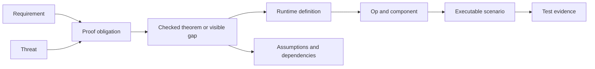

# Quiet Lean Requirements for Ops and the Development Workspace

Quiet Lean will be organized as a tree of op families with predictable source locations, components that own their queries, local navigation and draft state, and an interactive development overview at every source family and component level.

The development workspace will be accessible on the public website and will execute supported scenarios through WebAssembly using the same Lean application logic as the native app. Visitors and engineers will be able to navigate from a rendered component to its ops and validation, from a requirement or threat to its proof obligations, and from a proof to the actual definitions and scenarios it concerns.

This is a requirements specification. **MUST** identifies an acceptance requirement; **SHOULD** identifies a preferred behavior whose exceptions must be recorded. New capabilities and proof coverage described here are requirements for delivery. Existing coverage must be established from the checked implementation and its artifacts.

## Architecture and ownership requirements

**ARCH01 — Canonical family tree.** Every application op MUST belong to one canonical family tree. Dotted names such as `message.reaction` identify nodes in that tree. Nodes may own an op, group child families, or provide an op-less component. Parent registration MUST compose immediate children through ordinary functions.

**ARCH02 — Local ownership.** An op's definition, validation, construction, queries, components, editors, tests, and proofs MUST have predictable locations within its owning node. A component SHOULD receive entity IDs and perform its own queries. Parents assemble child components and query results through explicit interfaces.

**ARCH03 — Downward application dependencies.** A family MAY depend on its own files, its descendant families, and the ops it cites (its ancestors, LAYOUT03). Cross-family assembly MUST live at the nearest common ancestor that owns its concrete dependencies. A fixed lower layer of engine, platform, rendering, and UI primitives MAY be used by all families. This lower layer MUST have no dependency back into application families. The import checker MUST enforce these categories.

**ARCH04 — Dependency references and source imports.** Op requirement edges and source imports MUST remain distinct concepts. An op may require an already validated op of another kind. Registration MUST supply the required fact types and bindings without requiring a child implementation to import its ancestor's assembly module. The first message and reaction extraction MUST demonstrate this property in compiling Lean code.

**ARCH05 — Existing validity boundary.** The engine MUST preserve its current rule: an invalid requirement makes the dependent op invalid; undecided requirements keep it unresolved; only when every requirement is valid does its validator receive the corresponding facts. The receiving validator MUST check the expected fact kinds and relationships, such as the same community, and validate its own body and authority. It MUST NOT repeat the target op's validation merely because that target is a dependency. Queue wakeup alone is not proof that the dependent op itself is valid.

**ARCH06 — Screen and proof placement.** A screen MUST live at the deepest composition level that owns its concrete dependencies. Individual editors SHOULD remain with their component and use a mobile-style single task per screen. A proof MUST live at the deepest level that owns the definitions it relates. Cross-family composition theorems belong at their composition ancestor.

**ARCH07 — Headless composition.** Engine registration and validators MUST be usable without importing UI, development editors, or scenario tooling. Screen and overview registration MUST follow the same family structure through separate entry points.

Acceptance requires the message and reaction family to register, validate, query, render, and run its local proofs and tests without application-root imports in the child implementation. Shared dependency bindings must expose the existing engine facts and must not create an additional source of authority.

## Canonical names and strict source layout

**LAYOUT01 — One folder per op.** Every op type MUST have its own folder under `app/`. An op nests under the op it cites: a reaction under the message it is on, an approval under the request it approves. A folder that groups ops without being one (`member/`, `connection/`, `sync/`) is a family. The canonical name is the path below `app/`, dotted: `community.channel.message.reaction`, `sync.rbsr`. Module names are paths, as everywhere on main (`app.community.channel.message.reaction.Op`).

**LAYOUT02 — Eight file names.** Nothing else lives under `app/`.

| File | What it holds |
| --- | --- |
| `Op.lean` | The op: its body, its fact, their codecs, the relations its fact is filed in, scope and claimed time |
| `Validate.lean` | The validator: what the op requires, and the fact it produces from them |
| `View.lean` | The component for this op's fact; it reads only its own fact |
| `Commands.lean` | Intents and responders (LAYOUT03) |
| `Screen.lean` | Components that compose several ops (LAYOUT03) |
| `Proofs.lean` | Laws (LAYOUT03) |
| `Tests.lean` | Tests of the ops in this folder |
| `Family.lean` | The registry: this folder's op, then each child folder's registry, as plain functions |

Every op folder MUST have `Op.lean`, `Validate.lean`, `Proofs.lean` and `Tests.lean`; `View.lean` when its fact is drawn. A folder with child folders MUST have `Family.lean`. Whether a file exists is never a choice: it follows from these rules and LAYOUT03.

**LAYOUT03 — Placement by what a declaration names.** A law, command or screen MUST live in the common ancestor of the deepest ops it names. A folder sees its own subtree and the ops it cites (its ancestors); siblings meet at their common ancestor. So `message_authorized` (a message and its author's admission) lives in `message/`, `check_request` in `request/`, and a law over reactions and attachments in `message/`. This refines [LAYOUT.md](LAYOUT.md)'s rule, "a law that spans domains lives in the smallest module that imports everything it mentions", to one folder per op.

**LAYOUT04 — The workspace draws the tree on disk.** [`plan.py`](../tools/workspace/tools/plan.py) reads every tracked file under `app/` and [`layout/tree.json`](../tools/workspace/layout/tree.json), which gives each folder its summary and preview and names the planned ops and families; it names no code. A file LAYOUT02 requires that is not on disk is planned. It writes the [op tree](OP_TREE.txt). Its tests MUST check that every file under `app/` appears exactly once with its contents, every folder is on disk or planned, every planned file is absent and required by LAYOUT02, and every file has one of the eight names. The workspace sidebar MUST be this tree, beside `engine/` and `platforms/`.

**LAYOUT05 — Stable identities.** Canonical names MUST match registry identity, source location, workspace address and diagnostic labels. Wire tags, codec bytes, persisted IDs and public URLs MUST be explicitly defined. Moving source files MUST NOT change them.

**LAYOUT06 — Enforced layout.** A named CI task MUST reject unknown file names under `app/`, an op without its folder, duplicate registrations, imports that break LAYOUT03, and a missing `Family.lean`. Code that names a kind MUST NOT stay in `engine/`. `ci/layout.py` (`mise run layout:check`, `ci/local.sh layout`) does: eight names, an op folder with its validator, each family's `Family.lean` registering every op below it, imports down the tree or up to ancestors (a validator also to the `Op.lean` of each op it cites), across families only connection to community, and no engine module importing `app/`; one negative control per rule.

## Ownership map

The tree is on disk: [OP_TREE.txt](OP_TREE.txt) lists every folder and file, with planned ones marked. Its top level:

```text
app/            the root: the node's registry (Family.lean), the node's hooks and the app's live data (Commands.lean), the app (Screen.lean), laws over both (Proofs.lean)
  community/    the root op and its family; under it name/, profile/, key/wrap/, device/, member/, channel/message/
  connection/   the handshake and sessions: eph, request, opened, connection, established, send, recv, given
  nav/          planned: navigation as an ephemeral op
  settings/     this device's preferences, each a local op: appearance/
engine/         what holds for every op type, sync and the Merkle tree among it
platforms/      the shells and the headless twin
```

Planned ops (`channel`, `draft`, `emoji`, `nav`) are marked as planned in the tree and in the workspace. Existing ops keep their tags and codecs: the wire golden test (`tests/engine/WireGolden.lean`) pins every op type's bytes, ids and verdicts to main's before the cutover.

### Recorded exceptions

Where the tree departs from these requirements or from the planned tree, and why:

- **`Family.lean` only at a family's root** (`community/`, `connection/`), not at every folder with children (LAYOUT02). A family's registry is one closed Lean sum of its ops' facts and bodies, with the codec and validator dispatch; an intermediate folder (`member/`, `channel/message/`) adds no op to it.
- **`Tests.lean` planned.** Each op's tests are still the parts' suites in `tests/` (LAYOUT02); the tree marks every op's `Tests.lean` planned.
- **Sync is in the engine** (`engine/sync/`), not `app/sync/`: hello, round, have and want hold for every op type and name no kind (LAYOUT.md's rule).
- **A device's keys are community ops** (`community/device/secret`, `community/device/endpoint`), not a top-level `device/` family: their bodies are Community body constructors, cited by community ops.
- **The connection family is flat.** Established cites the reply, the request and the ephemeral key, which do not nest in one chain; each validator imports the `Op.lean` of the ops it cites (ARCH04), and connection's family is over the community's facts too.
- **Admit nests under approve** (`member/invite/request/approve/admit`): an admission cites the approvals it tallies. Authority as dependencies (an admin action citing its grant, no tally) is [issue #6](https://github.com/holmesworcester/lean-quiet/issues/6).
- **Views hold their laws.** A `View.lean` or `Screen.lean` keeps the laws about its component beside it ([LAYOUT.md](LAYOUT.md)): the laws' modules are above the live data and the renderer, which the family's `Proofs.lean` is below.
- **The root's `Screen.lean` is the whole app shell** (the former `App`, `AppTypes`, `AppLife` and the reader, pages and lifecycle), and the bootstrap model is a section of `community/Proofs.lean`: each source file is a section of its new file, with its own opens and variables.

## State components settings and emoji

**STATE01 — Unified application state.** Shared content, local preferences, navigation, drafts, and preloaded metadata MUST be represented by ops or by an explicitly defined in-memory working overlay of that op state. Queries MUST have a defined precedence and invalidation model across seeds, committed ops, pending writes, and working drafts. Disposable render caches, decoded images, and operating-system handles are derived or external resources.

**STATE02 — Independent lifetime and transport.** Shared, device-local, session, and seed behavior MUST be explicit policies. The engine already distinguishes local and shared transport scope; session overlays and seed behavior require explicit implementation. Local navigation, drafts, and secrets MUST never be offered to or accepted from peers. Seed records MUST originate from a versioned application bundle or an explicitly validated upgrade; peer data MUST NOT gain seed authority merely by claiming a builtin name. Retention and supersession MUST be specified independently of transport.

**UI01 — Op-less primitives.** Text fields, buttons, layout containers, and other primitives MAY own no op. They receive values and return events. Their enclosing editor or component owns meaningful state. A draft MUST accept incomplete input; submission validation determines whether it can produce a valid domain update. Each primitive MUST have its own interactive overview and behavioral tests.

**SETTINGS01 — Query-driven settings.** Settings screens MUST render ordered queries of sections and entries. Each entry identifies its value query, constraints, display component, and typed editor destination. Builtin settings metadata MUST be seeded with stable identities and a versioned upgrade rule. Overrides MUST have defined precedence and scope. Op data selects compiled component and editor types; it does not introduce executable application code.

**EMOJI01 — Unified catalogue.** Builtin and custom emoji MUST be visible through one query surface. Builtin definitions MUST have deterministic identities and metadata. Any client authorized by the community's emoji creation policy MUST be able to add a custom emoji. Received additions MUST pass the same validation boundary as locally created additions.

**EMOJI02 — Stable references and component ownership.** Message content and reactions MUST resolve emoji through the emoji component's own queries. References MUST survive shortcode or display-name changes. The catalogue MUST specify deterministic handling of colliding names, unavailable assets, deleted or superseded definitions, Unicode variants, and asset integrity. Per-component query ownership MUST support batching and shared subscriptions rather than repeated storage reads for every visible instance.

**EDIT01 — Local editors and onboarding.** Editors MUST live beside their component and normally show one editing task at a time. Onboarding MUST compose these editors and create, update, supersede, or abandon draft and domain ops as the user navigates. Returning to an earlier step MUST reuse the existing entity or draft identity. Back navigation MUST NOT implicitly undo a published action; cancellation semantics must be explicit.

## Theme and appearance requirements

**THEME01 — Local appearance preference.** The device-local `settings.appearance` op MUST select `system`, `light`, or `dark`, defaulting to `system`. Its value query and editor MUST belong to `app/Settings/Appearance/` under the canonical role-file rules, and its settings entry MUST use the normal queried settings list. The preference MUST survive restart and remain independent across clients.

**THEME02 — Resolve once and propagate.** The platform host MUST observe OS appearance through one shared adapter per host, rather than each component installing its own observer. An appearance query MUST combine that external input with the local preference: `system` follows OS changes, while an explicit `light` or `dark` choice takes precedence. The host MUST pass the resolved theme through the rendering context and update mounted components when it changes. OS observations are external inputs; the resolved theme is derived state. Neither requires a persisted op on every OS change. The shared theme interface MUST live in the lower UI/rendering layer without importing application settings or parent families, so op-less primitives can consume it.

**THEME03 — Shared colors and local styling.** Light and dark themes MUST supply a small shared palette of semantic tokens, initially `background`, `surface`, `text`, `mutedText`, `accent`, `border`, and `danger`. Components MUST use these tokens for common theme-dependent colors and retain ownership of their layout, styling, and token placement. Component-specific colors MAY remain local with explicit behavior in both modes. Engineers MAY edit multiple components directly for a design change; shared tokens provide consistent palette changes without requiring all styling to move into a global system.

**THEME04 — Workspace previews.** Every component overview MUST support light and dark previews independently of the visitor's OS setting, including side-by-side light and dark presentations of the same component and fixture. These presentations MUST share the selected client’s state and MUST NOT create independent clients or duplicate operations. The component previews MUST NOT add visible theme labels, client-name headings, or per-preview theme selectors; accessible names MAY distinguish presentations. Full app screens MAY stack on narrow viewports to preserve legibility. Simultaneous multi-client comparison belongs only in the top-level `network` view. Theme definitions and local component styling MUST participate in inline editing and live feedback. Scenarios MUST be able to inject OS appearance changes and control each simulated client's preference independently through the same appearance resolution path. Preview overrides MUST be inspectable, scoped to the preview, and leave the visitor's actual app preference unchanged.

## Draft persistence requirements

**DRAFT01 — Editing session ownership.** Drafts MUST belong to an editing session and stable entity or draft ID. A field remount, layout change, or navigation into a child editor MUST NOT accidentally create a second draft or discard the first. Independent windows and editors MUST have explicitly separate or explicitly shared draft ownership.

**DRAFT02 — Checkpoints.** Typing MUST update the working value immediately. Durable draft ops MUST checkpoint that value when leaving the editing session, on an app background signal, and through a debounced write policy with a maximum dirty interval. Teardown SHOULD request a final checkpoint, but correctness MUST NOT depend on teardown running after a crash.

The initial proposed timing is five seconds idle or fifteen seconds continuously dirty. These numbers are tunable policy, not an existing performance guarantee. A crash may lose changes since the last completed checkpoint. The overview MUST make the dirty value, pending checkpoint, and last durable revision observable.

**DRAFT03 — Ordering and closure.** Checkpoints MUST carry a session identity and revision. A delayed older write MUST NOT overwrite a newer draft, and a delayed checkpoint MUST NOT resurrect a draft after Send, Save, or Discard. Duplicate checkpoint requests MUST be harmless.

**DRAFT04 — Submission durability.** Submission MUST preserve recoverable content until the domain write or durable send intent is accepted. Recording that intent and closing the draft MUST be atomic or recoverably idempotent. A failed submission MUST leave recoverable content. Route exit MUST hand the latest snapshot to a writer that outlives the component and retain recoverability if persistence fails.

Acceptance scenarios MUST cover navigation away and back, continuous typing, backgrounding, restart after a completed checkpoint, failure during a pending checkpoint, overlapping editor instances, and an old checkpoint completing after Send or Discard.

## Routing linking and screen composition

**ROUTE01 — Declarative navigation.** The application MUST provide typed destinations, declarative links, nested screen outlets, and local navigation state. A link describes a destination without importing the destination screen implementation. Parent composition supplies cross-family link builders where required by the downward import rule.

**ROUTE02 — Destination identity.** Destination contracts MUST use stable content IDs. Public application links MUST remain independent of directory layout. Examples are `quiet://community/C/profile/U` and `quiet://community/C/message/M`. These are proposed formats; parsing, escaping, and version behavior require explicit tests.

**ROUTE03 — Container ownership.** Each navigation container MUST own its active destination, pending request, and history through local state. History MUST preserve full destinations and relevant restoration state, including entity IDs, thread context, editor identity, and scroll anchors. Navigation MUST be scoped per client and window. Phone flows SHOULD show one editing screen at a time; desktop layouts MAY render multiple outlets from the same destination model.

**ROUTE04 — Shared resolution.** Internal links, notifications, and external deep links MUST enter the same destination resolution path. The resolver MUST check context and access, retain pending destinations while required data arrives, and expose loading, unavailable, deleted, and inaccessible outcomes. Merely opening a link MUST NOT publish an application action.

**ROUTE05 — Message reveal.** Resolving a message MUST discover its conversation or thread context, load a query window around the target ID, mount it, and reveal it. Opening only the newest list page is insufficient. The target relationship MUST be validated against actual op facts, even when the URL includes channel or thread hints.

**ROUTE06 — Cancellation and history policy.** Every pending navigation request MUST have an identity or generation. A stale resolver completion MUST NOT redirect a user who has moved elsewhere. An in-app link may push a return entry; a notification may preserve the current screen; a cold launch must create a sensible parent path. These policies are inputs to navigation and do not change content identity.

**ROUTE07 — Editor transitions.** Leaving an editor MUST coordinate draft checkpointing. Save and Cancel outcomes MAY be interpreted by the enclosing flow. Repeated opens and Back operations MUST have defined idempotency and restoration behavior.

Acceptance MUST include a profile link from a message, a notification to an old unloaded message, a thread-to-channel link followed by Back, navigation away before sync completes, and an unknown or unauthorized community. Typed routes and nested outlets follow the general model illustrated in [React Router routing](https://reactrouter.com/start/declarative/routing) and [link navigation](https://reactrouter.com/start/declarative/navigating); Quiet's persistence and validation requirements are specific to this specification.

## Interactive development workspace

**DEV01 — Overview at every level.** Every source family and component node MUST expose a web-navigable overview. The root MUST aggregate the complete family tree. Each parent overview MUST list its immediate children and show their integration, while each child remains independently usable with explicit fixture inputs. A component overview MUST default to the component in isolation, with an explicit link into its containing screen or composition. Moving between isolated and contextual views MUST retain the inherited scenario and client state.

The workspace's primary subjects MUST be op themes/families and individual ops. The `Community/Channel/Message` nesting remains the ownership structure; this requirement does not flatten the tree into screen categories. Root and family documents MUST lead with their contained ops, including proposed local ops. An op owner may also group nested ops. Supporting component-only nodes and fixed role files MUST remain discoverable without replacing the op document with a file inventory.

Opening an op MUST expose its identity, required facts, produced facts, validation, associated components, and evidence together. A required fact MUST link to its producer ops, including multiple producers where applicable. These fact references MUST NOT be presented as source imports or proof of authority. `Op.lean`, `View.lean`, and `Proofs.lean` MUST open the corresponding content for that same owner, preserving the scenario and selected client. Native source imported for design reference MUST retain its pinned revision and remain distinct from browser-executed code and checked browser proofs.

**DEV02 — Working space for engineers.** The overview MUST let an engineer render the real components, interact with them, inspect validation, inspect their queries and local state, edit relevant source, rerun scenarios, and inspect proofs without leaving the workspace. Opening an external editor MAY be supported, but MUST NOT substitute for the required inline editing workflow.

**DEV03 — Observable execution.** Selecting a rendered element MUST identify its owning component, canonical op family, entity IDs, query instances, and source location. The inspector MUST show submitted ops, requirement IDs and verdicts, produced facts, query invalidations, pending writes, and resulting rendered changes. An op-less field MUST link to its owning editor state and its own source and tests.

**DEV04 — Required workspace surfaces.**

| Surface | Required behavior |
| --- | --- |
| Family browser | Hierarchy, search by dotted name, breadcrumbs, direct links |
| Rendered preview | Actual component interactions, viewport controls, focus and input |
| Op and query inspector | Dependencies, verdicts, facts, subscriptions, working and durable state |
| Validation editor | Actual validator source, diagnostics, scenario rerun, changed verdicts |
| Scenario controls | Seed, participants, delivery schedule, reset, step, replay, capture |
| Requirements and threats | Local and inherited records, coverage and unresolved obligations |
| Proof explorer | Statements, assumptions, source, goals where available, checked status |
| Source browser | Definition and reference navigation with links back to previews and evidence |

Each op overview MUST present its component, state, relevant source, and proofs as one coherent scrollable stack. The overview MUST NOT duplicate proof evidence in a right sidebar. These surfaces MUST NOT be separated into mutually exclusive tabs. Section links MUST support direct URLs, reload, and browser history. Navigation between sections and contexts MUST preserve the current scenario and selected entity unless the user explicitly resets or switches it.

The workspace MUST be an IDE and technical reference for the actual implementation, with compact navigation and emphasis on source, input/output contracts, dependencies, queries, validation, and evidence. Every page MUST identify its running target and distinguish it from native-only code and proposed ownership. A component MUST NOT inherit unrelated source, state fields, or proof claims merely because a common page template exists. The shell MUST support light and dark modes using black and white only; rendered component content and syntax-highlighted code MAY use their own colors. Source views and inline editors MUST use language-aware syntax highlighting that follows the selected mode. The mode control belongs in navigation, without a separate workspace title bar. The shell MUST NOT use cards or enclosing boxes; hierarchy MUST use headings, spacing, and dividing lines where necessary. Labels and expository text SHOULD be limited to what is needed to identify or use the content. Repeated descriptions, slogans, decorative checkmarks, and redundant status labels MUST be omitted. Default to removing a label unless it helps identify or operate the content. Proof assumptions, implementation gaps, and source/runtime distinctions MUST remain discoverable; secondary explanations MAY be placed in expandable details.

**DEV05 — Real source and controlled rebuilds.** Developer mode MUST edit the canonical files in the attached worktree. After an edit, the workspace MUST compile affected code and check affected proofs, exposing progress and errors. Lean module replacement MAY use a new worker or runner process; instantaneous mutation of a running native binary is not required.

**DEV06 — Replay after semantic changes.** A validator change MUST trigger replay from seed ops and the captured scenario history into a fresh scratch store. Previously accepted facts MUST NOT be reused as if validated by the new code. Rendering-only changes MAY preserve compatible scenario state. The workspace MUST distinguish the currently edited revision, the running build, and the revision last checked by proofs.

If a rebuild fails, the last working preview MAY remain available with its actual revision visible. It MUST NOT appear to be running the failed edit. Outdated proof results MUST become stale immediately.

**DEV07 — Scenario capture.** Engineers MUST be able to turn an interaction and delivery trace into a named reproducible scenario owned by the relevant family or composition ancestor. The capture MUST include seed identity, logical time, relevant randomness, user actions, op delivery, and expected observations. The same scenario definition MUST be executable in CI.

**DEV08 — Application fidelity.** Preview rendering and behavior MUST use the production component and validation implementations. A hand-written web imitation does not satisfy this requirement. Browser host adapters MAY implement input, clipboard, timers, and drawing surfaces through the same platform interface. Screenshots alone do not satisfy interactive preview requirements.

Acceptance requires changing a real reaction or emoji validator inline, observing the changed result in a rendered scenario, seeing affected proof results become stale and then checked or failed, and navigating directly to the affected source definitions.

## Fixture inheritance and multiple clients

**SCENARIO01 — Explicit inherited context.** A root scenario MAY establish a community, identities, admission, and content. Parent scenarios MUST pass typed fixture handles and capabilities down to children. A child MUST NOT import its parent's setup module or silently depend on a global database. Fixture origin and overrides MUST be visible.

**SCENARIO02 — Realistic data paths.** Fixtures SHOULD create valid state through real op constructors, validators, and ingestion. Deliberately invalid, missing, malformed, or out-of-order data MUST be explicit scenario inputs. Directly fabricated projection rows MUST be identified as a specialized fixture and MUST NOT be used as evidence for end-to-end behavior.

**SCENARIO03 — Independent clients.** The tree MUST expose top-level `network` and `app` views. Only `network` MUST render the community with multiple interactive clients. `app` and ordinary component documents MUST show one selected client, including its local inspector state; they MUST NOT repeat the multi-client simulator or its transport controls. Opening a client from `network` MUST carry its identity and scenario state into `app` and descendants, and returning to `network` MUST preserve all clients and queued delivery. Each client MUST have separate identity, local storage, navigation, drafts, pending writes, and query caches. One client changing a local setting or route MUST NOT change another's local state.

**SCENARIO04 — Delivery controls.** The workspace MUST support deterministic delay, reordering, duplication, partition, reconnect, and restart. Engineers MUST be able to step delivery and see how one client's action affects another. Delivery MUST use the real op intake and sync boundary where that boundary is under test. A simulated transport MUST be labeled and must not be presented as proof of native TCP, relay, or operating-system behavior.

**SCENARIO05 — Browser execution and isolation.** Multiple clients MAY run in separate workers or isolated runtimes within one visitor session. Visitors MUST have isolated fixture communities by default; interacting with the demonstration MUST NOT join or mutate a live user community. Explicit cross-tab scenarios MAY be provided.

**SCENARIO06 — Reproducibility.** The same seed and controlled action/delivery trace MUST produce the same relevant facts and assertions on native and browser targets, subject to documented platform observations. All clients MUST use the same selected build generation unless the scenario intentionally tests version mismatch.

A required root scenario is: Alice adds a custom emoji; Bob receives it and posts a message using it; Alice opens the message through a notification, follows its author link, edits her own profile, returns to the message, and observes updates. A partition variant delays Bob's data, and a crash variant checks the editor's durable draft.

## Public website and WebAssembly requirements

**WEB01 — Public navigation.** Visitors MUST be able to open the workspace from the project website without installing developer tools or signing in to browse. Family, component, scenario, requirement, threat, proof obligation, theorem, and source definition pages MUST have direct URLs. Reload, copied links, browser Back and Forward, and navigation into nested content MUST work.

Suggested route shapes include `/dev/ops/message.reaction`, `/dev/threats/cross_community_reference`, `/dev/obligations/reaction.sameCommunity`, and `/dev/symbols/Quiet.Message.Reaction.Op.validate`. The hosting prefix is configurable. Links MUST support a pinned build or revision so an archived proof remains associated with its actual source.

**WEB02 — Browser execution.** The public workspace MUST support executing representative validators, queries, components, and multi-client scenarios through WebAssembly built from the same Lean implementation used by the app. Browser code MUST NOT duplicate domain validation or projection logic in JavaScript. The inspector shell may use ordinary web technology.

**WEB03 — Portability boundary.** Native-only filesystem, socket, timing, cryptographic, threading, and SQLite dependencies MUST be isolated behind target-specific adapters. Browser scenarios MUST have a deterministic transport and usable storage implementation. A native/browser parity suite MUST exercise the same op bytes, verdicts, query results, and interaction outcomes. Any substituted adapter MUST be identified in the scenario and linked to its tests and trust assumptions.

The current build depends on native libraries, LeanSQLite, and platform externs. A browser target is therefore a delivery requirement with a portability validation milestone. The C and JavaScript interfaces described by [Emscripten](https://emscripten.org/docs/porting/connecting_cpp_and_javascript/Interacting-with-code.html) provide one candidate integration path; the compiler and runtime selection remains an implementation decision subject to these acceptance tests.

**WEB04 — Responsive execution.** Compilation, proof checking, replay, and multiple client runtimes MUST NOT block navigation in the workspace shell. Long-running work MUST expose progress, cancellation, and explicit resource limits. The site MUST report missing browser capabilities and preserve access to source, requirements, threats, and checked evidence when execution is unavailable.

**WEB05 — Developer and visitor modes.** Developer mode MUST support inline edits to an authorized local worktree. Visitors MUST be able to browse, run, and manipulate seeded scenarios. A visitor editing experience SHOULD support an isolated temporary fork or download of changes; it MUST NOT write to the project repository or change published proof status. A remote compilation or proof service, if used, MUST run untrusted code without project credentials and with bounded resources.

**WEB06 — Proof browsing and checking.** Public visitors MUST be able to inspect checked statements, proof source, dependencies, assumptions, and source targets without a local Lean installation. Running the Lean elaborator and checker entirely in the browser is desirable but is not required for initial delivery. Precomputed proof information or a sandboxed checking service MAY supply proof exploration. A simulated validator result MUST NOT be displayed as a checked proof.

**WEB07 — Separate histories.** The public workspace's browser history MUST be distinct from each simulated client's application navigation history. A visitor must be able to use Back within a simulated app and independently return from a proof page to the component overview that opened it.

**WEB08 — Accessibility and provenance.** The workspace shell MUST support keyboard navigation, readable text, non-color status indicators, and usable narrow layouts. Rendered previews MUST expose accessible interaction semantics through the browser host where needed. Each public build MUST identify its source revision, toolchain, browser adapters, scenario version, and proof report. Assets and reports from different revisions MUST NOT be silently mixed.

Acceptance requires opening a copied nested proof URL in a clean browser, following it to its validator and live component, running a two-client scenario in WASM, and retaining readable evidence if the runtime cannot start.

## Proof exploration and traceability

**PROOF01 — Proofs of running definitions.** Correctness claims MUST target functions used by the application or a simpler core that the application actually calls. A parallel abstract model MAY explain a design, but MUST be labeled as a model and MUST NOT be counted as a proof of running behavior without a checked connection to that behavior.

**PROOF02 — Local proofs and composition.** Proofs MUST follow family ownership. An op-level theorem may rely on the engine's valid-dependency contract and explicit assumptions. The composition owner MUST establish the bindings needed to apply those theorems to the real family registration. A source-layout convenience MUST NOT introduce an unchecked trust boundary.

**PROOF03 — Navigable proof pages.** Every proof obligation and implemented theorem MUST have a page showing its plain-language claim, exact statement, checked status, assumptions, source, and the runtime symbols it concerns. Visitors MUST be able to navigate into definitions appearing in the statement, premises, conclusions, and proof body. Types, constructors, helper lemmas, and transitive theorem dependencies MUST be inspectable.

The overview MUST have one **Proofs** section, grouped by relevant concern: **Validation** before **Rendering**, with additional groups when needed. Each group MUST list **Assumed:** before **Proven:**. Shared trust boundaries MUST be navigable through **Standard assumptions**, with local assumptions stated at their owning group. Proven entries MUST name the theorem, offer expandable code, and link to the exact definitions they cover. Concrete scenario outcomes belong with state and MUST NOT appear as proof status indicators. Missing rendering proofs MUST remain explicitly uncovered; pixel tests are not proofs.

**PROOF04 — Proof steps and operated-on objects.** For tactic proofs, the workspace MUST expose available elaborator information such as goals and local hypotheses at selected source positions. For term proofs, it MUST expose the term and its type. Selecting a runtime definition MUST reveal its source, schema or inputs, related op and component, relevant scenarios, and the proofs that mention or establish properties of it. Selecting an op instance in a scenario MUST link to its kind and applicable proof obligations while keeping concrete test observations distinct from universal claims.

**PROOF05 — Bidirectional evidence graph.** Requirements, threats, proof obligations, theorems, runtime symbols, op families, components, scenarios, and test results MUST have stable identifiers and bidirectional links. At minimum the graph MUST support the following paths:



The UI MUST allow traversal in either direction. A developer can start at a reaction pill and reach its validator and proofs; a visitor can start at a threat, inspect its missing obligation, open the relevant function, and run the attack scenario.

**PROOF06 — Evidence records.** The generated index MUST retain canonical IDs, owner, claim, target symbols, theorem names, assumptions, requirement and threat links, scenarios, source/dependency hashes, toolchain, check command, check result, and report location. Requirement and threat declarations belong in their fixed local files and aggregate at the root. The graph MUST be generated and checked from these declarations and build artifacts rather than maintained as an unrelated hand-written diagram.

**PROOF07 — Completion criteria.** A proof may be marked completed only when the named theorem checks for the displayed source and dependency revision, targets the stated implementation, and passes the project's axiom policy. The report MUST identify assumptions and trusted boundaries. It MUST reject `sorry` or equivalent admitted results as completed proofs. Lean exposes theorem axiom dependencies through `#print axioms`, which is one input to this check. [Lean interactive commands](https://lean-lang.org/doc/reference/latest/Interacting-with-Lean/)

| Proof state | Meaning shown to the reader |
| --- | --- |
| Unassessed | No verified inventory has established the obligation or evidence yet |
| Planned | An explicit obligation exists; no checked proof completes it |
| In progress | Proof work exists but the obligation is not yet established |
| Checked | The theorem passes for the displayed revision and stated scope |
| Failed | The current check fails, with diagnostics |
| Stale | Previous evidence exists but does not match the displayed code or dependencies |

Partial coverage belongs to a requirement or threat: some associated obligations are checked and others remain open. Assumptions and out-of-scope properties MUST appear separately. A theorem checked under a cryptographic assumption MUST NOT imply that the cryptographic implementation itself has been proved.

**PROOF08 — Change sensitivity.** Changes to a target, dependency, assumption, binding, or toolchain MUST invalidate affected evidence until rechecked. Published immutable revisions MAY retain their historical evidence. The development workspace MUST distinguish an edited local fork from published results.

**PROOF09 — Honest coverage.** Root and family summaries MUST distinguish implementation status, tests, proof coverage, and assumed properties. The number of checked theorems alone MUST NOT produce a claim that a feature or threat is fully covered. Every claimed property MUST identify the exact obligations used to support it.

Acceptance requires a visitor to follow a threat into both a completed theorem and a planned obligation, inspect a theorem's hypotheses and target definition, open its associated component scenario, and navigate back without losing the selected scenario. A source edit must make the corresponding evidence visibly stale.

## Threat model requirements

**THREAT01 — Adopt the approved Auditician model.** The normative baseline MUST be the owner-approved Quiet client 9.0.0 invariant-centric threat model from the Auditician run in `TryQuiet/quiet-private`, including its approved review decisions. The source was approved on 2026-08-31 and clarified on 2026-09-01. Its original invariant IDs and qualifiers MUST be retained. Its guarantees are requirements, not claims that either the audited client or Quiet Lean satisfies them.

The source documents are the [Auditician threat model](security/auditician/THREATMODEL.md) and [approved review decisions](security/auditician/ICTM-REVIEW-DECISIONS.md), pinned at audit commit `3a168fb7a36d4c0179b7e9f8f9b60afc803cbea9`. The source documents and associated user and Quint invariant inputs are retained with [provenance and checksums](security/README.md). A generic list of security topics MUST NOT replace this model.

The model includes colluding NETWORK, OUTSIDER, INVITEE, MEMBER, REMOVED, ADMIN, QSS, and LOCAL adversaries. LOCAL includes partial access to persisted files, logs, backups, IPC, or notification inputs without full control of the trusted client process. Assuming an uncompromised operating system MUST NOT exclude this partial-local attacker. Full trusted-endpoint compromise and total suppression of every honest communication path remain explicit limits.

**THREAT02 — Preserve invariant identities and local ownership.** Each original invariant MUST be addressable as `ICTM.A1`, `ICTM.A2`, and so on through the source's A–I families. Each MUST map to the owning Lean families, implementation targets, scenarios, proof obligations, assumptions, and remaining gaps. Cross-family properties belong at the relevant common ancestor, and the root overview MUST aggregate the full model.

| Original family | Required meaning to preserve | Lean evidence and navigation targets |
| --- | --- | --- |
| A1–A6 | Authenticity, identity and context binding, domain separation, replay resistance, verified displayed authorship | Op decoding and validation, identity bindings, message/profile/notification views |
| B1–B5 | Complete action-specific mediation, no general self-grant, scoped key authority, server/user separation, converged removal | Community policies, every action path, key distribution, connection eligibility |
| C1–C8 | Invitation and exact device possession, durable admission before secret release, owner-bound device linking, QSS-only preauthorized admission | Join and device families, acceptance transaction, server assistance and recovery |
| D1–D7 | Convergence, progress, consistent grant/use decisions, atomic graph/auth/key state, pending authorization and recovery | Engine transitions, persistence, ingestion and replay; D6 waiting scenarios |
| E1–E6 | Promised history and keys, recipient confinement, future exclusion, key generations and least-privilege secrets | Key management, historical keys, removal, logs, storage, backups |
| F1–F11 | Application confidentiality and full binding, private-channel membership consistency, profiles, notifications, files, user-created metadata | Content families and every rendering, notification, storage and export path |
| G1–G7 | Malicious QSS safety, narrow server authority, authenticated connection context, equivalent native notifications, version failure | Relay/server adapters, connections, notifications, protocol negotiation |
| H1–H5 | Safe restore, bounded malformed input and hostile cost, usable positive controls, authenticated local commands | Storage, resource budgets, host bridges and positive-control scenarios |
| I1–I7 | Transport possession is not membership; intended network boundary, application identity, content-addressed bytes, consistent ingestion and recovery | Lean transport/sync equivalents and explicitly recorded changes from the old stack |

The workspace MUST preserve the following approved policy details: removal converges to loss of connectivity, newly accepted write authority, and replacement keys, with no retroactive erasure or backdating/concurrent-content rejection promise; D6 forbids surfacing or using content before its required authorization is available; every current admin participates in every private channel and gets its full history, with authenticated membership, display, authorization, and key delivery agreeing; admins have no implicit DM access; private-channel membership changes are admin-only; account/device recovery and key management remain owner-bound; the sole self-grant is the exact invitation-preauthorized grant during admission.

All user-created fields, including names, profile text, filenames, file metadata, messages, and previews, MUST remain confidential from QSS and other third parties under E/F/G. Protocol and traffic metadata are outside that confidentiality promise. Push infrastructure receives a wake-up free of user-created content; a trusted device authenticates and decrypts locally, then displays at least the verified author and channel. Locked-screen visibility follows OS settings. Breaking major protocol versions fail closed.

**THREAT03 — Derived coverage and unfinished proofs.** The status for each original invariant MUST come from the shared evidence index. The original audit's prose, source-anchored analyses, regression probes, and findings MUST NOT be relabeled as completed Lean proofs. A checked theorem covers only its stated property and assumptions; the parent invariant remains partial while other obligations are open. Planned, failed, stale, unassessed, and out-of-scope items MUST remain visible and navigable.

Every invariant MUST have a recorded applicability disposition: applies now, planned feature, policy divergence requiring reconciliation, or architectural replacement with a documented equivalent or exclusion. An unimplemented feature is not a passed invariant. A new transport does not automatically inherit the original Tor/libp2p/OrbitDB guarantees. Changed wording MUST retain a link to the original ID and rationale.

**THREAT04 — Reconcile Lean policy explicitly.** The imported model describes its historical audit target. Applying it to Lean MUST preserve its security objectives while exposing actual policy differences rather than silently changing either document. In particular, audit C3/C8 and review decision 9 select durable Option A admission by a member or registered QSS, with no second online member and approval only as a possible later option. The inspected Lean implementation requires approvals for admission. Audit B1 makes member invitation issuance admin-only; the inspected Lean invitation validator checks an admitted issuer. These are explicit reconciliation items, not evidence of conformance and not authorization to change runtime policy in this documentation task.

Similarly, `Community.valid_stays` establishes historical validity under extension; it does not alone establish B5/D4/E3 converged exclusion from future connectivity, accepted writes, or replacement keys. Private channels, DMs, QSS capabilities, native notifications, and transport-specific guarantees MUST be marked according to their actual Lean implementation status. The audit leaves admin-demotion effects on existing private-channel participation unresolved; the specification MUST retain that question until a policy is explicitly chosen.

**THREAT05 — Attack scenarios and workspace extensions.** Each applicable invariant MUST link to realistic positive and adversarial scenarios, current implementation symbols, and its completed or unfinished proof obligations. The scenario MUST identify attacker-controlled inputs and the intended result. Proof coverage MUST never be satisfied by rejecting all honest operation, as required by H4.

New development-workspace threats MUST be separately identified as extensions to the ICTM: visitor-code isolation and bounded compilation, safe rendering of untrusted op/source content, draft checkpoint and route cancellation races, and integrity of source/runtime/proof provenance. They MUST map back to relevant ICTM principles, especially H1–H5 and A5, without replacing or weakening the approved model.

Acceptance requires a visitor to open an original invariant such as `ICTM.D6`, inspect its exact guarantee and applicability, navigate to a validator and scenario, inspect checked and unfinished obligations, and see its coverage become stale when the relevant implementation changes.

## Initial proof inventory

The baseline already contains theorem declarations useful for the first evidence index. Their presence identifies starting points; a checked report for the pinned build is required before showing a completed badge. Adapter and runtime connections must be included in that audit.

| Property area | Existing source declarations | Runtime connection and remaining assessment |
| --- | --- | --- |
| Local op intake | `Engine.intake_local` and `Engine.stored_local` in `Engine/Sync.lean` | `Engine.intake` and fed-state semantics; audit production intake wiring and browser parity |
| Shared-only offers | `Engine.offer_shared` and `Engine.run_offer` in `Engine/Sync.lean` | The actual `offer` function executed through the Store interface; retain adapter assumptions |
| Message authorship | `Community.message_authorized` and `Community.no_impersonation` in `Community/Laws.lean` | Community validation; expose the theorem's unforgeability hypothesis and spec-to-engine connection |
| Admission approval | `Community.admission_needs_approval` in `Community/Laws.lean` | Request, approval, and admission validation; preserve keyed-op and cryptographic premises |
| Historical validity | `Community.valid_stays` in `Community/Laws.lean` | Validity as the op set extends; does not establish current access or erase retained data |
| Family composition | `Engine.sum_left` in `Engine/Families.lean` | Actual `Family.sum` validation; the ownership extraction must preserve or replace this checked connection |
| Emoji picker hit testing | `SheetGeom.hit_iff` and `SheetGeom.hit_cell` in `Quiet/SheetGeom.lean` | Grid hit and drawn-box calculations; retain geometry assumptions and test host input integration |
| Viewport placement | `Geometry.visible_in_viewport` and `Geometry.pinned_tap` in `Quiet/Geometry.lean` | Geometry and input transforms; retain fitting conditions and native/browser seam tests |

New obligations MUST be created for draft checkpoint ordering and closure, route cancellation, canonical link resolution, seed upgrade semantics, custom emoji authorization and references, browser adapter parity, and proof-report provenance. They start as planned work for the new behavior.

The initial dashboard MUST distinguish these source-present candidates from the new obligations and from properties that remain unassessed, including the full scope of confidentiality and platform trust. Successful checks may promote individual obligations to checked; the broader threat stays partially covered until its other obligations are resolved or explicitly scoped out.

## Source extraction and compatibility requirements

The cutover's baseline was Lean Quiet `main` at `e727b5e`, with main merged in up to `456c4ff`; [`ci/optree-map.tsv`](../ci/optree-map.tsv) records, for every file it removed, the files its declarations are in now.

**MIGRATE01 — Preserve existing behavior during extraction.** Reorganization MUST first retain current op bytes, IDs, validator decisions, query ordering, local/shared scope, and app behavior. New navigation, draft, seed, and custom emoji semantics MUST be explicit additions. Canonical naming MUST not accidentally renumber codecs.

**MIGRATE02 — Extract real ownership.** The global op bodies, facts, codecs, validators, indexes, constructors, and laws in main's `ops/community/Facts.lean`, `Compose.lean`, `Intents.lean` and `Laws.lean` MUST move into their owning families. *Done:* each op's `Op.lean` and `Validate.lean` hold its types and validator; the family's `Family.lean` sums them and dispatches to them. A new directory containing wrappers around the unchanged global implementation does not complete ownership extraction. Aggregate dispatch may remain only as composition of owned definitions.

`ci/optree-map.tsv` lists, for every file of main the cutover removed, the files its declarations are in now.

**MIGRATE03 — Proven storage and codec continuity.** Regression suites MUST compare old and extracted behavior on realistic valid, invalid, unresolved, and reordered histories. Codec fixtures MUST prove byte and ID preservation for the extraction. Storage changes MUST include restart and migration tests.

**MIGRATE04 — Infrastructure inventory.** The browser target MUST inventory each native import and declare its browser adapter, test coverage, and remaining limitation. The current app's platform externs and the engine's native crypto and SQLite linkage MUST be included. Existing pure-model proofs MUST be connected to the executable functions and adapter assumptions they actually cover.

**MIGRATE05 — No fabricated completion.** Existing source theorems and test harnesses are useful starting points, but proof and threat dashboards MUST begin with an explicit inventory and checked reports. Current code must not be marked fully proved by inference from filenames or comments.

## Verification and continuous integration

**TEST01 — Real behavior.** Every extracted or new op MUST have realistic tests of its behavior and failure modes. Placeholder assertions and file-existence checks alone do not complete coverage. Layout tooling MUST itself be tested against invalid ownership, duplicate registration, and forbidden-import examples.

**TEST02 — Shared scenarios.** Interactive scenarios MUST run through the same application code in the workspace and automated suites. Tests MUST assert relevant ops, verdicts, query results, navigation state, and interactions. Visual assertions SHOULD supplement these observations. Native host behavior MUST retain native integration coverage.

**TEST03 — Named build and test tasks.** Every end-to-end or instrumentation suite MUST have a named Mise task that includes its build and setup dependencies. CI MUST invoke those same tasks. Proposed task names are listed below; implementation may retain existing equivalent names with an explicit mapping.

| Task | Required result |
| --- | --- |
| `check:layout` | Verify canonical ownership, role files, registration, imports, and source index integrity |
| `check:proofs` | Build proofs, enforce axiom policy, and emit revision-bound evidence |
| `check:traceability` | Verify requirement, threat, obligation, symbol, scenario, and evidence links |
| `test:ops` | Run real validator, codec, query, scope, and ordering cases |
| `test:scenarios` | Build and run deterministic component and multi-client scenarios |
| `test:native-wasm` | Build both targets and compare shared histories and interactions |
| `dev:web:build` | Build public workspace, WASM artifacts, source browser, and proof/threat indexes |
| `test:dev-web` | Build and serve the site, then run browser navigation, editing, and scenario tests |
| `dev:serve` | Start the local workspace, source editor, scenario runner, and checking services |
| Existing native E2E tasks | Build and exercise Android and iOS adapters on their documented runners |

**TEST04 — CI execution policy.** Deterministic suites, the public web build, browser tests, and evidence integrity checks MUST run in pull-request checks. Tests needing provisioned machines or external services MUST have scheduled or release coverage and manual dispatch. Runner prerequisites MUST be documented. Failures MUST propagate and retain useful artifacts.

**TEST05 — Failure artifacts.** Browser and scenario failures MUST retain the source revision, seed, action and delivery trace, relevant op bytes and verdicts, query outputs, screenshots, browser logs, and proof diagnostics. Native suites MUST retain their platform logs and screenshots. Artifact retention and access MUST be documented.

**TEST06 — Performance and cancellation.** The initial browser delivery MUST establish and record a reference device/browser, fixture sizes, startup download size, startup time, interaction latency, replay duration, and proof-check duration. It MUST define regression budgets for these measurements. Tests MUST demonstrate that long replay or proof work can be cancelled while the shell remains navigable.

**TEST07 — Accurate publication.** The public workspace artifact MUST bundle mutually consistent source, runtime, scenarios, and proof reports. CI MUST fail publication preparation when references are broken or a checked badge refers to another build. Publishing the site is a separate deployment action; authoring this specification does not perform that action.

## Required acceptance scenarios

The following scenarios are minimum acceptance criteria. Each MUST have a named fixture and automated assertions, appear in the development workspace where interactive, and link to the requirements and threat records it exercises.

| Scenario | Required observable result |
| --- | --- |
| Family discovery | Enter `message.reaction`, find its definition, validator, component, tests, requirements, threats, and proof obligations without guessing filenames |
| Validated dependencies | A reaction waits for a missing message, rejects an invalid or wrong-kind dependency, rejects a cross-community target, and succeeds with appropriate valid requirements |
| Inline validator editing | Edit the actual validator, rebuild, replay fresh state, observe changed behavior, and see dependent evidence become stale and then checked or failed |
| Fixture inheritance | Open a child overview using inherited community and identity fixtures, override one declared input, and reproduce the same result independently |
| Two clients | A shared op changes both clients after delivery, while navigation, drafts, and local settings remain independent |
| Partition and restart | Pause delivery, edit and send, restart a client, reconnect, and observe specified convergence and draft recovery |
| Profile and message links | Follow an author profile link, open an old message from a notification, reveal it, and restore the expected return context |
| Cancelled resolution | Navigate away while a deep-linked message is missing; later delivery must not hijack the new screen |
| Draft closure | Complete an old queued checkpoint after Send or Discard and prove by observation that the draft stays closed |
| Seeded settings and emoji | Render queried settings, combine builtin and authorized custom emoji, reject unauthorized updates, and preserve identities across seed upgrades |
| Appearance resolution | With no override, switch the injected OS mode and observe all mounted components update without losing editor state; verify explicit light/dark choices take precedence, survive restart, and returning to system uses the current OS mode |
| Theme previews and client isolation | Compare the same component in both modes, edit a shared color token and observe its consumers update, then change one simulated client's appearance without changing another client or the visitor's actual preference |
| Public proof navigation | Open a theorem URL in a clean browser, inspect its statement and assumptions, navigate into a referenced definition, open the related live component, and return |
| Unfinished proof navigation | Open a threat with incomplete coverage, inspect its planned obligation and runtime target, and run the associated adversarial scenario |
| Evidence invalidation | Change the target source or dependency and verify that published-history evidence remains pinned while current coverage becomes stale |
| Native and WASM parity | Run the same seeded op history on both targets and compare bytes, decisions, queries, and specified interaction outcomes |
| Visitor isolation | Reset or modify a public demo without affecting another visitor, official source, or published evidence; test sandbox limits for any public code execution |
| Public route reload | Reload a nested family, threat, or proof URL and recover the same selected revision and addressable content |
| UI and platform boundaries | Check hit testing, scroll anchors, keyboard and inset behavior through both component scenarios and the appropriate native suites |

A completed proof MUST also pass the formal checking criteria in PROOF07. A passing scenario is test evidence and does not replace that formal check.

## Delivery acceptance and remaining choices

Delivery SHOULD proceed through small demonstrable increments, each leaving a usable development workspace.

1. **Ownership and evidence inventory.** Establish canonical names, source layout rules, import boundaries, current op and theorem inventory, requirement/threat records, and automated layout and traceability checks.
2. **First web execution slice.** Build one real op validator, query, and component for the browser; establish the platform adapter boundary, copied URLs, source navigation, and an initial proof page. Confirm the pinned Lean runtime and native dependencies can satisfy the WASM acceptance requirements before migrating the full app.
3. **Message and reaction workspace.** Extract message and reaction ownership and their real dependency relationship. Deliver inline validator editing, rebuild/replay, inherited fixtures, proof invalidation, and a navigable threat with both checked evidence and an unfinished obligation.
4. **Multiple clients and navigation.** Deliver independently controlled clients, deterministic delivery, typed links, route resolution, historical message reveal, and per-client navigation state.
5. **Editors and data-driven UI.** Deliver draft checkpoints, editor and onboarding composition, seeded settings, local appearance preferences and theme previews, unified emoji queries, and authorized custom emoji.
6. **Complete the family migration.** Move the remaining domain behavior and proofs to canonical owners, preserve codec and storage behavior, and complete parity and native integration coverage.
7. **Public release artifact.** Produce the website bundle with reproducible scenarios, accessible navigation, source and proof exploration, threat coverage, build provenance, documented performance budgets, and deployment configuration.

The following implementation choices remain open within these requirements: the web inspector UI framework, the Lean-to-WASM build route and browser adapters, in-browser versus sandboxed server proof checking, the final public URL prefix, and tuned debounce and performance budgets. These choices MUST NOT weaken real-code execution, strict ownership, source-linked proof evidence, public navigation, or visitor isolation.

The one-directory format and role filenames above are the baseline layout. A second compact or expanded format can be introduced only through an explicit rule that preserves deterministic lookup and import boundaries.

For each worktree implementation task, the instructions MUST name the selected worktree and branch, its requirements, acceptance scenarios, and named checks. New worktrees, build targets, browser artifacts, and reports MUST live on `/mnt/storage`, with `TMPDIR=/mnt/storage/holmes-tmp`; disk availability must be checked before large builds. Review and corrections must remain in the same worktree context.

**Final step for every implementation handoff:** run the applicable checks, commit the completed work on that same worktree branch before handoff or review, and keep review corrections committed there.

The specification is satisfied when an engineer can work inside a family's web overview, change real validation or UI code, observe its behavior across clients, and inspect the corresponding requirements, threats, proofs, and remaining gaps—and a public visitor can navigate and execute the supported parts of that same workspace from the website.
